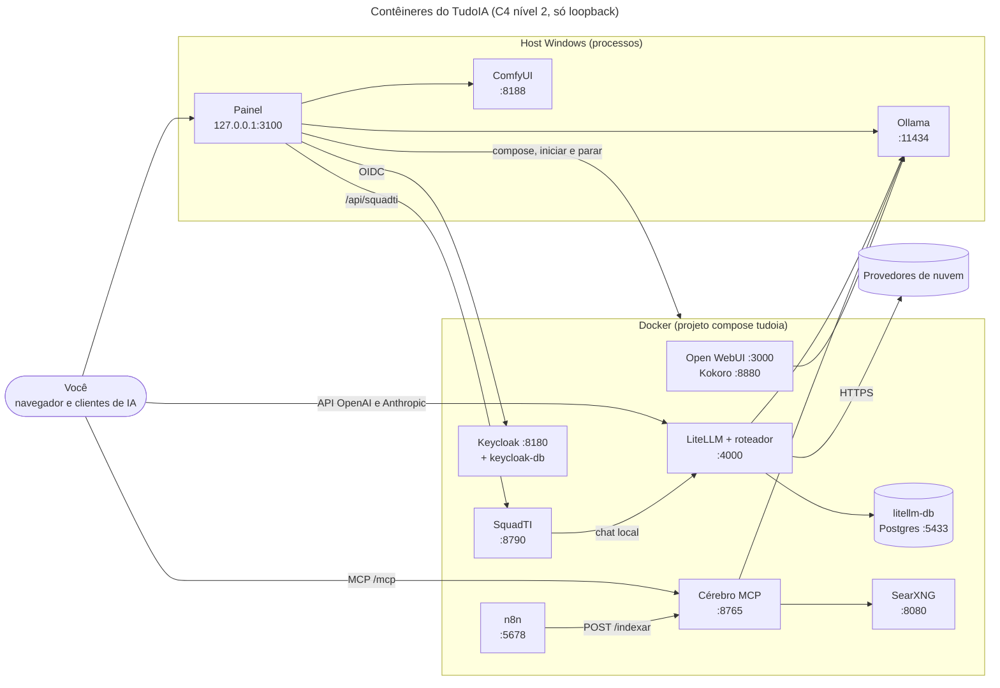

<div align="center">


# 🧠 TudoIA

**Uma stack local de IA para uma máquina com GPU: painel de controle, gateway com roteador entre modelos gratuitos, locais e pagos, memória e busca por MCP e uma única fonte de regras, skills e servidores MCP para todos os seus clientes de IA.**

LiteLLM · Ollama · ComfyUI · Cérebro (MCP) · Keycloak · Open WebUI · n8n · SquadTI · Python 3.12 · Windows

[](https://github.com/tudoemcodigo/TudoIA/actions/workflows/ci.yml)
[](#-compatibilidade)
[](pyproject.toml)
[](LICENSE)

[📥 Instalação](#-instalação) · [🚀 Início rápido](#-início-rápido) · [🧩 Componentes](#-componentes) · [📚 Documentação](docs/README.md) · [🛡️ Segurança](docs/seguranca.md) · [📖 Glossário](docs/glossario.md)

</div>

---

## 📑 Sumário

- [✨ Por que usar](#-por-que-usar)
- [📦 Componentes](#-componentes)
- [📥 Instalação](#-instalação)
- [🚀 Início rápido](#-início-rápido)
- [🧭 O que tem dentro](#-o-que-tem-dentro)
- [📚 Documentação](#-documentação)
- [⚡ Compatibilidade](#-compatibilidade)
- [🛡️ Segurança](#️-segurança)
- [🧪 Testes](#-testes)
- [🤝 Contribuição](#-contribuição)
- [🏷️ Versionamento](#️-versionamento)
- [📄 Licença](#-licença)

---

## ✨ Por que usar

| Sem o TudoIA | Com o TudoIA |
|---|---|
| Cada cliente de IA (Claude Code, Cursor, Codex...) com suas próprias regras, skills e MCP, copiados à mão | Uma pasta (`governanca/`) distribui regras, skills e MCP para todos, sem sobrescrever o que é seu e sem gravar segredo em workspace |
| Um provedor ou modelo por vez, escolhido na unha | Um gateway (LiteLLM, porta 4000) e o `tudoia-auto`, que escolhe o grupo de modelos por regras e similaridade semântica |
| Dado sensível indo para a nuvem sem querer | Os grupos `tudoia-local` e `tudoia-nuvem` separam o que fica na máquina do que vai à nuvem, e os marcadores `#local`, `#nuvem` e `#max` forçam o destino (`#local` pode ser desviado quando o pedido não cabe no contexto local: [risco 16](docs/seguranca.md#16-fallback-de-contexto-do-tudoia-local-para-a-nuvem-aceito-pelo-dono)) |
| Memória e busca espalhadas | O Cérebro, um servidor MCP local com busca na web, leitura de páginas, busca nos seus documentos e memória de fatos |
| Ligar e desligar tudo em vários terminais | Um painel com login (OIDC) para serviços, modelos, roteador, segredos, governança e Estúdio, e os scripts `iniciar.ps1` e `parar.ps1` para o ecossistema inteiro |
| Um agente de IA que gera código sem processo | A SquadTI: agentes coordenados pelo CHEFE, com aprovação humana, testes e ataque ao sistema gerado num sandbox, sob a Doutrina TEC |

- ✅ **Local por padrão:** todas as portas ficam em `127.0.0.1`; nenhum container recebe o `.env` inteiro.
- ✅ **Falha fechada:** sem login configurado o painel responde 503; a governança valida tudo antes de escrever; sem a Doutrina legível a SquadTI não trabalha.
- ✅ **Reproduzível:** imagens de terceiros fixadas por digest, `uv.lock` por projeto e instalador gerado no CI.

## 📦 Componentes

| Componente | O que faz | Código | Guia |
|---|---|---|---|
| Painel | Interface e API de controle (FastAPI e SPA): login OIDC, serviços, modelos, roteador, governança, segredos, Estúdio, SquadTI | `painel/` | [painel](docs/componentes/painel.md) |
| Gateway e roteador | LiteLLM na porta 4000; o hook `tudoia-auto` escolhe o grupo de modelos | `runtime/litellm/`, `config/` | [roteador](docs/componentes/roteador.md) |
| Cérebro | Servidor MCP local: busca na web, leitura de páginas, busca nos documentos e memória de fatos | `runtime/cerebro/` | [cérebro](docs/componentes/cerebro.md) |
| Governança | Fonte única de regras, skills e MCP para Claude Code, Cursor, Antigravity, Codex, OpenCode e Aider | `governanca/` | [governança](docs/componentes/governanca.md) |
| Doutrina TEC | Regras de engenharia consumidas pela skill `doutrina-tec`, pelo MCP `doutrina-tec` e pela SquadTI; commit fixado e levado no pacote do instalador | `governanca/doutrina.json` | [doutrina](docs/componentes/doutrina.md) |
| Login (Keycloak) | Realm `tudoia` com os papéis admin, operador e leitor | `scripts/keycloak/`, `infra/keycloak/` | [keycloak](docs/componentes/keycloak.md) |
| Modelos | Manifesto e baixador dos pesos de IA (fora do repositório) | `config/modelos.yaml`, `scripts/modelos/` | [modelos](docs/componentes/modelos.md) |
| Serviços Docker e do host | Postgres do LiteLLM, LiteLLM, Open WebUI, SearXNG, Kokoro, n8n e Keycloak no Docker; Ollama e ComfyUI no host | `runtime/docker-compose.yml`, `painel/tudoia_painel/servicos.py` | [serviços Docker](docs/componentes/servicos-docker.md) |
| Estúdio | Chat, imagens, vídeos e músicas pelo ComfyUI; imagem também por provedores de nuvem (Cloudflare Workers AI) | `painel/tudoia_painel/rotas/estudio_*.py` | [estúdio](docs/componentes/estudio.md) |
| Automação | Quatro fluxos do n8n (resumo de documentos, pesquisa, digest de notícias, ingestão no Cérebro) | `automacao/n8n/` | [automação n8n](docs/componentes/automacao-n8n.md) |
| SquadTI | Equipe de agentes (LangGraph), com o CHEFE como canal único, que gera projetos novos em container isolado; inclui sandbox de validação e suíte de evals (o Livro de Lições existe como módulo, ainda não ligado ao grafo) | `runtime/squadti/` | [squadti](docs/componentes/squadti.md) |
| Instalador | `TudoIA-Setup.exe`: instala tudo no Windows, com os componentes à sua escolha | `instalador/`, `scripts/empacotar/` | [instalador](docs/instalador.md) |
| Backup | Postgres do LiteLLM, `cerebro.db` e volumes do n8n e do Open WebUI, com manifesto sha256 (sem o `.env`) | `scripts/backup/` | [instalação](docs/instalacao.md) |

## 📥 Instalação

> [!IMPORTANT]
> O TudoIA é de uso pessoal e está em evolução. A instalação está automatizada e **testada só no Windows**. No Linux há o `scripts/tudoia.sh`, com quase os mesmos comandos e sem teste; no macOS nada é automatizado. Ver [instalação manual](docs/instalacao.md).

**Windows, um clique.** Baixe o [`TudoIA-Setup.exe`](https://github.com/tudoemcodigo/TudoIA/releases/latest/download/TudoIA-Setup.exe) e o [`.sha256`](https://github.com/tudoemcodigo/TudoIA/releases/latest/download/TudoIA-Setup.exe.sha256) da última release, confira o download e execute:

```powershell
(Get-FileHash .\TudoIA-Setup.exe -Algorithm SHA256).Hash.ToLower()   # compare com o conteúdo do .sha256
```

O assistente instala Docker Desktop, Ollama, os serviços, o login e os atalhos, com as pastas e os componentes à sua escolha. O `.exe` **não é assinado digitalmente** (o SmartScreen avisa na primeira execução). Detalhes: [instalador](docs/instalador.md). Para gerar o `.exe` você mesmo: `.\scripts\tudoia.ps1 empacotar`.

**Windows, manual.** Pré-requisitos: [uv](https://docs.astral.sh/uv/), Docker Desktop com `docker compose`, Ollama e Git. O passo a passo, a verificação, a atualização, o backup e a desinstalação estão em [instalação manual](docs/instalacao.md).

## 🚀 Início rápido

Na raiz do repositório, depois dos pré-requisitos da instalação manual:

```powershell
git clone https://github.com/tudoemcodigo/TudoIA.git
cd TudoIA
uv sync
Copy-Item .env.example .env
.\scripts\tudoia.ps1 segredos                       # gera só os segredos internos vazios
$env:PYTHONPATH = "$PWD;$PWD\painel"
uv run python -m tudoia_painel gerar-config         # cria runtime\litellm\config.yaml (não é versionado)
.\scripts\tudoia.ps1 up                             # Ollama, sync da governança, serviços Docker e painel
.\scripts\tudoia.ps1 status                         # espere o keycloak ficar "healthy"
.\scripts\tudoia.ps1 keycloak --admin-inicial admin@example.com
.\scripts\reiniciar.ps1                             # o painel só lê o .env ao iniciar
.\scripts\tudoia.ps1 n8n-credencial                 # credencial do Cérebro no n8n
.\scripts\tudoia.ps1 modelos --obrigatorios         # pesos de IA (fora do repositório)
```

O painel fica em `http://127.0.0.1:3100/app/`. Entre com a conta criada por `--admin-inicial`; a senha temporária aparece uma única vez. Troque `admin@example.com` pelo seu e-mail. Guarde uma cópia do `.env` fora da máquina: o backup do TudoIA não o inclui. Variáveis do `.env`: [configuração](docs/configuracao.md).

Dia a dia:

| Comando | O que faz |
|---|---|
| `.\scripts\iniciar.ps1` | Liga Docker Desktop, Ollama, ComfyUI, os serviços Docker e o painel (`-ComSquadti` liga também a SquadTI) |
| `.\scripts\parar.ps1` | Desliga o ecossistema inteiro: painel, SquadTI, serviços Docker de qualquer perfil, Ollama e ComfyUI. Dados e volumes ficam |
| `.\scripts\reiniciar.ps1` | Reinicia só o painel; `-Tudo` faz parar e iniciar |
| `.\scripts\tudoia.ps1 backup` | Faz o backup em `dados\backups\<AAAAMMDD-HHMMSS>` |

Quando algo não funcionar, [operação](docs/operacao.md).

## 🧭 O que tem dentro



*Legenda: retângulos são processos; cilindros são bancos e serviços externos; só Ollama, ComfyUI e o painel rodam no host (a GPU fica fora do Docker). Open WebUI, Kokoro, SearXNG, Cérebro, n8n, Keycloak e SquadTI sobem por perfil do compose (`COMPOSE_PROFILES`); LiteLLM e o Postgres dele sempre sobem. Fluxos, volumes e onde ficam os dados: [arquitetura](docs/arquitetura.md).*

## 📚 Documentação

Índice completo, com tipo e propósito de cada documento: [docs/README.md](docs/README.md).

| Grupo | Documentos |
|---|---|
| Visão geral | [Glossário](docs/glossario.md) · [Arquitetura](docs/arquitetura.md) · [Terceiros](docs/terceiros.md) |
| Instalar e operar | [Instalador](docs/instalador.md) · [Instalação manual](docs/instalacao.md) · [Configuração](docs/configuracao.md) · [Operação](docs/operacao.md) |
| Segurança e código | [Segurança](docs/seguranca.md) · [Desenvolvimento](docs/desenvolvimento.md) · [SPEC.md](SPEC.md) (interface pública do módulo `governanca`) |
| Componentes | [Painel](docs/componentes/painel.md) · [Estúdio](docs/componentes/estudio.md) · [Roteador](docs/componentes/roteador.md) · [Cérebro](docs/componentes/cerebro.md) · [Governança](docs/componentes/governanca.md) · [Doutrina](docs/componentes/doutrina.md) · [Keycloak](docs/componentes/keycloak.md) · [Modelos](docs/componentes/modelos.md) · [Serviços Docker](docs/componentes/servicos-docker.md) · [Automação n8n](docs/componentes/automacao-n8n.md) |
| SquadTI | [Componente](docs/componentes/squadti.md) · [Visão geral](docs/squadti/00-visao-geral-e-arquitetura.md) · [Catálogo de agentes](docs/squadti/01-catalogo-de-agentes.md) · [Protocolo e estado](docs/squadti/02-protocolo-de-comunicacao-e-estado.md) · [Guia de implementação](docs/squadti/03-guia-de-implementacao.md) · [Perfis dos agentes](docs/squadti/04-agentes/chefe-orquestrador.md) · [Doutrina na Squad](docs/squadti/05-fonte-da-verdade-arquitetura.md) · [Sistema web (proposta)](docs/squadti/06-sistema-web-squadti.md) · [Análise crítica](docs/squadti/07-analise-critica-e-benchmarks.md) · [Evals](docs/squadti/evals.md) · [Livro de Lições](docs/squadti/licoes.md) |

## ⚡ Compatibilidade

| Item | Suporte |
|---|---|
| Sistema operacional | Windows 10 e 11: testado (o CI roda em `windows-latest`). Linux: `scripts/tudoia.sh`, **não testado**. macOS: sem automação, não testado |
| Python | 3.12 (`.python-version`; `requires-python = ">=3.12"` nos três projetos: raiz, Cérebro e SquadTI) |
| Gerenciador de ambiente | `uv` 0.13.0, o fixado no CI, no `release.yml` e nas imagens |
| Docker | Docker Desktop com `docker compose`; o instalador o instala quando falta |
| GPU, Ollama e ComfyUI | Rodam como processos do host, fora do Docker. Tempos e limites de contexto foram medidos numa RTX 5070 com 8 GB de VRAM: com outra GPU, meça de novo |
| Rede | Todas as portas do compose são publicadas só em `127.0.0.1`, o painel escuta em `127.0.0.1`, o Ollama é iniciado com `OLLAMA_HOST=127.0.0.1:11434` e o ComfyUI, sem `--listen` |
| Testes | Sem rede, Docker, GPU nem Keycloak (o teste opcional do Keycloak liga com `TUDOIA_KEYCLOAK_IT=1`) |

## 🛡️ Segurança

Tudo escuta só em loopback, o painel exige login OIDC com papéis, os segredos vivem só no `.env` (ignorado pelo git) e a governança nunca grava segredo em workspace. Modelo de ameaças, controles e riscos residuais: [docs/seguranca.md](docs/seguranca.md).

> [!CAUTION]
> A SquadTI monta o `docker.sock` do host para os testes de integração do que ela gera. Quem controla o socket controla o Docker do host, então o código gerado por modelo deixa de estar isolado dele. Só ligue o perfil `squadti` sabendo disso e leia o aviso em [docs/componentes/squadti.md](docs/componentes/squadti.md). Vulnerabilidades: não abra *issue* pública com detalhes de exploração; use o security advisory privado do repositório, conforme [docs/seguranca.md](docs/seguranca.md#como-reportar-uma-vulnerabilidade), e nunca cole o valor de um segredo em um relato.

## 🧪 Testes

O CI (`.github/workflows/ci.yml`) roda em todo push e pull request. Os mesmos comandos, na raiz:

```powershell
uv sync --frozen
uv run --frozen ruff check .
uv run --frozen pytest -q
cd runtime\cerebro; uv sync --frozen; uv run --frozen pytest -q; cd ..\..
cd runtime\squadti; uv sync --frozen; uv run --frozen python -W error -m pytest -q; cd ..\..
```

A suíte da raiz cobre o painel, o roteador, a governança, o instalador, o backup, os scripts PowerShell e o compose; as do Cérebro e da SquadTI ficam dentro de cada projeto. Os testes não usam rede, Docker, GPU nem Keycloak. Os evals da SquadTI (`python -m evals.run`) usam modelo real, consomem tokens e **não** fazem parte do `pytest`: ver [evals](docs/squadti/evals.md). O mapa da cobertura e as verificações de sintaxe do JavaScript e do PowerShell estão em [desenvolvimento](docs/desenvolvimento.md#testes).

## 🤝 Contribuição

Mudanças entram por pull request. Antes de abrir um, rode o lint e as três suítes acima, acrescente testes que cubram o caminho feliz e as falhas, e atualize o guia do componente que você tocou (a documentação segue [docs/README.md](docs/README.md#-convenções-desta-documentação)). Nunca inclua segredo, dado pessoal ou caminho real da sua máquina em código, teste ou documento. Convenções, layout do repositório e o passo a passo para adicionar um componente: [desenvolvimento](docs/desenvolvimento.md). As regras e skills dos agentes de IA são geradas: edite `governanca/regras/` e `governanca/skills/`, não o `AGENTS.md`.

## 🏷️ Versionamento

[SemVer](https://semver.org/lang/pt-BR/). A versão do produto é a do `pyproject.toml` (2.0.6) e precisa ser igual à do instalador (`instalador/tudoia_instalador/__init__.py`) e à tag `vX.Y.Z` da release; o teste `tests/instalacao/test_versao.py` e o workflow `release.yml` conferem. Empurrar a tag constrói o `TudoIA-Setup.exe` no CI e publica a release com notas geradas automaticamente. Cada projeto Python (Cérebro, SquadTI) tem a própria versão interna, sem tag.

## 📄 Licença

[Apache 2.0](LICENSE) — consulte [NOTICE](NOTICE) para informações de atribuição. Skills, servidores MCP, imagens e pesos de terceiros mantêm a licença de origem: [docs/terceiros.md](docs/terceiros.md) e [governanca/ORIGEM.md](governanca/ORIGEM.md). Criado e mantido pela equipe **Tudo em Código** · [github.com/tudoemcodigo](https://github.com/tudoemcodigo)
