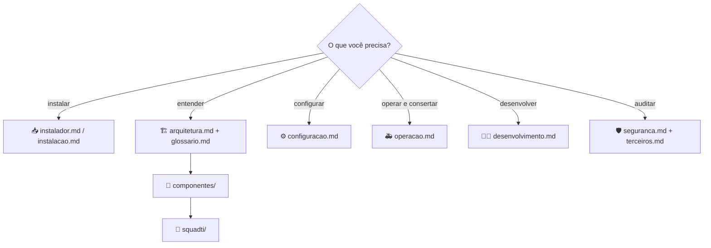

[🏠 TudoIA](../README.md) › 📚 Documentação

# 📚 Documentação do TudoIA

> Índice de todos os documentos de `docs/`, para quem instala, opera, desenvolve ou audita o TudoIA: o que cada um responde, de que tipo é e por onde começar. Cada afirmação foi conferida com o código do repositório; o que não foi conferido está marcado como **a confirmar**.

## 📑 Sumário

- [🧭 Por onde começar](#-por-onde-começar)
- [🗂️ Documentos](#️-documentos)
  - [Visão geral e referência](#visão-geral-e-referência)
  - [Instalação e operação](#instalação-e-operação)
  - [Componentes](#componentes)
  - [SquadTI (desenho)](#squadti-desenho)
  - [Perfis de agente da SquadTI](#perfis-de-agente-da-squadti)
- [🗺️ Mapa dos temas](#️-mapa-dos-temas)
- [📐 Convenções desta documentação](#-convenções-desta-documentação)

---

## 🧭 Por onde começar

| Eu quero... | Leia |
|---|---|
| Instalar no Windows com um clique | [Instalador](instalador.md) |
| Instalar à mão, a partir do código | [Instalação manual](instalacao.md) |
| Entender as peças e como se ligam | [Arquitetura](arquitetura.md) e o [Glossário](glossario.md) |
| Saber o que cada variável do `.env` faz | [Configuração](configuracao.md) |
| Resolver um problema em produção local | [Operação](operacao.md) |
| Mexer no código, rodar lint e testes | [Desenvolvimento](desenvolvimento.md) |
| Avaliar os riscos e reportar uma falha | [Segurança](seguranca.md) |
| Medir a qualidade do que a SquadTI entrega | [Evals](squadti/evals.md) |
| Conferir licenças e serviços externos | [Terceiros](terceiros.md) |

## 🗂️ Documentos

Tipos (DOC-EST-02): `tutorial`, `guia`, `referencia`, `explicacao`, `adr`, `runbook`, `glossario`. Um tipo por documento.

### Visão geral e referência

| Documento | Tipo | O que responde |
|---|---|---|
| [Glossário](glossario.md) | glossário | O termo canônico de cada conceito (Painel, Roteador, `tudoia-auto`, grupo de modelos, Cérebro, Governança, instância, bloco gerenciado, Doutrina, Estúdio, Keycloak, realm e, na SquadTI, CHEFE, stack, kit, sandbox, proveniência, eval...) e o sinônimo que não se usa. |
| [Arquitetura](arquitetura.md) | explicação | Componentes, portas, fluxos (login, chat, imagem, leitura de página, governança, SquadTI), ciclo de vida de iniciar e parar, serviços Docker e onde ficam os dados. |
| [Configuração](configuracao.md) | referência | Toda variável do `.env` e do ambiente: padrão, efeito, quem lê, como diagnosticar. |
| [Desenvolvimento](desenvolvimento.md) | guia | Ambiente, lint, testes (comandos do CI, suítes e evals), empacotamento, convenções e como adicionar um componente. |
| [Terceiros](terceiros.md) | referência | Skills, servidores MCP, dependências, imagens, ComfyUI, pesos e serviços externos, com versão e licença. |
| [Segurança](seguranca.md) | explicação | Modelo de ameaças, controles e riscos residuais; como reportar uma vulnerabilidade. |

### Instalação e operação

| Documento | Tipo | O que responde |
|---|---|---|
| [Instalador](instalador.md) | guia | Como instalar com o `TudoIA-Setup.exe` e como empacotar e publicar o executável. |
| [Instalação manual](instalacao.md) | guia | Pré-requisitos, passo a passo, verificação, atualização, backup e desinstalação a partir do código-fonte. |
| [Operação](operacao.md) | runbook | Sintoma, impacto, diagnóstico, mitigação, reversão e confirmação de recuperação dos problemas conhecidos. |

### Componentes

| Documento | Tipo | O que responde |
|---|---|---|
| [Painel](componentes/painel.md) | referência | O que o painel é, como subir e desligar, quais rotas expõe e quem pode usar cada uma. |
| [Estúdio](componentes/estudio.md) | referência | Que mídia o Estúdio gera, em qual motor, com quais limites e custos. |
| [Roteador (LiteLLM e `tudoia-auto`)](componentes/roteador.md) | referência | Grupos e perfis, como o `tudoia-auto` decide, quarentena e métricas. |
| [Cérebro](componentes/cerebro.md) | referência | Ferramentas MCP, autenticação, limites e operação do servidor de memória e busca. |
| [Governança](componentes/governanca.md) | referência | Como regras, skills e MCP chegam a cada cliente de IA; o que é escrito e onde. A interface pública está em [SPEC.md](../SPEC.md). |
| [Integração com a Doutrina](componentes/doutrina.md) | referência | Onde o TudoIA usa a Doutrina TEC, como o commit é fixado e como atualizá-lo. |
| [Keycloak](componentes/keycloak.md) | guia | O que o provisionamento cria, como rodá-lo e como o painel autentica. |
| [Modelos de IA](componentes/modelos.md) | guia | Manifesto, catálogo, download e verificação dos pesos. |
| [Serviços Docker e do host](componentes/servicos-docker.md) | referência | Containers, portas, volumes, usuário e limites; Ollama e ComfyUI. |
| [Automação n8n](componentes/automacao-n8n.md) | guia | Como importar e usar os quatro fluxos do n8n. |
| [SquadTI (componente)](componentes/squadti.md) | referência | O que a Squad faz, como roda isolada no Docker e como configurá-la. |

### SquadTI (desenho)

O desenho da SquadTI, a suíte de evals e o Livro de Lições ficam em `squadti/`. O estado real do código está em [SquadTI (componente)](componentes/squadti.md).

| Documento | Tipo | Status | O que responde |
|---|---|---|---|
| [00 Visão geral e arquitetura](squadti/00-visao-geral-e-arquitetura.md) | explicação | vigente | Por que a squad é um grafo de artefatos e como se liga ao TudoIA. |
| [01 Catálogo de agentes](squadti/01-catalogo-de-agentes.md) | referência | vigente | Cada papel, entradas, saídas e regras; o que está implementado e o que é intenção. |
| [02 Protocolo de comunicação e estado](squadti/02-protocolo-de-comunicacao-e-estado.md) | referência | vigente | Ciclo de vida da tarefa, `SquadState` e o laço de auto-cura. |
| [03 Guia de implementação](squadti/03-guia-de-implementacao.md) | guia | vigente | Conexão com o LiteLLM, o grafo real e a configuração da stack. |
| [05 Consumo da Doutrina pela SquadTI](squadti/05-fonte-da-verdade-arquitetura.md) | explicação | vigente | Como as regras chegam aos agentes, o orçamento de tokens e a falha fechada. |
| [06 Sistema web da SquadTI (proposta)](squadti/06-sistema-web-squadti.md) | explicação | vigente | Proposta de portal, **não implementada**. |
| [07 Análise crítica e benchmarks](squadti/07-analise-critica-e-benchmarks.md) | explicação | histórico | Registro datado do desenho inicial; não é reescrito. |
| [Evals](squadti/evals.md) | guia | vigente | Como medir, com modelo real, se a Squad entrega código bom: casos dourados, verificadores, `pass@k` e `pass^k`. |
| [Livro de Lições](squadti/licoes.md) | referência | vigente | Como um achado dos agentes vira prevenção: ciclo, árvore de decisão, aprovação humana, formato do livro. O módulo ainda não está ligado ao grafo. |

### Perfis de agente da SquadTI

Pasta `squadti/04-agentes/`: um perfil por papel (tipo referência, status vigente). Cada um diz o papel no desenho e o que o orquestrador executa hoje.

| Documento | Papel |
|---|---|
| [analista-requisitos-negocios](squadti/04-agentes/analista-requisitos-negocios.md) | Analista de Requisitos e Negócios |
| [arquiteto-documentacao](squadti/04-agentes/arquiteto-documentacao.md) | Arquiteto (Documentação e Arquitetura) |
| [appsec-seguranca](squadti/04-agentes/appsec-seguranca.md) | Segurança (AppSec) |
| [chefe-orquestrador](squadti/04-agentes/chefe-orquestrador.md) | CHEFE (Tech Lead e Prompt Architect) |
| [dba-dados](squadti/04-agentes/dba-dados.md) | DBA (Banco de Dados) |
| [dev-backend](squadti/04-agentes/dev-backend.md) | Desenvolvedor Backend |
| [dev-frontend](squadti/04-agentes/dev-frontend.md) | Desenvolvedor Frontend |
| [devops-infra](squadti/04-agentes/devops-infra.md) | DevOps e Infraestrutura |
| [documentacao-redator](squadti/04-agentes/documentacao-redator.md) | Documentação (Redator Técnico) |
| [qa-testes](squadti/04-agentes/qa-testes.md) | QA e Testes Automatizados |
| [release-notas](squadti/04-agentes/release-notas.md) | Release |
| [revisor-codigo](squadti/04-agentes/revisor-codigo.md) | Revisor de Código |
| [carga-sre](squadti/04-agentes/carga-sre.md) | Carga (DevOps/SRE) |
| [hacker-ofensivo](squadti/04-agentes/hacker-ofensivo.md) | Hacker (AppSec ofensivo) |
| [macaco-qa](squadti/04-agentes/macaco-qa.md) | Macaco (QA de uso à força) |
| [mantenedor-manutencao](squadti/04-agentes/mantenedor-manutencao.md) | Mantenedor (eu daqui a 1 ano) |
| [senior-master](squadti/04-agentes/senior-master.md) | Sênior Master |

Fora de `docs/`: [README](../README.md) · [SPEC.md](../SPEC.md) (interface pública do módulo `governanca`) · [NOTICE](../NOTICE) · [LICENSE](../LICENSE) · [`.env.example`](../.env.example) · [CI](../.github/workflows/ci.yml) · [`governanca/ORIGEM.md`](../governanca/ORIGEM.md).

---

## 🗺️ Mapa dos temas

## 📐 Convenções desta documentação

- **Idioma:** pt-BR. Código, identificadores e comandos ficam como no repositório.
- **Front-matter** em todo arquivo de `docs/`: `titulo`, `tipo`, `dono`, `status` (`vigente` ou `historico`), `classificacao` e `verificado-em`. O `README.md` da raiz é um README e não tem front-matter.
- **Fonte da verdade é o código.** Comando, porta, variável, rota e valor padrão foram conferidos em `painel/`, `runtime/`, `scripts/`, `instalador/`, `config/`, `governanca/` e `.env.example`. Quando o documento e o código divergem, o código vence e o documento é corrigido.
- **Sem segredos nem dados pessoais.** Variáveis aparecem pelo nome (`LITELLM_MASTER_KEY`), nunca pelo valor; exemplos usam `example.com`, `<usuario>` e `localhost`.
- **Comandos destrutivos** vêm marcados como `DESTRUTIVO`, com a verificação do alvo e a confirmação antes.
- **Nomes de arquivo** em minúsculas, com hífen, sem acento. Os nomes de `docs/*.md` e `docs/componentes/*.md` são referenciados pelo código e por comentários: não os renomeie sem buscar as referências.
- **Um assunto, um lugar.** Quem precisa do mesmo assunto linka para o dono dele em vez de copiar.
- **Termos** seguem o [Glossário](glossario.md).

---

[🏠 README](../README.md) · ➡️ [Glossário](glossario.md) · [Arquitetura](arquitetura.md)
