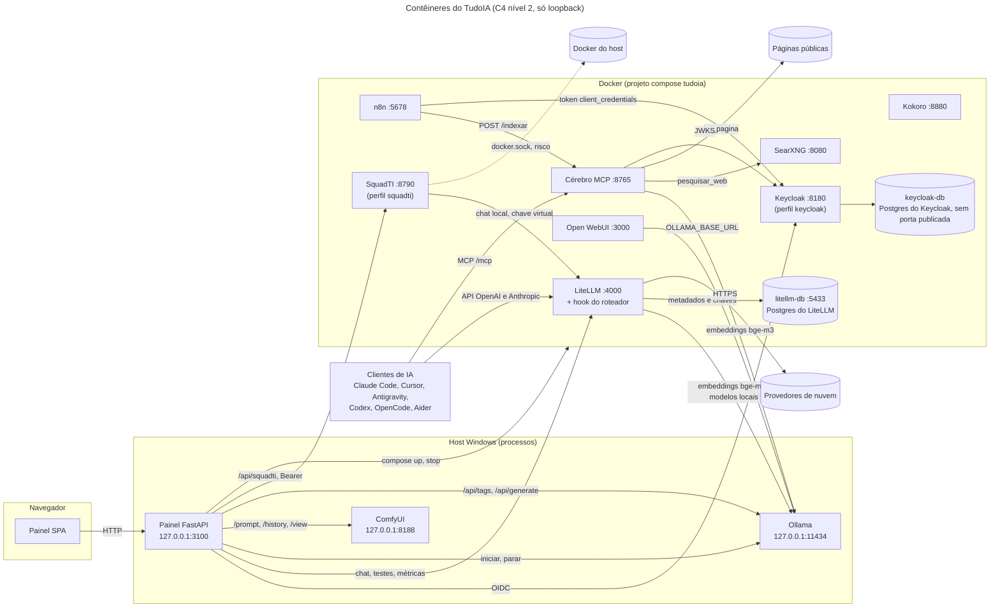
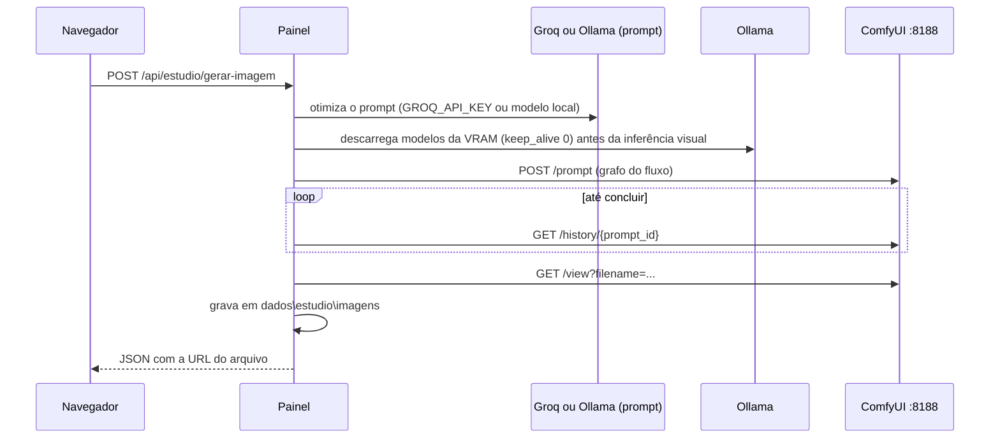
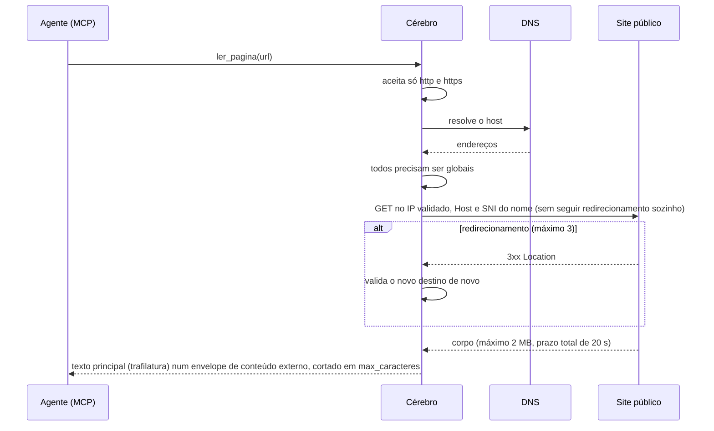
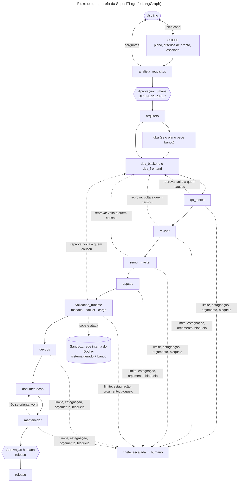

[🏠 TudoIA](../README.md) › [📚 Documentação](README.md) › 🏗️ Arquitetura

# 🏗️ Arquitetura

> Para quem mantém ou audita o TudoIA: que peças existem, onde cada uma roda, em que porta escuta, com quem conversa e onde guarda os dados. Cada componente tem o seu guia; aqui está o que liga um ao outro.

## 📑 Sumário

- [🎯 Visão geral](#-visão-geral)
- [🧱 Componentes](#-componentes)
- [🔌 Portas](#-portas)
- [🔄 Fluxos](#-fluxos)
- [🔁 Ciclo de vida: iniciar e parar](#-ciclo-de-vida-iniciar-e-parar)
- [🤖 SquadTI v2](#-squadti-v2)
- [🐳 Serviços Docker](#-serviços-docker)
- [🗄️ Localização dos dados](#️-localização-dos-dados)
- [🛡️ Segurança em uma página](#️-segurança-em-uma-página)
- [📏 Ambiente de referência](#-ambiente-de-referência)

---

## 🎯 Visão geral

O TudoIA é uma máquina só. A GPU fica no host, então o Ollama e o ComfyUI rodam como processos do Windows. Os serviços de rede ficam em containers Docker, com as portas publicadas só em `127.0.0.1`. O painel é o ponto de controle: sobe e para serviços, edita a configuração, guarda o login e conversa com os demais.



Três observações que o desenho não mostra:

- O Kokoro não tem chamada em nenhum código deste repositório. O compose só faz o Open WebUI depender dele e do SearXNG; como o Open WebUI os usa fica na configuração interna dele, que não é versionada.
- O compose configura o Open WebUI só para o Ollama (`OLLAMA_BASE_URL`). Qualquer conexão dele com o LiteLLM é feita na interface do próprio Open WebUI.
- O Keycloak embutido é opcional. Quem tem um Keycloak próprio tira `keycloak` de `COMPOSE_PROFILES` e aponta `TUDOIA_OIDC_ISSUER` para ele (ver [Keycloak](componentes/keycloak.md)).

## 🧱 Componentes

| Componente | Tecnologia | Papel | Guia |
|---|---|---|---|
| Painel | FastAPI, SPA estática (`painel/tudoia_painel/static/`) | Controle, login, Estúdio, configuração, tela da governança e da SquadTI | [painel](componentes/painel.md) |
| LiteLLM e roteador | Imagem `ghcr.io/berriai/litellm` e hook `runtime/litellm/roteador*.py` | Gateway OpenAI e Anthropic, roteamento, quarentena, métricas | [roteador](componentes/roteador.md) |
| Cérebro | Python 3.12, `mcp`, SQLite, `numpy` | Busca web, leitura de páginas, documentos e memória | [cérebro](componentes/cerebro.md) |
| Governança | Python (biblioteca padrão), `governanca/` | Distribui regras, skills e MCP para os clientes de IA | [governança](componentes/governanca.md) |
| Doutrina | Pasta indicada por `DOUTRINA_TEC`, commit fixado em `governanca/doutrina.json` | Regras de engenharia consumidas pela skill, pelo MCP `doutrina-tec` e pela SquadTI | [doutrina](componentes/doutrina.md) |
| Keycloak | Imagem `quay.io/keycloak/keycloak`, tema em `infra/keycloak/tema/` | Identidade OIDC do painel, do Cérebro e do n8n | [keycloak](componentes/keycloak.md) |
| Modelos | Python, `config/modelos.yaml` | Baixa e verifica os pesos | [modelos](componentes/modelos.md) |
| Open WebUI, SearXNG, Kokoro, n8n, Postgres (`litellm-db`, `keycloak-db`) | Imagens fixadas por digest | Chat com interface própria, metabusca, voz, automação, bancos | [serviços Docker](componentes/servicos-docker.md) |
| Automação | Fluxos JSON do n8n (`automacao/n8n/`) | Resumo, pesquisa, digest e ingestão no Cérebro | [automação n8n](componentes/automacao-n8n.md) |
| SquadTI | LangGraph, SDK .NET, Node e `uv` numa imagem própria (`runtime/squadti/`) | Gera projetos novos seguindo a Doutrina; valida o resultado num sandbox | [squadti](componentes/squadti.md) e [a seção abaixo](#-squadti-v2) |
| Estúdio | Parte do painel e fluxos do ComfyUI (`runtime/comfyui/workflows/`) | Imagens, vídeos e músicas | [estúdio](componentes/estudio.md) |
| Instalador | PyInstaller, tela web local (`instalador/`) | Instala o TudoIA no Windows | [instalador](instalador.md) |

## 🔌 Portas

Os valores vêm de `runtime/docker-compose.yml`, `painel/tudoia_painel/cli.py`, `painel/tudoia_painel/servicos.py`, `painel/tudoia_painel/upstreams.py` e `scripts/_comum.ps1`.

| Porta | Serviço | Onde escuta | Observação |
|---|---|---|---|
| 3100 | Painel | `127.0.0.1` (uvicorn) | Padrão de `tudoia painel --porta`. O redirect URI do login OIDC depende dela. |
| 4000 | LiteLLM | `127.0.0.1:4000` publicado | Único gateway; todos os clientes falam com ele. |
| 8765 | Cérebro (`/mcp`, `/indexar`, `/saude`) | `127.0.0.1:8765` publicado; `0.0.0.0` dentro do container | Endpoint MCP em `/mcp`. |
| 3000 | Open WebUI | `127.0.0.1:3000` publicado (container 8080) | |
| 8080 | SearXNG | `127.0.0.1:8080` publicado | Precisa de `formats: json`, já configurado em `runtime/searxng/settings.yml`. |
| 5678 | n8n | `127.0.0.1:5678` publicado | |
| 8880 | Kokoro | `127.0.0.1:8880` publicado | |
| 5433 | `litellm-db` (Postgres do LiteLLM) | `127.0.0.1:5433` publicado (container 5432) | O `keycloak-db` (perfil `keycloak`) não publica porta: só o Keycloak o alcança, pela rede do compose. |
| 8180 | Keycloak | `127.0.0.1:8180` publicado (container 8080) | Só com o perfil `keycloak`. HTTP puro: não exponha. |
| 8790 | SquadTI | `127.0.0.1:8790` publicado | Só com o perfil `squadti`. |
| 11434 | Ollama | `127.0.0.1:11434` (`OLLAMA_HOST` definido por quem o inicia) | Os containers chegam por `host.docker.internal`. |
| 8188 | ComfyUI | O painel e o `iniciar.ps1` o iniciam sem `--listen`; o código sempre o chama em `127.0.0.1` | O bind real é do próprio ComfyUI e não foi verificado aqui. |

## 🔄 Fluxos

### Login no painel (OIDC, Authorization Code com PKCE)

```mermaid
sequenceDiagram
    participant B as Navegador
    participant P as Painel
    participant K as Keycloak
    B->>P: GET /auth/login?retorno=/app/
    P->>P: guarda o estado no servidor; gera code_verifier (S256)
    P-->>B: 302 para o authorize (state, code_challenge); cookie tudoia_login_<state>
    B->>K: login
    K-->>B: 302 para /auth/callback?code=...&state=...
    B->>P: GET /auth/callback
    P->>K: troca code + code_verifier por tokens (servidor a servidor)
    K-->>P: id_token com claims (groups ou realm_access.roles)
    P->>P: mapeia tudoia-admin, tudoia-operador, tudoia-leitor
    P-->>B: 303 para o retorno; cookie tudoia_sessao (8 h)
```

Detalhes e limites: [painel](componentes/painel.md) e [segurança](seguranca.md).

### Chat pelo gateway

```mermaid
sequenceDiagram
    participant C as Cliente (ex.: Claude Code)
    participant L as LiteLLM
    participant H as Hook roteador.py
    participant O as Ollama (bge-m3)
    participant N as Membro do grupo (nuvem ou local)
    C->>L: POST /v1/messages ou /v1/chat/completions (model=tudoia-auto)
    L->>H: async_pre_call_hook
    H->>H: marcador (#local, #nuvem, #max); regras; visão; ferramentas
    alt pontuação ambígua
        H->>O: embedding da última mensagem (até 1,5 s)
        O-->>H: vetor; vizinhos mais próximos em exemplos-roteamento.yaml
    end
    H->>L: escolhe o grupo (tudoia-nuvem, tudoia-codigo, tudoia-local...)
    L->>N: membro escolhido (latency-based, cooldown de 60 s)
    N-->>L: resposta ou erro
    L->>H: eventos (só metadados) para eventos.jsonl
    L-->>C: resposta (nova tentativa em outro membro se falhar)
```

Em `/v1/messages` (Claude Code) o hook segura o stream até `message_stop` e só então o libera. Assim uma falha no meio da resposta pode ser refeita em outro modelo sem o cliente perceber (ver [roteador](componentes/roteador.md)).

### Geração de imagem no Estúdio (ComfyUI)



Quando o motor pedido não é o ComfyUI, ou ele está fora do ar, `gerar-imagem` segue outro caminho em `painel/tudoia_painel/rotas/estudio_imagem.py` e não passa por ele. Vídeos, músicas e vídeo longo: [estúdio](componentes/estudio.md).

### Leitura de página pelo Cérebro



Os detalhes de SSRF estão em [segurança](seguranca.md).

### Distribuição da governança

```mermaid
sequenceDiagram
    participant U as Usuário ou instalador
    participant G as governanca.sincronizar
    participant F as governanca/ (regras, skills, mcp.json, governanca.json)
    participant E as .env
    participant D as Clientes de IA (arquivos em ~ e nos workspaces)
    U->>G: tudoia sync (ou o painel: aplicar_tudo)
    G->>F: lê regras, skills, catálogo MCP e instâncias
    G->>E: lê as variáveis ${VAR} dos MCP ativos
    G->>G: valida tudo (destino, segredo, JSON, marcas); nada é escrito se algo falhar
    G->>D: bloco gerenciado, skills, MCP (atômico, com backup em ~/.tudoia/backups)
    G-->>U: {alvo: atualizado | igual | removido}
```

A interface pública está em [SPEC.md](../SPEC.md) e o comportamento por cliente em [governança](componentes/governanca.md).

## 🔁 Ciclo de vida: iniciar e parar

O ecossistema (painel, SquadTI, serviços Docker de qualquer perfil, Ollama e ComfyUI) liga e desliga por scripts em `scripts/`, que compartilham as funções de `scripts/_comum.ps1` (ASCII puro, para o PowerShell 5.1).

| Script | O que faz |
|---|---|
| `iniciar.ps1 [-ComSquadti] [-SemNavegador]` | Liga, nesta ordem: Docker Desktop (espera até 5 min), Ollama e ComfyUI (só se o `.env` aponta `TUDOIA_OLLAMA_MODELS` e `TUDOIA_COMFYUI_PORTABLE`), os serviços Docker (`up -d --wait --wait-timeout 300`, perfis do `COMPOSE_PROFILES`) e o painel. Com `-ComSquadti`, sobe também a SquadTI (`up -d --build squadti`). Seguro de rodar com tudo ligado |
| `tudoia.ps1 up` | Ollama (se a porta 11434 está fechada), `sync` da governança, `docker compose up -d --build` e o painel em segundo plano. Não inicia o ComfyUI |
| `parar.ps1` | Desliga o ecossistema inteiro, sempre: painel, SquadTI, `docker compose --profile '*' stop` (inclui perfis fora do `COMPOSE_PROFILES`), Ollama e ComfyUI. Dados e volumes ficam. Confirma que as portas 3100, 11434 e 8188 fecharam e sai com código 1 se algo continuou no ar |
| `tudoia.ps1 down` | `docker compose down`: remove os containers do compose e mantém os volumes. Não toca no painel, no Ollama nem no ComfyUI |
| `reiniciar.ps1 [-Tudo] [-ComSquadti]` | Padrão: reinicia só o painel (e a SquadTI, se estava no ar ou se pedida). `-Tudo` é `parar.ps1` seguido de `iniciar.ps1` |

Como o `parar.ps1` evita matar o que não é do TudoIA e ainda assim não deixa o painel vivo:

- **Quem escuta a porta, sem filtrar por estado.** `DonosDaPorta` usa `Get-NetTCPConnection -LocalPort` sem `-State Listen`, porque em alguns Windows o estado vem vazio e o filtro não achava ninguém; o painel sobrevivia ao `parar.ps1`.
- **Confere a linha de comando antes de encerrar.** O processo só cai se a linha de comando contém o texto esperado (`tudoia_painel`, `ollama`, `ComfyUI`); outro programa na mesma porta recebe só um aviso.
- **Rede de segurança por linha de comando.** O que sobra (launcher do venv sem socket, bandeja do Ollama) é encerrado por `PararPorLinhaDeComando`, comparação literal e nunca o próprio script.
- **"Porta aberta" é uma conexão TCP de verdade.** O `Listen` fantasma que o Windows deixa de processos mortos engana o `Get-NetTCPConnection`.
- **O painel sobe sempre.** O `iniciar.ps1` roda Docker, Ollama e compose sob `try`: se algum falhar, o painel sobe mesmo assim (para mostrar o que está fora) e o script sai com código 1.

## 🤖 SquadTI v2

A SquadTI é o único componente que executa código escrito por modelo. O desenho abaixo é o do grafo real (`runtime/squadti/orquestrador/graph.py`); o guia operacional está em [squadti](componentes/squadti.md) e o desenho de projeto em [docs/squadti/](squadti/00-visao-geral-e-arquitetura.md).



*Legenda: losangos duplos são pausas do grafo para aprovação humana (`interrupt_before` em `arquiteto` e `release`); linhas tracejadas são desvios. O CHEFE confere o critério de pronto entre as fases (`chefe_gate_requisitos`, `chefe_gate_design`).*

O que muda em relação a uma execução simples de agentes, e onde está no código:

| Mecanismo | O que garante | Onde |
|---|---|---|
| CHEFE como canal único | Só ele fala com o usuário; a conversa nunca altera portão, aprovação nem configuração (só `/ajuste <texto>`, sempre como dado sanitizado) | `chefe.py`, `entrada.py` |
| Stack | O grafo e os portões são os mesmos; o adaptador (`dotnet` ou `python`) diz comandos, áreas de escrita e famílias da Doutrina que não se aplicam | `stacks.py` |
| Doutrina por papel | Cada papel carrega o núcleo e as regras do perfil dele; sem Doutrina legível ou sem perfil a Squad não trabalha; versão e hash vão para o estado e mudança no meio da tarefa a aborta | `doutrina_tec.py` |
| Orçamento e estagnação | Teto de tokens, tempo e chamadas por tarefa (padrão 2.000.000, 7200 s, 300) e escalada na mesma falha duas vezes seguidas | `agentes.py`, `auditoria.py` |
| Aprovação amarrada ao conteúdo | O `sim` vale para o texto aprovado; arquivo alterado depois invalida | `aprovacao.py` |
| Fronteira de arquivos e comandos | Saída de modelo só vira arquivo por função que valida caminho, área e tamanho; comandos vêm da configuração da stack, sem shell | `execucao.py` |
| Validação em execução | O sistema gerado sobe numa rede Docker interna e é atacado (hacker), usado à força (macaco) e estressado (carga); com o Docker fora do ar a fase é pulada com motivo registrado (`validacao.modo = auto`) ou a tarefa escala (`sempre`); `nunca` a desliga | `validacao.py`, `sandbox.py`, `kits/`, `carga.py` |
| Qualidade e manutenção | Sênior Master (métricas `QC-*`) e Mantenedor ("eu daqui a 1 ano") | `qualidade.py`, `metricas.py` |
| Proveniência | Doutrina, modelo, hash do prompt, tokens e hash de cada arquivo da entrega, sem prompt nem resposta | `proveniencia.py` |
| Evals | Casos dourados executados com modelo real pela API, fora do `pytest` | `runtime/squadti/evals/`, [evals](squadti/evals.md) |
| Livro de Lições | Módulo de API pura (achado vira lição, aprovação humana, proposta de Doutrina). **Ainda não está ligado ao grafo, à API HTTP nem ao painel** | `licoes.py`, [licoes](squadti/licoes.md) |

O painel conversa com a Squad só por `/api/squadti/*` (Bearer `TUDOIA_SQUADTI_TOKEN`, papéis do painel por cima): iniciar, responder, aprovar, falar com o CHEFE, continuar, ver auditoria, proveniência, log e configuração dos agentes. A API do container aceita uma ação por vez (`409` se houver outra).

### Doutrina no pacote e na imagem

A Doutrina TEC entra por três caminhos, todos fixados no mesmo commit de `governanca/doutrina.json` (repositório e `sha` de 40 caracteres):

| Caminho | Como a Doutrina chega | Quem confere |
|---|---|---|
| Pacote do instalador | O empacotador (`scripts/empacotar/payload.py`) lê um instantâneo do histórico git do clone em `DOUTRINA_TEC` (edição local não entra) para a pasta `doutrina/` do payload e reprova o pacote se faltar algo. O instalador grava `DOUTRINA_TEC` e `TUDOIA_PYTHON` no `.env`; se o código veio do GitHub sem `doutrina/`, baixa a Doutrina no `sha` fixado ou a instalação falha | `tests/instalacao/` |
| Imagem da SquadTI | O `Dockerfile` clona o `sha` (`ARG DOUTRINA_SHA`, sem histórico) em `/doutrina` e exige `gerado/manifesto.json`; o compose repete o `sha` em `SQUADTI_DOUTRINA_SHA` | `tests/test_squadti_compose.py` confere que JSON, Dockerfile e compose usam o mesmo commit |
| Clientes de IA | A skill e o MCP `doutrina-tec` apontam para `DOUTRINA_TEC`; o MCP é somente leitura, stdio, sem `npx` | Cartão da Doutrina na tela da governança (`doutrina_servico.py`) |

Sem Doutrina legível, a skill, o MCP e a SquadTI falham fechado (ECO-CON-01, IA-ORQ-03). Como atualizar o `sha`: [desenvolvimento](desenvolvimento.md#doutrina-fixada-e-instalador).

## 🐳 Serviços Docker

Definidos em `runtime/docker-compose.yml`, projeto `tudoia` (ou o de `TUDOIA_COMPOSE_PROJETO`). Suba com `.\scripts\tudoia.ps1 up`.

- O `litellm-db` e o `litellm` sempre sobem. Os demais dependem de `COMPOSE_PROFILES`: `cerebro` (Cérebro e SearXNG), `webui` (Open WebUI, Kokoro e SearXNG), `n8n`, `keycloak` (Keycloak e `keycloak-db`) e `squadti`.
- Todas as imagens baixadas estão fixadas por digest (`@sha256:`). As tags continuam no arquivo, mas o digest é o que vale. As imagens base do Cérebro (`python:3.12-slim`) não têm digest; as da SquadTI têm.
- Nenhum serviço recebe o `.env` inteiro (não há `env_file`). O `litellm` recebe uma lista explícita de variáveis (chaves de provedor, `LITELLM_MASTER_KEY`, `DATABASE_URL`, `OLLAMA_URL`, `TZ`); `tests/runtime/test_compose.py` confere que toda chave do catálogo chega a ele.
- O `n8n` recebe a `N8N_ENCRYPTION_KEY`, que cifra as credenciais salvas nele; restaurar o volume `n8n` exige a mesma chave. Ele roda com `N8N_BLOCK_ENV_ACCESS_IN_NODE=true` e guarda o segredo do Cérebro no próprio cofre.
- Healthcheck em `litellm-db`, `litellm`, `searxng`, `cerebro`, `n8n`, `keycloak-db`, `keycloak` e `squadti`. Kokoro e Open WebUI não têm.
- O `litellm` monta `runtime/litellm/config.yaml` (gerado pelo painel), os quatro arquivos Python do hook (`roteador.py`, `roteador_regras.py`, `roteador_eventos.py`, `roteador_resiliente.py`) e `config/`, tudo somente leitura, mais `dados/logs` com escrita.
- O Cérebro monta `dados/documentos` como `/docs` (somente leitura) e `dados/cerebro` como `/dados`. O `n8n` monta `dados/documentos` como `/data/docs`, com `N8N_RESTRICT_FILE_ACCESS_TO=/data/docs`.
- A SquadTI roda sem root (uid 10001), com sistema de arquivos somente leitura, sem capabilities, com `no-new-privileges` e com teto de CPU, memória e processos. **Monta o `docker.sock` do host** (com `group_add: ["0"]` e `TESTCONTAINERS_HOST_OVERRIDE=host.docker.internal`) para os testes de integração dos projetos que gera e para o sandbox de validação (decisão registrada no compose): quem controla o socket controla o Docker do host, então o código que o modelo gera deixa de estar isolado do host. Ver [squadti](componentes/squadti.md).

## 🗄️ Localização dos dados

| Caminho | Conteúdo | Quem grava | Versionado | Backup |
|---|---|---|---|---|
| `.env` | Segredos e configuração | Você; `segredos`; `keycloak`; instalador; painel (aba Segredos) | Não (`.gitignore`) | Cópias em `dados\backups\env\`; não entra no `backup` |
| `dados\backups\env\` | Cópias do `.env` antes de cada gravação (máximo 10) | Painel e `segredos` | Não | É o backup |
| `dados\backups\<AAAAMMDD-HHMMSS>\` | `litellm-db.sql.gz`, `cerebro.db`, `n8n.tar.gz`, `open-webui.tar.gz` e `manifesto.json` (sha256 de cada item) | `tudoia.ps1 backup` (`scripts/backup/backup.py`) | Não | É o backup; `--manter N` guarda os N mais recentes |
| `dados\cerebro\cerebro.db` | SQLite: fatos, trechos indexados e arquivos | Cérebro | Não | `backup` |
| `dados\documentos\` | Documentos que o Cérebro indexa (`.md`, `.txt`, `.pdf`, `.docx`, `.html`) | Você; n8n (`entrada`, `resumos`) | Não | Manual |
| `dados\estudio\` | Saídas do Estúdio (`imagens`, `videos`, `musicas`) e `uploads` | Painel | Não | Manual |
| `dados\squadti-template\` | Padrão de `SQUADTI_TEMPLATE_DIR`: o TemplateTEC montado em `/template` na SquadTI | Você | Não | Manual |
| `dados\logs\` | Do hook: `eventos.jsonl`, `roteador.jsonl`, `correcoes.jsonl`, `ratelimit.json`, `exemplos-vetores.json`. Do painel e dos scripts: `auditoria.jsonl`, `painel.out.log`, `painel.err.log`, `comfyui.log`, `comfyui.err.log`. Lidos pelo hook: `limites.json`, `quarentena.json` e `gpu.json` (nenhum código versionado que os escreva foi localizado). Os `.jsonl` de `roteador`, `correcoes` e `auditoria` giram para `.1` acima de 5 MB | Hook do roteador; painel; scripts | Não | Não |
| `modelos\ollama\models\` | Pesos do Ollama (padrão de `TUDOIA_OLLAMA_MODELS`) | Ollama | Não (`.gitignore`) | Não |
| `modelos\comfyui\ComfyUI_windows_portable\` | ComfyUI portable e pesos (padrão de `TUDOIA_COMFYUI_PORTABLE`) | Você; baixador | Não | Não |
| `runtime\litellm\config.yaml` | Configuração gerada do LiteLLM | Painel (`/api/roteador/gerar`) | Não | `config.yaml.anterior` |
| Volume `litellm-db` | Dados do Postgres do LiteLLM | LiteLLM | Não | `backup` (`pg_dump`) |
| Volume `keycloak-db` | Dados do Postgres do Keycloak (perfil `keycloak`) | Keycloak | Não | Não (o `backup` não o cobre) |
| Volume `open-webui` | Dados do Open WebUI | Open WebUI | Não | `backup` (tar) |
| Volume `n8n` | Fluxos e credenciais do n8n, cifradas com `N8N_ENCRYPTION_KEY` | n8n | Não | `backup` (tar); restaurar exige a mesma chave |
| Volume `squadti-dados` | Checkpoint SQLite, `workspace/<tarefa>`, configuração dos agentes (`agentes.json`) e caches NuGet e npm da SquadTI | SquadTI | Não | Não |
| `~\.claude\`, `~\.claude.json`, `~\.gemini\`, `~\.codex\`, `~\.cursor\mcp.json`, `opencode.json`, `~\.aider.conf.yml` | Arquivos gerados pela governança nos clientes | `sincronizar` e painel (`aplicar_tudo`) | Não | Não |
| `~\.tudoia\backups\` | Cópias dos arquivos de MCP antes de cada gravação (`claude-json`, `opencode-json`, `antigravity-json`, `cursor-json`, `codex-toml`; 10 por arquivo). Têm tokens em claro | Governança | Não | É o backup |

Os volumes levam o prefixo do projeto compose (`tudoia_litellm-db`, `tudoia_n8n` etc.). `dados\`, `modelos\` e `runtime\litellm\config.yaml*` estão no `.gitignore`. Os nomes de pasta e de arquivo foram conferidos em `painel/tudoia_painel/caminhos.py`, `scripts/backup/backup.py`, `scripts/_comum.ps1` e `runtime/litellm/roteador.py`.

## 🛡️ Segurança em uma página

- Todo serviço publica em `127.0.0.1`; nada escuta na rede local por padrão.
- O painel só atende `/api` com sessão OIDC (ou Bearer de cliente de serviço permitido); sem IdP configurado responde 503.
- Nenhum container recebe o `.env` inteiro; o LiteLLM é o mais exposto a texto de terceiros e recebe só o que o `config.yaml` referencia.
- A governança falha fechada: valida tudo antes de escrever e nunca grava segredo em workspace.
- A exceção declarada é o `docker.sock` da SquadTI, descrita acima.

O modelo de ameaças completo, os controles e os riscos residuais estão em [segurança](seguranca.md).

## 📏 Ambiente de referência

Os limites de contexto, os tempos de espera e os comentários de desempenho em `painel/tudoia_painel/gerador.py` foram medidos em uma RTX 5070 com 8 GB de VRAM. Com outra GPU, esses valores precisam ser medidos de novo.

---

[🏠 README](../README.md) · ⬅️ [Glossário](glossario.md) · [Configuração](configuracao.md) ➡️
