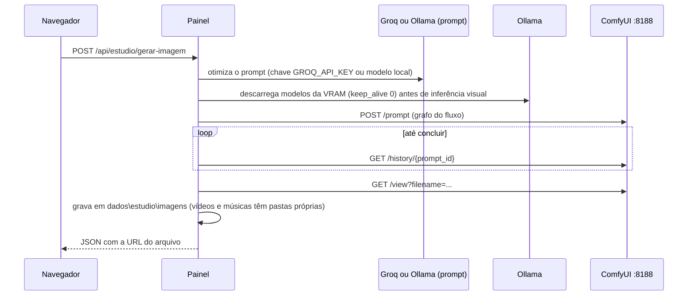
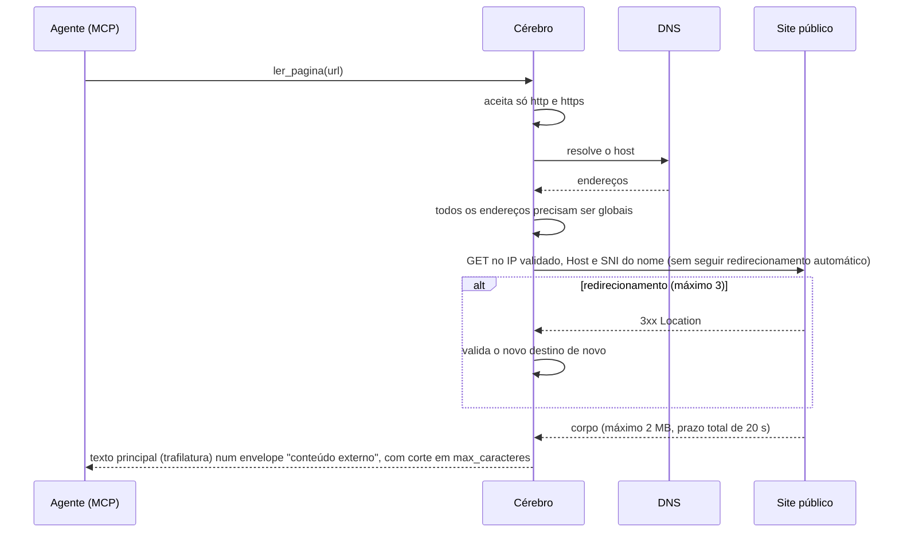

# Arquitetura

O TudoIA é uma máquina só. A GPU fica no host, então Ollama e ComfyUI rodam como processos do Windows. Os serviços de
rede ficam em containers Docker, com as portas publicadas só em `127.0.0.1`. O painel é o ponto de controle: sobe e
para serviços, edita a configuração e guarda o login.

## Visão geral

```mermaid
flowchart LR
    subgraph Navegador
        UI[Painel SPA]
    end

    subgraph Host["Host Windows (processos)"]
        Painel["Painel FastAPI<br/>127.0.0.1:3100"]
        Ollama["Ollama<br/>127.0.0.1:11434"]
        ComfyUI["ComfyUI<br/>127.0.0.1:8188"]
    end

    subgraph Docker["Docker (compose: tudoia)"]
        LiteLLM["LiteLLM :4000<br/>+ hook roteador"]
        LDB[("Postgres<br/>litellm-db :5433")]
        Cerebro["Cérebro MCP<br/>:8765"]
        SearXNG["SearXNG :8080"]
        OWUI["Open WebUI :3000"]
        Kokoro["Kokoro TTS :8880"]
        N8N["n8n :5678"]
    end

    Keycloak["Keycloak :8180<br/>(externo ao repositório)"]
    Nuvem[("Provedores de nuvem<br/>NIM, OpenRouter, Groq,<br/>Gemini, Cloudflare, pagos")]
    Clientes["Clientes de IA<br/>Claude Code, Cursor,<br/>Antigravity, Codex"]
    Web[("Páginas públicas")]

    UI -->|HTTP| Painel
    Painel -->|OIDC: login e metadados| Keycloak
    Painel -->|chat e testes| LiteLLM
    Painel -->|/api/servicos: start/stop| Docker
    Painel -->|start/stop, status| Ollama
    Painel -->|/prompt, /history, /view| ComfyUI
    Painel -->|/api/tags, /api/generate| Ollama

    Clientes -->|OpenAI e Anthropic API| LiteLLM
    Clientes -->|MCP streamable HTTP /mcp| Cerebro
    OWUI -->|OLLAMA_BASE_URL| Ollama
    OWUI -.->|conexão com LiteLLM: a confirmar| LiteLLM
    LiteLLM -->|embeddings bge-m3 e modelos locais| Ollama
    LiteLLM -->|metadados e chaves| LDB
    LiteLLM -->|HTTPS| Nuvem
    Cerebro -->|embeddings bge-m3| Ollama
    Cerebro -->|pesquisar_web| SearXNG
    Cerebro -->|ler_pagina: HTTPS| Web
    N8N -->|POST /indexar (Bearer)| Cerebro
    N8N -->|token client_credentials| Keycloak
    Cerebro -->|JWKS| Keycloak
```

O Kokoro não tem chamada no código deste repositório. O n8n só aparece com `POST /indexar` no Cérebro
(`automacao/n8n/ingerir-documento.json`), com token do cliente `tudoia-mcp` pedido ao Keycloak pela credencial OAuth2
do n8n. O compose faz o Open WebUI depender de SearXNG e Kokoro, mas a forma como ele os usa fica na
configuração do próprio Open WebUI (a confirmar).

## Componentes

| Componente | Tecnologia | Papel | Doc |
|---|---|---|---|
| Painel | FastAPI, SPA estática (`painel/tudoia_painel/static/`) | Controle, login, Estúdio, configuração | [painel](componentes/painel.md) |
| LiteLLM | Imagem `ghcr.io/berriai/litellm` + hook `roteador.py` | Gateway OpenAI e Anthropic, roteamento, quarentena, métricas | [roteador](componentes/roteador.md) |
| Cérebro | Python 3.12, MCP (`mcp`), SQLite, `numpy` | Busca web, leitura de páginas, documentos e memória | [cérebro](componentes/cerebro.md) |
| Governança | Python (stdlib), `governanca/` | Distribui regras, skills e MCP para os clientes | [governança](componentes/governanca.md) |
| Keycloak | Externo | Identidade (OIDC) do painel | [keycloak](componentes/keycloak.md) |
| Modelos | Python, `config/modelos.yaml` | Baixa e verifica pesos | [modelos](componentes/modelos.md) |
| Open WebUI | Imagem `ghcr.io/open-webui/open-webui` | Chat com interface própria | [serviços Docker](componentes/servicos-docker.md) |
| SearXNG | Imagem `searxng/searxng` | Metabusca usada pelo Cérebro e pelo Open WebUI | [serviços Docker](componentes/servicos-docker.md) |
| Kokoro | Imagem `ghcr.io/remsky/kokoro-fastapi-cpu` | Síntese de voz em CPU | [serviços Docker](componentes/servicos-docker.md) |
| n8n | Imagem `docker.n8n.io/n8nio/n8n` | Automação visual; fluxos em `automacao/n8n/` | [automação n8n](componentes/automacao-n8n.md) |
| Postgres | Imagem `postgres:17.6-alpine` | Banco do LiteLLM (chaves, gasto, contagem de tokens) | [serviços Docker](componentes/servicos-docker.md) |

## Portas

Os valores vêm de `runtime/docker-compose.yml`, de `painel/tudoia_painel/cli.py`, de
`painel/tudoia_painel/servicos.py` e de `scripts/tudoia.ps1`.

| Porta | Serviço | Onde escuta | Observação |
|---|---|---|---|
| 3100 | Painel (`tudoia painel`) | `127.0.0.1` (uvicorn) | Porta padrão. O login OIDC depende dela para o redirect URI. |
| 4000 | LiteLLM | `127.0.0.1:4000` publicado | Único gateway; todos os clientes falam com ele. |
| 8765 | Cérebro (MCP e `/saude`) | `127.0.0.1:8765` publicado (dentro do container: `0.0.0.0`) | Endpoint MCP em `/mcp`. |
| 3000 | Open WebUI | `127.0.0.1:3000` publicado (container 8080) | |
| 8080 | SearXNG | `127.0.0.1:8080` publicado | Precisa de `formats: json`, já configurado. |
| 5678 | n8n | `127.0.0.1:5678` publicado | |
| 8880 | Kokoro | `127.0.0.1:8880` publicado | |
| 5433 | Postgres do LiteLLM | `127.0.0.1:5433` publicado (container 5432) | |
| 11434 | Ollama | `127.0.0.1:11434` (definido por `OLLAMA_HOST`) | Só loopback; containers chegam por `host.docker.internal`. |
| 8188 | ComfyUI | `127.0.0.1:8188` (o código sempre conecta em `127.0.0.1`) | O bind real depende dos argumentos de `run_nvidia_gpu.bat`, que não está versionado. A confirmar. |
| 8180 | Keycloak | Externo | Usado pelo `keycloak` (provisionamento) e pelo login do painel. |

## Fluxos

### Login no painel (OIDC, Authorization Code com PKCE)

```mermaid
sequenceDiagram
    participant B as Navegador
    participant P as Painel
    participant K as Keycloak
    B->>P: GET /auth/login?retorno=/app/
    P->>P: guarda o retorno na sessão; gera code_verifier (S256)
    P-->>B: 302 para o authorize do Keycloak (state, code_challenge)
    B->>K: login e consentimento
    K-->>B: 302 para /auth/callback?code=...&state=...
    B->>P: GET /auth/callback
    P->>K: troca code + code_verifier por tokens (servidor a servidor)
    K-->>P: id_token com claims (groups ou realm_access.roles)
    P->>P: mapeia papéis tudoia-admin, -operador, -leitor
    P-->>B: 303 para o retorno; cookie tudoia_sessao (8 h)
```

Detalhes e limites: [painel](componentes/painel.md#autenticação) e [seguranca.md](seguranca.md#autenticação-oidc).

### Chat pelo gateway

```mermaid
sequenceDiagram
    participant C as Cliente (ex.: Claude Code)
    participant L as LiteLLM
    participant H as Hook roteador.py
    participant O as Ollama (bge-m3)
    participant N as Provedor (nuvem ou local)
    C->>L: POST /v1/messages ou /v1/chat/completions (model=tudoia-auto)
    L->>H: async_pre_call_hook
    H->>H: marcador (#local, #nuvem, #max); regras; visão; ferramentas
    alt pontuação ambígua
        H->>O: embed da última mensagem (até 1,5 s)
        O-->>H: vetor; kNN sobre exemplos-roteamento.yaml
    end
    H->>L: escolhe o grupo (tudoia-nuvem, tudoia-codigo, tudoia-local...)
    L->>N: membro escolhido (latency-based, cooldown de 60 s)
    N-->>L: resposta ou erro
    L->>H: eventos (metadados) para eventos.jsonl
    L-->>C: resposta (com nova tentativa em outro membro se falhar)
```

Para `/v1/messages` (Claude Code), o hook segura o stream até `message_stop` e só então envia ao cliente. Assim uma
falha no meio da resposta pode ser refeita em outro modelo sem o cliente perceber (ver
[roteador.md](componentes/roteador.md)).

### Geração de imagem no Estúdio (ComfyUI)



Quando o motor pedido não é o ComfyUI, ou o ComfyUI está offline, `gerar-imagem` segue outro caminho dentro de
`painel/tudoia_painel/rotas/estudio_imagem.py` e não passa pelo ComfyUI.

### Leitura de página pelo Cérebro



Os detalhes de SSRF estão em [seguranca.md](seguranca.md#cérebro-leitura-de-páginas-ssrf).

## Serviços Docker

Definidos em `runtime/docker-compose.yml`, projeto `tudoia`. Suba pelo `.\scripts\tudoia.ps1 up`.

- Todas as imagens estão fixadas por digest (`@sha256:`). As tags continuam no arquivo (`main-latest`, `latest`), mas
  o digest é o que vale. A exceção é a imagem base do Cérebro (`python:3.12-slim` no
  `runtime/cerebro/Dockerfile`), que não tem digest.
- Nenhum serviço recebe o `.env` inteiro (não há `env_file`). O `litellm` recebe uma lista explícita de variáveis: as
  chaves de provedor, `LITELLM_MASTER_KEY`, `DATABASE_URL`, `OLLAMA_URL` e `TZ` (ver
  [seguranca.md](seguranca.md#containers-e-variáveis)).
- O `n8n` recebe a `N8N_ENCRYPTION_KEY`, que cifra as credenciais salvas nele. Restaurar o volume `n8n` exige a mesma
  chave (ver [configuracao.md](configuracao.md#segredos-internos)). Ele roda com `N8N_BLOCK_ENV_ACCESS_IN_NODE=true` e
  guarda o segredo do Cérebro no próprio cofre.
- Healthcheck: `litellm-db` (`pg_isready`), `litellm` (`/health/liveliness`), `searxng` (`/healthz`), `cerebro`
  (`/saude`) e `n8n` (`/healthz`). Kokoro e Open WebUI não têm.
- O serviço `litellm` monta `runtime/litellm/config.yaml` (gerado pelo painel), os quatro arquivos Python do hook e
  `config/` em somente leitura.
- O Cérebro monta `dados/documentos` como `/docs` em somente leitura e `dados/cerebro` como `/dados`.
- `n8n` monta `dados/documentos` como `/data/docs` com `N8N_RESTRICT_FILE_ACCESS_TO=/data/docs`.

## Localização dos dados

| Caminho | Conteúdo | Quem grava | Versionado | Backup |
|---|---|---|---|---|
| `.env` | Segredos e configuração | Você; `segredos`; `keycloak`; painel (Segredos) | Não (gitignore) | Cópias em `dados\backups\env\`. Não entra no `backup` |
| `dados\backups\env\` | Cópias do `.env` antes de cada gravação (máximo 10) | Painel e `segredos` | Não | É o backup |
| `dados\backups\<AAAAMMDD-HHMMSS>\` | `litellm-db.sql.gz`, `cerebro.db`, `n8n.tar.gz`, `open-webui.tar.gz` e `manifesto.json` (sha256 de cada item) | `tudoia.ps1 backup` (`scripts/backup/backup.py`) | Não | É o backup. Mantém os 7 mais recentes (`--manter N`) |
| `dados\cerebro\cerebro.db` | SQLite: fatos, trechos indexados e arquivos | Cérebro | Não | `backup` |
| `dados\documentos\` | Documentos que o Cérebro indexa (`.md`, `.txt`, `.pdf`, `.docx`, `.html`) | Você; n8n (`entrada`, `resumos`) | Não | Manual |
| `dados\estudio\` | Saídas do Estúdio (`imagens`, `videos`, `musicas`) e `uploads` | Painel | Não | Manual |
| `dados\logs\` | `eventos.jsonl`, `roteador.jsonl`, `correcoes.jsonl`, `ratelimit.json`, `exemplos-vetores.json` (hook do roteador); `auditoria.jsonl`, `comfyui.log` (painel). `roteador.jsonl`, `correcoes.jsonl` e `auditoria.jsonl` giram para `.1` em 5 MB | Hook do roteador; painel | Não | Não |
| `modelos\ollama\models\` | Pesos do Ollama (padrão de `OLLAMA_MODELS`) | Ollama | Não (gitignore) | Não |
| `modelos\comfyui\ComfyUI_windows_portable\` | ComfyUI portable e pesos | Você; baixador | Não | Não |
| `runtime\litellm\config.yaml` | Configuração gerada do LiteLLM | Painel (`/api/roteador/gerar`) | Não (gitignore) | `config.yaml.anterior` |
| Volume `litellm-db` (`tudoia_litellm-db`) | Dados do Postgres do LiteLLM | LiteLLM | Não | `backup` (`pg_dump`) |
| Volume `open-webui` (`tudoia_open-webui`) | Dados do Open WebUI | Open WebUI | Não | `backup` (tar) |
| Volume `n8n` (`tudoia_n8n`) | Fluxos e credenciais do n8n (cifradas com `N8N_ENCRYPTION_KEY`) | n8n | Não | `backup` (tar). Restaurar exige a mesma `N8N_ENCRYPTION_KEY` |
| `~\.claude\`, `~\.claude.json`, `~\.gemini\`, `~\.codex\`, `opencode.json` | Arquivos gerados pela governança nos clientes | `sincronizar` e painel (`aplicar_tudo`) | Não | Não |
| `~\.tudoia\backups\` | Cópias dos JSON de MCP antes de cada gravação (`claude-json`, `opencode-json`, `antigravity-json`; 10 por arquivo). Têm tokens em claro | Governança | Não | É o backup |

`dados\` e `modelos\` estão no `.gitignore`. Os nomes de pasta e de arquivo foram conferidos no código
(`painel/tudoia_painel/caminhos.py` e `runtime/litellm/roteador.py`).

## Ambiente de referência

Os limites de contexto, os tempos de espera e os comentários sobre desempenho em `painel/tudoia_painel/gerador.py`
foram medidos em uma RTX 5070 com 8 GB de VRAM. Se a sua GPU for diferente, esses valores precisam ser medidos de
novo.
