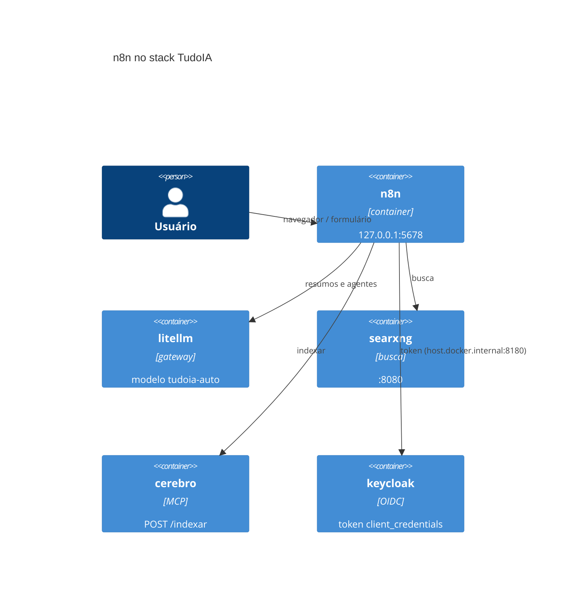

[🏠 TudoIA](../../README.md) › [📚 Documentação](../README.md) › 🔁 Automação n8n

# 🔁 Automação com n8n

> Para quem usa e mantém os fluxos de automação do TudoIA. Responde: como o n8n roda no stack, como importar os quatro
> workflows versionados, que credenciais criar, o que cada fluxo faz e quais limites e riscos existem.

## 📑 Sumário

- [🎯 Visão geral](#-visão-geral)
- [🚀 Uso](#-uso)
- [🔀 Workflows](#-workflows)
- [⚙️ Opções](#️-opções)
- [❌ Erros / diagnóstico](#-erros--diagnóstico)
- [🛡️ Segurança](#️-segurança)
- [❓ Perguntas frequentes](#-perguntas-frequentes)

## 🎯 Visão geral

O n8n é o serviço `n8n` do perfil `n8n` em `runtime/docker-compose.yml` (ver [servicos-docker.md](servicos-docker.md)).
Os workflows versionados ficam em `automacao/n8n/`: resumir documentos, agente pesquisador, digest de notícias e ingestão
de documento no Cérebro.



O que o container enxerga (conferido no compose):

- Interface e formulários em `http://localhost:5678`, publicada só em `127.0.0.1`.
- `dados/documentos` do host em `/data/docs` (leitura e escrita); é a mesma pasta que o Cérebro lê em `/docs`, somente
  leitura. `N8N_RESTRICT_FILE_ACCESS_TO=/data/docs`: os nós de arquivo só alcançam essa pasta.
- Volume `n8n` em `/home/node/.n8n` (banco, credenciais cifradas).
- Fuso: `GENERIC_TIMEZONE` e `TZ` vêm de `TZ` do `.env`; os gatilhos de agenda seguem esse fuso.
- Rede: alcança `litellm`, `searxng` e `cerebro` pelo nome do serviço; o Keycloak por `host.docker.internal:8180`.
- Healthcheck: `GET /healthz` a cada 30 s, início 60 s.
- A imagem é `docker.n8n.io/n8nio/n8n:latest` fixada por digest. A versão não está escrita no repositório.

Pastas usadas pelos workflows (dentro de `dados/documentos`): `entrada/` (documentos de origem) e `resumos/` (resumos em
Markdown). Crie-as antes da primeira execução; não verifiquei se o n8n as cria sozinho.

## 🚀 Uso

1. Suba o stack com o perfil `n8n` em `COMPOSE_PROFILES` (`scripts\tudoia.ps1 up`) e abra `http://localhost:5678`. Na
   primeira vez o n8n pede para criar o usuário dono.
2. Com o container no ar e o Keycloak já provisionado (ver [keycloak.md](keycloak.md)), grave a credencial do Cérebro:

   ```powershell
   scripts\tudoia.ps1 n8n-credencial
   ```

   O comando (`scripts/n8n/credencial_cerebro.py`) lê `TUDOIA_MCP_CLIENT_ID` (padrão `tudoia-mcp`),
   `TUDOIA_MCP_CLIENT_SECRET` e `TUDOIA_KEYCLOAK_REALM` (padrão `tudoia`) e grava, via `n8n import:credentials` dentro do
   container, a credencial OAuth2 `TudoIA Cérebro (client_credentials)` (id `tudoiaCerebroOAuth`, `clientCredentials`, token
   em `http://host.docker.internal:8180/realms/<realm>/protocol/openid-connect/token`). O segredo vai pelo stdin do
   `docker exec`, nunca por argumento; o arquivo temporário usa `umask 077` e é apagado em seguida. Repetir sobrescreve a
   mesma credencial.

   | Código de saída | Significado |
   |---|---|
   | `0` | credencial gravada |
   | `1` | `TUDOIA_MCP_CLIENT_SECRET` ausente no `.env` (rode o provisionamento do Keycloak) |
   | `2` | Docker indisponível ou o n8n recusou a importação |

3. Crie no n8n as outras duas credenciais, com estes nomes exatos (os fluxos as referenciam pelo nome):

   | Credencial | Tipo no n8n | Usada por | Observação |
   |---|---|---|---|
   | `TudoIA LiteLLM` | OpenAI API | os quatro fluxos | aponta para o LiteLLM do compose; a chave fica só na credencial |
   | `SearXNG local` | SearXNG API | `02-agente-pesquisador` | URL `http://searxng:8080` na credencial |

   O JSON dos fluxos não contém segredo; só nomes e, em `ingerir-documento.json`, ids internos de credencial.
4. Importe cada arquivo (**Workflows** > **Import from file**): `01-resumir-documentos.json`, `02-agente-pesquisador.json`,
   `03-digest-noticias.json`, `ingerir-documento.json`.
5. Os JSON não têm o campo `active`: entram desativados. Ative os de agenda (01, 03) e o de formulário (ingerir) quando
   quiser. O 02 é usado pela URL do gatilho de chat.

> [!NOTE]
> Quem importou uma versão antiga de `ingerir-documento.json` (que lia `$env` para o token) deve rodar o
> `n8n-credencial` e reimportar: com `N8N_BLOCK_ENV_ACCESS_IN_NODE=true` o fluxo antigo não lê mais o segredo.

## 🔀 Workflows

Todos usam o modelo `tudoia-auto` via credencial `TudoIA LiteLLM`.

### 01 - Resumir documentos (`01-resumir-documentos.json`)

- **Gatilhos:** manual e agenda diária às 7h.
- **Entrada:** `/data/docs/entrada/*.{txt,md}`; extrai o texto de cada arquivo.
- **Processo:** agente pede resumo em português do Brasil de até 8 tópicos e uma linha final `Ações:` com tarefas, se houver.
- **Saída:** `/data/docs/resumos/<nome original>.resumo.md`.
- **Limite:** o texto entra inteiro no prompt, sem corte; arquivo grande pode estourar o contexto do modelo.

### 02 - Agente pesquisador (`02-agente-pesquisador.json`)

- **Gatilho:** Chat do n8n, aberto pela URL do próprio gatilho.
- **Processo:** agente com data de hoje (fuso `America/Sao_Paulo`) no prompt, instruído a pesquisar, citar fontes e usar a
  calculadora. Ferramentas: SearXNG (5 resultados, idioma `pt-BR`) e Calculadora.
- **Credenciais:** `TudoIA LiteLLM`, `SearXNG local`.
- **Atenção:** o gatilho de chat não tem autenticação no JSON; ver [Segurança](#️-segurança).

### 03 - Digest de notícias (`03-digest-noticias.json`)

- **Gatilhos:** manual e agenda diária às 8h.
- **Fonte:** RSS `https://g1.globo.com/rss/g1/tecnologia/` (URL escrita no nó "Ler RSS"; trocar a fonte é editar o nó), 10
  primeiros itens.
- **Processo:** agente escreve digest curto e neutro, em português, com os links.
- **Saída:** `/data/docs/resumos/digest-AAAA-MM-DD.md`.
- **Chamada externa:** só o RSS; o texto vai ao LiteLLM, que pode encaminhar a provedor de nuvem conforme o roteamento.

### 04 - Ingerir documento (`ingerir-documento.json`)

O fluxo que liga o n8n ao Cérebro.

- **Gatilho:** formulário (`formTrigger`), caminho `tudoia-ingerir-documento`, `authentication: n8nUserAuth`: só quem
  está logado no n8n abre o formulário. Aceita `.txt`, `.md`, `.pdf`. URL esperada: `http://localhost:5678/form/tudoia-ingerir-documento`
  (padrão do n8n; confirme na instância).
- **Passos:**
  1. "Preparar arquivo": limpa o nome (sem caminho nem caracteres estranhos) e valida a extensão no servidor.
  2. Extensão inválida: mensagem de formato e fim.
  3. Se já existe `entrada/<nome>` ou `resumos/<base>.md`, acrescenta `-AAAAMMDD-HHMMSS` aos dois nomes (nunca sobrescreve).
  4. Grava o original em `/data/docs/entrada`.
  5. PDF: extrai o texto do PDF; demais: lê como texto. Sem texto (PDF escaneado, vazio ou corrompido): grava o original,
     avisa e não gera resumo.
  6. Resume (até 15 tópicos, título na primeira linha); o texto enviado ao modelo é cortado em 30 000 caracteres. Falha do
     modelo: avisa, o original fica salvo.
  7. Grava `resumos/<base>.md`.
  8. `POST http://cerebro:8765/indexar`, timeout 120 s, autenticado pela credencial `TudoIA Cérebro (client_credentials)`.
     200: indexação concluída. 409: já há indexação em andamento; o arquivo entra na próxima rodada. Outro status: a
     mensagem informa a falha e o resumo fica salvo. Cérebro fora do ar: aviso "será indexado em até 10 min" (o Cérebro
     reindexa a cada 600 s, `INTERVALO_INDEXACAO` em `runtime/cerebro/cerebro/servidor.py`).
- **Credenciais:** `TudoIA LiteLLM`, `TudoIA Cérebro (client_credentials)`.
- Endpoint, papéis e indexação: [cerebro.md](cerebro.md).

## ⚙️ Opções

| Item | Valor | Onde |
|---|---|---|
| `N8N_ENCRYPTION_KEY` | do `.env`; cifra as credenciais | compose |
| `N8N_BLOCK_ENV_ACCESS_IN_NODE` | `true` | compose (fixo) |
| `N8N_RESTRICT_FILE_ACCESS_TO` | `/data/docs` | compose (fixo) |
| `N8N_HOST` / `N8N_WEBHOOK_URL` | `localhost` / `http://localhost:5678/` | compose (fixos) |
| `TUDOIA_MCP_CLIENT_ID` | `tudoia-mcp` | `.env`, lido por `credencial_cerebro.py` |
| `TUDOIA_MCP_CLIENT_SECRET` | sem padrão; obrigatório | `.env` (gravado pelo provisionamento do Keycloak) |
| `TUDOIA_KEYCLOAK_REALM` | `tudoia` | `.env` |

## ❌ Erros / diagnóstico

| Sintoma | Causa | Ação |
|---|---|---|
| `n8n-credencial` sai com `1` | segredo do cliente `tudoia-mcp` ausente | rodar o provisionamento do Keycloak ([keycloak.md](keycloak.md)) |
| `n8n-credencial` sai com `2` | container `n8n` parado, Docker fora ou importação recusada | subir o perfil `n8n`; ler o fim da mensagem de erro |
| Fluxo reclama de `$env` | fluxo antigo | reimportar o arquivo atual |
| Credenciais salvas não decifram após restaurar | `N8N_ENCRYPTION_KEY` diferente | restaurar a chave original do `.env`; o backup não a inclui |
| Indexação responde 401/403 | credencial do Cérebro errada ou cliente sem papel | rodar `n8n-credencial` de novo; conferir o cliente `tudoia-mcp` |
| Resposta de indexação 409 | indexação em andamento | nada; o arquivo entra na próxima rodada |

## 🛡️ Segurança

- Nenhum fluxo lê variável de ambiente (`tests/n8n/test_fluxos_n8n.py` confere que `$env` e `process.env` não aparecem e
  que o formulário exige login). O segredo do Cérebro vive no cofre de credenciais do n8n.
- A credencial do cliente `tudoia-mcp` fica cifrada no volume `n8n` com a `N8N_ENCRYPTION_KEY`: quem tem o volume (ex.:
  backup `n8n.tar.gz`) e o `.env` obtém o segredo.
- O formulário exige login no n8n, mas quem tem conta pode enviar documentos que o Cérebro indexa.
- O conteúdo dos documentos vai ao modelo e pode conter instruções. Os agentes de resumo não têm ferramentas, então o dano
  fica no texto do resumo, que é gravado e indexado: trate-o como dado não confiável.
- O gatilho de chat do fluxo 02 não tem autenticação; a porta só escuta em loopback. Se o n8n for exposto a outra rede,
  proteja o gatilho antes.
- Modelo geral: [../seguranca.md](../seguranca.md).

## ❓ Perguntas frequentes

**Por que os fluxos entram desativados?** Os JSON não trazem `active`; ative o que quiser depois de importar.

**Compatibilidade com a versão do n8n?** A importação foi conferida só pela leitura dos JSON; confirme na primeira importação.

---

[🏠 README](../../README.md) · ⬅️ [Serviços Docker](servicos-docker.md) · [Cérebro](cerebro.md) ➡️
