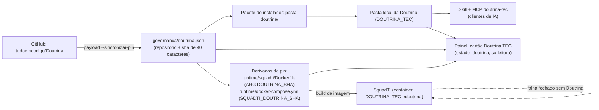

[🏠 TudoIA](../../README.md) › [📚 Documentação](../README.md) › 📖 Doutrina TEC

# 📖 Integração com a Doutrina TEC

> Para quem mantém o TudoIA e para quem empacota ou atualiza a versão da Doutrina. Responde: onde o TudoIA usa a
> Doutrina, como apontar a pasta, como a versão é fixada e propagada, o que acontece quando ela falta (fail-closed)
> e o que o cartão "Doutrina TEC" do painel mostra. As regras da Doutrina em si ficam no repositório dela, não aqui.

## 📑 Sumário

- [🎯 Visão geral](#-visão-geral)
- [🚀 Uso](#-uso)
- [⚙️ Opções](#️-opções)
- [🔧 Como funciona](#-como-funciona)
- [❌ Erros e diagnóstico](#-erros-e-diagnóstico)
- [🛡️ Segurança](#️-segurança)
- [🧪 Testes](#-testes)
- [❓ Perguntas frequentes](#-perguntas-frequentes)

---

## 🎯 Visão geral

A Doutrina TEC é um repositório externo (`tudoemcodigo/Doutrina`) com as regras de engenharia da TEC e artefatos gerados
(`gerado/manifesto.json`, `gerado/<familia>.json`, `gerado/<familia>-nucleo.md`, `gerado/perfis/<papel>.json`). O TudoIA
a consome em três pontos, sempre a partir de uma **pasta local** apontada por `DOUTRINA_TEC`:

| Consumidor | O que lê | Arquivo |
|---|---|---|
| Skill `doutrina-tec` | Orientação ao agente do cliente para consultar a Doutrina | `governanca/skills/doutrina-tec/SKILL.md` |
| MCP `doutrina-tec` | Servidor stdio somente leitura: manifesto, índice, núcleo e regras por ID | entrada em `governanca/mcp.json` (roda `tools/mcp_doutrina.py` da pasta da Doutrina) |
| SquadTI | Núcleo e regras do papel de cada agente, mais versão e hash por tarefa | `runtime/squadti/orquestrador/doutrina_tec.py` |

O commit fixado em `governanca/doutrina.json` é a fonte da verdade da versão. O Docker não lê JSON, então o mesmo SHA é
repetido (derivado) no `Dockerfile` e no `docker-compose.yml` da SquadTI; a ferramenta de empacotamento mantém os três
iguais e o painel avisa quando divergem.

## 🚀 Uso

### Configurar a pasta

`DOUTRINA_TEC` (pasta da Doutrina) e `TUDOIA_PYTHON` (Python que roda o servidor MCP) ficam no `.env` (modelo em
`.env.example`). O instalador preenche as duas. Numa cópia de desenvolvimento, aponte `DOUTRINA_TEC` para um clone da
Doutrina e `TUDOIA_PYTHON` para o `.venv` do TudoIA. Depois rode `.\scripts\tudoia.ps1 sync` para o caminho do MCP chegar
aos clientes (em destinos sob a home o `sync` grava o caminho já resolvido, então a skill funciona sem a variável no
ambiente do cliente).

### Atualizar a versão fixada

O painel **não** atualiza a Doutrina: o cartão mostra o estado e a lista de passos. A atualização é decisão de quem
empacota e roda na linha de comando:

1. Publique a mudança na `main` da Doutrina.
2. `python -m scripts.empacotar.payload --sincronizar-pin` busca o commit mais novo (`git ls-remote ... HEAD`), grava em
   `governanca/doutrina.json` e propaga para o `Dockerfile` e o `docker-compose.yml`. Se `DOUTRINA_TEC` estiver definida,
   faz `git fetch` nesse clone para o commit existir localmente. Falha de rede não altera nada.
3. `.\scripts\tudoia.ps1 empacotar` gera o pacote com a Doutrina nesse commit (lida do histórico git do clone, não da pasta
   de trabalho: edição local não entra).
4. Reconstrua a imagem da SquadTI para usar a versão nova (`up -d --build squadti` no compose, ou `tudoia.ps1 up`).

`python -m scripts.empacotar.payload --derivar-pin` só propaga o SHA já gravado no JSON, sem rede. O botão **Sincronizar com
os clientes** do painel **não** muda a versão da Doutrina: só reaplica a governança (regras, skills e MCP, inclusive o caminho do MCP). O empacotamento e a Doutrina dentro do
instalador estão em [instalador.md](../instalador.md) (seção "A Doutrina TEC dentro do pacote").

### O que o painel mostra

Aba de governança, cartão "Doutrina TEC" (`GET /api/governanca`, campo `doutrina`, calculado por
`painel/tudoia_painel/doutrina_servico.py::estado_doutrina`). O cartão é somente leitura, sem rede e sem gravar nada.
Um bloco recolhido ("Como atualizar a Doutrina") repete os passos acima com os comandos do campo `comandos`.

| Campo | Significado |
|---|---|
| `estado` | `ok`, `sem_pasta` (`DOUTRINA_TEC` ausente ou em branco no `.env`) ou `ilegivel` (a pasta não tem um `gerado/manifesto.json` legível com `versao` e `hash`) |
| `mensagem` | Texto do estado; em `sem_pasta` avisa que skill, MCP e SquadTI "falham fechado" |
| `em_uso` | `{versao, hash}` do manifesto da pasta; o cartão mostra o hash cortado em 12 caracteres e a pasta |
| `fixada` | `{repositorio, sha}` de `governanca/doutrina.json`; mostrada como "Fixada para o pacote e a SquadTI" |
| `derivados_divergentes` | Arquivos cujo SHA difere do JSON (`runtime/squadti/Dockerfile`, `runtime/docker-compose.yml`) |
| `aviso_fixacao` | Pin inválido, derivado ilegível ou sem exatamente uma ocorrência do SHA, ou ferramenta de empacotamento indisponível nesta instalação |
| `comandos` | Os comandos `atualizar`, `derivar` e `empacotar` exibidos em "Como atualizar a Doutrina" |

O badge de drift da tela passa a "Doutrina TEC com pendência" quando `estado` não é `ok`, há derivados divergentes ou
há `aviso_fixacao`. Nada disso derruba a tela: erro vira estado ou aviso. O endpoint devolve só estes campos, nunca o
restante do `.env`.

## ⚙️ Opções

| Nome | Onde | Padrão | Efeito |
|---|---|---|---|
| `DOUTRINA_TEC` | `.env` (e `DOUTRINA_TEC=/doutrina` dentro do container da SquadTI) | vazio | Pasta da Doutrina. Tem precedência sobre `architecture_source_path` do estado da tarefa. Vazia: skill, MCP e SquadTI não trabalham |
| `TUDOIA_PYTHON` | `.env` | vazio | Python que executa `tools/mcp_doutrina.py` |
| `SQUADTI_DOUTRINA_SHA` | `.env` (opcional, comentada em `.env.example`) | SHA gravado no compose | Sobrescreve o commit usado no `build` da imagem da SquadTI. Se divergir do JSON, o painel avisa só dos arquivos, não do `.env` |
| `DOUTRINA_FAMILIAS` | ambiente da SquadTI | perfil de cada papel | Lista separada por vírgula que força as mesmas famílias em todos os papéis (cada nome deve casar `^[a-z0-9-]{1,40}$`). Também aceita `doutrina_familias` no estado/`stack_config` |
| `DOUTRINA_REGRAS_MAX_TOKENS` | ambiente da SquadTI | 12000 | Orçamento de tokens das regras do papel no prompt. Aceito de 500 a 200000; fora disso volta a 12000 (nunca ilimitado) |
| `governanca/doutrina.json` | repositório | `repositorio`, `sha` | `repositorio` no formato `dono/nome`; `sha` com os 40 caracteres do commit. SHA curto ou ref móvel (`main`) é recusado: o pacote precisa ser reprodutível |

Família padrão quando nada está definido e não há perfil: `arquitetura`, `ia`, `ecossistema` (`FAMILIAS_PADRAO`). Na prática
cada papel usa o `nucleo_sugerido` do próprio perfil em `gerado/perfis/<papel>.json`.

## 🔧 Como funciona

### Na SquadTI (`doutrina_tec.py`)

Consome apenas os JSON e `-nucleo.md` gerados pela própria Doutrina; não faz parse de Markdown de regras.

- `raiz_doutrina`: `DOUTRINA_TEC` > `architecture_source_path` do estado. Sem caminho, ou pasta sem
  `gerado/manifesto.json`: `DoutrinaIndisponivel`.
- `perfil(papel)`: lê `gerado/perfis/<papel>.json` (papel válido: `^[a-z0-9-]{1,20}$`; precisa de `nucleo_sugerido` e
  `familias` como listas). Papel sem perfil não trabalha.
- `nucleo`/`regras_do_papel`/`contexto`: o prompt de cada agente recebe o núcleo (uma vez por família) mais as regras do
  papel. As regras entram por prioridade: `MUST` primeiro, depois `SHOULD`; `MAY` fica de fora; o que não coube no
  orçamento é declarado numa linha final com a quantidade, para o agente não presumir que viu tudo. O núcleo não é
  repetido nas regras do papel.
- `verificar_versao(state)`: chamada no início de cada nó. Na primeira vez grava `doutrina_versao` e `doutrina_hash` no
  estado; nas seguintes, se o hash do manifesto mudou, aborta a tarefa pedindo para reiniciá-la, para a entrega seguir
  **uma** versão rastreável.
- `evidencias` e `ids_do_papel`: o nó de QA usa as evidências (testes que travam cada regra) e o de segurança lista os
  ids `SEC-` do papel, só ids e níveis.

### Fail-closed

Qualquer dos casos abaixo levanta `DoutrinaIndisponivel` e a tarefa não segue (ECO-CON-01, IA-ORQ-03, provas em
`runtime/squadti/orquestrador/tests/test_fronteiras.py`): sem caminho, pasta que não é a Doutrina, `manifesto.json` ou
perfil ausente/corrompido, papel desconhecido, família inválida, núcleo ilegível, doutrina que mudou no meio da tarefa
(ECO-CON-02). A razão é objetiva: um agente sem regras produz código fora do padrão sem avisar. No painel o mesmo princípio
aparece como `sem_pasta`/`ilegivel`; a tela em si nunca falha.

### No container da SquadTI

`runtime/squadti/Dockerfile` clona o repositório no SHA fixado (`git fetch --depth 1` do SHA, `checkout`, confere a
existência de `gerado/manifesto.json`, apaga `.git`) numa imagem de build separada e copia o resultado para `/doutrina`; o
ambiente da imagem define `DOUTRINA_TEC=/doutrina`. O compose repassa `SQUADTI_DOUTRINA_SHA` como `build.args`. Veja
[squadti.md](squadti.md) e [servicos-docker.md](servicos-docker.md).

## ❌ Erros e diagnóstico

| Sintoma | Causa | Ação |
|---|---|---|
| Cartão: "DOUTRINA_TEC não está no .env" (`sem_pasta`) | Variável ausente ou em branco | Defina `DOUTRINA_TEC` no `.env`; rode `sync` |
| Cartão: "pasta sem gerado/manifesto.json legível" (`ilegivel`) | Pasta errada, `manifesto.json` ausente, JSON corrompido ou sem `versao`/`hash` | Aponte para a raiz da Doutrina; no clone, confira `gerado/manifesto.json` |
| Cartão: "o commit fixado não está em ..." | O JSON mudou e o `Dockerfile`/compose não | `python -m scripts.empacotar.payload --derivar-pin` |
| `aviso_fixacao` com `governanca/doutrina.json ausente ou inválido` | JSON ausente, `sha` curto ou `main` | Use `repositorio` `dono/nome` e `sha` de 40 caracteres |
| `aviso_fixacao`: "esperava exatamente uma ocorrência do SHA" | Alguém reformatou o `Dockerfile` ou o compose | Restaure a linha `ARG DOUTRINA_SHA=` e `DOUTRINA_SHA: ${SQUADTI_DOUTRINA_SHA:-...}` |
| `aviso_fixacao`: "ferramenta de empacotamento indisponível" | Instalação sem `scripts/` | Informativo; só a checagem dos derivados some |
| SquadTI: "defina DOUTRINA_TEC" / "não parece uma Doutrina TEC" | Caminho ausente ou errado no container | Reconstrua a imagem (a Doutrina vai em `/doutrina`) |
| SquadTI: "a Doutrina TEC mudou durante a tarefa" | Hash do manifesto diferente do gravado | Reinicie a tarefa |
| SquadTI: papel "desconhecido" ou perfil ausente | Perfil do papel não existe nessa versão da Doutrina | Atualize a versão fixada ou use `DOUTRINA_FAMILIAS` |

## 🛡️ Segurança

- A Doutrina é conteúdo de terceiros: o texto dela chega ao prompt do agente como dado normativo, não como permissão
  para executar nada (ECO-PRE-07). Comandos da SquadTI vêm da configuração da stack, não da Doutrina.
- O pin exige SHA completo: uma ref móvel mudaria o comportamento dos agentes sem revisão. O Dockerfile baixa o commit
  exato e remove `.git`.
- O servidor MCP `doutrina-tec` é local (stdio), somente leitura e só biblioteca padrão; não usa `npx` nem baixa código em
  execução. Registrar ou alterar a entrada faz a verificação de distribuição da Doutrina acusar `alterada` até alguém
  revisar.
- `estado_doutrina` lê só `DOUTRINA_TEC` do `.env` e não devolve nenhum outro valor (teste adversarial com chave falsa
  em `tests/painel/test_doutrina_estado.py`). O caminho da pasta aparece no cartão: é o único dado local exposto.
- O instalador baixa a Doutrina no SHA fixado quando o código vem do GitHub sem a pasta `doutrina/`; se falhar, a
  instalação falha (`garantir_doutrina` em `instalador/tudoia_instalador/etapas.py`).

## 🧪 Testes

- `tests/painel/test_doutrina_estado.py`: tudo em dia; variável ausente ou em branco; manifesto corrompido ou
  incompleto; pasta inexistente; derivados defasados; pin inválido vira aviso e não exceção; instalação sem arquivos da
  SquadTI; somente leitura e sem vazar o `.env`.
- `tests/painel/test_painel.py` (HTTP: o campo `doutrina` em `GET /api/governanca`).
- `tests/instalacao/test_payload.py`: instantâneo da Doutrina no pacote, pin, `--sincronizar-pin` e `--derivar-pin`. `tests/instalacao/test_etapas.py`: `garantir_doutrina`.
- `tests/test_squadti_compose.py`: o SHA de `governanca/doutrina.json` é o mesmo do `Dockerfile` e do compose da SquadTI.
- `runtime/squadti/orquestrador/tests/test_fronteiras.py` e `test_nos.py`: fail-closed da SquadTI e mudança de
  doutrina no meio da tarefa.

## ❓ Perguntas frequentes

**Atualizei a Doutrina e o cartão ainda mostra a versão antiga.** `em_uso` vem da pasta apontada por `DOUTRINA_TEC`;
`fixada` vem do JSON. Atualizar o clone não altera o pin: rode `--sincronizar-pin`.

**"Sincronizar com os clientes" atualiza a Doutrina?** Não. Só regrava a configuração dos clientes, inclusive o caminho
do MCP.

**Por que o SHA aparece em três arquivos?** Porque o Docker não lê o JSON. O JSON manda; o `Dockerfile` e o compose são
derivados e o painel acusa a diferença.

**A Doutrina precisa de rede para o painel funcionar?** Não. O cartão não faz rede; só `--sincronizar-pin`, o `build` da
imagem e o instalador (quando o código vem do GitHub) consultam o GitHub.

---

[🏠 README](../../README.md) · ⬅️ [Governança](governanca.md) · [Keycloak](keycloak.md) ➡️
