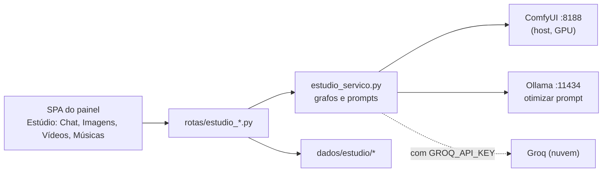

[🏠 TudoIA](../../README.md) › [📚 Documentação](../README.md) › 🎨 Estúdio

# 🎨 Estúdio de criação

> Para quem usa e mantém o Estúdio do painel. Responde: que mídia ele gera, em qual motor, com quais limites e custos,
> onde grava, quais rotas expõe e o que sai da máquina.

## 📑 Sumário

- [🎯 Visão geral](#-visão-geral)
- [🚀 Uso](#-uso)
- [⚙️ Opções](#️-opções)
- [🔬 Como funciona](#-como-funciona)
- [🔌 API](#-api)
- [❌ Erros e diagnóstico](#-erros-e-diagnóstico)
- [🛡️ Segurança e privacidade](#️-segurança-e-privacidade)
- [⚠️ Limitações conhecidas](#️-limitações-conhecidas)
- [❓ Perguntas frequentes](#-perguntas-frequentes)

---

## 🎯 Visão geral

O Estúdio é a parte criativa do [painel](painel.md): chat, imagem (com inpainting), vídeo (local) e
música. Cada mídia roda em um ou mais motores:

| Mídia | Motores | Observação |
|---|---|---|
| Chat | LiteLLM (`/api/chat/completions`) | Modelo padrão `tudoia-auto` ([roteador.md](roteador.md)). |
| Imagem | ComfyUI local; Cloudflare Workers AI; Pollinations (opt-in); SVG de reserva | Ordem em [Imagem](#imagem-escolha-do-motor). |
| Inpainting | só ComfyUI | |
| Vídeo | só ComfyUI | O campo `motor` de `POST /gerar-video` é ignorado. |
| Música | só ComfyUI (YuE 2) | |

Código:

| Arquivo | Papel |
|---|---|
| `painel/tudoia_painel/rotas/estudio_catalogo.py` | `status-motores` e `catalogo-modelos`. |
| `rotas/estudio_imagem.py` | Gerar imagem, inpaint, otimizar prompt. |
| `rotas/estudio_video.py` | Clipe único, status de job, cancelar, otimizar prompt de vídeo. |
| `rotas/estudio_musica.py` | Gerar música, otimizar estilo. |
| `rotas/estudio_arquivos.py` | Listar, servir e apagar saídas; upload. |
| `estudio_servico.py` | Grafos do ComfyUI montados em memória, otimização de prompt, pastas. |
| `comfyui.py` | Valida nome de arquivo e parâmetros de `/view` vindos do ComfyUI. |
| `midia.py` | Confere o conteúdo (bytes iniciais) do arquivo enviado. |
| `runtime/comfyui/workflows/*.json` | Três fluxos de referência para abrir na interface do ComfyUI (ver abaixo). |

> [!NOTE]
> Os grafos que o painel envia ao ComfyUI são montados em memória no Python. Os JSON de `runtime/comfyui/workflows/`
> (`TUDOIA_Imagem_e_Inpainting.json`, `TUDOIA_Musica_TrilhaSonora.json`, `TUDOIA_Video_Cinematografico.json`) não são
> lidos por nenhum código do painel (busca em `*.py` sem ocorrência). Servem de referência visual para carregar na UI do
> ComfyUI; `config/modelos.yaml` os cita em `usado_por`. Se o grafo do código mudar, esses JSON podem ficar defasados.

## 🚀 Uso

### Pré-requisitos

1. **ComfyUI portable no host.** Pasta com `ComfyUI\` (`models`, `input`, `output`) e `run_nvidia_gpu.bat`. Caminho:
   `TUDOIA_COMFYUI_PORTABLE` no `.env`; vazio, o padrão é `modelos\comfyui\ComfyUI_windows_portable` na raiz
   (`caminhos.py`). Sobe pelo painel (tela Serviços & Runtime) ou `iniciar.ps1`.
2. **Porta 8188 em `127.0.0.1`, fixa** (`upstreams.py`). Ollama (11434) e LiteLLM (4000) também são fixos.
3. **Pesos dos modelos** em `ComfyUI\models\`. Nomes exatos e download em [modelos.md](modelos.md) e `config/modelos.yaml`. O `flux-schnell` local (`local:<arquivo>` com `flux` no nome) usa o nó `UnetLoaderGGUF` (custom node `ComfyUI-GGUF`).
4. **GPU NVIDIA.** Antes de imagem, inpaint, vídeo e música, o painel descarrega da VRAM os modelos do Ollama
   (`_arbitrar_vram_para_estudio`, erros ignorados).

### Imagem

- Campos (`GerarImagemReq`, extras proibidos): `prompt` (1 a 4096), `prompt_negativo` (até 4096), `motor`
  (`auto` padrão, `comfyui`, outro), `modelo` (padrão `flux`), `aspect_ratio`, `seed` (opcional) e `steps` (padrão 20,
  1 a 100).
- Proporções: `1:1` 1024x1024; `16:9` 1344x768; `9:16` 768x1344; `4:3` 1152x864; `3:4` 864x1152.
- **A otimização de prompt é automática** em `gerar-imagem` (`otimizar_prompt_visual`): não há campo para desligá-la. A
  resposta traz `prompt` (efetivo), `prompt_original`, `prompt_otimizado` e `prompt_msg`. A rota
  `POST /api/estudio/otimizar-prompt` só devolve o prompt melhorado, sem gerar. Regras em
  [Otimização de prompt](#otimização-de-prompt).

### Inpainting

- `POST /api/estudio/inpaint`: `imagem_base` (URL `/api/estudio/imagens/...`, `/api/estudio/uploads/...` ou só o nome
  dentro de `imagens`), `mascara_base64` (aceita data URL), `prompt`, `prompt_negativo`, `modelo` (padrão `auto`),
  `denoise` (padrão 0,75; aceita 0,05 a 1,0), `seed` e `steps` (padrão 25).
- A máscara é lida pelo canal vermelho, ampliada em 6 px (`grow_mask_by` do `VAEEncodeForInpaint`). O checkpoint padrão é
  `Juggernaut-XL_v9_RunDiffusionPhoto_v2.safetensors`; `modelo` no formato `local:<arquivo>.safetensors|.ckpt` troca o
  checkpoint se o arquivo existir em `models\checkpoints` e não for YuE.
- Espera até 180 s pelo resultado; depois responde 504 `tempo_esgotado`.

### Vídeo

- **Vídeo** (`POST /api/estudio/gerar-video`): `prompt`, `modelo` (padrão `video-minimax-h3`),
  `duracao_segundos` (1 a 60), `resolucao` (`480p`, `720p`, `1080p`), `fps` (8 a 60), `seed`, `modo_origem` (`t2v`, `i2v`,
  `v2v`), `arquivo_referencia`, `modo_execucao` (`sync` padrão ou `async`). `i2v` e `v2v` exigem arquivo de referência
  enviado antes por `POST /upload`. O arquivo é resolvido só dentro da pasta de uploads. A otimização cinematográfica do
  prompt é automática. Campos desconhecidos são ignorados (`extra="ignore"`).
- **Modelos locais**: MiniMax H3 (vídeo com áudio), Wan 2.2 T2V 14B, Wan 2.2 I2V 14B e Wan 2.2 TI2V 5B. O catálogo vem dos
  arquivos em `ComfyUI\models\diffusion_models`.

### Música

- Modelo: YuE 2 (`musica-yue2`). Campos (`GerarMusicaReq`): `style` (1 a 4096), `lyrics` (padrão `[instrumental]`, até
  8192), `duracao_segundos` (5 a 360, padrão 30), `modo` (`full`, `melody` ou `off`), `seed`.

### Galeria

A galeria da interface guarda o que foi gerado na sessão da página. Os arquivos ficam em disco e voltam por
`GET /api/estudio/imagens`, `/videos` e `/musicas`.

## ⚙️ Opções

Variáveis do `.env` lidas pelo Estúdio (só nomes; padrões completos em [configuracao.md](../configuracao.md)):

| Variável | Padrão | Efeito |
|---|---|---|
| `TUDOIA_COMFYUI_PORTABLE` | `modelos\comfyui\ComfyUI_windows_portable` | Pasta do ComfyUI portable. |
| `CLOUDFLARE_API_KEY` e `CLOUDFLARE_ACCOUNT_ID` | vazio | Imagem pela Cloudflare Workers AI. Sem as duas, a rota é ignorada. |
| `TUDOIA_ESTUDIO_POLLINATIONS` | desligado | Só o valor `1` liga o Pollinations (o prompt vai na URL a um serviço público). |
| `GROQ_API_KEY` | vazio | Otimização de prompt pela Groq. Sem ela, usa o Ollama local. **O texto do prompt sai da máquina.** |

### Limites das rotas

| Item | Limite | Onde |
|---|---|---|
| Corpo JSON comum | 10 MB | `seguranca.py` |
| `POST /api/estudio/upload` | 140 MB de corpo (base64), 100 MB de arquivo decodificado | `seguranca.py`, `midia.py` |
| Extensões de upload | imagem: `.png .jpg .jpeg .webp .bmp .gif`; vídeo: `.mp4 .mov .webm .avi .mkv` | `estudio_arquivos.py` |
| Conteúdo do upload | os bytes iniciais precisam bater com a extensão (`midia_confere`), senão 422 | `midia.py` |
| Jobs de vídeo assíncronos em memória | 200 (os mais antigos saem) | `MAX_JOBS_VIDEO` |
| Espera por vídeo (`sync`) | 600 s | `_executar_comfyui_video` |
| Espera por música | 300 s | `_executar_comfyui_musica` |
| Espera por inpaint | 180 s | `rotas/estudio_imagem.py` |

## 🔬 Como funciona

### Imagem: escolha do motor

`gerar_imagem` (`rotas/estudio_imagem.py`) segue esta ordem:

1. Modelo `local:<arquivo>` ou motor `comfyui` com a porta 8188 fechada: 503 `servico_offline` com
   `extras.servico_offline = "comfyui"`. Não tenta outro motor.
2. ComfyUI online e motor `auto` ou `comfyui` (ou modelo local): descarrega o Ollama da VRAM e executa o grafo. Falha de
   um modelo `local:` responde 502 `falha_motor`; nos demais casos o fluxo segue para a nuvem.
3. **Cloudflare Workers AI**, com as duas variáveis e modelo `cf-*`, `flux`, `turbo`, `flux-anime` ou `auto`:
   FLUX.1 Schnell (`cf-flux`, `flux`; `steps` limitado a 8), SDXL base 1.0 (`cf-sdxl`, `turbo`) ou DreamShaper 8 LCM
   (`cf-dreamshaper`, `flux-anime`). Timeout de 45 s; qualquer falha segue adiante.
4. **Pollinations**, só com `TUDOIA_ESTUDIO_POLLINATIONS=1`. Timeout de 35 s.
5. **SVG de reserva** (motor `estudio`), com o início do prompt escapado por `html.escape`. Se o Pollinations estava
   desligado, a resposta traz `aviso`.

Cada geração entra no histórico visual em memória (`HISTORICO_VISUAL`, 60 entradas, exibido em
`/api/telemetria` como `feed_visual`).

### Vídeo de clipe único

- O grafo é escolhido por `_preparar_grafo_video` conforme o nome do modelo (`minimax`/`h3`, `5b`/`ti2v`, `i2v`; o resto
  é Wan 2.2 14B T2V).
- Dimensões (`res_dims`): MiniMax 768x768 em 480p e 1344x768 em 720p; Wan 832x480 em 480p e 1280x704 em 720p;
  **1080p gera o mesmo tamanho de 720p**. Wan 14B I2V usa 640x640.
- Quadros e fps, como o código monta o grafo:

  | Modelo | fps do grafo | Quadros |
  |---|---|---|
  | MiniMax H3 | o `fps` do pedido | `round(duracao x fps)`, no mínimo 5, arredondado para cima na grade 17k+5 |
  | Wan 2.2 5B | o `fps` do pedido | `round(duracao x fps)`, no mínimo 17, na grade 4n+1 |
  | Wan 2.2 14B T2V | 16 fixo | `int(duracao x fps)`, no mínimo 17 |
  | Wan 2.2 14B I2V | 16 fixo | 81 fixos |

  Não há teto de duração por modelo além do limite do campo (60 s); durações longas podem não caber na VRAM.
- Em `v2v` (referência em vídeo), o painel extrai o primeiro quadro com o PyAV do `python_embeded` do ComfyUI
  (`_extrair_frame_chave_video`, timeout de 12 s) e o usa como imagem inicial; sem o `python_embeded`, copia o arquivo
  como está.
- **Job**: `sync` espera até 600 s no histórico do ComfyUI e copia o vídeo de `ComfyUI\output\video` para
  `dados\estudio\videos`; `async` devolve `job_id` e a SPA consulta `GET /status-video/{job_id}`. Os jobs ficam em memória
  (`_jobs_video`); depois de reiniciar o painel a consulta ainda funciona enquanto o ComfyUI mantiver o histórico.
- **Cancelar** (`POST /cancelar`): sem corpo; envia `POST /interrupt` ao ComfyUI e interrompe o que estiver rodando.

### Música

O grafo YuE 2 é montado em memória com estilo, letra, seed e duração. O servidor espera até 300 s pelo histórico e copia o
áudio de `ComfyUI\output\audio` (ou `output`) para `dados\estudio\musicas` com prefixo `comfy_audio_`.

### Otimização de prompt

Imagem, vídeo e música têm funções próprias (`otimizar_prompt_visual`, `_otimizar_prompt_video`,
`_otimizar_prompt_musica`) com a mesma lógica:

1. Texto com 30 palavras ou mais, sem acento e sem termos em português da lista interna: devolvido como está.
2. Com `GROQ_API_KEY`: chama a API da Groq (`qwen/qwen3.8-27b`, timeout de 6 s).
3. Senão, ou se falhar: chama o Ollama local (`qwen3.5:4b`, timeout de 8 s).
4. Se tudo falhar: devolve o original, sem erro.

### Armazenamento

| Pasta | Conteúdo |
|---|---|
| `dados/estudio/imagens` | PNG/JPG gerados, resultados de inpaint, SVG de reserva |
| `dados/estudio/videos` | Vídeos gerados |
| `dados/estudio/musicas` | Áudio do YuE 2 |
| `dados/estudio/uploads` | Referências enviadas (`upload_<epoch>_<8 hex>_<nome>.<ext>`) |
| `ComfyUI\input` | Cópias de base, máscara e imagem de upload criadas pelo painel |
| `ComfyUI\output\video`, `ComfyUI\output\audio` | Saída original do ComfyUI |

`dados/` é de execução e não vai para o git. `DELETE /api/estudio/videos/{nome}` apaga o arquivo de `dados\estudio\videos`
**e** a cópia em `ComfyUI\output\video`.

## 🔌 API

Tabela gerada dos decoradores em `rotas/estudio_*.py` e `rotas/chat.py`. Papel mínimo para alterar: operador.

| Método | Rota | O que faz |
|---|---|---|
| GET | `/api/estudio/status-motores` | `{litellm, ollama, comfyui}` (porta aberta ou não). |
| GET | `/api/estudio/catalogo-modelos` | Modelos locais de imagem, vídeo e música (checkpoints, unet, diffusion_models); as listas de nuvem vêm vazias. |
| POST | `/api/estudio/otimizar-prompt` | Traduz e enriquece prompt de imagem. |
| POST | `/api/estudio/otimizar-prompt-video` | Idem, vídeo. |
| POST | `/api/estudio/otimizar-prompt-musica` | Idem, estilo musical. |
| POST | `/api/estudio/gerar-imagem` | Gera imagem. |
| POST | `/api/estudio/inpaint` | Regenera a região marcada. |
| POST | `/api/estudio/gerar-video` | Gera vídeo, local. |
| GET | `/api/estudio/status-video/{job_id}` | Estado de um job assíncrono. |
| POST | `/api/estudio/cancelar` | Interrompe a execução atual no ComfyUI. |
| POST | `/api/estudio/gerar-musica` | Compõe música. |
| POST | `/api/estudio/upload` | Envia imagem ou vídeo em base64 (`tipo` `imagem` ou `video`). |
| GET | `/api/estudio/uploads/{nome_arquivo}` | Serve um upload. |
| GET | `/api/estudio/imagens`, `/videos`, `/musicas` | Lista os arquivos de cada pasta. |
| GET, DELETE | `/api/estudio/imagens/{nome_arquivo}`, `/videos/{nome_arquivo}`, `/musicas/{nome_arquivo}` | Serve ou apaga um arquivo. |
| POST | `/api/chat/completions` | Chat pelo LiteLLM (`ChatReq`: `model` padrão `tudoia-auto`, 1 a 100 mensagens, `temperature` 0 a 2, `max_tokens` 16 a 16384). |

Rotas de arquivo passam por `arquivo_em` (`estudio_servico.py`): a pasta permitida e o alvo são resolvidos, e só vale
arquivo dentro dela (`is_relative_to`). `..` e caminho absoluto são recusados.

## ❌ Erros e diagnóstico

Formato de erro e códigos gerais: [painel.md](painel.md#-erros-e-diagnóstico). Códigos específicos do Estúdio:

| Sintoma | Código | Causa | Ação |
|---|---|---|---|
| 503 ao gerar imagem, vídeo, música ou inpaint | `servico_offline` (`extras.servico_offline`: `comfyui`) | Porta 8188 fechada | Tela Serviços & Runtime: iniciar o ComfyUI. O painel não troca de motor sozinho. |
| 502 `falha_motor` | `falha_motor` | O ComfyUI recusou o grafo (`node_errors`), faltam pesos ou custom nodes | Veja `dados\logs\comfyui.log` e confira os arquivos em `ComfyUI\models`. |
| 504 no inpaint | `tempo_esgotado` | ComfyUI não terminou em 180 s | Reduza `steps` ou veja a fila no ComfyUI. |
| 404 `nao_encontrado` em `i2v`/`v2v` | `nao_encontrado` | Referência não está em `dados\estudio\uploads` | Envie o arquivo de novo por `POST /upload`. |
| 422 `validacao` em `i2v`/`v2v` sem referência | `validacao` | Modo exige mídia | Informe `arquivo_referencia`. |
| 422 no upload | `validacao` | Extensão não permitida ou conteúdo que não bate com a extensão | Envie um arquivo válido. |
| 413 no upload | `corpo_grande_demais` | Arquivo acima de 100 MB | Reduza o arquivo. |
| Imagem sai como SVG com `aviso` | (campo `aviso`) | Nenhum motor respondeu e o Pollinations está desligado | Inicie o ComfyUI ou configure Cloudflare. |

## 🛡️ Segurança e privacidade

- **O que sai da máquina**: a Groq recebe o prompt quando há `GROQ_API_KEY`: em toda geração de imagem e de vídeo (a otimização é automática) e nas rotas
  de otimizar prompt, inclusive a de música (a geração de música não otimiza sozinha). O Pollinations recebe o
  prompt na URL só com `TUDOIA_ESTUDIO_POLLINATIONS=1`. Para dado confidencial,
  fique em ComfyUI local e sem Groq (IA-PRV-01, IA-PRV-03).
- **Entradas do ComfyUI são tratadas como não confiáveis** (`comfyui.py`): `filename`, `subfolder` e `type` vindos do
  histórico são validados (sem separador, `..`, unidade ou byte nulo) antes de virar caminho ou query.
- **Caminhos**: leitura e exclusão só dentro das pastas do Estúdio; referência de vídeo só em `uploads`; imagem-base de
  inpaint só em `imagens` ou `uploads`.
- **Upload**: extensão em lista, tamanho conferido antes de decodificar, conteúdo conferido pelos bytes iniciais, nome
  sanitizado com prefixo único.
- **Segredos**: as chaves da Groq e da Cloudflare viajam só para o respectivo provedor; o corpo de nenhuma rota do Estúdio é gravado na
  auditoria ([painel.md](painel.md#️-segurança)).

## ⚠️ Limitações conhecidas

1. 1080p gera a mesma resolução de 720p.
2. `POST /gerar-video` é só local; não há geração de vídeo em nuvem.
3. Portas fixas: ComfyUI 8188 e Ollama 11434 não são configuráveis.
4. Jobs de vídeo assíncronos e histórico visual ficam em memória; reiniciar o painel os apaga.
5. O arquivo SVG de reserva é servido como `application/octet-stream`; a exibição no `` não foi verificada.
6. A contagem do histórico, as dimensões e os nós acima vêm da leitura do código. Nenhuma geração real (GPU ou
   nuvem paga) foi executada na verificação deste documento.

## ❓ Perguntas frequentes

**Posso trocar o checkpoint do inpaint?** Sim: `modelo: "local:<arquivo>.safetensors"` com o arquivo em
`ComfyUI\models\checkpoints`. Qualquer outro valor usa o Juggernaut XL.

---

[🏠 README](../../README.md) · ⬅️ [Painel](painel.md) · [Roteador](roteador.md) ➡️
