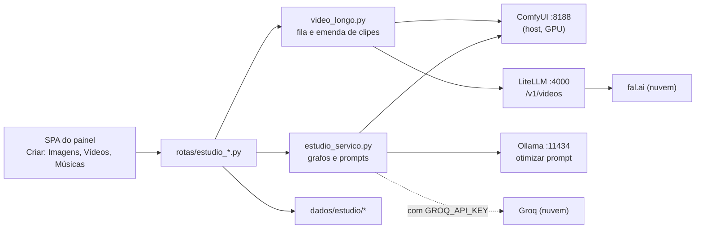

[🏠 TudoIA](../../README.md) › [📚 Documentação](../README.md) › 🎨 Estúdio

# 🎨 Estúdio de criação

> Para quem usa e mantém o Estúdio do painel. Responde: que mídia ele gera, em qual motor, com quais limites e custos,
> onde grava, quais rotas expõe e o que sai da máquina.

## 📑 Sumário

- [🎯 Visão geral](#-visão-geral)
- [🚀 Uso](#-uso)
- [⚙️ Opções](#️-opções)
- [🔬 Como funciona](#-como-funciona)
- [🔌 API](#-api)
- [❌ Erros e diagnóstico](#-erros-e-diagnóstico)
- [🛡️ Segurança e privacidade](#️-segurança-e-privacidade)
- [⚠️ Limitações conhecidas](#️-limitações-conhecidas)
- [❓ Perguntas frequentes](#-perguntas-frequentes)

---

## 🎯 Visão geral

O Estúdio é a parte criativa do [painel](painel.md): chat, imagem (com inpainting), vídeo (clipe único e "vídeo longo") e
música. Cada mídia roda em um ou mais motores:

| Mídia | Motores | Observação |
|---|---|---|
| Chat | LiteLLM (`/api/chat/completions`) | Modelo padrão `tudoia-auto` ([roteador.md](roteador.md)). |
| Imagem | ComfyUI local; Cloudflare Workers AI; Pollinations (opt-in); SVG de reserva | Ordem em [Imagem](#imagem-escolha-do-motor). |
| Inpainting | só ComfyUI | |
| Vídeo, clipe único | só ComfyUI | O campo `motor` de `POST /gerar-video` é ignorado. |
| Vídeo longo | ComfyUI ou nuvem (fal.ai, via LiteLLM) | A nuvem é paga por segundo e exige confirmação a cada pedido. |
| Música | só ComfyUI (YuE 2) | |

Código:

| Arquivo | Papel |
|---|---|
| `painel/tudoia_painel/rotas/estudio_catalogo.py` | `status-motores` e `catalogo-modelos`. |
| `rotas/estudio_imagem.py` | Gerar imagem, inpaint, otimizar prompt. |
| `rotas/estudio_video.py` | Clipe único, status de job, cancelar, otimizar prompt de vídeo. |
| `rotas/estudio_video_longo.py` | Vídeo longo: estimar, criar, listar, cancelar, retomar. |
| `rotas/estudio_musica.py` | Gerar música, otimizar estilo. |
| `rotas/estudio_arquivos.py` | Listar, servir e apagar saídas; upload. |
| `estudio_servico.py` | Grafos do ComfyUI montados em memória, perfis de vídeo, otimização de prompt, pastas. |
| `comfyui.py` | Valida nome de arquivo e parâmetros de `/view` vindos do ComfyUI. |
| `video_longo.py`, `video_nuvem.py`, `video_midia.py`, `midia_av.py` | Plano, executor, cliente de nuvem e montagem do MP4. |
| `midia.py` | Confere o conteúdo (bytes iniciais) do arquivo enviado. |
| `config/video-nuvem.yaml` | Catálogo dos modelos de vídeo em nuvem (preços, durações, parâmetros). |
| `runtime/comfyui/workflows/*.json` | Três fluxos de referência para abrir na interface do ComfyUI (ver abaixo). |

> [!NOTE]
> Os grafos que o painel envia ao ComfyUI são montados em memória no Python. Os JSON de `runtime/comfyui/workflows/`
> (`TUDOIA_Imagem_e_Inpainting.json`, `TUDOIA_Musica_TrilhaSonora.json`, `TUDOIA_Video_Cinematografico.json`) não são
> lidos por nenhum código do painel (busca em `*.py` sem ocorrência). Servem de referência visual para carregar na UI do
> ComfyUI; `config/modelos.yaml` os cita em `usado_por`. Se o grafo do código mudar, esses JSON podem ficar defasados.

## 🚀 Uso

### Pré-requisitos

1. **ComfyUI portable no host.** Pasta com `ComfyUI\` (`models`, `input`, `output`) e `run_nvidia_gpu.bat`. Caminho:
   `TUDOIA_COMFYUI_PORTABLE` no `.env`; vazio, o padrão é `modelos\comfyui\ComfyUI_windows_portable` na raiz
   (`caminhos.py`). Sobe pelo painel (Serviços) ou `iniciar.ps1`.
2. **Porta 8188 em `127.0.0.1`, fixa** (`upstreams.py`). Ollama (11434) e LiteLLM (4000) também são fixos.
3. **Pesos dos modelos** em `ComfyUI\models\`. Nomes exatos e download em [modelos.md](modelos.md) e `config/modelos.yaml`.
4. **Custom nodes para o LTX-2.3**: `ComfyUI-GGUF` e `ComfyUI-KJNodes` em `ComfyUI\custom_nodes\` (`NODES_LTX23` em
   `estudio_catalogo.py`). O modelo `video-ltx23` só aparece no catálogo quando os 5 arquivos de peso e as duas pastas
   existem. O `flux-schnell` local também usa os nós GGUF.
5. **GPU NVIDIA.** Antes de imagem, inpaint, vídeo e música, o painel descarrega da VRAM os modelos do Ollama
   (`_arbitrar_vram_para_estudio`, erros ignorados).

### Imagem

- Campos (`GerarImagemReq`, extras proibidos): `prompt` (1 a 4096), `prompt_negativo` (até 4096), `motor`
  (`auto` padrão, `comfyui`, outro), `modelo` (padrão `flux`), `aspect_ratio`, `seed` (0 a 2^32-1), `steps` (padrão 20,
  1 a 100), `otimizar_prompt` (padrão `false`).
- Proporções: `1:1` 1024x1024; `16:9` 1344x768; `9:16` 768x1344; `4:3` 1152x864; `3:4` 864x1152.
- **A otimização de prompt só roda se `otimizar_prompt` for `true`** (a SPA envia o botão "Melhorar com IA"; não há
  otimização implícita no servidor).

### Inpainting

- `POST /api/estudio/inpaint`: `imagem_base` (URL `/api/estudio/imagens/...`, `/api/estudio/uploads/...` ou só o nome
  dentro de `imagens`), `mascara_base64` (aceita data URL), `prompt`, `prompt_negativo`, `modelo`, `denoise` (padrão
  0,75; aceita 0,05 a 1,0), `seed`, `steps` (padrão 25) e `otimizar_prompt`.
- A máscara é lida pelo canal vermelho, ampliada em 6 px (`GrowMask`). O checkpoint padrão é
  `Juggernaut-XL_v9_RunDiffusionPhoto_v2.safetensors`; `modelo` no formato `local:<arquivo>.safetensors|.ckpt` troca o
  checkpoint se o arquivo existir em `models\checkpoints` e não for YuE.
- Espera até 180 s pelo resultado; depois responde 504 `tempo_esgotado`.

### Vídeo

- **Clipe único** (`POST /api/estudio/gerar-video`): `prompt`, `modelo` (padrão `video-minimax-h3`),
  `duracao_segundos` (1 a 60), `resolucao` (`480p`, `720p`, `1080p`), `fps` (8 a 60), `modo_origem` (`t2v`, `i2v`, `v2v`),
  `arquivo_referencia`, `modo_execucao` (`sync` padrão ou `async`). `i2v` e `v2v` exigem arquivo de referência enviado
  antes por `POST /upload`. O arquivo é resolvido só dentro da pasta de uploads.
- **Modelos locais**: MiniMax H3 (vídeo com áudio), Wan 2.2 T2V 14B, Wan 2.2 I2V 14B, Wan 2.2 TI2V 5B e LTX-2.3
  distilled GGUF (com áudio). O catálogo vem dos arquivos em `ComfyUI\models`.
- **Vídeo longo** (`POST /api/estudio/video-longo`): `prompt`, `motor` (`comfyui` padrão ou `nuvem`), `modelo`,
  `duracao_segundos` (1 a 60), `resolucao` (`480p` ou `720p`), `modo` (`continuo` ou `cenas`), `cenas` (até 12, 1 a 2000
  caracteres cada), `seed`, `arquivo_referencia`, `trilha` (nome de arquivo de `dados\estudio\musicas`) e
  `confirmar_nuvem`. Se o trabalho para (erro, cancelamento, painel reiniciado), use **Retomar**.

### Música

- Modelo: YuE 2 (`musica-yue2`). Campos (`GerarMusicaReq`): `style` (1 a 4096), `lyrics` (padrão `[instrumental]`, até
  8192), `duracao_segundos` (5 a 360, padrão 30), `modo` (`full` ou `melody`; o nó YuE2 não aceita outro), `seed`,
  `otimizar_prompt`.

### Galeria

A galeria da interface guarda o que foi gerado na sessão da página. Os arquivos ficam em disco e voltam por
`GET /api/estudio/imagens`, `/videos` e `/musicas`.

## ⚙️ Opções

Variáveis do `.env` lidas pelo Estúdio (só nomes; padrões completos em [configuracao.md](../configuracao.md)):

| Variável | Padrão | Efeito |
|---|---|---|
| `TUDOIA_COMFYUI_PORTABLE` | `modelos\comfyui\ComfyUI_windows_portable` | Pasta do ComfyUI portable. |
| `CLOUDFLARE_API_KEY` e `CLOUDFLARE_ACCOUNT_ID` | vazio | Imagem pela Cloudflare Workers AI. Sem as duas, a rota é ignorada. |
| `TUDOIA_ESTUDIO_POLLINATIONS` | desligado | Só o valor `1` liga o Pollinations (o prompt vai na URL a um serviço público). |
| `GROQ_API_KEY` | vazio | Otimização de prompt pela Groq. Sem ela, usa o Ollama local. **O texto do prompt sai da máquina.** |
| `FAL_AI_API_KEY` | vazio | Habilita os modelos de vídeo em nuvem (campo `chave` de cada modelo em `video-nuvem.yaml`). Depois de gravar, gere o config do LiteLLM e recrie o container `litellm`. |
| `TUDOIA_VIDEO_NUVEM_TETO_USD` | sem teto | Teto em US$ por vídeo longo na nuvem. Valor não numérico equivale a "sem teto". |
| `LITELLM_MASTER_KEY` | gerada | Chave usada para chamar `/v1/videos` e o chat. |

### Limites das rotas

| Item | Limite | Onde |
|---|---|---|
| Corpo JSON comum | 10 MB | `seguranca.py` |
| `POST /api/estudio/upload` | 140 MB de corpo (base64), 100 MB de arquivo decodificado | `seguranca.py`, `midia.py` |
| Extensões de upload | imagem: `.png .jpg .jpeg .webp .bmp .gif`; vídeo: `.mp4 .mov .webm .avi .mkv` | `estudio_arquivos.py` |
| Conteúdo do upload | os bytes iniciais precisam bater com a extensão (`midia_confere`), senão 422 | `midia.py` |
| Jobs de vídeo assíncronos em memória | 200 (os mais antigos saem) | `MAX_JOBS_VIDEO` |
| Vídeo longo: duração total | 60 s; no máximo 12 cenas | `video_longo.py` |
| Vídeo longo: trabalhos guardados | 50 mais recentes | `MAX_TRABALHOS_GUARDADOS` |
| Vídeo longo: tempo por clipe | 60 min local, 30 min nuvem | `TIMEOUT_CLIPE_LOCAL_S`, `TIMEOUT_CLIPE_NUVEM_S` |
| Download de clipe da nuvem | 1 GB; quadro inicial em JPEG até 8 MB | `video_nuvem.py` |

## 🔬 Como funciona

### Imagem: escolha do motor

`gerar_imagem` (`rotas/estudio_imagem.py`) segue esta ordem:

1. Modelo `local:<arquivo>` ou motor `comfyui` com a porta 8188 fechada: 503 `servico_offline` com
   `extras.servico_offline = "comfyui"`. Não tenta outro motor.
2. ComfyUI online e motor `auto` ou `comfyui` (ou modelo local): descarrega o Ollama da VRAM e executa o grafo. Falha de
   um modelo `local:` responde 502 `falha_motor`; nos demais casos o fluxo segue para a nuvem.
3. **Cloudflare Workers AI**, com as duas variáveis e modelo `cf-*`, `flux`, `turbo`, `flux-anime` ou `auto`:
   FLUX.1 Schnell (`cf-flux`, `flux`; `steps` limitado a 8), SDXL base 1.0 (`cf-sdxl`, `turbo`) ou DreamShaper 8 LCM
   (`cf-dreamshaper`, `flux-anime`). Timeout de 45 s; qualquer falha segue adiante.
4. **Pollinations**, só com `TUDOIA_ESTUDIO_POLLINATIONS=1`. Timeout de 35 s.
5. **SVG de reserva** (motor `estudio`), com o início do prompt escapado por `html.escape`. Se o Pollinations estava
   desligado, a resposta traz `aviso`.

Cada geração entra no histórico visual em memória (`HISTORICO_VISUAL`, 60 entradas, exibido em
`/api/telemetria` como `feed_visual`).

### Vídeo de clipe único

- O grafo é escolhido por `_preparar_grafo_video` conforme o nome do modelo (`ltx`, `minimax`/`h3`, `i2v`, `5b`,
  `wan14b-t2v`).
- Dimensões (`res_dims`): MiniMax 768x768 em 480p e 1344x768 em 720p; Wan e LTX 832x480 em 480p e 1280x704 em 720p;
  **1080p gera o mesmo tamanho de 720p**. Wan 14B I2V usa 640x640.
- Quadros por modelo (`PERFIS_VIDEO_LOCAL`, `quadros_video`). O grafo grava no fps do modelo; o `fps` pedido não muda a
  duração:

  | Modelo | fps | Grade de quadros | Clipe máximo | 5 s viram |
  |---|---|---|---|---|
  | Wan 2.2 5B | 24 | 4n+1 | 5 s | 121 |
  | Wan 2.2 14B (T2V e I2V) | 16 | 4n+1 | 5 s | 81 |
  | MiniMax H3 | 24 | 17k+5, para cima | 10 s | 124 |
  | LTX-2.3 | 24 | 8n+1 | 20 s em 480p, 10 s em 720p (`max_segmento_video_local`) | 121 |

- LTX-2.3 (`_grafo_ltx23`): distilled Q4_K_S em GGUF, um estágio de 8 passos (sigmas fixos), sem upscaler de latente,
  vídeo e áudio juntos.
- **Job**: `sync` espera até 600 s no histórico do ComfyUI e copia o vídeo de `ComfyUI\output\video` para
  `dados\estudio\videos`; `async` devolve `job_id` e a SPA consulta `GET /status-video/{job_id}`. Os jobs ficam em memória
  (`_jobs_video`); depois de reiniciar o painel a consulta ainda funciona enquanto o ComfyUI mantiver o histórico.
- **Cancelar** (`POST /cancelar`): com `prompt_id`, cancela só aquele trabalho (`/api/jobs/{id}/cancel`, com `interrupt`
  como alternativa em ComfyUI antigo); sem corpo, interrompe o que estiver rodando.

### Vídeo longo

1. **Plano** (`planejar_segmentos`): o menor número de clipes, os mais parecidos possíveis, cada um numa duração aceita
   pelo motor. Local: 1 s até o máximo do perfil. Nuvem: `duracoes_validas()` do modelo no YAML. A montagem corta no total
   pedido, mas a nuvem cobra o clipe inteiro.
2. **Roteiro**: modo `continuo` usa a mesma descrição em todos os clipes. Modo `cenas` usa o roteiro digitado; sem roteiro, o
   Ollama local divide a descrição (`dividir_em_cenas`; resposta inválida cai em "Scene N of M").
3. **Continuidade**: no modo contínuo o último quadro de cada clipe vira o quadro inicial do seguinte. Modelo de nuvem sem
   endpoint de imagem continua só pelo texto. A seed de cada clipe é a do pedido mais o índice.
4. **Execução**: uma thread daemon (`video-longo`) roda um trabalho por vez, consultando a cada 3 s. Falha transitória
   (rede, 429, 5xx) é repetida até 4 vezes, com backoff exponencial limitado a 60 s e jitter. Timeout no envio à nuvem não
   é repetido, porque o pedido pode ter chegado ao provedor e repetir cobraria duas vezes.
5. **Estado em disco**: `dados/estudio/video-longo/<id>/trabalho.json` (id `vl_` + 12 hex), gravado a cada passo. Ao subir,
   o que estava em andamento volta como `interrompido`; nada recomeça sozinho. **Retomar** pula clipes prontos e reconsulta
   pelo id o clipe já enviado à nuvem. Na nuvem, retomar pede a confirmação de novo.
6. **Montagem** (`midia_av.py`, via `video_midia.py`): roda com o `python_embeded` do ComfyUI em modo isolado (`-I`), que já
   traz o PyAV; o painel não instala FFmpeg. Clipes são redimensionados para as dimensões do primeiro e reamostrados para o
   fps dele. Saída H.264 com AAC 48 kHz em `dados/estudio/videos/video_longo_<id>.mp4`. A trilha, quando escolhida,
   substitui o som dos clipes. Timeout da montagem: 1800 s. Sem o `python_embeded`, criar vídeo longo responde 503.
7. **Nuvem**: o painel chama `POST /v1/videos` do LiteLLM com o modelo fixado em `video/<nome>` (ou `video/<nome>-i2v`),
   nunca pelo `tudoia-auto`; depois consulta `GET /v1/videos/{id}` e baixa `GET /v1/videos/{id}/content`. Os deployments
   `video/*` são gerados por `gerador.py` a partir de `config/video-nuvem.yaml`, só para modelos com a chave no `.env`,
   fora de grupos e fallbacks (um pedido pago nunca troca de provedor sozinho).
8. **Confirmação e teto**: sem `confirmar_nuvem: true`, 422 `confirmacao_necessaria` com a estimativa; sem a chave, 422
   `chave_ausente`; estimativa acima de `TUDOIA_VIDEO_NUVEM_TETO_USD`, 422 `acima_do_teto`; LiteLLM fora do ar, 503.

Modelos de nuvem do catálogo atual (`config/video-nuvem.yaml`, preços de 2026-10-30, estimativa): `wan-3`, `minimax-h3`,
`kling-3`, `seedance-2-fast` e `ltx-23-fast`, todos com `FAL_AI_API_KEY`. O arquivo é a fonte de duração, resolução e preço
por segundo; os preços mudam sem aviso.

### Música

O grafo YuE 2 é montado em memória com estilo, letra, seed e duração. O servidor espera até 300 s pelo histórico e copia o
áudio de `ComfyUI\output\audio` (ou `output`) para `dados\estudio\musicas` com prefixo `comfy_audio_`.

### Otimização de prompt

Imagem, vídeo e música têm funções próprias (`otimizar_prompt_visual`, `_otimizar_prompt_video`,
`_otimizar_prompt_musica`) com a mesma lógica:

1. Texto com 30 palavras ou mais, sem acento e sem termos em português da lista interna: devolvido como está.
2. Com `GROQ_API_KEY`: chama a API da Groq (`qwen/qwen3.8-27b`, timeout de 6 s).
3. Senão, ou se falhar: chama o Ollama local (modelo `qwen3.*` detectado no servidor; timeout de 30 s).
4. Se tudo falhar: devolve o original, sem erro.

### Armazenamento

| Pasta | Conteúdo |
|---|---|
| `dados/estudio/imagens` | PNG/JPG gerados, resultados de inpaint, SVG de reserva |
| `dados/estudio/videos` | MP4 gerados, inclusive `video_longo_<id>.mp4` |
| `dados/estudio/video-longo/<id>` | `trabalho.json`, clipes e quadros intermediários |
| `dados/estudio/musicas` | Áudio do YuE 2 |
| `dados/estudio/uploads` | Referências enviadas (`upload_<epoch>_<8 hex>_<nome>.<ext>`) |
| `ComfyUI\input` | Cópias de base, máscara e imagem de upload criadas pelo painel |
| `ComfyUI\output\video`, `ComfyUI\output\audio` | Saída original do ComfyUI |

`dados/` é de execução e não vai para o git. `DELETE /api/estudio/videos/{nome}` apaga o arquivo de `dados\estudio\videos`
**e** a cópia em `ComfyUI\output\video`.

## 🔌 API

Tabela gerada dos decoradores em `rotas/estudio_*.py` e `rotas/chat.py`. Papel mínimo para alterar: operador.

| Método | Rota | O que faz |
|---|---|---|
| GET | `/api/estudio/status-motores` | `{litellm, ollama, comfyui}` (porta aberta ou não). |
| GET | `/api/estudio/catalogo-modelos` | Modelos locais (checkpoints, unet, diffusion_models), fluxos e nuvem. |
| POST | `/api/estudio/otimizar-prompt` | Traduz e enriquece prompt de imagem. |
| POST | `/api/estudio/otimizar-prompt-video` | Idem, vídeo. |
| POST | `/api/estudio/otimizar-prompt-musica` | Idem, estilo musical. |
| POST | `/api/estudio/gerar-imagem` | Gera imagem. |
| POST | `/api/estudio/inpaint` | Regenera a região marcada. |
| POST | `/api/estudio/gerar-video` | Clipe único, local. |
| GET | `/api/estudio/status-video/{job_id}` | Estado de um job assíncrono. |
| POST | `/api/estudio/cancelar` | Cancela um trabalho (`prompt_id` opcional) ou interrompe a execução atual. |
| POST | `/api/estudio/video-longo/estimar` | Plano de clipes e custo, sem efeito colateral. |
| POST | `/api/estudio/video-longo` | Cria o trabalho. |
| GET | `/api/estudio/video-longo` | Lista trabalhos recentes. |
| GET | `/api/estudio/video-longo/{tid}` | Um trabalho (fase, clipes prontos, URL final). Caminhos de disco não aparecem: só nomes. |
| POST | `/api/estudio/video-longo/{tid}/cancelar` | Cancela (o clipe já enviado à nuvem é cobrado). |
| POST | `/api/estudio/video-longo/{tid}/retomar` | Retoma do clipe que faltou (nuvem exige `confirmar_nuvem`). |
| POST | `/api/estudio/gerar-musica` | Compõe música. |
| POST | `/api/estudio/upload` | Envia imagem ou vídeo em base64 (`tipo` `imagem` ou `video`). |
| GET | `/api/estudio/uploads/{nome_arquivo}` | Serve um upload. |
| GET | `/api/estudio/imagens`, `/videos`, `/musicas` | Lista os arquivos de cada pasta. |
| GET, DELETE | `/api/estudio/imagens/{nome_arquivo}`, `/videos/{nome_arquivo}`, `/musicas/{nome_arquivo}` | Serve ou apaga um arquivo. |
| POST | `/api/chat/completions` | Chat pelo LiteLLM (`ChatReq`: `model` padrão `tudoia-auto`, 1 a 100 mensagens, `temperature` 0 a 2, `max_tokens` 16 a 16384). |

Rotas de arquivo passam por `arquivo_em` (`estudio_servico.py`): a pasta permitida e o alvo são resolvidos, e só vale
arquivo dentro dela (`is_relative_to`). `..` e caminho absoluto são recusados.

## ❌ Erros e diagnóstico

Formato de erro e códigos gerais: [painel.md](painel.md#-erros-e-diagnóstico). Códigos específicos do Estúdio:

| Sintoma | Código | Causa | Ação |
|---|---|---|---|
| 503 ao gerar imagem, vídeo, música ou inpaint | `servico_offline` (`extras.servico_offline`: `comfyui` ou `litellm`) | Porta 8188 (ou 4000) fechada | Serviços → iniciar ComfyUI. O painel não troca de motor sozinho. |
| 502 `falha_motor` | `falha_motor` | O ComfyUI recusou o grafo (`node_errors`), faltam pesos ou custom nodes | Veja `dados\logs\comfyui.log` e confira os arquivos em `ComfyUI\models`. |
| 504 no inpaint | `tempo_esgotado` | ComfyUI não terminou em 180 s | Reduza `steps` ou veja a fila no ComfyUI. |
| 404 `nao_encontrado` em `i2v`/`v2v` | `nao_encontrado` | Referência não está em `dados\estudio\uploads` | Envie o arquivo de novo por `POST /upload`. |
| 422 `validacao` em `i2v`/`v2v` sem referência | `validacao` | Modo exige mídia | Informe `arquivo_referencia`. |
| 422 no upload | `validacao` | Extensão não permitida ou conteúdo que não bate com a extensão | Envie um arquivo válido. |
| 413 no upload | `corpo_grande_demais` | Arquivo acima de 100 MB | Reduza o arquivo. |
| 422 `chave_ausente` | `chave_ausente` | A chave do modelo de nuvem não está no `.env` | Grave a chave em Chaves e segredos. |
| 422 `confirmacao_necessaria` | `confirmacao_necessaria` | Pedido de nuvem sem `confirmar_nuvem: true` | Confirme na interface após ver a estimativa. |
| 422 `acima_do_teto` | `acima_do_teto` | Estimativa maior que `TUDOIA_VIDEO_NUVEM_TETO_USD` | Reduza a duração ou ajuste o teto. |
| 503 em vídeo longo, mensagem sobre Python do ComfyUI | `servico_offline` | `python_embeded\python.exe` não existe no portable | Confira `TUDOIA_COMFYUI_PORTABLE`. |
| Vídeo longo "interrompido" | (estado) | Painel reiniciou durante a geração | Use Retomar. |
| Imagem sai como SVG com `aviso` | (campo `aviso`) | Nenhum motor respondeu e o Pollinations está desligado | Inicie o ComfyUI ou configure Cloudflare. |
| `Invalid model name` em modelo de nuvem | LiteLLM | `config.yaml` regenerado sem reiniciar o container | Recrie o `litellm`. |

## 🛡️ Segurança e privacidade

- **O que sai da máquina**: a Groq recebe o prompt quando há `GROQ_API_KEY` e a otimização é pedida. O Pollinations recebe o
  prompt na URL só com `TUDOIA_ESTUDIO_POLLINATIONS=1`. No vídeo longo em nuvem, a fal.ai recebe a descrição de cada clipe e
  os quadros de referência (imagem enviada e últimos quadros dos clipes), só depois da confirmação. Para dado confidencial,
  fique em ComfyUI local e sem Groq (IA-PRV-01, IA-PRV-03).
- **Gasto**: nuvem é paga por segundo gerado; a estimativa é obrigatória antes, a confirmação é por pedido, o teto é
  opcional e os deployments de vídeo ficam fora de fallback.
- **Entradas do ComfyUI são tratadas como não confiáveis** (`comfyui.py`): `filename`, `subfolder` e `type` vindos do
  histórico são validados (sem separador, `..`, unidade ou byte nulo) antes de virar caminho ou query.
- **Caminhos**: leitura e exclusão só dentro das pastas do Estúdio; referência de vídeo só em `uploads`; imagem-base de
  inpaint só em `imagens` ou `uploads`.
- **Upload**: extensão em lista, tamanho conferido antes de decodificar, conteúdo conferido pelos bytes iniciais, nome
  sanitizado com prefixo único.
- **Segredos**: a chave da nuvem viaja só para o LiteLLM ou para o provedor; o corpo de nenhuma rota do Estúdio é gravado na
  auditoria ([painel.md](painel.md#️-segurança)).

## ⚠️ Limitações conhecidas

1. 1080p gera a mesma resolução de 720p.
2. `POST /gerar-video` é só local; a nuvem entra pelo vídeo longo.
3. Portas fixas: ComfyUI 8188 e Ollama 11434 não são configuráveis.
4. Jobs de vídeo assíncronos e histórico visual ficam em memória; reiniciar o painel os apaga.
5. Preço da nuvem é estimativa copiada das páginas do provedor; cancelar não devolve clipe já enviado.
6. Emendas no modo contínuo: o movimento recomeça a cada clipe e cor ou identidade podem se desviar ao longo de muitos
   clipes.
7. O arquivo SVG de reserva é servido como `application/octet-stream`; a exibição no `` não foi verificada.
8. A contagem do histórico, as dimensões e as versões de nós acima vêm da leitura do código. Nenhuma geração real (GPU ou
   nuvem paga) foi executada na verificação deste documento.

## ❓ Perguntas frequentes

**Por que o painel não trocou para a nuvem quando o ComfyUI caiu no meio de um vídeo?** Vídeo local e nuvem são fluxos
separados; o pedido de nuvem exige confirmação e custa dinheiro, então nunca é automático.

**Posso trocar o checkpoint do inpaint?** Sim: `modelo: "local:<arquivo>.safetensors"` com o arquivo em
`ComfyUI\models\checkpoints`. Qualquer outro valor usa o Juggernaut XL.

**Onde fica o vídeo final do vídeo longo?** `dados\estudio\videos\video_longo_<id>.mp4`; os clipes intermediários ficam em
`dados\estudio\video-longo\<id>`.

---

[🏠 README](../../README.md) · ⬅️ [Painel](painel.md) · [Roteador](roteador.md) ➡️
