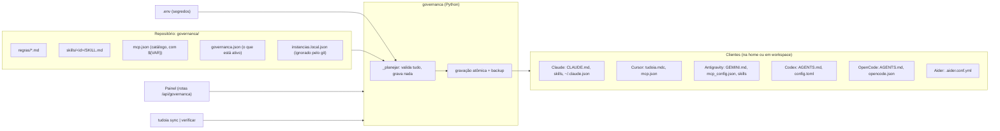

[🏠 TudoIA](../../README.md) › [📚 Documentação](../README.md) › 🧭 Governança

# 🧭 Governança

> Para quem mantém o TudoIA e para quem administra os clientes de IA da máquina (Claude Code, Cursor, Antigravity, Codex,
> OpenCode, Aider). Responde: o que a governança distribui, de onde vem, o que ela grava em cada cliente, como
> não vazar segredo nesse caminho e como adicionar regra, skill ou servidor MCP.

## 📑 Sumário

- [🎯 Visão geral](#-visão-geral)
- [🚀 Uso](#-uso)
- [⚙️ Opções](#️-opções)
  - [Fonte única](#fonte-única)
  - [`governanca.json`](#governancajson)
  - [Instâncias de cliente](#instâncias-de-cliente)
  - [O que o `sync` escreve](#o-que-o-sync-escreve)
  - [Catálogo de MCP](#catálogo-de-mcp)
  - [Catálogo de skills](#catálogo-de-skills)
- [🔧 Como funciona](#-como-funciona)
- [❌ Erros e diagnóstico](#-erros-e-diagnóstico)
- [🛡️ Segurança](#️-segurança)
- [🧪 Testes](#-testes)
- [❓ Perguntas frequentes](#-perguntas-frequentes)

---

## 🎯 Visão geral

A governança mantém regras de engenharia, skills e servidores MCP num lugar só (`governanca/`) e os distribui para os
clientes de IA instalados na máquina. Você edita a fonte única; o `sync` escreve os arquivos de cada cliente; o `verificar`
acusa quando um cliente saiu de sincronia. O módulo é Python puro (biblioteca padrão), em `governanca/__init__.py`.

A interface pública (`sincronizar`, `verificar`, `aplicar_mcp_claude`, `aplicar_mcp_opencode`, `aplicar_tudo`,
`detectar_instancias`, `ErroGovernanca`) e as regras de comportamento estão no [`SPEC.md`](../../SPEC.md). Este documento
não repete o contrato: descreve a operação e aponta divergências de uso.



Quem chama o módulo:

- **Linha de comando** (`tudoia sync`, `tudoia verificar`): chama `sincronizar` e `verificar`. O `MCP` do Claude Code e do
  OpenCode **não** é escrito por aqui.
- **Painel** (`painel/tudoia_painel/rotas/governanca.py`): chama `aplicar_tudo`, que valida Claude, OpenCode,
  Antigravity, Cursor, Codex e regras numa fase só e só então grava.
- O `up` do `scripts/tudoia.ps1` roda `sync` antes de subir os containers; se o `sync` falhar, o `up` para.

A integração com a Doutrina TEC (skill e MCP `doutrina-tec`, versão fixada, cartão do painel) tem guia próprio:
[doutrina.md](doutrina.md).

## 🚀 Uso

| Comando | Equivalente | O que faz |
|---|---|---|
| `.\scripts\tudoia.ps1 sync` | `python -m tudoia_painel sync` | Escreve os arquivos gerados. Uma linha por alvo: `igual`, `atualizado` ou `removido` (skill gerenciada órfã) |
| `.\scripts\tudoia.ps1 verificar` | `python -m tudoia_painel verificar` | Lista divergências (`ausente`, `divergente`, skill órfã). Não escreve. Sai com código 1 se houver alguma; sem drift imprime `tudo em sincronia` |

Fluxo comum de mudança:

1. Edite `governanca/regras/*.md`, `governanca/skills/<id>/` ou `governanca/mcp.json`, e ative o id em `governanca.json`.
2. `.\scripts\tudoia.ps1 verificar` mostra o que vai mudar.
3. `.\scripts\tudoia.ps1 sync` grava. Rodar de novo devolve `igual` em tudo.

Pelo painel (aba de governança), o botão **Sincronizar com os clientes** equivale ao `sync` mais a escrita de MCP do
Claude e do OpenCode. O painel também cria regras, skills e servidores MCP, testa um MCP (`POST /api/governanca/mcp/{id}/testar`)
e gerencia instâncias (`/api/governanca/instancias`, com `POST .../detectar`).

### Adicionar uma regra

Crie `governanca/regras/<id>.md` (en-us, curta: ela vai em toda mensagem de todo cliente; temas específicos pertencem a
skills) e acrescente o id em `regras` de `governanca.json`. A ordem da lista é a ordem no bloco gerenciado. Regras de
comportamento de agente moram aqui; regras de engenharia moram na Doutrina (ECO-MAP-01).

### Adicionar uma skill

1. Crie `governanca/skills/<id>/SKILL.md`, com cabeçalho `---` contendo `name` e `description`. O id aceita letras,
   números, `.`, `_` e `-`, e não pode começar com `.`.
2. Acrescente `<id>` em `skills` de `governanca.json`.
3. `verificar` (deve apontar `ausente` nas cópias) e depois `sync`.
4. Registre origem e licença em `governanca/ORIGEM.md` na mesma mudança.

Pelo painel: `POST /api/governanca/skills` cria; `POST /api/governanca/skills/importar` baixa de um repositório do GitHub
(ver [Segurança](#️-segurança)).

### Adicionar um servidor MCP

1. Acrescente a entrada em `mcpServers` de `governanca/mcp.json`. Servidor por `npx`, com versão fixa:

   ```json
   "meu-servidor": {
     "command": "npx",
     "args": ["-y", "@dono/pacote@1.2.3"],
     "env": { "MINHA_CHAVE": "${MINHA_CHAVE}" },
     "description": "O que o servidor faz"
   }
   ```

   Servidor HTTP: `"type": "http"` e `"url"` (como `cerebro`, `github`, `vercel`).
2. `${VAR}` é obrigatória: se faltar ou estiver vazia no `.env`, o `sync` recusa. `${VAR:-}` é opcional.
3. Ponha o valor no `.env` (ou na aba Segredos do painel, para admin). Nunca no `mcp.json`.
4. Acrescente o id em `mcp` de `governanca.json` e rode `sync`.

Fixe a versão do pacote (`@1.2.3`), nunca `@latest`. A aba Segredos lista como "MCP: &lt;id&gt;" as variáveis que aparecem em
`${...}` no `env`, nos `args` ou na `url` do servidor.

## ⚙️ Opções

### Fonte única

| Arquivo | Conteúdo |
|---|---|
| `governanca/governanca.json` | O que está ativo: `regras`, `skills`, `mcp`, `workspaces`, `clientes`, `instancias` |
| `governanca/instancias.local.json` | Instâncias da sua máquina (`{"instancias": [...]}`). Ignorado pelo git; **tem precedência** sobre `instancias` de `governanca.json`. Malformado é erro, nunca lista vazia |
| `governanca/regras/*.md` | `system-first.md`, `operational-safety.md`, `ai-data-privacy.md`, `ponytail.md` |
| `governanca/skills/<id>/` | `SKILL.md` e arquivos extras (`references/`, `LICENSE.txt`) |
| `governanca/mcp.json` | Catálogo de servidores MCP (`mcpServers`), com `${VAR}` |
| `governanca/doutrina.json` | Versão fixada da Doutrina TEC (ver [doutrina.md](doutrina.md)) |
| `governanca/ORIGEM.md`, `governanca/LICENSE-agent-skills` | Origem, commit copiado, alterações e licença das skills de terceiros |

Só o `.env` guarda segredos. O `mcp.json` referencia `${NOME}`; o valor real não entra no repositório.

### `governanca.json`

| Chave | Efeito |
|---|---|
| `regras` | Ids de `regras/`, na ordem em que entram no bloco gerenciado. Id inexistente: erro |
| `skills` | Ids a copiar. Cada um precisa de `skills/<id>/SKILL.md`. Atualmente 23 |
| `mcp` | Ids do `mcp.json` a ativar. Id fora do catálogo: erro. Atualmente 9 ativos de 11 no catálogo |
| `workspaces` | Pastas de projeto que recebem `AGENTS.md` (e, no modo legado, `.cursor/rules/tudoia.mdc`). Pasta inexistente: erro, e o `sync` recusa tudo. No repositório está `[]` |
| `clientes` | Tipos do **modo legado**, usado só quando `instancias` está vazio ou ausente |
| `instancias` | Uma entrada por perfil de cliente (abaixo). Se presente e não vazia, substitui `clientes` |

Ativos hoje em `mcp`: `context7`, `cerebro`, `playwright`, `sequential-thinking`, `fetch`, `vercel`, `microsoft-learn`,
`serena`, `doutrina-tec`. No catálogo mas inativos: `supabase`, `github`. Inativo no `governanca.json` significa que
o painel **remove** o id dos arquivos do cliente.

### Instâncias de cliente

| Campo | Significado |
|---|---|
| `id` | Único. Letras, números, `.`, `_`, `-` |
| `cliente` | `claude`, `antigravity`, `cursor`, `codex`, `opencode`, `aider` ou `workspace`. Outro valor: erro |
| `nome` | Rótulo na tela |
| `caminho` | Pasta do cliente (`~/.claude`, `~/.gemini`...). `~` é a home. Fora da home e dos workspaces: recusado |
| `config_json` | Arquivo de configuração de MCP, se não for o padrão |
| `ativo` | `false` pula a instância sem apagá-la (padrão `true`) |

Padrões de `config_json`: Claude `<caminho>/.claude.json` ou `~/.claude.json` conforme a instância; Antigravity
`<caminho>/config/mcp_config.json`; Cursor `~/.cursor/mcp.json`; Codex `<caminho>/config.toml`; OpenCode
`<caminho>/opencode.json`. Instâncias `cursor` e `workspace` ativas também viram raízes de workspace (a regra de segredo
muda, ver [Segurança](#️-segurança)). `detectar_instancias` só lê o disco e sugere entradas (Claude padrão e perfis
`~/.claude-*`, Antigravity, Codex, Aider, Cursor por workspace existente); quem grava é o painel, só para admin.

### O que o `sync` escreve

Modo com `instancias` (o atual). `~` é a home do usuário.

| Alvo | Arquivo | Como é escrito |
|---|---|---|
| `agents:<workspace>` | `<workspace>/AGENTS.md` | Bloco gerenciado |
| `claude:<id>` | `<caminho>/CLAUDE.md` | Bloco gerenciado |
| `claude:<id>:skill:...` | `<caminho>/skills/<skill>/...` | Cópia de cada arquivo, mais o marcador `.tudoia` |
| `antigravity:<id>` | `<caminho>/GEMINI.md` | Bloco gerenciado |
| `antigravity:<id>:mcp` | `config_json` (padrão `<caminho>/config/mcp_config.json`) | Só as entradas de `mcpServers` do catálogo |
| `antigravity:<id>:skill:...` | `<caminho>/antigravity-cli/skills/...` | Cópia, mais `.tudoia` |
| `cursor:<id>` | `<caminho>/.cursor/rules/tudoia.mdc` | Arquivo inteiro, com `alwaysApply: true` |
| `cursor:mcp:<arquivo>` | `~/.cursor/mcp.json` (ou `config_json`; nunca a pasta da instância) | Só as entradas do catálogo |
| `codex:<id>` | `<caminho>/AGENTS.md` | Bloco gerenciado |
| `codex:<id>:mcp` | `config_json` (padrão `<caminho>/config.toml`) | Só as tabelas `[mcp_servers.<id>]` do catálogo |
| `opencode:<id>` | `<caminho>/AGENTS.md` | Bloco gerenciado. O `opencode.json` é do painel |
| `aider:<id>:conf` | `<caminho>/.aider.conf.yml` | Arquivo inteiro gerado: endpoint do roteador (`http://127.0.0.1:4000/v1`), modelos `openai/tudoia-codigo` e `openai/tudoia-local`, aliases por grupo |
| `aider:<id>:metadata` | `<caminho>/.aider.model.metadata.json` | Arquivo inteiro: um bloco por grupo do roteador (30000 tokens de entrada, 4096 de saída, custo 0) |
| `workspace` (instância) | `<caminho>/AGENTS.md` | Bloco gerenciado |

Sem escrita pelo `sync`: o `mcpServers` do `~/.claude.json` e a seção `mcp` do `opencode.json`. Esses dois são do painel
(`aplicar_mcp_claude`, `aplicar_mcp_opencode`, ou `aplicar_tudo`).

O Aider usa os grupos de `- model_name:` de `runtime/litellm/config.yaml` (se o arquivo existir e tiver grupos) ou, como
reserva, `tudoia-auto`, `tudoia-codigo`, `tudoia-local`, `tudoia-local-agente`, `tudoia-nuvem`. A chave
`openai-api-key` recebe o valor de `LITELLM_MASTER_KEY` do `.env` só quando a pasta está sob a home; em workspace sai
`${LITELLM_MASTER_KEY}` literal. Sem a variável, o arquivo traz um comentário pedindo para defini-la.

Modo legado (`instancias` vazio): usa `clientes` e `workspaces` com os caminhos padrão na home (`~/.claude`, `~/.gemini`,
`~/.codex`, `~/.cursor/mcp.json`, Aider em `~`).

### Catálogo de MCP

Versões fixas, conferidas em `governanca/mcp.json`:

| Id | Transporte | Fonte | Variáveis do `.env` |
|---|---|---|---|
| `context7` | stdio (`npx`) | `@upstash/context7-mcp@4.4.4` | `CONTEXT7_API_KEY` |
| `supabase` | stdio (`npx`) | `@supabase/mcp-server-supabase@0.15.0`, `--read-only`, um projeto | `SUPABASE_ACCESS_TOKEN`, `SUPABASE_PROJECT_REF` |
| `cerebro` | http | `http://127.0.0.1:8765/mcp`, cabeçalho `Authorization: Bearer` | `CEREBRO_TOKEN_ESTATICO` |
| `github` | http | `https://api.githubcopilot.com/mcp/` | `GITHUB_PERSONAL_ACCESS_TOKEN` |
| `playwright` | stdio (`npx`) | `@playwright/mcp@0.0.84` | nenhuma |
| `sequential-thinking` | stdio (`npx`) | `@modelcontextprotocol/server-sequential-thinking@2.0.0` | nenhuma |
| `fetch` | stdio (`npx`) | `@tokenizin/mcp-npx-fetch@1.0.0` | nenhuma |
| `vercel` | http | `https://mcp.vercel.com` | nenhuma (OAuth no cliente) |
| `microsoft-learn` | stdio (`npx`) | `mcp-remote@0.16.0` para `https://learn.microsoft.com/api/mcp` | nenhuma |
| `serena` | stdio (`serena`) | `serena start-mcp-server` | nenhuma |
| `doutrina-tec` | stdio (`${TUDOIA_PYTHON}`) | `${DOUTRINA_TEC}/tools/mcp_doutrina.py` | `DOUTRINA_TEC`, `TUDOIA_PYTHON` |

Cada cliente recebe o catálogo traduzido para o próprio formato: o OpenCode usa `{"type": "remote", "url", "headers"?}`
para `http`/`sse` e `{"type": "local", "command": [...], "environment"?}` para stdio, sempre `"enabled": true`; o Cursor
e o Codex têm tradução própria (no Windows o Codex roda `npx` por `cmd /c`).

**Serena.** Instalada à parte (`uv tool install -p 3.13 "serena-agent==<versão>"`; confira a versão na documentação da
Serena antes de instalar: o `mcp.json` não fixa a versão porque o binário é `serena`, não um pacote `npx`). Os argumentos do
catálogo são obrigatórios: `--context=ide` (tira ferramentas de shell e de arquivo genérico), `--agent-interface tools`
(com a interface REPL padrão da v2, excluir ferramentas não impede nada), `--open-web-dashboard false` (sem isso cada
cliente abre uma aba do navegador) e `--project-from-cwd`. A Serena cria `.serena/` em cada projeto; o `.gitignore` do
TudoIA já a ignora.

### Catálogo de skills

23 ids ativos em `governanca.json`, uma pasta cada em `governanca/skills/`. Origem, commit copiado e alterações de cada
uma estão em `governanca/ORIGEM.md` (fonte da verdade da proveniência; esta tabela agrupa por origem).

| Origem declarada em `ORIGEM.md` | Skills |
|---|---|
| addyosmani/agent-skills (MIT; texto em `governanca/LICENSE-agent-skills`) | `using-agent-skills`, `spec-driven-development`, `planning-and-task-breakdown`, `incremental-implementation`, `debugging-and-error-recovery`, `code-review-and-quality`, `security-and-hardening`, `git-workflow-and-versioning`, `observability-and-instrumentation`, `documentation-and-adrs` |
| Canônicas do TudoIA (conteúdo próprio) | `disciplined-tdd`, `grill-me`, `improve-codebase-architecture` |
| Criação própria do autor (licença do projeto, Apache-2.0) | `humanize-text`, `lgpd-compliance` |
| Anthropic (`LICENSE.txt` na pasta) | `frontend-design` (Apache-2.0), `mcp-builder` (Apache-2.0, adaptada) |
| Outras (licença na pasta) | `dotnet-aot-compat` (dotnet/skills, MIT), `security-threat-model` (openai/skills, Apache-2.0), `advanced-evaluation` (MIT, adaptada), `n8n-expression-syntax` (czlonkowski/n8n-skills, MIT, adaptada) |
| Sem origem e licença registradas | `microsoft-docs` (`ORIGEM.md` pede verificação antes da próxima atualização) |
| Ecossistema TEC (repositório Doutrina, Apache-2.0) | `doutrina-tec` |

> [!NOTE]
> Para `ORIGEM.md`: as seções de origem de `lgpd-compliance` (referências goul4rt/lgpd-skills e onfire7777/brazil-lgpd),
> de modificações para o TudoIA e das skills de outras origens foram escritas à mão e são o registro; não duplicamos aqui.

## 🔧 Como funciona

### Bloco gerenciado

Arquivos de regras (`AGENTS.md`, `CLAUDE.md`, `GEMINI.md`) recebem um bloco entre marcas:

```text
<!-- tudoia:inicio (gerado por governanca; edite governanca/regras/) -->
...regras...
<!-- tudoia:fim -->
```

- Só o trecho entre as marcas é reescrito; o texto fora delas é preservado. Arquivo sem marcas ganha o bloco no fim;
  arquivo inexistente é criado.
- Marcas desemparelhadas ou fora de ordem são erro (`_bloco`): nada é gravado e a mensagem pede correção manual.
- A edição manual dentro do bloco some no próximo `sync`. O `tudoia.mdc` do Cursor e os arquivos do Aider não têm bloco:
  são sobrescritos por inteiro.

### Idempotência e drift

O plano é montado sem escrever. Conteúdo igual ao do disco devolve `igual` e não toca o arquivo; não há carimbo de data no
conteúdo gerado. `verificar` usa o mesmo plano e lista `ausente`, `divergente` ou skill órfã. Nos JSON/TOML de MCP só
entram na comparação as entradas cujos ids pertencem ao catálogo: um servidor escrito à mão, ou outra chave que o próprio
cliente alterou, não aparece como drift.

### Skills gerenciadas

Cada pasta de skill copiada recebe o marcador `.tudoia`. Pasta com marcador cuja skill saiu de `governanca.json` é órfã: o
`sync` a apaga (`removido`) e o `verificar` a lista. Pasta sem marcador é do usuário e nunca é apagada; link simbólico e
junction também não, nem quando o marcador é um link.

### Gravação

Para cada arquivo (`_gravar`, `_efetivar`, `_trocar`): temporário único no mesmo diretório, `flush` e `fsync`, mesmo modo
do original (arquivo novo que pode ter segredo nasce `0600`); releitura antes da troca, e se outro processo gravou no
meio (o Claude Code regravando `~/.claude.json`) o plano é refeito sobre o conteúdo novo, até 3 tentativas;
`os.replace`, com até 5 tentativas no Windows para `PermissionError` (cliente com o arquivo aberto). O temporário nunca
fica para trás. Não há transação entre arquivos: falha de E/S na fase de escrita deixa trocados os arquivos já gravados.

### Backups dos arquivos de MCP

Antes de trocar um arquivo de MCP, a governança guarda uma cópia (10 por arquivo, modo `0600`) em
`~/.tudoia/backups/`:

| Arquivo | Pasta |
|---|---|
| `~/.claude.json` (ou `config_json` da instância Claude) | `claude-json/` |
| `opencode.json` | `opencode-json/` |
| `mcp_config.json` do Antigravity | `antigravity-json/` |
| `~/.cursor/mcp.json` | `cursor-json/` |
| `config.toml` do Codex | `codex-toml/` |

As cópias têm os tokens em claro. Por isso ficam na home, fora de qualquer workspace (que o Cursor indexa).

### MCP do Claude e do OpenCode

O painel é o único escritor de `mcpServers` do `~/.claude.json` e da seção `mcp` do `opencode.json`. `aplicar_mcp_claude`
grava os MCP ativos, remove os ids do catálogo inativos ou removidos, preserva as demais entradas (inclusive as escritas à
mão), recusa arquivo malformado sem gravar (nunca recria um JSON malformado como `{}`) e não reformata um arquivo cujas
entradas já estão como deveriam. As rotas que mudam MCP (`POST /api/governanca/mcp`, `PUT /api/governanca/mcp/{id}`,
`PUT /api/governanca/mcp/{id}/conteudo`, `DELETE /api/governanca/mcp/{id}`, `POST /api/governanca/sincronizar`) chamam
`aplicar_tudo`. Se ele recusar, o catálogo salvo continua salvo; a resposta traz o motivo em `pendencia` (ou erro 422 em
edição de conteúdo e sincronização) e o drift mostra o que falta. Corrija a causa e sincronize de novo.

## ❌ Erros e diagnóstico

Toda falha de validação aborta com `ERRO: ...` (código 1 na linha de comando; 422 na API) **antes de gravar qualquer
arquivo** (fail-closed).

| Sintoma | Causa | Ação |
|---|---|---|
| `regra inexistente: <id>` / `skill inexistente: <id>` | Id em `governanca.json` sem arquivo | Crie o arquivo ou tire o id da lista |
| `MCP inexistente no catálogo: <id>` | Id em `mcp` sem entrada em `mcp.json` | Adicione a entrada ou tire o id |
| `MCP '<id>': variável X ausente no .env` | `${X}` obrigatória vazia | Preencha `X` no `.env` ou use `${X:-}` se for opcional |
| `workspace inexistente: <pasta>` | Pasta em `workspaces` não existe nesta máquina | Corrija ou esvazie `workspaces` |
| `clientes desconhecidos` / `cliente desconhecido` | Tipo fora da lista | Use um dos sete tipos de [Instâncias](#instâncias-de-cliente) |
| Id com `..` ou separador | Id inseguro de regra, skill ou instância | Use só letras, números, `.`, `_`, `-` |
| Destino recusado (fora de home e de workspace) | `caminho` aponta para fora, ou junction desvia | Mova a instância para a home; a decisão usa o caminho resolvido |
| Catálogo com valor literal de segredo e destino em workspace | Segredo copiado no `mcp.json` | Troque por `${VAR}` |
| JSON de MCP malformado / arquivo que não é UTF-8 | `~/.claude.json`, `opencode.json` ou `mcp_config.json` corrompido | Corrija à mão; a governança nunca o recria vazio |
| Marcas do bloco desemparelhadas | Marca de início ou fim apagada à mão | Corrija o arquivo apontado na mensagem |
| Pede para fechar o cliente | `PermissionError` no `os.replace` após 5 tentativas | Feche o cliente que mantém o arquivo aberto |
| `instancias.local.json: 'instancias' deve ser uma lista` | Arquivo local malformado | Corrija; ele tem precedência |
| `drift` aponta `divergente` logo após `sync` | Outro processo regravou o arquivo | Rode `sync` de novo |

## 🛡️ Segurança

- **Segredos vão para o disco em texto claro, por design.** O `mcpServers` do `~/.claude.json`, o `mcp_config.json`, o
  `~/.cursor/mcp.json`, a seção `mcp` do `opencode.json`, as tabelas do `config.toml` do Codex e o `.aider.conf.yml`
  contêm valores das variáveis, porque os clientes precisam deles. Quem lê esses arquivos (e os backups em
  `~/.tudoia/backups/`) lê os tokens. Veja [seguranca.md](../seguranca.md).
- **Segredo só em destino sob a home.** `${VAR}` é interpolada apenas quando o destino está sob a home e fora de
  workspace. Destino em workspace (raízes de `workspaces[]` e pastas de instâncias `cursor`/`workspace`) recebe
  `${VAR}` literal; destino fora de home e de workspace é recusado. A decisão usa o caminho resolvido: junction ou
  symlink não desviam a escrita.
- **Guarda de valor literal.** Se o catálogo ou um arquivo para workspace contiver o valor cru (ou escapado em JSON) de uma
  variável de segredo do `.env`, a escrita é recusada. Variável de segredo: nome contendo `KEY`, `TOKEN`, `SECRET`,
  `PASSWORD`, `SENHA`, `SEGREDO` ou a parte `PAT`, ou referenciada por `${VAR}` em algum MCP. Valores com menos de 8
  caracteres não são procurados. A mensagem cita o nome da variável, nunca o valor.
- **Autorização no painel.** Qualquer papel lê `/api/governanca`; **escrita em `/api/governanca` exige `tudoia-admin`**, e
  `/api/governanca/mcp*` e `/api/governanca/skills/importar` são só admin em qualquer método
  (`painel/tudoia_painel/autenticacao.py`, `PREFIXOS_SO_ADMIN` e `PREFIXOS_ESCRITA_SO_ADMIN`). Regras e skills são
  instrução executada por todo agente de IA, e o `sync` grava tokens nas pastas dos clientes: é poder de admin.
- **Importar skill executa código de terceiros.** `POST /api/governanca/skills/importar` roda
  `npx --yes skills@1.7.4 add <repositório> --skill <nome> -y` num diretório temporário, com prazo de 90 s
  (`skills_servico.py`: `VERSAO_SKILLS_CLI`, `PRAZO_S`). Só aceita repositório do GitHub (`dono/repo` ou
  `https://github.com/dono/repo`, regex `REPO_GITHUB`, sem caractere que o `cmd.exe` interprete), exige nome de skill
  válido, recusa skill com link simbólico, e instala trocando a pasta antiga só no fim (falha no meio não apaga a skill
  existente). Leia a skill antes de ativá-la (IA-FER-01).
- **Risco de cadeia de suprimentos nos MCP.** Servidores por `npx` rodam código baixado do npm. Por isso as versões estão
  fixas no `mcp.json`. Troque a versão só depois de ler a mudança.
- **Gravação.** Atômica, com modo `0600` para arquivos que podem ter segredo, releitura contra corrida e backup
  fora de workspace. Backups antigos que existiam em `dados/backups/claude-json/` (versões anteriores) não são
  apagados pelo módulo: apague-os à mão.

> [!WARNING]
> `governanca/instancias.local.json` descreve contas e pastas da sua máquina e é ignorado pelo git. Não o comite.

## 🧪 Testes

Em `tests/governanca/`: `test_sync.py`, `test_mcp_claude.py`, `test_mcp_cursor_codex.py`, `test_robustez.py` e
`test_instancias_locais.py` (segredo por destino, fail-closed, idempotência, corrida, TOML preservado). As rotas do painel
são cobertas em `tests/painel/test_painel.py` e `tests/painel/test_autenticacao.py` (papéis), e a importação de skill em
`tests/painel/test_skills_servico.py`. Comando: `uv run --frozen pytest -q tests/governanca`. Contagem atual em
[desenvolvimento.md](../desenvolvimento.md).

## ❓ Perguntas frequentes

**O `sync` mexe no `~/.claude.json`?** Não. Só o painel (`aplicar_tudo`) escreve o `mcpServers` desse arquivo. O `sync` da
linha de comando cuida de `CLAUDE.md`, skills e dos demais clientes.

**Editei um `CLAUDE.md` dentro do bloco e perdi a edição.** Esperado: edite `governanca/regras/*.md`. Fora das marcas o
texto é seu.

**Por que o `sync` recusa tudo por causa de um único erro?** Para nunca deixar clientes com configuração pela metade.
A validação roda inteira antes da primeira escrita.

**Preciso editar `governanca.json` para o meu computador?** Não para instâncias: ponha-as em
`governanca/instancias.local.json` (ignorado pelo git). O `governanca.json` versionado mantém `workspaces` vazio.

**Onde está a Doutrina nisso tudo?** Em [doutrina.md](doutrina.md).

---

[🏠 README](../../README.md) · ⬅️ [Painel](painel.md) · [Doutrina](doutrina.md) ➡️
