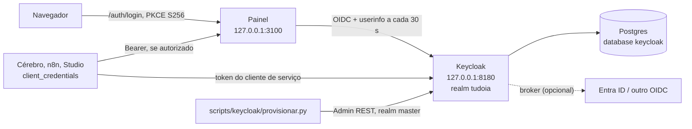

[🏠 TudoIA](../../README.md) › [📚 Documentação](../README.md) › 🔐 Keycloak

# 🔐 Keycloak e autenticação do painel

> Para quem instala, opera e mantém o login do TudoIA. Responde: o que o provisionamento cria no Keycloak, como rodá-lo,
> como adicionar usuários e provedores de identidade (Entra ID), como o painel valida sessão e token, e o que fazer
> quando o login falha.

## 📑 Sumário

- [🎯 Visão geral](#-visão-geral)
- [🚀 Uso](#-uso)
- [⚙️ Opções](#️-opções)
- [🧩 O que o provisionamento cria](#-o-que-o-provisionamento-cria)
- [👤 Usuários, papéis e provedores de identidade](#-usuários-papéis-e-provedores-de-identidade)
- [🔑 Como o painel autentica](#-como-o-painel-autentica)
- [🎨 Tema da tela de login](#-tema-da-tela-de-login)
- [❌ Erros / diagnóstico](#-erros--diagnóstico)
- [🛡️ Segurança](#️-segurança)
- [❓ Perguntas frequentes](#-perguntas-frequentes)

---

## 🎯 Visão geral

O painel não guarda usuários nem senhas. Ele faz login por OpenID Connect (Authorization Code com PKCE `S256`) contra o
realm `tudoia` de um Keycloak. O realm é provisionado por código: `scripts/keycloak/provisionar.py` aplica o template
`infra/keycloak/realm-tudoia.json` e os provedores de identidade de `infra/keycloak/idps/`. Rodar de novo não duplica
nada e só altera o que divergir do template.



Onde cada peça vive:

| Peça | Arquivo |
|---|---|
| Serviço `keycloak` (perfil `keycloak` do compose, imagem 26.3 fixada por digest, `127.0.0.1:8180`, modo `start` com HTTP) | `runtime/docker-compose.yml` (detalhes em [servicos-docker.md](servicos-docker.md)) |
| Template do realm | `infra/keycloak/realm-tudoia.json` |
| Provedores de identidade | `infra/keycloak/idps/*.json` (exemplos: `entra-id.example.json`, `oidc-generico.example.json`) |
| Tema de login | `infra/keycloak/tema/tudoia/login/` |
| Provisionador | `scripts/keycloak/provisionar.py` |
| Token do cliente `tudoia-mcp` | `scripts/keycloak/token_mcp.py` |
| Autenticação e autorização do painel | `painel/tudoia_painel/autenticacao.py` |
| Testes | `tests/keycloak/` |

O banco é o container próprio `keycloak-db` (Postgres, database `keycloak`, role `keycloak`, senha em `KEYCLOAK_DB_PASSWORD`; `runtime/docker-compose.yml`). A senha do
admin do realm `master` é `TUDOIA_KEYCLOAK_ADMIN_PASSWORD`, gerada por `tudoia segredos`. Quem prefere um Keycloak próprio
tira `keycloak` de `COMPOSE_PROFILES` e aponta `TUDOIA_OIDC_ISSUER` para ele.

> [!NOTE]
> Sem `TUDOIA_OIDC_ISSUER`, `TUDOIA_OIDC_CLIENT_ID` e `TUDOIA_OIDC_CLIENT_SECRET` (e um `TUDOIA_SESSAO_SEGREDO` de pelo
> menos 32 caracteres), toda rota `/api` do painel responde 503 `auth_nao_configurada` e aponta para este documento. O
> painel falha fechado: nada é liberado sem identidade.

## 🚀 Uso

Pré-requisitos: Keycloak no ar (`http://localhost:8180`), credenciais de um admin do realm `master`
(`TUDOIA_KEYCLOAK_ADMIN` e `TUDOIA_KEYCLOAK_ADMIN_PASSWORD`, ou digitadas no terminal; sem terminal interativo e sem as
variáveis, o script para com erro) e o Python do venv do projeto (o script só usa `httpx`).

Na raiz do repositório (`scripts\tudoia.ps1 keycloak` e `scripts/tudoia.sh keycloak` repassam os mesmos argumentos):

```powershell
# 1. Comparar o template com o Keycloak (somente leitura; sai com 1 se houver desvio)
.venv\Scripts\python.exe -m scripts.keycloak.provisionar --verificar

# 2. Aplicar (idempotente; a segunda execução deve imprimir "igual")
.venv\Scripts\python.exe -m scripts.keycloak.provisionar

# 3. Criar o primeiro administrador do painel (senha temporária exibida uma vez)
.venv\Scripts\python.exe -m scripts.keycloak.provisionar --admin-inicial pessoa@example.com

# 4. Trocar os segredos dos clientes e reenviar os segredos dos IdPs
.venv\Scripts\python.exe -m scripts.keycloak.provisionar --rotacionar-secret
```

Ao aplicar, o script grava no `.env` (somente quando o valor muda; cada gravação gera backup em `dados\backups\env`):

- `TUDOIA_OIDC_ISSUER` (`<TUDOIA_KEYCLOAK_URL>/realms/<realm>`), `TUDOIA_OIDC_CLIENT_ID` e `TUDOIA_OIDC_CLIENT_SECRET`;
- `TUDOIA_MCP_CLIENT_ID` e `TUDOIA_MCP_CLIENT_SECRET`;
- `TUDOIA_CAPTURAS_CLIENT_ID` e `TUDOIA_CAPTURAS_CLIENT_SECRET` (quando o template define o cliente de capturas).

Os valores só são gravados quando os três clientes têm segredo na execução. Depois de aplicar, reinicie o painel para ele
ler o novo `.env`.

### Rotacionar segredos

`--rotacionar-secret` gera novo segredo para **todos** os clientes do template (`tudoia-painel`, `tudoia-mcp` e
`tudoia-capturas`), grava no `.env` e reenvia os segredos dos IdPs a partir das variáveis. O segredo antigo deixa de
funcionar na hora; reinicie o painel e os consumidores (Cérebro, n8n). Os segredos dos IdPs
(`TUDOIA_IDP_*_CLIENT_SECRET`) não são comparados com o Keycloak, que os devolve mascarados: trocar uma dessas variáveis
só tem efeito com `--rotacionar-secret` ou quando outro campo daquele IdP também mudar.

### Token do cliente `tudoia-mcp`

`scripts/keycloak/token_mcp.py` obtém um token `client_credentials` para o Cérebro. O fluxo está em
[cerebro.md](cerebro.md#token-jwt-do-cliente-tudoia-mcp).

### Validade do token do painel

O painel reconfirma a sessão no `userinfo` a cada 30 s com o `access_token` guardado no login. Por isso o cliente
`tudoia-painel` precisa de `access.token.lifespan = 28800` (8 h, igual à sessão). Sem o atributo valeria o padrão do realm
(300 s): o token venceria, o `userinfo` responderia 401 e o painel derrubaria a sessão em 5 minutos. O provisionador só
exige o atributo nos clientes de serviço (`tudoia-mcp`, `tudoia-capturas`); no `tudoia-painel` ele vem do template, então
não o remova de lá. O valor só chega ao Keycloak em execução quando o provisionamento roda. Depois, saia e entre de novo
no painel: a sessão aberta ainda carrega o token antigo.

## ⚙️ Opções

Variáveis do provisionador (o ambiente tem prioridade sobre o `.env`; só chaves `TUDOIA_*` são lidas):

| Variável | Padrão | Efeito |
|---|---|---|
| `TUDOIA_KEYCLOAK_URL` | `http://localhost:8180` | URL base do Keycloak (`http://` ou `https://`) |
| `TUDOIA_KEYCLOAK_REALM` | `tudoia` | realm a provisionar (letras, números, `-`, `_`) |
| `TUDOIA_PAINEL_PORTA` | `3100` | porta dos redirect URIs (1 a 65535) |
| `TUDOIA_KEYCLOAK_ADMIN` | pede no terminal | admin do realm `master` (o `.env.example` traz `admin`) |
| `TUDOIA_KEYCLOAK_ADMIN_PASSWORD` | pede no terminal | senha do admin (gerada por `tudoia segredos`) |
| `TUDOIA_IDP_*` | sem padrão | variáveis referenciadas por `${...}` nos IdPs aplicados |

Argumentos:

| Argumento | Efeito |
|---|---|
| (nenhum) | aplica o template; imprime `igual` ou uma linha `alterado:` por mudança |
| `--verificar` | só leitura; lista os desvios e sai com 1 se houver algum |
| `--rotacionar-secret` | gera novo segredo dos clientes do template e reenvia o dos IdPs |
| `--admin-inicial EMAIL` | cria o primeiro administrador (ver abaixo); ignorado em `--verificar` |

Códigos de saída: `0` ok ou sem alterações; `1` desvio (`--verificar`) ou erro de validação; `2` conexão ou autenticação.
Mensagens de erro não mostram segredos nem tokens.

Variáveis do painel (lidas de `.env`; o ambiente vence):

| Variável | Padrão | Efeito |
|---|---|---|
| `TUDOIA_OIDC_ISSUER` | sem padrão no código (o `.env.example` traz `http://localhost:8180/realms/tudoia`) | issuer do realm; precisa começar com `http://` ou `https://` |
| `TUDOIA_OIDC_CLIENT_ID` | sem padrão | client do painel (`tudoia-painel`) |
| `TUDOIA_OIDC_CLIENT_SECRET` | sem padrão | segredo do client; gravado pelo provisionador |
| `TUDOIA_OIDC_SCOPE` | `openid email profile` | escopos pedidos no login |
| `TUDOIA_SESSAO_SEGREDO` | gerado no primeiro uso | chave que assina o cookie de sessão; mínimo de 32 caracteres, senão a autenticação fica desconfigurada |
| `TUDOIA_COOKIE_SEGURO` | `0` | `1`, `true` ou `sim` marca o cookie como só-HTTPS |
| `TUDOIA_API_BEARER_CLIENTES` | vazio | lista de `azp` (separados por vírgula) aceitos com `Authorization: Bearer`; vazio desliga o Bearer |

A tabela completa de variáveis está em [configuracao.md](../configuracao.md).

## 🧩 O que o provisionamento cria

| Recurso | Detalhe (conferido no template) |
|---|---|
| Realm `tudoia` | cadastro público desligado, login por e-mail, recuperação de senha ligada, proteção contra força bruta, `sslRequired=external`, `verifyEmail=false`, sessão SSO 8 h ociosa / 24 h máxima, tema `tudoia`, idioma `pt-BR` |
| Política de senha | `length(12) and notUsername and notEmail`: vale para senhas novas ou trocadas (contexto em [seguranca.md](../seguranca.md#política-de-senha-do-realm-tudoia)) |
| Papéis de realm | `tudoia-admin`, `tudoia-operador`, `tudoia-leitor` |
| Grupos | um por papel, com o mesmo nome, cada um mapeado ao papel correspondente |
| Client scope `tudoia-groups` | mapper *Group Membership* → claim `groups` (só o nome, sem caminho) no ID token, access token, userinfo e introspection |
| Client `tudoia-painel` | confidencial; Authorization Code com PKCE `S256`; sem implicit, sem direct grant, sem conta de serviço; escopos padrão `profile`, `email`, `roles`, `tudoia-groups`; token de 8 h |
| Client `tudoia-mcp` | confidencial, só `client_credentials`; conta de serviço no grupo `tudoia-operador`; mapper de audiência `tudoia-mcp`; token de 8 h. Usado pelo Cérebro e pelo n8n |
| Client `tudoia-capturas` | confidencial, só `client_credentials`; conta de serviço no grupo `tudoia-leitor`; mapper de audiência `tudoia-painel`; token de 300 s. Capturas de tela do Studio |
| Redirect URIs e logout | `http://127.0.0.1:<porta>/auth/callback` e `http://localhost:<porta>/auth/callback`; `post.logout.redirect.uris` para as mesmas origens |
| Identity providers | um por arquivo `*.json` de `infra/keycloak/idps/` (os `*.example.json` não são aplicados) |
| Segredo dos clients | gerado pelo Keycloak e gravado no `.env`; nunca fica no template |

Papéis e grupos que existem no realm mas não estão no template não são removidos. Já os mapeamentos de papel dos grupos
gerenciados são sincronizados exatamente: um papel a mais em `tudoia-leitor` seria escalonamento de privilégio e é
removido.

O provisionador valida o template antes de qualquer chamada de rede e recusa: seção ausente, chave contendo `secret`,
grupo que referencia papel inexistente, `tudoia-painel` sem PKCE `S256` ou com implicit, direct grant ou conta de
serviço, cliente de serviço com fluxo interativo ou sem `access.token.lifespan` numérico.

## 👤 Usuários, papéis e provedores de identidade

### Adicionar usuários

- **Primeiro administrador:** `--admin-inicial EMAIL`. O usuário entra no grupo `tudoia-admin`, recebe senha temporária
  aleatória (24 caracteres, exibida uma vez) e é obrigado a trocá-la no primeiro login. Se já existir um usuário com
  aquele login ou e-mail, nada é alterado.
- **Demais usuários:** no console (`http://localhost:8180/admin`, realm `tudoia`), crie o usuário e coloque-o em
  `tudoia-admin`, `tudoia-operador` ou `tudoia-leitor`. O papel vem do grupo.

### Papéis do painel

O painel lê papéis do claim `groups` (aceita caminho `/tudoia-admin`) e de `realm_access.roles`. Conta sem nenhum dos três
papéis recebe 403 `sem_papel` no login.

| Papel | Pode |
|---|---|
| `tudoia-admin` | tudo, inclusive segredos, provedores, importar skills, MCP, baixar modelos locais e alterar a governança |
| `tudoia-operador` | ler e alterar o que não é administrativo (métodos `POST`, `PUT`, `PATCH`, `DELETE`) |
| `tudoia-leitor` | só leitura (`GET`, `HEAD`, `OPTIONS`) |

A regra está em `decidir()` e nos prefixos `PREFIXOS_SO_ADMIN` e `PREFIXOS_ESCRITA_SO_ADMIN` de `autenticacao.py`.

### Adicionar um identity provider (Entra ID)

O Entra autentica o usuário, o Keycloak recebe o retorno pelo broker e o painel só fala com o Keycloak. O painel conhece
apenas o `TUDOIA_OIDC_ISSUER`.

1. Registre um aplicativo (App registration) no Entra, tipo Web, com a URI de redirecionamento do broker
   (`http://localhost:8180/realms/tudoia/broker/entra-id/endpoint` na instância local; `entra-id` é o alias do exemplo).
   Crie um segredo de cliente (o Entra mostra o valor uma vez) e mantenha as permissões delegadas `openid`, `profile` e
   `email`.
2. Para o claim `groups`, configure o aplicativo para emitir grupos. O Entra envia **IDs de objeto** (GUIDs). Para grupos
   demais ele manda "overage" em vez da lista; nesse caso atribua os grupos ao aplicativo.
3. Copie o exemplo para um nome sem `.example`:

   ```bash
   cp infra/keycloak/idps/entra-id.example.json infra/keycloak/idps/entra-id.json
   ```

   O `entra-id.json` não está no `.gitignore`: mantenha os placeholders `${TUDOIA_IDP_...}`. O provisionador troca os
   placeholders na memória, a partir do `.env`; o segredo nunca vai para o JSON.
4. Preencha no `.env` (ou no ambiente) as seis variáveis do exemplo: `TUDOIA_IDP_ENTRA_TENANT_ID`,
   `TUDOIA_IDP_ENTRA_CLIENT_ID`, `TUDOIA_IDP_ENTRA_CLIENT_SECRET`, `TUDOIA_IDP_ENTRA_GRUPO_ADMIN_OID`,
   `TUDOIA_IDP_ENTRA_GRUPO_OPERADOR_OID` e `TUDOIA_IDP_ENTRA_GRUPO_LEITOR_OID`.
5. Rode `--verificar` e depois a aplicação. Se faltar qualquer variável, o script para com
   `variável(is) ausente(s)` antes de tocar no Keycloak; nunca cria um IdP com segredo vazio.

Para outro provedor OIDC, copie `oidc-generico.example.json` e use as variáveis `TUDOIA_IDP_OIDC_*`. Para um provedor
que não é OIDC (SAML, por exemplo), crie o JSON com o `providerId` correspondente: o script aplica o que estiver no
arquivo, mas não conhece as regras de cada tipo. Cada arquivo exige `alias` (`[a-z0-9-]+`, único), `providerId` e
`config`.

> [!WARNING]
> Não verificado neste repositório: o login de ponta a ponta com o Entra nunca foi executado, o ID do tenant e a emissão
> do claim `groups` dependem do seu tenant, e o mapper `oidc-advanced-group-idp-mapper` do exemplo (com `claims` igual a
> `[{"key":"groups","value":"<ID do grupo>"}]` e `group` igual a `/tudoia-admin`) nunca foi aplicado nesta instalação. A
> forma do campo depende da versão do Keycloak. Teste pelo botão do Entra no console (Identity providers) e confira os
> grupos no usuário de teste.

Com `trustEmail: true` (como no exemplo do Entra), o Keycloak confia no e-mail informado pelo provedor. Só mantenha essa
opção quando o provedor for controlado pela organização.

## 🔑 Como o painel autentica

- **Login:** `/auth/login` inicia o fluxo com PKCE `S256`. O estado do OAuth (`state`, `nonce`, `code_verifier`) e o destino
  (`retorno`) ficam na sessão assinada (cookie `tudoia_sessao`), no padrão do authlib.
- **Falha no callback:** com o navegador aceitando HTML, o painel redireciona de novo a `/auth/login`; não há limite de
  tentativas nem página de erro própria (leitura do código; não executado). Cookies antigos podem manter o laço.
- **Sessão:** cookie `tudoia_sessao` assinado (não cifrado), `SameSite=Lax`, validade máxima de 8 h. O cookie guarda o `access_token` e o `id_token`
  (este usado no logout).
- **Revalidação:** no máximo a cada 30 s por sessão o painel consulta o `userinfo` com o `access_token`. Conta
  desativada, sessão revogada ou sem papel do painel derrubam a sessão; se o Keycloak não responde, a requisição é negada
  com 503 `identidade_indisponivel` (fail-closed).
- **Bearer (clientes de serviço):** com `TUDOIA_API_BEARER_CLIENTES` preenchido, o painel aceita `Authorization: Bearer`
  em `/api`. O token é validado localmente: RS256 fixo, emissor, `exp`, `azp` na lista e `aud` contendo o `client_id` do
  painel (por isso o template dá ao `tudoia-capturas` um mapper de audiência `tudoia-painel`). As chaves do realm ficam
  em cache por 600 s; um `kid` desconhecido renova o cache no máximo a cada 30 s. Sem as chaves, 503. Vazio, qualquer
  Bearer recebe 401 `bearer_desativado`.
- **Logout:** `POST /auth/logout` passa pela checagem de origem, limpa a sessão e devolve a URL do
  `end_session_endpoint` do Keycloak com `id_token_hint` (quando disponível).

Mais contexto sobre o painel em [painel.md](painel.md) e sobre a arquitetura em [arquitetura.md](../arquitetura.md).

## 🎨 Tema da tela de login

O tema `tudoia` fica em `infra/keycloak/tema/tudoia/login/` (`theme.properties`, CSS, logo, textos em pt-BR). Herda o
`keycloak.v2`. O serviço `keycloak` do compose já monta a pasta em `/opt/keycloak/themes/tudoia` (somente leitura), e o
template define `loginTheme: tudoia` e o idioma `pt-BR`. Num Keycloak próprio, monte a pasta do mesmo modo e rode o
provisionador. Para ver mudanças, recarregue a tela de login com cache limpo (Ctrl+F5).

O tema usa Bricolage Grotesque e JetBrains Mono, servidas localmente (`resources/fonts`; licença em `LICENCA.md` na
mesma pasta). A órbita da esquerda tem versão animada (`orbita.svg`) e estática (`orbita-estatica.svg`), escolhida
automaticamente para quem pede redução de movimento no sistema.

## ❌ Erros / diagnóstico

| Sintoma | Causa | Ação |
|---|---|---|
| `credenciais de administrador recusadas` (saída 2) | o usuário não existe no `master` ou a senha está errada. `KC_BOOTSTRAP_ADMIN_*` do compose só cria o admin na **primeira** inicialização do banco; se o `.env` mudou depois, o admin pode não existir mais | corrija o admin pelo console ou pelo `kcadm.sh` dentro do container e rode de novo |
| `não foi possível conectar` (saída 2) | Keycloak fora do ar ou `TUDOIA_KEYCLOAK_URL` com outra porta | teste `curl http://localhost:8180/realms/master/.well-known/openid-configuration` |
| `defina TUDOIA_KEYCLOAK_ADMIN e TUDOIA_KEYCLOAK_ADMIN_PASSWORD` | sem as variáveis e sem terminal interativo | defina no `.env` ou no ambiente |
| `variável(is) ausente(s): ...` (saída 1) | falta variável de um IdP ou do template | preencha no `.env` (passo 4 do Entra) |
| Desvio do `--verificar` (saída 1) | o registro mostra o campo divergente | rode a aplicação; papel extra em grupo gerenciado é removido |
| 503 `auth_nao_configurada` em `/api` | falta `TUDOIA_OIDC_*`, ou `TUDOIA_SESSAO_SEGREDO` com menos de 32 caracteres | rode o provisionador e reinicie o painel |
| 503 `identidade_indisponivel` | o painel não alcançou o Keycloak para confirmar a sessão ou obter as chaves | confira o container `keycloak` e o `TUDOIA_OIDC_ISSUER`; tente de novo |
| `Invalid redirect_uri` no login | `TUDOIA_PAINEL_PORTA` difere da porta registrada nos redirect URIs | ajuste a variável e rode a aplicação |
| Login funciona, mas sem papéis (403 `sem_papel`) | o usuário não está em nenhum grupo `tudoia-*`, ou o escopo `tudoia-groups` / mapper `groups` sumiu do client | coloque o usuário num grupo; `--verificar` aponta escopo e mapper ausentes |
| `invalid issuer` / `iss` não confere | o issuer é o do `.env` (`http://localhost:8180/realms/tudoia`); o painel roda no host, então navegador e backend veem o mesmo endereço. Se o painel passar a rodar em container, `localhost` deixa de servir | use um issuer alcançável pelos dois lados; o serviço `cerebro` já aceita dois issuers (`localhost` e `host.docker.internal`) |
| Sessão cai a cada 5 min | `access.token.lifespan` do `tudoia-painel` fora do realm vivo | rode o provisionador e entre de novo |
| `ERR_TOO_MANY_REDIRECTS` | cookies antigos de `localhost` / `127.0.0.1` | apague os cookies desses hosts e entre de novo |
| 401 `token_invalido` com Bearer | assinatura, emissor, validade, `azp` fora da lista ou `aud` sem o `client_id` do painel | confira `TUDOIA_API_BEARER_CLIENTES` e o mapper de audiência do cliente |

## 🛡️ Segurança

- O template não tem segredos; o provisionador recusa qualquer chave que contenha `secret`, e há teste para isso.
- O client do painel exige PKCE `S256` e não tem direct grant nem implicit flow.
- A conta `master` serve só para administrar o Keycloak; o painel usa apenas o realm `tudoia`.
- Os papéis vêm dos grupos. Só o provisionador (ou um admin do realm) deve mudar a composição dos grupos `tudoia-*`.
- Segredos ficam só no `.env` (ignorado pelo git) e no Keycloak. O script não os imprime nem os coloca em URLs ou logs. A
  senha temporária do `--admin-inicial` é a única credencial exibida, uma vez, no terminal.
- O Keycloak do compose roda em modo `start` com HTTP e escuta só em `127.0.0.1`: não exponha a porta 8180. Para uso fora
  da máquina local, ponha um proxy com TLS na frente e use `TUDOIA_COOKIE_SEGURO=1`.
- Modelo de ameaças e riscos residuais: [seguranca.md](../seguranca.md).

## ❓ Perguntas frequentes

**Preciso rodar o provisionador a cada mudança no template?** Sim. O template só vale no Keycloak vivo depois de aplicado.
Use `--verificar` para ver o que mudaria sem escrever nada.

**Como rodar os testes?** `uv run --frozen pytest -q tests/keycloak`. Eles não usam a rede; o teste de integração contra um
Keycloak vivo só roda com `TUDOIA_KEYCLOAK_IT=1` e as credenciais de admin no ambiente.

**Posso usar um Keycloak que já tenho?** Sim: tire `keycloak` de `COMPOSE_PROFILES`, aponte `TUDOIA_KEYCLOAK_URL` e
`TUDOIA_OIDC_ISSUER` para ele e rode o provisionador com um admin do `master` dele.

---

[🏠 README](../../README.md) · ⬅️ [Governança](governanca.md) · [Modelos](modelos.md) ➡️
