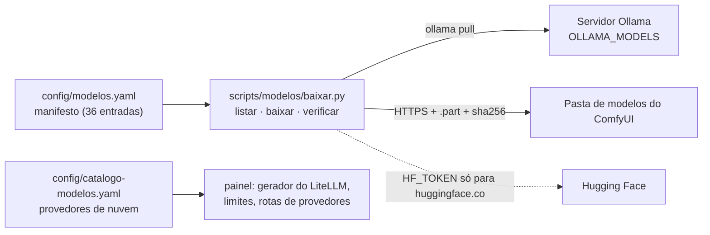

[🏠 TudoIA](../../README.md) › [📚 Documentação](../README.md) › 🧠 Modelos

# 🧠 Modelos de IA, manifesto e catálogo

> Para quem prepara uma máquina ou mantém a lista de modelos do TudoIA. Responde: como baixar e verificar os pesos locais
> (Ollama e ComfyUI) a partir do manifesto, como o download se protege, e para que serve o catálogo de provedores de
> nuvem (`catalogo-modelos.yaml`).

## 📑 Sumário

- [🎯 Visão geral](#-visão-geral)
- [🚀 Uso](#-uso)
- [⚙️ Opções](#️-opções)
- [📦 Formato do manifesto](#-formato-do-manifesto)
- [⬇️ Como o download funciona](#️-como-o-download-funciona)
- [➕ Adicionar um modelo](#-adicionar-um-modelo)
- [☁️ Catálogo de provedores](#️-catálogo-de-provedores)
- [❌ Erros / diagnóstico](#-erros--diagnóstico)
- [🛡️ Segurança](#️-segurança)
- [❓ Perguntas frequentes](#-perguntas-frequentes)

---

## 🎯 Visão geral

Os pesos dos modelos locais não vão no repositório: são grandes (a soma de `tamanho_aprox_gb` das entradas ComfyUI do
manifesto passa de 185 GB), têm licenças próprias (algumas exigem aceite em conta) e mudam de versão. O repositório guarda
só o manifesto, o baixador e esta documentação; cada máquina baixa os seus.



Há dois arquivos de configuração com nomes parecidos e papéis distintos:

| Arquivo | O que descreve | Quem lê |
|---|---|---|
| `config/modelos.yaml` | pesos que a máquina baixa (Ollama e ComfyUI) | `scripts/modelos/baixar.py` |
| `config/catalogo-modelos.yaml` | provedores e modelos de nuvem (FREE e PAID) que o roteador pode usar | painel (gerador da configuração do LiteLLM, limites, rotas de provedores) |

## 🚀 Uso

Na raiz do repositório, com o Python do projeto (`uv run` ou `.venv\Scripts\python.exe`). O atalho
`.\scripts\tudoia.ps1 modelos <opções>` (e `scripts/tudoia.sh modelos`) chama o mesmo módulo, `scripts.modelos.baixar`.

```powershell
.venv\Scripts\python.exe scripts\modelos\baixar.py --listar
.venv\Scripts\python.exe scripts\modelos\baixar.py --obrigatorios
.venv\Scripts\python.exe scripts\modelos\baixar.py --modelo ollama-qwen3.5-9b comfy-ae
.venv\Scripts\python.exe scripts\modelos\baixar.py --verificar --obrigatorios
.venv\Scripts\python.exe scripts\modelos\baixar.py --verificar
```

- `--listar`: tabela com `STATUS` (`presente`, `ausente`, `pendente-origem`), `ID`, `TIPO`, `GB`, `OBRIG` e `DESTINO`, e uma
  linha de resumo. Não lê nem calcula hash de arquivo.
- `--obrigatorios` e `--modelo ID ...`: baixam. Quem já está presente é pulado (`ja-presente`); um download interrompido é
  retomado a partir do `.part`. Os dois podem ser combinados.
- `--verificar`: sem ids verifica todos. Com `sha256` declarado, calcula o hash (minutos em arquivos grandes); sem ele,
  confere só a presença (`sem-sha256`). Entradas `ollama` são confiadas ao próprio Ollama, que valida os digests no pull.

### Preparar uma máquina nova

1. Clone o repositório. A pasta `modelos\` não vem junto (está no `.gitignore`).
2. Instale o Ollama e confirme `ollama --version`.
3. Defina onde ficam os pesos do Ollama (ver [Onde cada coisa fica](#onde-cada-coisa-fica)). Se quiser outro disco, defina
   `TUDOIA_MODELOS_DIR` e `TUDOIA_OLLAMA_MODELS=<essa pasta>\ollama\models`.
4. Suba o servidor Ollama (o `tudoia.ps1 up` faz isso) e rode `--listar` para ver o que falta.
5. Baixe os obrigatórios com `--obrigatorios`.
6. Crie os modelos locais do TudoIA a partir dos Modelfiles de `runtime\ollama\modelfiles\`
   (`Modelfile.tudoia-chat`, `.tudoia-agente`, `.tudoia-codigo`, `.tudoia-raciocinio`, `.assistente`, `.programador`,
   `.revisor`, `.tradutor`, `.opencode`, `.opencode-coder`), por exemplo
   `ollama create tudoia-chat -f runtime\ollama\modelfiles\Modelfile.tudoia-chat`. O manifesto guarda só o modelo-base
   (`FROM`) de cada um.
7. Para o Estúdio, baixe os modelos ComfyUI desejados com `--modelo ID ...` (use `--listar` para os ids).
8. Confira com `--verificar --obrigatorios`.

### Onde cada coisa fica

A pasta base é `<raiz-do-repositório>\modelos`; mude com `--base-dir DIR` ou `TUDOIA_MODELOS_DIR`. Os `destino` do manifesto
são relativos a ela.

| Componente | Local | Como o TudoIA aponta |
|---|---|---|
| Ollama | `TUDOIA_OLLAMA_MODELS` (ambiente, depois `.env`); sem ela, `<base>\ollama\models` | `tudoia.ps1 up` exporta `OLLAMA_MODELS` com esta mesma regra; o painel usa `caminhos.pesos_ollama` |
| ComfyUI | `<base>\<destino>` do manifesto, que começa por `ComfyUI\ComfyUI\models\<categoria>\` | ver aviso abaixo |

`ollama pull` é enviado ao **servidor** Ollama, que grava no `OLLAMA_MODELS` **dele**. Se o servidor usar outra pasta, o
baixador reportará `ausente` mesmo após o pull: mantenha o servidor e o `TUDOIA_OLLAMA_MODELS` apontando para o mesmo lugar.

Categorias de ComfyUI no manifesto: `checkpoints`, `clip`, `text_encoders`, `diffusion_models`, `unet`, `vae`, `loras`.

> [!WARNING]
> `TUDOIA_COMFYUI_PORTABLE` só desvia o destino de um arquivo ComfyUI quando o resultado cai **dentro** da pasta base
> (`caminho_local`, `baixar.py`). Fora dela, o baixador ignora a variável e grava em `<base>\ComfyUI\ComfyUI\models\...`.
> Já o painel procura o ComfyUI em `TUDOIA_COMFYUI_PORTABLE` ou, sem ela, em
> `<raiz>\modelos\comfyui\ComfyUI_windows_portable\ComfyUI` (`painel/tudoia_painel/caminhos.py`). Os dois padrões
> não coincidem: confira com `--listar` e com a tela do Estúdio onde os arquivos aterrissam antes de baixar dezenas de GB.
> Esse desencontro não tem teste; é um achado de leitura de código, não de execução.

## ⚙️ Opções

| Variável / argumento | Padrão | Efeito |
|---|---|---|
| `--base-dir DIR` | `TUDOIA_MODELOS_DIR`, senão `<raiz>\modelos` | pasta base dos destinos |
| `TUDOIA_MODELOS_DIR` | vazia | pasta base alternativa |
| `TUDOIA_OLLAMA_MODELS` | vazia (usa `<base>\ollama\models`) | pasta de pesos do Ollama; lida do ambiente e depois do `.env` da raiz |
| `TUDOIA_COMFYUI_PORTABLE` | vazia | pasta do ComfyUI portable; lida do ambiente e depois do `.env`; vale só dentro da base (ver aviso) |
| `HF_TOKEN` | vazio | token do Hugging Face; lido **só do ambiente** (o baixador não lê o `.env` para ele) |

Para cada chave do `.env`, o baixador lê apenas a chave pedida; nada é registrado em log.

Códigos de saída: `0` ok; `1` manifesto inválido, id desconhecido, entrada PENDENTE, sha256 divergente, dependência
ausente (`ollama`, PyYAML) ou uso sem argumentos; `2` rede, disco ou espaço insuficiente. Com `--verificar`, `divergente` e
`ausente` dão saída 1; `sem-sha256` e `pendente-origem` não.

API Python (funções públicas de `scripts/modelos/baixar.py`): `carregar_manifesto`, `status_modelos`, `status_modelo`,
`selecionar_modelos`, `baixar_modelo`, `verificar_modelo`, `resolver_base`, `caminho_local`, `validar_destino`,
`validar_url_https`.

## 📦 Formato do manifesto

`config/modelos.yaml` começa com `versao: 1` e uma lista `modelos`. Cada entrada tem todos os campos abaixo, exceto
`arquivo` e `revisao` (opcionais):

| Campo | Significado |
|---|---|
| `id` | identificador único (`[a-z0-9][a-z0-9._-]*`, até 80 caracteres) |
| `tipo` | `ollama`, `url`, `huggingface` ou `comfyui-node-asset` (arquivo por URL para uma pasta do ComfyUI) |
| `destino` | caminho relativo à base; sem `..`, sem caminho absoluto, sem unidade e sem `: * ? " < > \|` |
| `origem` | `ollama`: `nome:tag`; `url` e `comfyui-node-asset`: URL `https://...`; `huggingface`: `dono/repositorio`; `null` = PENDENTE |
| `arquivo` | só `huggingface`: caminho do arquivo dentro do repositório (obrigatório nesse tipo) |
| `revisao` | só `huggingface`: branch, tag ou commit (padrão `main`; prefira fixar um commit) |
| `tamanho_aprox_gb` | estimativa para checar espaço livre; `null` = desconhecido |
| `licenca` | mapa com `nome` e/ou `url` (https); `nome: null` quando não confirmada |
| `obrigatorio` | `true` entra em `--obrigatorios` |
| `usado_por` | onde o TudoIA usa o modelo (texto obrigatório) |
| `sha256` | 64 hexadecimais minúsculos; `null` = só presença e tamanho; não se aplica ao tipo `ollama` |
| `notas` | texto livre; `origem: null` exige `PENDENTE` nas notas |

Estado atual do manifesto (conferido em 2026-11-03): 36 entradas, 7 `ollama` e 29 `comfyui-node-asset`; nenhuma com
`origem: null`; nenhuma com `sha256` declarado; obrigatórios: `ollama-qwen3.5-9b`, `ollama-qwen3.5-4b` e `ollama-bge-m3`
(soma de ~11,1 GB; o `bge-m3` serve ao Cérebro e ao classificador semântico do roteador).

O carregador recusa o manifesto inteiro, de propósito (fail-closed), se houver: id duplicado, `destino` com `..` ou
absoluto, `origem` em `http://`, URL com credenciais embutidas, `sha256` malformado (ou presente em entrada `ollama`),
chave desconhecida (erro de digitação), campo obrigatório ausente ou `origem: null` sem `PENDENTE`.

## ⬇️ Como o download funciona

Referência do comportamento de `baixar_modelo` para tipos diferentes de `ollama`:

- **Arquivo parcial:** escreve em `<destino>.part` e só renomeia (atômico) para o nome final quando o conteúdo está completo
  e, se houver, o `sha256` confere. Nunca existe arquivo parcial com o nome final.
- **Retomada:** com `.part` existente, pede o restante com `Range` e `If-Range`. O validador é o `ETag` forte da primeira
  resposta ou, sem ele, o `Last-Modified`, guardado em `<destino>.part.meta` junto de um hash da URL (a URL em si não é
  gravada). `ETag` fraco (`W/`) não vale (RFC 9110). Sem validador e sem `sha256`, o parcial é descartado e o download
  recomeça. Se o arquivo mudou no servidor ou o `Range` foi ignorado, a resposta é 200 e recomeça do zero. Numa resposta
  206 o início do `Content-Range` precisa ser o tamanho do `.part`; senão o parcial é descartado.
- **Tamanho:** o total esperado vem do `Content-Range` (206) ou do `Content-Length` (200). Menos bytes que o esperado é falha
  transitória. Sem tamanho declarado e sem `sha256` no manifesto, o download falha: o fim da conexão não prova que o arquivo
  veio inteiro. Com `sha256`, o hash decide.
- **Repetição:** até 4 tentativas, com espera de 2, 4 e 8 s, para erros transitórios (timeout de 30 s por operação de
  socket, HTTP 408, 425, 429, 500, 502, 503, 504, conexão caída). 401, 403, 404 e outros não são repetidos.
- **Trava:** `<destino>.part.lock` impede dois downloads do mesmo arquivo. Se nenhum download estiver rodando e a trava
  sobrou de uma queda, apague o `.lock`.
- **Espaço:** antes de baixar, compara `tamanho_aprox_gb` (menos o que o `.part` já tem) com o espaço livre.
- **`sha256` divergente:** o `.part` é apagado e o comando falha com saída 1. Um arquivo final antigo nunca é substituído
  por conteúdo não verificado. Um arquivo final já presente cujo hash diverge é baixado de novo.
- **Só `https://`:** redirecionamentos (até 5) são refeitos um a um; se qualquer salto for `http://`, para antes de
  conectar. Respostas são pedidas com `Accept-Encoding: identity`.
- **Ollama:** roda `ollama pull <origem>` com lista de argumentos (sem shell), com teto de 6 h. Se `ollama` não estiver no
  `PATH`, o script informa o comando a rodar manualmente. Modelo já presente não dispara `pull`.

## ➕ Adicionar um modelo

1. Confirme a origem na fonte oficial (página do modelo, repositório Hugging Face, URL direta).
2. Acrescente a entrada em `config/modelos.yaml` com um `id` novo. Para Hugging Face use `tipo: huggingface`, `origem`
   `dono/repositorio`, `arquivo` e, de preferência, `revisao` com commit fixo. Para URL direta de ComfyUI use
   `comfyui-node-asset` com o `destino` sob `ComfyUI/ComfyUI/models/<categoria>/`.
3. Declare o `sha256` se o conhecer por fonte confiável; não o calcule a partir de cópia local sem conferir a origem.
4. Rode `--listar`, depois `--modelo ID` e `--verificar --modelo ID`.
5. Rode `uv run --frozen pytest -q tests/modelos` para garantir que o manifesto continua válido.

Licenças: `licenca.nome: null` significa não confirmada; confirme na página do modelo antes de uso comercial. Modelos do
Hugging Face com licença sob aceite respondem 401 ou 403 sem token: aceite a licença na conta, crie um token de leitura em
`https://huggingface.co/settings/tokens` e exporte `HF_TOKEN` no ambiente antes de rodar o script (no PowerShell:
`$env:HF_TOKEN = "<token>"`). Não o cole no manifesto nem em logs.

## ☁️ Catálogo de provedores

`config/catalogo-modelos.yaml` lista os provedores de nuvem e seus modelos. Ele não baixa nada: alimenta o roteador. O
painel o lê (`painel/tudoia_painel/catalogo.py`) para gerar a configuração do LiteLLM, calcular limites e servir as rotas
de provedores (`/api/provedores...`), e também o altera quando você cadastra provedor ou modelo pelo painel. A ordem de
roteamento fica em `config/roteamento.yaml` (ver [roteador.md](roteador.md)); a chave de cada provedor, no `.env`.

Estrutura (chave de topo `provedores`, um mapa por id de provedor):

| Campo do provedor | Efeito |
|---|---|
| `nome`, `tier` | nome exibido; `FREE` ou `PAID` (outro valor é erro de carga) |
| `chave`, `chaves_extras` | variáveis do `.env`; o provedor só é considerado ligado se **todas** estiverem preenchidas |
| `site_chave`, `fonte_limites` | links e origem dos limites exibidos no painel |
| `api_base`, `url_modelos` | endpoint e URL de listagem usada em "descobrir modelos" |
| `limites` | por exemplo `rpm`, `rpd`, `usd_dia`, `neurons_dia`, `reset` |
| `descartar_params` | parâmetros que o provedor recusa com 400 |
| `repeticoes` | `num_retries` do deployment |
| `modelos[]` | `nome`, `id` (formato do LiteLLM), `papeis` (`chat`, `codigo`, `raciocinio`, `visao`), `contexto`, `ativo` (padrão `true`), `desativado_por_falha` |

Conteúdo em 2026-11-03: 10 provedores (5 FREE: `nvidia`, `openrouter`, `groq`, `gemini`, `cloudflare`; 5 PAID:
`anthropic`, `openai`, `deepseek`, `xai`, `huggingface`) e nenhum modelo listado: cada provedor tem `modelos: []` e a lista é preenchida pelo painel
("descobrir modelos" e "Sincronizar Novos"). Confie no arquivo, não neste número.

> [!NOTE]
> O arquivo é mantido em boa parte pelo painel. Prefira editá-lo pelo menu Modelos & Motores; o painel
> regrava o arquivo ao cadastrar provedores e modelos e ao sincronizar, então mantenha edições manuais fora de uso concorrente
> com a tela.

## ❌ Erros / diagnóstico

| Sintoma | Causa provável | Ação |
|---|---|---|
| `erro: ... https` ao carregar | manifesto com `http://` ou URL sem host | use `https://` |
| `destino ... '..'` ou absoluto | caminho fora da base | use caminho relativo a `modelos` |
| `'ollama' nao encontrado no PATH` | Ollama não instalado ou fora do `PATH` | instale e reabra o terminal, ou rode o `ollama pull` indicado |
| Pull feito, mas `--listar` mostra `ausente` | servidor Ollama usa outro `OLLAMA_MODELS` | alinhe `TUDOIA_OLLAMA_MODELS` e reinicie o Ollama |
| `acesso negado (HTTP 401/403)` | modelo restrito ou token ausente | aceite a licença no Hugging Face e exporte `HF_TOKEN` |
| `arquivo nao encontrado no servidor (HTTP 404)` | `origem` ou `arquivo` errados no manifesto | corrija a entrada |
| `sha256 divergente` | arquivo corrompido ou origem mudou | o `.part` foi apagado; tente de novo e, se persistir, confira `sha256` e `revisao` |
| `outro download ... em andamento` | trava de um download interrompido | sem download rodando, apague `<arquivo>.part.lock` |
| `espaco livre insuficiente` | disco cheio em relação ao `tamanho_aprox_gb` | libere espaço ou aponte `--base-dir` / `TUDOIA_MODELOS_DIR` para outro disco |
| Download para no meio (saída 2) | rede instável ou timeout | rode de novo: o `.part` é retomado |
| `certificado TLS nao confiavel` | proxy ou antivírus com certificado próprio | instale a CA corporativa no Windows e tente de novo |
| `o servidor nao informou o tamanho do arquivo ...` | resposta sem `Content-Length` e entrada sem `sha256` | declare o `sha256` no manifesto |
| `PyYAML nao instalado` | ambiente sem as dependências do projeto | rode com o venv do projeto (`uv run`) |

## 🛡️ Segurança

- Só `https://` é aceito, também em cada redirecionamento; URL com credenciais embutidas é recusada.
- `HF_TOKEN` só é enviado a `huggingface.co` e subdomínios; o redirecionamento para um CDN de outro domínio segue sem o
  cabeçalho `Authorization`. O token nunca é gravado no manifesto nem impresso, e as mensagens de erro não ecoam URLs com
  query.
- `destino` é validado duas vezes (no carregamento e em `caminho_local`): nada sai da pasta base por `..`, caminho absoluto
  ou fluxo alternativo de dados do NTFS.
- Pesos são código executável em potencial para quem os carrega (formatos pickle, nós do ComfyUI). Declare `sha256` e fixe
  `revisao` para origens que você controla ou audita; sem `sha256` a integridade se limita ao tamanho.
- O download de modelos locais pelo painel (`POST /api/modelos/local/baixar`) exige o papel `tudoia-admin`
  (ver [keycloak.md](keycloak.md#papéis-do-painel)).
- Privacidade: o catálogo de nuvem envia o conteúdo das conversas ao provedor escolhido. Dados pessoais e confidenciais
  devem usar só modelos locais (grupos pinados ao Ollama). Detalhes em [seguranca.md](../seguranca.md).

## ❓ Perguntas frequentes

**Por que `--listar` não mostra se o hash confere?** Porque listar não lê arquivos. Use `--verificar`.

**Entrada `ollama` verifica `sha256`?** Não. O Ollama valida os digests no `pull`; o baixador só confere que o manifesto do
modelo existe na pasta de pesos.

**Os testes do baixador usam a internet?** Não: sobem um servidor HTTPS local em loopback. Rode `uv run --frozen pytest -q tests/modelos`.

---

[🏠 README](../../README.md) · ⬅️ [Keycloak](keycloak.md) · [Serviços Docker](servicos-docker.md) ➡️
