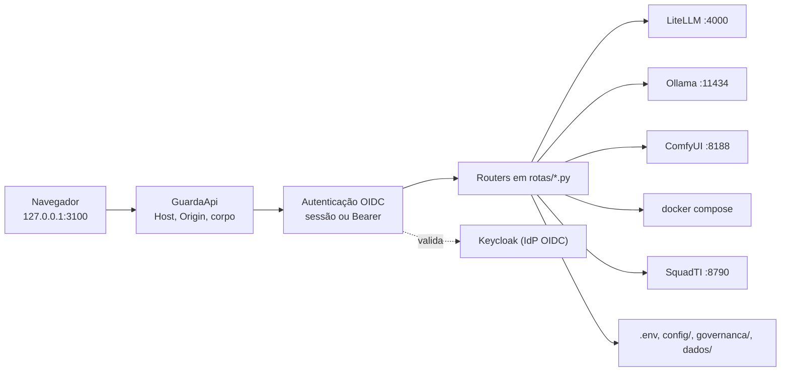

[🏠 TudoIA](../../README.md) › [📚 Documentação](../README.md) › 🖥️ Painel

# 🖥️ Painel de controle

> Para quem opera e mantém o TudoIA. Responde: o que o painel é, como subir e desligar, quais rotas expõe, quem pode
> chamar cada uma, que erro devolve e o que ele grava em disco.

## 📑 Sumário

- [🎯 Visão geral](#-visão-geral)
- [🚀 Uso](#-uso)
- [⚙️ Opções](#️-opções)
- [🔌 API](#-api)
- [🧩 Serviços controlados](#-serviços-controlados)
- [🏛️ Integração com a Doutrina](#️-integração-com-a-doutrina)
- [💾 O que o painel grava](#-o-que-o-painel-grava)
- [❌ Erros e diagnóstico](#-erros-e-diagnóstico)
- [🛡️ Segurança](#️-segurança)
- [🧪 Testes](#-testes)
- [❓ Perguntas frequentes](#-perguntas-frequentes)

---

## 🎯 Visão geral

O painel é uma aplicação FastAPI (`painel/tudoia_painel/`) que serve uma SPA estática em `/app/` e uma API JSON em `/api`.
Por ele você sobe e para serviços, edita provedores e segredos, ajusta o roteador `tudoia-auto`, distribui a governança
aos clientes de IA, acompanha o uso e usa o Estúdio (chat, imagem, vídeo, música). A OpenAPI e a documentação
interativa estão desligadas (`docs_url`, `redoc_url` e `openapi_url` são `None` em `app.py`).



Estrutura do código:

- `app.py`: monta o `Contexto` (`ambiente.py`: raiz, home, serviços e a trava de escrita em `.env`, `governanca.json`,
  `mcp.json` e catálogo), inclui os routers da tupla `ROTAS`, registra a autenticação e liga a `GuardaApi`.
- `rotas/`: um `APIRouter` por domínio (`servicos`, `segredos`, `governanca`, `modelos`, `roteador`, `telemetria`,
  `provedores`, `hardware`, `estudio_catalogo`, `estudio_arquivos`, `estudio_imagem`, `estudio_video`,
  `estudio_video_longo`, `estudio_musica`, `squadti`, `chat`, `ui`).
- Regra de negócio fora das rotas: `servicos.py`, `provedores_service.py`, `modelos_service.py`, `roteador_service.py`,
  `gerador.py`, `estudio_servico.py`, `skills_servico.py`, `mcp_teste.py`, `doutrina_servico.py`, `limites.py`.
- Endereços dos upstreams (todos loopback): `upstreams.py` (LiteLLM `4000`, Ollama `11434`, ComfyUI `8188`).

## 🚀 Uso

### Subir

| Comando | Efeito |
|---|---|
| `.\scripts\tudoia.ps1 painel` | Roda `python -m tudoia_painel painel` em primeiro plano, em `http://127.0.0.1:3100/app/`. Não repassa `--porta`. |
| `.\scripts\painel.ps1` | Se o painel não responde na porta 3100, sobe-o em segundo plano; abre o navegador (`-SemNavegador` desliga). |
| `.\scripts\iniciar.ps1` | Liga Docker, Ollama, ComfyUI, serviços e painel (em segundo plano, sem janela). `-ComSquadti` liga também a API da Squad. |
| `.\scripts\tudoia.ps1 up` | Sobe a pilha Docker (`compose up -d --build`) e o painel em segundo plano. |
| `.\scripts\reiniciar.ps1` | Reinicia só o painel (e a Squad, se estava ligada). `-Tudo` desliga e liga tudo. Use depois de mudar código de rota ou serviço. |
| `.\scripts\parar.ps1` | Desliga o ecossistema (ver abaixo). |

O uvicorn escuta só em `127.0.0.1`, com `log_level="warning"` (`cli.py`). Em segundo plano os logs ficam em
`dados\logs\painel.out.log` e `painel.err.log`.

`parar.ps1` encerra painel, API da Squad, todos os serviços Docker (`compose --profile '*' stop`, inclusive os de perfil
opcional), Ollama e ComfyUI. Só mata um processo cuja linha de comando seja a do serviço esperado, confere que as portas
3100, 11434 e 8188 fecharam e sai com código 1 se algo continuar no ar. Dados e volumes ficam.

> [!WARNING]
> `parar.ps1`, `reiniciar.ps1 -Tudo` e a ação "todos" do painel derrubam o Ollama e o ComfyUI. Nenhuma tarefa em
> andamento nesses serviços sobrevive. Reiniciar só o painel (`reiniciar.ps1` sem `-Tudo`) não os toca.

### CLI (`python -m tudoia_painel <comando>`)

Definida em `cli.py`. Os comandos passam por `.\scripts\tudoia.ps1 <comando>` quando existe o mesmo nome no `ValidateSet`.

| Comando | O que faz |
|---|---|
| `painel [--porta N]` | Sobe o painel (padrão `3100`). Grava a porta em `TUDOIA_PAINEL_PORTA` para a guarda de Host. |
| `sync` | Distribui regras, skills e MCP aos clientes de IA (`governanca.sincronizar`). |
| `verificar` | Lista divergências (drift) sem escrever. Código de saída 1 se houver. |
| `segredos` | Preenche no `.env` os segredos internos que estiverem vazios. Nunca troca um valor existente. |
| `gerar-config` | Gera `runtime/litellm/config.yaml` a partir do catálogo, do roteamento e do `.env`. |

Segredos gerados por `segredos`: `WEBUI_SECRET_KEY`, `SEARXNG_SECRET`, `N8N_ENCRYPTION_KEY`, `LITELLM_MASTER_KEY`
(prefixo `sk-`), `POSTGRES_ADMIN_PASSWORD`, `LITELLM_DB_PASSWORD`, `KEYCLOAK_DB_PASSWORD`, `TUDOIA_SESSAO_SEGREDO` e
`CEREBRO_TOKEN_ESTATICO`. Com o perfil `keycloak` em `COMPOSE_PROFILES`, também `TUDOIA_KEYCLOAK_ADMIN_PASSWORD`; com o
perfil `squadti`, também `TUDOIA_SQUADTI_TOKEN`. O comando imprime só os nomes.

### Telas

A navegação (`static/index.html`) agrupa as telas por contexto:

| Grupo | Tela (`data-view`) | Para que serve |
|---|---|---|
| (topo) | `inicio` | Saúde e pendências, montada a partir das APIs. Botão "Desligar tudo". |
| Criar | `chat`, `imagens`, `videos`, `musicas` | Estúdio. Ver [estudio.md](estudio.md). |
| IA | `modelos` | Catálogo agrupado por origem e tipo, teste de modelos, modelos locais do Ollama. |
| IA | `provedores` | Provedores de nuvem: cadastro, descoberta e sincronização de modelos, links para chave e limites. |
| IA | `roteador` | Grupos do `tudoia-auto`, membros, auto-vínculo e geração do `config.yaml`. Ver [roteador.md](roteador.md). |
| Agentes | `squadti` | Inicia tarefas, responde à entrevista, aprova especificação e release. Ver [squadti.md](squadti.md). |
| Uso | `telemetria` ("Atividade"), `limites` ("Custos e cotas") | Tráfego ao vivo e consumo de tokens por provedor. |
| Sistema | `servicos`, `hardware` | Estado e ações dos serviços; GPU, VRAM e fila do ComfyUI. |
| Segurança | `segredos` ("Chaves e segredos"), `governanca` ("Agentes e regras") | Chaves do `.env` mascaradas; regras, skills, MCP, instâncias e Doutrina. Ver [governanca.md](governanca.md). |
| (conta) | `usuario` ("Minha conta") | Sessão atual e papéis. |

Os ícones são os do mapa `ICONES` em `static/painel.js` (Lucide, ver [terceiros.md](../terceiros.md)). Arquivos
estáticos servidos em `/app/{arquivo}`: `painel.js`, `painel.css`, `squadti.js`, `squadti.css`, `fontes.css`, `logo.svg`,
`favicon.ico`, `logo-512.png` e `fonte-N.woff2` (1 a 2 dígitos). Qualquer outro nome responde 404.

## ⚙️ Opções

Variáveis lidas do `.env` pelo código do painel (valores nunca vão para este documento). Lista completa e padrões em
[configuracao.md](../configuracao.md).

| Variável | Padrão | Efeito |
|---|---|---|
| `TUDOIA_OIDC_ISSUER` | vazio | URL do realm OIDC (`http://` ou `https://`). Sem ela, OIDC fica desligado. |
| `TUDOIA_OIDC_CLIENT_ID` / `TUDOIA_OIDC_CLIENT_SECRET` | vazio | Cliente do painel no IdP. |
| `TUDOIA_OIDC_SCOPE` | `openid email profile` | Escopos pedidos no login. |
| `TUDOIA_SESSAO_SEGREDO` | vazio | Assina o cookie de sessão. Mínimo de 32 caracteres. |
| `TUDOIA_COOKIE_SEGURO` | `0` | `1`, `true` ou `sim` marca o cookie como `Secure`. |
| `TUDOIA_API_BEARER_CLIENTES` | vazio | Lista (vírgula) de clientes de serviço (`azp`) aceitos com `Authorization: Bearer`. Vazio desliga o Bearer. |
| `TUDOIA_SQUADTI_TOKEN` | vazio | Token (32+ caracteres) da API da Squad. Sem ele, `/api/squadti/*` responde 503. |
| `TUDOIA_SQUADTI_URL` | `http://127.0.0.1:8790` | Só `http` em `127.0.0.1` ou `localhost`. |
| `TUDOIA_COMPOSE_PROJETO` | `tudoia` | Nome do projeto no `docker compose -p`. |
| `TUDOIA_COMFYUI_PORTABLE`, `TUDOIA_OLLAMA_MODELS` | ver `caminhos.py` | Pasta do ComfyUI portable e dos pesos do Ollama. |
| `TUDOIA_ESTUDIO_POLLINATIONS` | desligado | `1` permite o motor Pollinations no Estúdio. |
| `DOUTRINA_TEC` | vazio | Pasta da Doutrina TEC (precisa de `gerado/manifesto.json`). |
| `LITELLM_MASTER_KEY` | gerada por `segredos` | Chave com que o painel fala com o LiteLLM. |

## 🔌 API

Tabela gerada dos decoradores em `painel/tudoia_painel/rotas/*.py` e `autenticacao.py` (conferida em 2026-11-03).
Papel mínimo para alterar (`POST`, `PUT`, `PATCH`, `DELETE`): `operador`, salvo onde indicado. Todo `GET` exige apenas
sessão válida (qualquer papel), salvo onde indicado. Regra completa em [Papéis](#papéis).

### Sessão e interface

| Método | Rota | Papel | O que faz |
|---|---|---|---|
| GET | `/auth/login` | nenhum | Redireciona ao IdP (PKCE S256). |
| GET | `/auth/callback` | nenhum | Troca o código por tokens e cria a sessão. |
| POST | `/auth/logout` | sessão | Encerra a sessão e leva ao logout do IdP. |
| GET | `/api/sessao` | nenhum | Diz se o OIDC está configurado, se há sessão e quais papéis. |
| GET | `/` | nenhum | Redireciona para `/app/`. |
| GET | `/app/`, `/app/{arquivo}`, `/favicon.ico` | nenhum | SPA e estáticos. |
| GET | `/saude` | nenhum | `{"ok": true}`. Fora de `/api` e sem login: launcher e healthcheck. |

### Serviços, hardware e telemetria

| Método | Rota | O que faz |
|---|---|---|
| GET | `/api/servicos` | Lista serviços Docker e do host com `ativo`. |
| POST | `/api/servicos/todos/{acao}` | `start`, `stop` ou `restart` de tudo. Outra ação: 422. |
| POST | `/api/servicos/{nome}/{acao}` | Ação em um serviço. Nome desconhecido: 404. |
| GET | `/api/hardware` | GPU, VRAM e fila do ComfyUI. |
| POST | `/api/hardware/limpar-vram` | Descarrega modelos do Ollama da VRAM. |
| GET | `/api/telemetria` | Tráfego e feed ao vivo (últimas 24 h do LiteLLM + `eventos.jsonl`). |
| GET | `/api/limites-tokens?periodo=` | Consumo por provedor. `periodo`: `total`, `Nh` ou `Nd` (padrão `24h`). Outro valor cai em 24 h. |

### Modelos, provedores e roteador

| Método | Rota | Papel | O que faz |
|---|---|---|---|
| GET | `/api/modelos` | leitor | Catálogo e modelos locais. |
| POST | `/api/modelos/testar` | operador | Testa modelos. Responde 200 mesmo com teste negativo. |
| POST | `/api/modelos/local/baixar` | admin | Baixa modelo no Ollama. |
| DELETE | `/api/modelos/local/{nome_modelo}` | operador | Remove modelo local. |
| POST | `/api/modelos/local/{nome_modelo}/descarregar` | operador | Descarrega da VRAM. |
| POST | `/api/modelos/local/{nome_modelo}/toggle-ativo` | operador | Liga ou desliga o modelo no catálogo. |
| DELETE | `/api/modelos/midia/{item_id}` | operador | Remove item de mídia do catálogo do Estúdio. |
| GET | `/api/provedores` | admin | Lista provedores (leitura também exige admin). |
| POST | `/api/provedores` | admin | Cadastra provedor. |
| PATCH / DELETE | `/api/provedores/{provedor_id}` | admin | Edita; exclui (409 se um modelo dele está em grupo do roteador). A chave fica no `.env`. |
| GET | `/api/provedores/{provedor_id}/descobrir-modelos` | admin | Lista modelos na API do provedor. |
| POST | `/api/provedores/{provedor_id}/modelos` | admin | Inclui modelos. |
| PATCH / DELETE | `/api/provedores/{provedor_id}/modelos/{nome}` | admin | Liga, papéis, contexto; remove. |
| GET | `/api/provedores/novos` | admin | Modelos novos desde a última sincronização. |
| POST | `/api/provedores/sincronizar` | admin | Sincroniza catálogo com as APIs. |
| POST | `/api/provedores/modelos-lote` | admin | Inclusão em lote. |
| POST | `/api/provedores/{provedor_id}/testar-modelos` | admin | Testa os modelos do provedor. |
| GET | `/api/roteador` | leitor | Estado do roteador. |
| GET | `/api/roteador/detalhes` | leitor | Grupos e membros. |
| POST | `/api/roteador/testar` | operador | Testa um pedido contra o `tudoia-auto`. |
| POST | `/api/roteador/gerar` | operador | Grava `runtime/litellm/config.yaml`. Não reinicia o LiteLLM. |
| PUT | `/api/roteador/grupos` | operador | Substitui a composição dos grupos. |
| POST | `/api/roteador/auto-bind` | operador | Vincula modelos aos grupos automaticamente. |
| POST | `/api/roteador/grupos/novo` | operador | Cria grupo. |
| PATCH / DELETE | `/api/roteador/grupos/{grupo_id}` | operador | Edita; remove. |

### Segredos e governança

| Método | Rota | Papel | O que faz |
|---|---|---|---|
| GET | `/api/segredos` | admin | Lista chaves do `.env`, mascaradas, agrupadas por `grupo`. |
| PUT | `/api/segredos/{chave}` | admin | Grava o valor (backup do `.env` antes). |
| POST | `/api/segredos/{chave}/revelar` | admin | Revela o valor (auditado). |
| POST | `/api/segredos/{chave}/testar` | admin | Testa a chave no provedor. Responde 200 com o resultado. |
| GET | `/api/governanca` | leitor | Estado: drift, Doutrina, alertas de MCP, instâncias, regras, skills, MCP. |
| POST | `/api/governanca/sincronizar` | admin | `governanca.aplicar_tudo`: valida tudo antes de gravar. |
| GET | `/api/governanca/instancias` | leitor | Instâncias de clientes configuradas. |
| POST | `/api/governanca/instancias` | admin | Cria instância. |
| PUT / DELETE | `/api/governanca/instancias/{id}` | admin | Edita; remove. |
| POST | `/api/governanca/instancias/detectar` | admin | Detecta clientes instalados na home e nos workspaces. |
| GET | `/api/governanca/{tipo}/{item}` | leitor | Lê regra, skill ou MCP. `tipo`: `mcp`, `skills`, `regras`. |
| PUT | `/api/governanca/{tipo}/{item}/conteudo` | admin | Edita o arquivo. |
| PUT / DELETE | `/api/governanca/{tipo}/{item}` | admin | Ativa ou desativa; remove. |
| POST | `/api/governanca/regras` | admin | Inclui regra. |
| POST | `/api/governanca/skills` | admin | Inclui skill. |
| POST | `/api/governanca/skills/importar` | admin | Importa skill de repositório externo (executa `npx`). |
| POST | `/api/governanca/mcp` | admin | Inclui servidor MCP. |
| POST | `/api/governanca/mcp/{id}/testar` | admin | Testa o MCP (HTTP ou handshake stdio). Responde 200 com o resultado. |

Nota: o `GET` de `/api/governanca/mcp` e de qualquer subcaminho também é só admin (`PREFIXOS_SO_ADMIN`).

### SquadTI

| Método | Rota | O que faz |
|---|---|---|
| GET | `/api/squadti/estado` | `{configurado, no_ar, perfis}`. Consulta `/saude` da Squad com timeout de 2 s. |
| GET | `/api/squadti/tarefas` | Lista tarefas. |
| GET | `/api/squadti/tarefas/{tarefa}` | Detalhe. |
| GET | `/api/squadti/tarefas/{tarefa}/arquivo?caminho=` | Lê arquivo gerado (`caminho` de 1 a 300 caracteres). |
| POST | `/api/squadti/tarefas` | Inicia tarefa (202). |
| POST | `/api/squadti/tarefas/{tarefa}/responder` | Responde à entrevista (202). |
| POST | `/api/squadti/tarefas/{tarefa}/aprovar` | Aprova a especificação (202). |
| POST | `/api/squadti/tarefas/{tarefa}/aprovar-release` | Aprova o release (202). Só gera notas: nada é commitado nem publicado. |

O painel só repassa pedidos validados à API da Squad, com o token de `TUDOIA_SQUADTI_TOKEN`, timeout de 15 s e
Bearer fixo. `tarefa` casa `^[A-Za-z0-9][A-Za-z0-9._-]{0,63}$`; `briefing` e `resposta` têm no máximo 20 000
caracteres; o corpo rejeita campos extras. Perfis oferecidos: `local-estrito` (padrão), `local`, `hibrido`, `nuvem`
(`max` não é oferecido). Qualquer perfil diferente de `local-estrito` exige `consentimento_nuvem: true`, senão 422 com
código `consentimento_nuvem` (o gateway pode reenviar à nuvem um pedido que não cabe no modelo local). Resposta 401 da
Squad vira 503 (token divergente); 5xx da Squad vira 503; 4xx é repassado com o código e a mensagem (até 500 caracteres).

### Estúdio e chat

Rotas de `/api/estudio/*` e `/api/chat/completions`: veja a tabela em [estudio.md](estudio.md#-api). Papel mínimo para
alterar: operador.

### Papéis

| Papel | Pode | Não pode |
|---|---|---|
| `tudoia-leitor` | Ver as telas (`GET`), inclusive o estado da governança | Alterar qualquer coisa. Não acessa `/api/segredos`, `/api/provedores` nem `/api/governanca/mcp`. |
| `tudoia-operador` | Alterar o que não é administrativo: serviços, roteamento, modelos, Estúdio, SquadTI | Segredos, provedores, qualquer alteração em `/api/governanca/*`, baixar modelo local |
| `tudoia-admin` | Tudo | Nada |

A regra é a função pura `decidir` (`autenticacao.py`):

1. `/api/sessao` passa sempre. Sem papéis: 401 `nao_autenticado`.
2. `PREFIXOS_SO_ADMIN` (`/api/segredos`, `/api/provedores`, `/api/governanca/skills/importar`, `/api/governanca/mcp`,
   `/api/modelos/local/baixar`) vale para qualquer método: só admin.
3. `PREFIXOS_ESCRITA_SO_ADMIN = ("/api/governanca",)`: todos leem, só admin altera.
4. Qualquer outro método que não seja `GET`, `HEAD` ou `OPTIONS` exige operador ou admin.

O papel vem do claim `groups` ou de `realm_access.roles`. Sem nenhum papel do painel, o login é recusado com 403
(`sem_papel`). Cliente de serviço com Bearer: aceito só se o `azp` estiver em `TUDOIA_API_BEARER_CLIENTES`; algoritmo
fixo `RS256`; chaves públicas em cache por 600 s; `kid` desconhecido só dispara nova busca a cada 30 s.

## 🧩 Serviços controlados

`servicos.py` (`ServicosDocker`). O módulo é Windows-only em vários pontos (`powershell`, `taskkill`, `cmd.exe`).

| Tipo | Nomes | Como |
|---|---|---|
| Docker (`DOCKER`) | `litellm`, `postgres`, `cerebro`, `searxng`, `open-webui`, `kokoro`, `n8n`, `keycloak`, `squadti` | `docker compose -p <projeto> -f runtime\docker-compose.yml --env-file .env` |
| Host (`HOST`) | `ollama` (11434), `comfyui` (8188) | Processo. Para parar, encerra o dono da porta; no Ollama também `ollama.exe` e `ollama_llama_server.exe`; no ComfyUI, processos cuja linha de comando contém a pasta do portable (caminho passado por variável de ambiente, nunca no texto do comando). |

Ações (`ACOES`): `start` = `up -d`; `stop` = `stop`; `restart` = `up -d --no-deps --force-recreate`. O `restart`
recria o container de propósito: `compose restart` mantém as variáveis com que o container foi criado, e uma chave
preenchida depois no `.env` nunca chegava ao LiteLLM. Os dados ficam em volumes.

Ação "todos": `start` inicia Ollama e ComfyUI se as portas estiverem fechadas e roda `compose up -d`; `stop` encerra os
dois do host e roda `compose stop`; `restart` reinicia os do host e roda `compose up -d --force-recreate`. Serviços de
perfil (`cerebro`, `searxng`, `open-webui`, `kokoro`, `n8n`, `keycloak`, `squadti`, conforme `profiles:` do compose)
só participam do "todos" se o perfil estiver em `COMPOSE_PROFILES` no `.env`; individualmente o painel os controla
sempre.

Ao iniciar o Ollama, o painel define `OLLAMA_HOST=127.0.0.1:11434` e `OLLAMA_MODELS` (só loopback). O ComfyUI sobe com
`python_embeded\python.exe` do portable (ou `run_nvidia_gpu.bat` como alternativa), com `--disable-auto-launch`, e escreve
em `dados\logs\comfyui.log`. Falha ao subir Ollama ou ComfyUI no "todos" é registrada como aviso e não aborta.

## 🏛️ Integração com a Doutrina

`doutrina_servico.py` alimenta o campo `doutrina` de `GET /api/governanca`. Somente leitura: sem rede e sem gravar.

| Campo | Significado |
|---|---|
| `estado` | `ok`; `sem_pasta` (`DOUTRINA_TEC` ausente no `.env`); `ilegivel` (pasta sem `gerado/manifesto.json` legível). |
| `em_uso` | `{versao, hash}` do manifesto da pasta `DOUTRINA_TEC`. |
| `fixada` | Commit fixado em `governanca/doutrina.json` (lido por `scripts.empacotar.payload.ler_pin`). |
| `derivados_divergentes` | Arquivos derivados (Dockerfile e compose da SquadTI) que não repetem o commit fixado. |
| `aviso_fixacao` | Mensagem quando a fixação não pôde ser lida, ou "ferramenta de empacotamento indisponível". |
| `comandos` | Comandos de manutenção: `python -m scripts.empacotar.payload --sincronizar-pin`, `... --derivar-pin` e `.\scripts\tudoia.ps1 empacotar`. |

Atualizar o commit é decisão de quem empacota; a tela só mostra. Sem Doutrina legível, a skill, o MCP `doutrina-tec` e a
SquadTI não trabalham (falham fechado; IA-ORQ-03).

## 💾 O que o painel grava

| Arquivo | Quando |
|---|---|
| `.env` (backup em `dados\backups\env\`) | Edição de segredo e provisionamento do Keycloak. |
| `runtime\litellm\config.yaml` | `POST /api/roteador/gerar` e `gerar-config`. Guarda o anterior em `config.yaml.anterior`. O LiteLLM só lê o arquivo na inicialização: reinicie o serviço `litellm` para aplicar. |
| `config\roteamento.yaml`, `config\catalogo-modelos.yaml` | Edição de grupos, provedores e modelos (gravação atômica sob a trava do `Contexto`). |
| `governanca\governanca.json`, `governanca\mcp.json`, `governanca\regras\*.md`, `governanca\skills\*\SKILL.md` | Edições da tela Agentes e regras. |
| Arquivos dos clientes de IA (`~\.claude\`, `~\.claude.json`, `~\.gemini\`, `opencode.json` etc.) | Quando regras, skills ou MCP mudam e em `sincronizar`. Backups em `~\.tudoia\backups\`, fora de qualquer workspace porque trazem tokens em claro. Ver [governanca.md](governanca.md). |
| `dados\logs\auditoria.jsonl` | Uma linha por `POST`, `PUT`, `PATCH` ou `DELETE` em `/api`. |
| `dados\logs\comfyui.log` | Ao iniciar o ComfyUI pelo painel. |
| `dados\estudio\...` | Saídas e uploads do Estúdio ([estudio.md](estudio.md)). |

## ❌ Erros e diagnóstico

Toda resposta de erro da API segue o formato de `erros.py`:

```json
{"erro": {"codigo": "validacao", "mensagem": "texto em português", "campo": "valor", "detalhes": []}}
```

`campo`, `detalhes` e `extras` só aparecem quando há. `extras` é contexto legível por máquina (por exemplo
`{"servico_offline": "comfyui"}`). Operação que falha responde com status HTTP de erro, nunca `200` com `ok: false`. As
rotas de teste (`/api/modelos/testar`, `/api/roteador/testar`, `/api/governanca/mcp/{id}/testar`,
`/api/segredos/{chave}/testar`) respondem `200` com o resultado, porque "o teste deu negativo" é o resultado.

| HTTP | `codigo` | Quando |
|---|---|---|
| 400 | `requisicao_invalida` | `Content-Length` inválido |
| 401 | `nao_autenticado` | Sem sessão válida em `/api` |
| 401 | `login_recusado`, `bearer_desativado`, `token_invalido` | Falha de login ou de Bearer |
| 403 | `papel_insuficiente` | O papel não permite a ação |
| 403 | `sem_papel` | Login sem papel do painel |
| 403 | `host_recusado` | `Host` diferente de `127.0.0.1:<porta>` ou `localhost:<porta>` |
| 403 | `origem_recusada` | `Origin`, `Referer` ou `Sec-Fetch-Site` de outro site |
| 404 | `nao_encontrado` | Recurso ou arquivo inexistente |
| 409 | `duplicado` ou `conflito` | Já existe, ou conflito com o estado atual |
| 413 | `corpo_grande_demais` | Corpo acima de 10 MB (140 MB em `POST /api/estudio/upload`) |
| 415 | `tipo_de_conteudo` | `POST`, `PUT`, `PATCH` (ou `DELETE` com corpo) sem `application/json`. Sem corpo, envie `{}`. |
| 422 | `validacao` | Campo inválido; `campo` aponta qual |
| 500 | `falha_interna` | Exceção não tratada. A mensagem traz só o tipo e o id do pedido |
| 503 | `auth_nao_configurada` | OIDC não configurado |
| 503 | `indisponivel`, `identidade_indisponivel` | Dependência fora do ar (ComfyUI, Squad, Keycloak) |

Toda resposta de `/api`, `/app` e `/auth/*` traz `X-Request-ID`. O mesmo id aparece na mensagem do 500, no log do
servidor e em `auditoria.jsonl`.

| Sintoma | Causa provável | Ação |
|---|---|---|
| Toda rota `/api` responde 503 `auth_nao_configurada` | Falta `TUDOIA_OIDC_ISSUER`, `TUDOIA_OIDC_CLIENT_ID`, `TUDOIA_OIDC_CLIENT_SECRET`, ou `TUDOIA_SESSAO_SEGREDO` tem menos de 32 caracteres | Complete o `.env` e reinicie o painel. É fail-closed de propósito. |
| 403 `host_recusado` | Acesso por IP da rede, nome de máquina ou porta diferente | Use `http://127.0.0.1:3100/app/` ou `http://localhost:3100/app/`. |
| 415 em um `POST` sem corpo | Falta `Content-Type: application/json` | Envie `{}` com o cabeçalho. |
| Login volta para a página "O login não foi concluído" | Duas falhas seguidas no callback, em geral cookies antigos | Apague os cookies de `localhost` e `127.0.0.1` e entre de novo. |
| `/api/squadti/*` responde 503 "não configurado" | `TUDOIA_SQUADTI_TOKEN` com menos de 32 caracteres | Rode `tudoia.ps1 segredos` com o perfil `squadti` ativo. |
| 503 "a SquadTI recusou o token" | Token do painel difere do da API | Reinicie painel e container após acertar o `.env`. |
| Teste de modelo dá `Invalid model name` | `config.yaml` regenerado e LiteLLM não reiniciado (`litellm_sem_o_modelo`) | Reinicie o serviço `litellm`. Nada é desativado. |
| Modelo desativado após "Testar" | O provedor disse que ele não existe (404, ou 400/410 com `decommissioned`, `deprecated`, `does not exist`, `no longer supported`, `model not found`) | Confira no provedor. Timeout, 429, 5xx e 401 nunca desativam. |
| `parar.ps1` sai com código 1 | Alguma porta (3100, 11434, 8188) continua aberta | Leia o aviso impresso e encerre o processo indicado. |

## 🛡️ Segurança

Detalhes e modelo de ameaças em [seguranca.md](../seguranca.md). Controles do painel conferidos no código:

- **Fail-closed**: sem OIDC válido, `/api` inteira responde 503. Sem resposta do Keycloak ao reconfirmar a conta, o
  acesso é negado (503).
- **Sessão**: Authorization Code + PKCE S256; dura 8 h (`IDADE_MAXIMA_SESSAO`); a conta é reconfirmada no Keycloak no
  máximo a cada 30 s (`TTL_REVALIDACAO_S`), então desativar o usuário ou trocar o papel vale no ciclo seguinte. Duas
  falhas no callback mostram página de erro em vez de laço com o SSO.
- **Guarda** (`seguranca.py`): `Host` exato em `/api`, `/app` e `/auth`; em métodos que alteram, `Origin`/`Referer`
  locais, `Sec-Fetch-Site` `same-origin` ou `none`, `Content-Type: application/json` e corpo contado nos bytes recebidos
  (10 MB; 140 MB no upload). Respostas de `/api` com `Cache-Control: no-store`, `nosniff`, `no-referrer`, CORP
  `same-origin` e `X-Frame-Options: DENY`; `/app` com CSP sem origem remota. Não há CORS.
- **Erro 500** só com o tipo da exceção e o id do pedido; traceback só no log do servidor.
- **Auditoria** (`auditoria.py`): uma linha JSON por pedido que altera estado, inclusive os negados (403). Campos: instante,
  id, usuário, papéis, método, rota e status. Nunca o corpo. Gira ao passar de 5 MB (`auditoria.jsonl.1`, sobrescreve a
  cópia anterior). Falha de disco não derruba o pedido.
- **Segredos**: `GET /api/segredos` devolve valores mascarados; revelar e gravar são só admin e ficam na auditoria.
- **Importar skill** executa `npx` com repositório externo: só admin (IA-FER-01: leia a skill antes de adotá-la).
- **Teste de MCP stdio** executa o comando do catálogo: só admin. O teste HTTP não segue redirecionamento (o token não
  acompanha um 3xx a outro host) e testa o Cérebro pelo `/saude`, porque o `/mcp` exige token.
- **Squad**: o painel chama a Squad só em loopback, com token e timeout; o release só gera notas.

## 🧪 Testes

Suíte do painel: `tests\painel\` (`test_painel.py`, `test_autenticacao.py`, `test_bearer.py`, `test_cli.py`,
`test_contrato_erro.py`, `test_doutrina_estado.py`, `test_estudio_revisao.py`, `test_fronteiras.py`,
`test_mcp_stdio.py`, `test_mcp_teste.py`, `test_provedores_crud.py`, `test_servicos_parar.py`,
`test_servicos_reiniciar.py`, `test_squadti.py`, `test_video_longo.py` e outros). Comando, na raiz do repositório:

```powershell
uv run --frozen pytest -q tests/painel
```

Resultado da verificação desta revisão: ver o relatório de entrega (o resultado fica no relatório, não no documento, para
não envelhecer). Mais em [desenvolvimento.md](../desenvolvimento.md).

## ❓ Perguntas frequentes

**Posso expor o painel na rede?** Não. O uvicorn escuta só em `127.0.0.1` e a guarda recusa `Host` que não seja loopback.
Para acesso remoto, a decisão é de arquitetura (túnel autenticado), não de configuração.

**Mudei código de rota e nada mudou.** O painel carrega o código na subida. Rode `.\scripts\reiniciar.ps1`.

**O `POST /api/roteador/gerar` não aplicou o roteamento.** Ele só grava o `config.yaml`. Reinicie o serviço `litellm`.

**Por que o teste de um modelo cadastrado falhou mas ele continua ativo?** Só "o provedor diz que não existe" desativa.
Falha de rede, cota ou chave não desativam.

---

[🏠 README](../../README.md) · ⬅️ [Governança](governanca.md) · [Estúdio](estudio.md) ➡️
