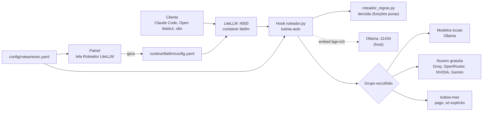

[🏠 TudoIA](../../README.md) › [📚 Documentação](../README.md) › 🔀 Roteador

# 🔀 Roteador (LiteLLM e `tudoia-auto`)

> Para quem opera, configura ou depura o gateway de modelos. Responde: quais grupos existem, como o `tudoia-auto`
> decide, como o gateway reage a falhas e onde olhar o destino real de um pedido.

## 📑 Sumário

- [🎯 Visão geral](#-visão-geral)
- [🧭 Grupos e aliases](#-grupos-e-aliases)
- [🤖 Como o `tudoia-auto` decide](#-como-o-tudoia-auto-decide)
- [🧱 Resiliência](#-resiliência)
- [🖼️ Imagens e `cache_control`](#️-imagens-e-cache_control)
- [📜 Logs e eventos](#-logs-e-eventos)
- [⚙️ Opções](#️-opções)
- [🚀 Uso](#-uso)
- [❌ Erros e diagnóstico](#-erros-e-diagnóstico)
- [🛡️ Segurança](#️-segurança)
- [❓ Perguntas frequentes](#-perguntas-frequentes)

---

## 🎯 Visão geral

Os clientes falam com um único endereço, `http://127.0.0.1:4000`, usando a API OpenAI (`/v1/chat/completions`) ou a API
Anthropic (`/v1/messages`, usada pelo Claude Code). O gateway é o LiteLLM em container. Por cima dele, um hook em Python
(`proxy_handler_instance`, registrado em `litellm_settings.callbacks`) escolhe, para cada pedido, o grupo de modelos que o
atende.

| Arquivo | Papel |
|---|---|
| `runtime/litellm/roteador.py` | Hook (`Roteador`, herda `CustomLogger`): pré-chamada, embedding, escolha de membro, streaming, sucesso, erro, logs. |
| `runtime/litellm/roteador_regras.py` | Funções puras: marcadores, pontuação, kNN, `decidir`, leitura de limites e quarentena, `validar_regras`. Só biblioteca padrão. |
| `runtime/litellm/roteador_resiliente.py` | Em `/v1/messages`: segura o stream até estar completo, detecta laço e corte por `max_tokens`, refaz em outro membro. |
| `runtime/litellm/roteador_eventos.py` | Eventos da tela "Telemetria & Logs": lista branca de campos, gravador em thread própria, corte por idade e tamanho. |
| `runtime/litellm/config.yaml` | Gerado pelo painel (`gerador.py`). Não edite à mão. Ignorado pelo git. |
| `config/roteamento.yaml` | Pesos, limiar, palavras, ordem dos membros, grupos customizados. Relido quando muda. |
| `config/catalogo-modelos.yaml` | Provedores, modelos, `tier` (`FREE`/`PAID`), papéis, limites. Fonte do `config.yaml`. |
| `config/exemplos-roteamento.yaml` | Frases rotuladas `local` e `nuvem` do classificador semântico (80 itens na data da verificação). |
| `config/precos-referencia.yaml` | Preços de referência (US$ por milhão de tokens) para a "economia estimada" de `/api/limites-tokens`. Não é cobrança. |
| `painel/tudoia_painel/gerador.py` | Monta o `config.yaml`. |
| `painel/tudoia_painel/roteador_service.py` | Edição dos grupos pelo painel: detalhes, composição, criar, atualizar, excluir, auto-vínculo. |
| `painel/tudoia_painel/rotas/roteador.py` | Rotas `/api/roteador/*` ([painel.md](painel.md#modelos-provedores-e-roteador)). |

O serviço `litellm` do `runtime/docker-compose.yml` publica `127.0.0.1:4000:4000`, usa o database `litellm` do Postgres
único e monta `config/` e os quatro arquivos do hook como somente leitura (`config.yaml` em `/app/config.yaml`, os `.py`
em `/app`, `dados/logs` em `/app/logs`). Não lê o `.env` inteiro: recebe só `DATABASE_URL`, `LITELLM_MASTER_KEY`,
`OLLAMA_URL`, `TZ` e as chaves de provedor listadas em `environment` (`NVIDIA_NIM_API_KEY`, `NVIDIA_NIM_API_BASE`,
`OPENROUTER_API_KEY`, `GROQ_API_KEY`, `GEMINI_API_KEY`, `CLOUDFLARE_API_KEY`, `CLOUDFLARE_ACCOUNT_ID`, `ANTHROPIC_API_KEY`,
`OPENAI_API_KEY`, `DEEPSEEK_API_KEY`, `XAI_API_KEY`, `HF_TOKEN`). Provedor novo no catálogo precisa
entrar nessa lista; `tests/runtime/test_compose.py` falha se faltar. Healthcheck: `GET /health/liveliness` a cada 30 s.

## 🧭 Grupos e aliases

O cliente escolhe um nome de modelo, que é um grupo do LiteLLM. Grupos criados por `gerador.py`:

| Grupo | Membros | Uso |
|---|---|---|
| `tudoia-auto` | Virtual. O hook troca o nome pelo grupo escolhido. Sem o hook, cai no modelo local padrão. | Padrão para roteamento automático |
| `tudoia-nuvem` | Membros `FREE` na ordem de `roteamento.yaml`. Sem membros: modelo local padrão. | Pedidos leves ou de texto |
| `tudoia-codigo` | Membros `FREE`. Sem membros: modelo local de código. | Pedidos com `tools` ou bloco de código |
| `tudoia-codigo-reserva` | Membros `FREE` de reserva de `tudoia-codigo`. | Quando o principal falha |
| `tudoia-visao` | Membros `FREE` com visão. Sem membros o grupo não existe e o hook ignora a imagem. | Pedidos com imagem |
| `tudoia-max` | Membros `PAID`, com `order` crescente. Nunca é escolhido sozinho. | `#max` ou o nome |
| `tudoia-local` | Modelo local padrão (Ollama) | Fallback local e `#local` |
| `tudoia-local-agente` | Modelo local de código (Ollama) | Fallback local para ferramentas |

Grupos extras podem ser criados na tela Roteador LiteLLM; entram em `ordem` e viram grupos do LiteLLM. `grupos_desativados` os
omite. Membros com prefixo `local/` viram deployments Ollama (`ollama_chat/<modelo>`), sem custo.

Todo modelo `FREE` pedido pelo nome também recebe fallback para `tudoia-nuvem`; `PAID` pedido pelo nome nunca troca
sozinho.

`tudoia-chat` e `tudoia-agente` são nomes de modelos do Ollama (criados de `runtime/ollama/modelfiles/`), não grupos: um
cliente que os peça ao gateway não recebe roteamento.

Um membro só entra no `config.yaml` se o provedor tem todas as chaves preenchidas (`provedores_ligados`) e o modelo está
`ativo` no catálogo.

## 🤖 Como o `tudoia-auto` decide

`decidir` (`roteador_regras.py`) roda antes de cada chamada a `tudoia-auto`, nesta ordem:

1. **Marcador** na última mensagem do usuário: `#local`, `#nuvem` ou `#max` (sem diferenciar maiúsculas, com espaço ou
   início antes do `#`). É removido do texto. `#local` vai direto a `tudoia-local` e nunca é desviado pelo hook.
   `#nuvem` vai a `tudoia-nuvem`. `#max` vai a `tudoia-max` se o grupo existir; senão segue as regras normais.
2. **Ferramentas** (`tools`): `tudoia-codigo`, mesmo com imagem (motivo `imagem com ferramentas`; para ver a imagem com
   ferramentas, use `#max`).
3. **Imagem** sem ferramentas: `tudoia-visao`, se o grupo existir.
4. **Pontuação** (pesos de `config/roteamento.yaml`):

   | Critério | Peso | Condição |
   |---|---|---|
   | `longo` | +3 | Última mensagem com mais de 2000 caracteres, ou pedido com mais de 12000 tokens estimados |
   | `codigo` | +2 | Bloco de código, stack trace, diff ou linha `Erro:`/`Exception:` na última mensagem |
   | `palavras_dificeis` | +2 por palavra, até 2 | Termos da lista, casados no início de palavra, sem acento |
   | `muitos_turnos` | +1 | Mais de 8 mensagens do usuário |
   | `trivial` | −3 | Só sem palavra difícil nem código, com termo de `palavras_triviais` como palavra inteira |
   | `semantico_nuvem` | +3 | kNN: rótulo `nuvem` mais votado entre os 7 vizinhos, margem de pelo menos 2 |
   | `semantico_local` | −2 | Idem com rótulo `local` |

   Pontuação `>= limiar` (3) vai a `tudoia-nuvem`; abaixo, a `tudoia-local`.
5. **GPU ocupada**: com `gpu.json` indicando job de vídeo com lock ativo, `tudoia-local` vira `tudoia-nuvem` (salvo
   `#local`, ou se todos os membros da nuvem estão esgotados).
6. **Provedores esgotados**: se todos os membros de `tudoia-nuvem` (ou `tudoia-codigo`) estão esgotados, o pedido vai a
   `tudoia-local` (ou `tudoia-local-agente`).
7. **Ollama fora** (`_ollama_no_ar`): se a decisão deu `tudoia-local` ou `tudoia-local-agente` sem `#local`, o hook consulta
   `GET /api/version`. Fora do ar, `tudoia-local` vira `tudoia-nuvem` e `tudoia-local-agente` vira `tudoia-codigo`
   (`ollama fora`). `#local` nunca é desviado. Resultado vale 10 s, timeout 0,3 s. Erro que não diz nada sobre o Ollama
   mantém o destino local.

**Embedding do kNN**: o hook chama `POST {OLLAMA_URL}/api/embed` com o modelo `bge-m3` em CPU (`num_gpu: 0`,
`keep_alive: 30m`). O pedido espera no máximo 1,5 s (`LIMITE_EMBED_S`); passou disso, segue sem o semântico (motivo
`semantico_indisponivel`). Só embute se o pedido vai ser pontuado (`precisa_pontuar`). Os vetores dos exemplos ficam em
cache em `dados/logs/exemplos-vetores.json`, indexados por SHA-1 do texto; vetor de dimensão diferente (cache de outro
modelo) não vota. Na primeira requisição o hook aquece o `bge-m3` em segundo plano. Exemplos aprendidos
(`config/exemplos-aprendidos.yaml`, opcional) são aceitos se existirem.

Exemplos (a partir do código e do YAML atual):

| Pedido | Resultado |
|---|---|
| `oi, tudo bem?` | Trivial (−3), sem palavra difícil: tende a `tudoia-local`, salvo se o kNN somar `semantico_nuvem`. |
| `Compare duas arquiteturas de fila e explique o trade-off` | `palavras_dificeis` (+4, teto de 2 palavras) e possivelmente `longo`/`semantico_nuvem`: `tudoia-nuvem`. |
| `#nuvem oi` | Marcador: `tudoia-nuvem`; o texto enviado é `oi`. |
| Pedido com `tools` | `tudoia-codigo`, mesmo com imagem. |
| `previsão do tempo` | `revis` não casa: palavras difíceis casam só no início de palavra. |

## 🧱 Resiliência

### 1. Cooldown do próprio LiteLLM

Definido em `router_settings` por `gerador.py` (cada valor é comentado no código com a medição que o motivou):

| Parâmetro | Valor | Efeito |
|---|---|---|
| `routing_strategy` | `latency-based-routing` | Escolhe o membro mais rápido; membro sem histórico conta como latência zero e é testado. |
| `allowed_fails` | 1 | Falhas por minuto antes de esfriar o membro. |
| `allowed_fails_policy` | Timeout 3, RateLimit 1, InternalServerError 2, BadRequest 5, Authentication 0 | Limite por tipo; autenticação esfria na primeira falha. |
| `cooldown_time` | 60 s | Tempo fora depois de esfriar. |
| `num_retries` | 1 | Nova tentativa no router. |
| `enable_pre_call_checks` | `true` | Pula membro cujo `max_input_tokens` não cabe no pedido. |
| `fallbacks` | `tudoia-nuvem`→`tudoia-local`; `tudoia-codigo`→reserva e `tudoia-local-agente`; `tudoia-max`→`tudoia-nuvem`; `tudoia-visao`→`tudoia-nuvem` | Só para os grupos existentes. |
| `context_window_fallbacks` | `tudoia-local`→`tudoia-nuvem` | Ver o aviso abaixo. |

Timeouts por membro (`gerador.py`): nuvem 60 s (espera sem dados), stream de nuvem 30 s de silêncio, local 600 s, agente
local 300 s. Geral: `request_timeout` 60.

> [!WARNING]
> `context_window_fallbacks` leva um pedido que não cabe no contexto do modelo local à nuvem, **inclusive com `#local`**
> em `tudoia-auto` ou direto em `tudoia-local`; o hook não roda nessa troca. É risco aceito (decisão do dono, registrada
> no comentário de `gerador.py`; ver [seguranca.md](../seguranca.md)). Esta versão não tem grupo só local sem esse
> desvio: se o dado não pode sair da máquina, não use o gateway para ele.

### 2. Limites, quarentena e GPU lidos de arquivo

O hook lê em `dados/logs/` (relido só quando o arquivo muda): `limites.json` (`esgotados` e `membros` por grupo, válido
por 120 s desde `ts`), `quarentena.json` (cada entrada tem `ate`; `membros` vale por 3600 s) e `gpu.json` (`dono` e
`expira_em` em UTC). Esses membros são descartados da escolha. Arquivo ausente, vencido ou malformado equivale a "sem
informação" e nunca derruba o roteamento.

> [!NOTE]
> Nenhum código deste repositório grava `limites.json`, `quarentena.json` ou `gpu.json` (busca em `*.py` encontra só
> leitores e o caminho em `caminhos.py`). O comentário de `roteador_regras.py` diz que o painel grava `limites.json`, mas
> isso não se confirma no código versionado. Se algum processo externo os grava, está fora do repositório. Sem escritor,
> os desvios por "esgotados" e "gpu ocupada" não disparam.

### 3. Refazer quando o stream falha (`/v1/messages`)

`roteador_resiliente.py`:

- O hook segura os bytes da resposta até chegar `message_stop`. Stream que termina sem isso, com `event: error`, ou
  cortado por `max_tokens` (sem o cliente ter pedido pouco) é descartado e o pedido é refeito. Os eventos são lidos só das
  linhas `event:` do SSE, então texto de modelo que fale de "SSE" não parece erro.
- A nova tentativa vai ao próximo membro do grupo, até `MAX_TENTATIVAS = 3` além da original, depois aos fallbacks do grupo.
  Os campos do pedido vêm de uma lista de permitidos (`CAMPOS_DO_CLIENTE`); carimbos internos do router não são reenviados.
- Enquanto segura a resposta, envia `event: ping` a cada 10 s (`PING_S`).
- Se todas as tentativas falham, o cliente recebe `event: error` com "TudoIA: todos os modelos falharam nesta resposta".
- `DetectorDeLaco`: repetição exata de um trecho gerado (texto, pensamento ou JSON de ferramenta) com período de até 750
  caracteres e pelo menos 4 cópias seguidas nos últimos 3000 caracteres corta o stream e refaz.
- `stop_reason: max_tokens` só é falha quando o orçamento do pedido é grande (8192 ou mais, `ORCAMENTO_PEQUENO`) ou a saída
  ficou abaixo de 90% do pedido.

Sem streaming, a nova tentativa segue o `router_settings`.

## 🖼️ Imagens e `cache_control`

Depois da decisão, o hook ajusta o corpo ao destino:

- Destino com visão (`tudoia-visao`, `tudoia-max`): imagens seguem como vieram.
- Destino sem visão e pedido com `tools`: todas as imagens viram texto (`[Imagem anterior no histórico omitida]`),
  inclusive as da última mensagem e as de `tool_result`.
- Destino sem visão e sem `tools`: se a última mensagem do usuário não tem imagem, as do histórico viram texto; se tem, o
  pedido segue como veio.
- `cache_control` só fica para deployments pagos pedidos pelo nome e sem fallback (`destinos_com_cache`); nos outros é
  removido de `system`, mensagens e ferramentas.

## 📜 Logs e eventos

Tudo em `dados/logs/` (montado em `/app/logs`):

| Arquivo | Conteúdo | Retenção |
|---|---|---|
| `eventos.jsonl` | Eventos da tela Telemetria & Logs: `inicio`, `modelo` (cada tentativa), `progresso`, `fim`, `erro`, `vazia`, `cancelado` | 24 h e 20 MB (`Gravador`, `cortar_arquivo`) |
| `roteador.jsonl` | Uma linha por decisão: grupo, pontos, motivos, marcador, modelo, provedor, membro, tempo, sucesso, erro | Vira `.1` ao passar de 5 MB |
| `correcoes.jsonl` | Rótulo (`local`/`nuvem`), SHA-1 e tamanho do pedido quando o usuário usa `#local`/`#nuvem`. Nunca o texto | Vira `.1` ao passar de 5 MB |
| `ratelimit.json` | Últimos cabeçalhos `x-ratelimit-*` por provedor | Atualizado por provedor |
| `exemplos-vetores.json` | Cache SHA-1 do texto para vetor `bge-m3` | Sem corte |

`eventos.jsonl` só guarda os campos da lista branca `CAMPOS` (`roteador_eventos.py`): `origem`, `call_type`, `grupo`,
`pontos`, `motivos`, `marcador`, `modelo_pedido`, `stream`, `modelo`, `provedor`, `membro`, `tentativa`, `tokens_entrada`,
`tokens_saida`, `tok_s`, `ms`, `custo_usd`, `erro`, `ok`, `finish_reason`. Nenhum é texto
de pedido ou resposta. O erro é registrado como classe da exceção e código HTTP (`resumir_erro`), sem a mensagem.

Nenhum código lê `correcoes.jsonl` nem gera `exemplos-aprendidos.yaml`: o aprendizado a partir de correções não existe. Se
for construído, precisa de decisão sobre guardar texto.

A telemetria do painel (`/api/telemetria`) lê `eventos.jsonl` e `/spend/logs` do LiteLLM (últimas 24 h);
`/api/limites-tokens` lê o período pedido e usa `config/precos-referencia.yaml` para a economia estimada.

## ⚙️ Opções

### `config/roteamento.yaml`

| Chave | Padrão atual | Efeito |
|---|---|---|
| `limiar` | 3 | Pontuação mínima para `tudoia-nuvem`. |
| `pesos` | ver tabela de decisão | `longo`, `codigo`, `palavras_dificeis`, `muitos_turnos`, `trivial`, `semantico_nuvem`, `semantico_local`. |
| `limites_texto` | `caracteres` 2000, `tokens_total` 12000, `turnos` 8 | Gatilhos de `longo` e `muitos_turnos`. |
| `palavras_dificeis`, `palavras_triviais` | listas em minúsculas | Comparadas sem acento. Difíceis casam no início de palavra (`revis` casa "revisão", não "previsão"); triviais, só palavra inteira. |
| `ordem` | por grupo | Membros (nome do catálogo) na ordem de tentativa. Prefixo `local/` = Ollama. |
| `grupos_desativados` | `[]` | Grupos omitidos do `config.yaml`. |
| `grupos_customizados` | metadados | Título, descrição, `tier` e papéis exibidos na tela Roteador LiteLLM. |

O hook relê o arquivo quando o `mtime` muda. Se o novo for inválido (`validar_regras`), mantém a última
versão válida e registra no log. Pesos e palavras entram sem reiniciar. A `ordem` dos membros só vale depois
de regerar o `config.yaml` e reiniciar o LiteLLM, porque o `model_list` é lido na inicialização. Edições feitas pelo painel regravam o
arquivo e perdem os comentários.

### `config/catalogo-modelos.yaml`

Por provedor: `nome`, `tier`, `chave` e `chaves_extras`, `api_base`, `url_modelos`, `limites`, `fonte_limites`, `modelos`.
Por modelo: `nome` (nome do membro), `id` (identificador no LiteLLM), `papeis`, `contexto`, `ativo` (padrão `true`).

### Exemplos e preços

`config/exemplos-roteamento.yaml`: listas `local` e `nuvem`. Não repita ali as `palavras_dificeis`, porque o semântico
existe para o que a lista não pega. `config/precos-referencia.yaml`: declara a própria `data` (2026-10-22) e a
`referencia_padrao`; entrada inválida é ignorada e listada em "problemas" no painel.

## 🚀 Uso

- **Escolher no cliente**: Claude Code, Open WebUI e n8n escolhem o modelo (`tudoia-auto`, `tudoia-local`, `tudoia-nuvem`,
  `tudoia-codigo`, ...). Em `tudoia-auto`, a mensagem pode levar os marcadores `#local`, `#nuvem` e `#max`.
- **Editar grupos** na tela Roteador LiteLLM (`PUT /api/roteador/grupos`, `POST .../grupos/novo`, `PATCH`/`DELETE
  .../grupos/{id}`, `POST .../auto-bind`): cada uma dessas rotas regrava `roteamento.yaml` e regenera o
  `runtime/litellm/config.yaml` (`regenerar_config_litellm`, sem levantar erro). **Nada reinicia o LiteLLM.**
  `POST /api/roteador/gerar` faz só a geração. Ids de grupo seguem `^[a-z0-9][a-z0-9_-]{1,63}$`.
- **Trocar um provedor**: preencha a chave no `.env` (ou na tela Cofre de Segredos); confirme o modelo `ativo: true` no
  catálogo; ponha o membro na `ordem` do grupo; gere o `config.yaml`; recrie o `litellm`. Provedor sem todas as chaves fica
  fora do `config.yaml`, sem erro.
- **Reiniciar o gateway**: tela Serviços & Runtime do painel, `.\scripts\tudoia.ps1 up`, ou
  `docker compose -p tudoia -f runtime\docker-compose.yml --env-file .env up -d --force-recreate --no-deps litellm`. O
  `restart` simples não relê o `.env` (ver [painel.md](painel.md#-serviços-controlados)).
- **Ver o destino real**: `dados\logs\roteador.jsonl` (uma linha por pedido) e a tela Telemetria & Logs.
- **Checar o gateway**: `curl.exe -s http://127.0.0.1:4000/v1/models -H "Authorization: Bearer $env:LITELLM_MASTER_KEY"`,
  com a chave carregada na variável de ambiente da sessão, nunca colada em arquivo.

### Chaves virtuais do LiteLLM: restringir grupos por cliente

A documentação do LiteLLM ([model_access](https://docs.litellm.ai/docs/proxy/model_access)) permite gerar uma chave com
`POST /key/generate` e `"models": ["tudoia-local", "tudoia-local-agente"]`: a chave só enxerga e só chama esses modelos.
É o único controle de acesso por cliente; a chave mestra continua irrestrita. **Não verificado** nesta revisão contra um
LiteLLM em execução. Atenção: `context_window_fallbacks` leva `tudoia-local` à nuvem quando o pedido não cabe no contexto
local, então a lista de modelos da chave não, por si só, garante que nada saia da máquina.

O [tag routing](https://docs.litellm.ai/docs/proxy/tag_routing) do LiteLLM não é usado: o Claude Code não manda tags.

## ❌ Erros e diagnóstico

| Sintoma | Causa | Ação |
|---|---|---|
| Mudou a `ordem` e nada mudou | `config.yaml` regenerado, LiteLLM não reiniciado | Recrie o container `litellm`. |
| `Invalid model name` | `config.yaml` sem o modelo | Gere o config e reinicie o LiteLLM. |
| Log do container: `[roteador] não li ...` | Hook sem acesso a `roteamento.yaml` ou `config.yaml`; `#max`, visão e nova tentativa ficam desligados | Confira os volumes e a validade do YAML. |
| `tudoia-auto` nunca desvia por "esgotado" ou "gpu ocupada" | Não há escritor de `limites.json`/`quarentena.json`/`gpu.json` | Ver a nota na seção [Resiliência](#2-limites-quarentena-e-gpu-lidos-de-arquivo). |
| Resposta `/v1/messages` cortada com "todos os modelos falharam" | As 3 tentativas falharam | Veja `eventos.jsonl` (evento `erro`) e o estado de cooldown dos provedores. |

## 🛡️ Segurança

- **Não é controle de acesso.** O destino é escolhido pelo cliente: quem tem a chave do gateway pode pedir
  `tudoia-nuvem`, `tudoia-max` ou `tudoia-auto`. Para restringir, use chave virtual com lista de modelos.
- Os marcadores vêm do texto do usuário. Texto colado com `#nuvem` ou `#max` muda o destino em `tudoia-auto`. Para
  conteúdo de terceiros, não use `tudoia-auto` (IA-PRV-01, IA-PRV-02).
- `#local` e `tudoia-local` não são garantia de que nada sai da máquina: `context_window_fallbacks` e o fallback do router
  podem levar o pedido à nuvem (ver o aviso em [Resiliência](#-resiliência)).
- Não foi exercitado nesta revisão nenhum comportamento contra um LiteLLM em execução (regra: não reiniciar o gateway). Os
  testes cobrem o `config.yaml` gerado, as decisões e o hook com LiteLLM simulado.
- O container só recebe as variáveis de provedor listadas no compose; segredos de Keycloak, n8n ou GitHub não entram.
- Logs são metadados, não texto; `correcoes.jsonl` guarda SHA-1 e tamanho, não o pedido.

## ❓ Perguntas frequentes

**`tudoia-chat` é um grupo?** Não: é um modelo do Ollama. Pedi-lo ao gateway não aciona roteamento.

**Posso editar `runtime/litellm/config.yaml` à mão?** Não. O cabeçalho do arquivo diz "GERADO"; a próxima geração o
sobrescreve (e guarda o anterior em `config.yaml.anterior`). A gravação recusa gerar se o código do gerador mudou desde que
o painel abriu: reinicie o painel.

---

[🏠 README](../../README.md) · ⬅️ [Estúdio](estudio.md) · [Cérebro](cerebro.md) ➡️
