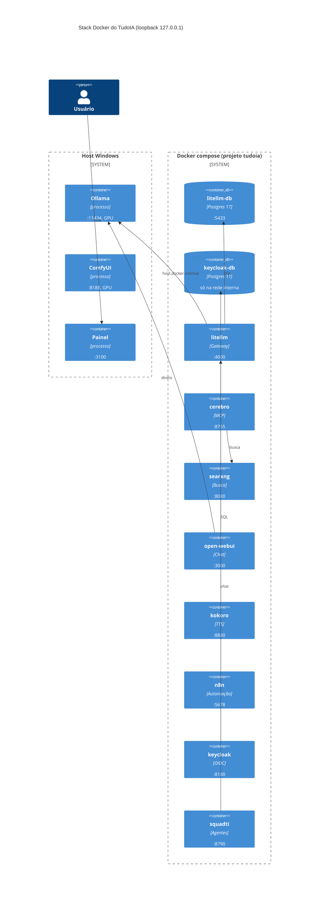

[🏠 TudoIA](../../README.md) › [📚 Documentação](../README.md) › 🐳 Serviços Docker

# 🐳 Serviços Docker e processos do host

> Para quem opera e mantém o stack. Responde: quais containers existem, em que porta, com que volumes, usuário e limites,
> quais perfis os ligam, como subir e parar, e o que fica fora do Docker (Ollama e ComfyUI).
> Fonte da verdade: `runtime/docker-compose.yml`, guardado por `tests/runtime/test_compose.py`.

## 📑 Sumário

- [🎯 Visão geral](#-visão-geral)
- [📦 Containers](#-containers)
- [🗄️ Bancos Postgres](#️-bancos-postgres)
- [🚀 Uso](#-uso)
- [⚙️ Opções](#️-opções)
- [🖥️ Processos do host](#️-processos-do-host)
- [❌ Erros / diagnóstico](#-erros--diagnóstico)
- [🛡️ Segurança](#️-segurança)
- [❓ Perguntas frequentes](#-perguntas-frequentes)

## 🎯 Visão geral

Os containers vivem em `runtime/docker-compose.yml` (projeto `tudoia`, `name: tudoia`). Ollama e ComfyUI rodam direto no
Windows porque precisam da GPU e ficam fora do compose.

- **Perfis.** Só `litellm-db` e `litellm` sobem sem perfil. O resto é escolhido em `COMPOSE_PROFILES` no `.env`
  (o `.env.example` traz `cerebro,webui,n8n,keycloak`; o perfil `squadti` não vem ligado):

  | Perfil | Serviços |
  |---|---|
  | (nenhum) | `litellm-db`, `litellm` |
  | `cerebro` | `cerebro`, `searxng` |
  | `webui` | `open-webui`, `kokoro`, `searxng` |
  | `n8n` | `n8n` |
  | `keycloak` | `keycloak-db`, `keycloak` |
  | `squadti` | `squadti` |

- **Portas.** Todas publicadas só em `127.0.0.1` (o teste `test_portas_so_em_loopback` falha se alguma não for).
- **Segredos.** O compose lê o `.env` da raiz (`--env-file`) só para substituir `${VAR}`. Nenhum serviço usa `env_file`:
  cada um recebe só as variáveis listadas em `environment`.
- **Rede.** O compose não declara redes: todos os serviços ficam na rede padrão do projeto (`<projeto>_default`) e se
  alcançam pelo nome do serviço (`litellm-db`, `litellm`, `searxng`, `cerebro`). Para o host (Ollama, Keycloak a partir
  do Cérebro) usam `host.docker.internal`, mapeado por `extra_hosts: host-gateway`.
- **Projeto.** `TUDOIA_COMPOSE_PROJETO` no `.env` (padrão `tudoia`) muda o prefixo dos volumes e containers de rede;
  outro nome isola uma segunda instalação. Os `container_name` são fixos, então duas instalações não coexistem sem
  ajuste.
- **Imagens.** As de terceiros estão fixadas por digest `@sha256:`. `cerebro` e `squadti` são construídos localmente
  (ver [Riscos e limites](#️-segurança)).



## 📦 Containers

Digests omitidos por legibilidade; a tag completa está no compose. Todos têm `restart: unless-stopped`.

| Serviço | Container | Imagem | Porta no host | Healthcheck |
|---|---|---|---|---|
| `litellm-db` | `litellm-db` | `postgres:17.6-alpine` | `5433` para `5432` | `pg_isready -U litellm -d litellm`, 5 s, timeout 5 s, 10 tentativas |
| `keycloak-db` | `keycloak-db` | `postgres:17-alpine` | nenhuma | `pg_isready -U keycloak -d keycloak`, 5 s, timeout 5 s, 10 tentativas |
| `litellm` | `litellm` | `ghcr.io/berriai/litellm:main-latest` | `4000` | `GET /health/liveliness`, 30 s, timeout 10 s, 3 tentativas, início 60 s |
| `searxng` | `searxng` | `searxng/searxng:2026.10.19-81371861f` | `8080` | `GET /healthz` contém `OK`, 30 s, início 20 s |
| `cerebro` | `cerebro` | build de `runtime/cerebro/Dockerfile` | `8765` | `GET /saude`, 30 s, início 30 s |
| `squadti` | `squadti` | build de `runtime/squadti/Dockerfile` | `8790` | `GET /saude`, 30 s, início 30 s |
| `kokoro` | `kokoro` | `ghcr.io/remsky/kokoro-fastapi-cpu:v0.9.0` | `8880` | nenhum |
| `open-webui` | `open-webui` | `ghcr.io/open-webui/open-webui:main` | `3000` para `8080` | nenhum |
| `n8n` | `n8n` | `docker.n8n.io/n8nio/n8n:latest` | `5678` | `GET /healthz` (via `node -e fetch`), 30 s, início 60 s |
| `keycloak` | `keycloak` | `quay.io/keycloak/keycloak:26.3` | `8180` para `8080` | `GET /health/ready` na porta de gerenciamento 9000 (só dentro do container) por `/dev/tcp` do bash, 10 s, 30 tentativas, início 90 s |

### Variáveis, volumes e dependências

| Serviço | Variáveis recebidas (nomes) | Volumes | Depende de |
|---|---|---|---|
| `litellm-db` | `POSTGRES_USER=litellm`, `POSTGRES_DB=litellm`, `POSTGRES_PASSWORD` (de `LITELLM_DB_PASSWORD`), `TZ` | volume `litellm-db` em `/var/lib/postgresql/data` | nada |
| `keycloak-db` | `POSTGRES_USER=keycloak`, `POSTGRES_DB=keycloak`, `POSTGRES_PASSWORD` (de `KEYCLOAK_DB_PASSWORD`), `TZ` (`UTC` se ausente) | volume `keycloak-db` em `/var/lib/postgresql/data` | nada |
| `litellm` | `DATABASE_URL` (monta com `LITELLM_DB_PASSWORD`), `LITELLM_MASTER_KEY`, `OLLAMA_URL`, `TZ`, `NVIDIA_NIM_API_KEY`, `NVIDIA_NIM_API_BASE`, `OPENROUTER_API_KEY`, `GROQ_API_KEY`, `GEMINI_API_KEY`, `CLOUDFLARE_API_KEY`, `CLOUDFLARE_ACCOUNT_ID`, `ANTHROPIC_API_KEY`, `OPENAI_API_KEY`, `DEEPSEEK_API_KEY`, `XAI_API_KEY`, `HF_TOKEN` | `runtime/litellm/config.yaml` (gerado), `roteador.py`, `roteador_regras.py`, `roteador_eventos.py`, `roteador_resiliente.py` (todos somente leitura); `config/` em `/app/config` (somente leitura); `dados/logs` em `/app/logs` | `litellm-db` saudável |
| `searxng` | `SEARXNG_SECRET` | `runtime/searxng` em `/etc/searxng` (leitura e escrita) | nada |
| `cerebro` | `OLLAMA_URL` (fixo no compose, `http://host.docker.internal:11434`), `SEARXNG_URL`, `CEREBRO_DOCS`, `CEREBRO_DOCS_HOST`, `CEREBRO_DADOS`, `CEREBRO_OIDC_ISSUER`, `CEREBRO_OIDC_JWKS_URL`, `CEREBRO_OIDC_CLIENT_ID`, `CEREBRO_TOKEN_ESTATICO` | `dados/documentos` em `/docs` (somente leitura); `dados/cerebro` em `/dados` | `searxng` (só início) |
| `squadti` | `TUDOIA_SQUADTI_TOKEN`, `TUDOIA_API_KEY` (de `SQUADTI_API_KEY`), `TUDOIA_GATEWAY_URL`, `TUDOIA_TIMEOUT_S`, `TUDOIA_CONTEXTO_TOKENS`, `TUDOIA_NUGET_USER`, `TUDOIA_NUGET_PAT`, `TUDOIA_NUGET_FEED_URL`, `TESTCONTAINERS_HOST_OVERRIDE` | volume `squadti-dados` em `/dados`; `SQUADTI_TEMPLATE_DIR` (padrão `dados/squadti-template`) em `/template` (somente leitura); `/var/run/docker.sock` | `litellm` saudável |
| `kokoro` | nenhuma | nenhum | nada |
| `open-webui` | `OLLAMA_BASE_URL`, `WEBUI_NAME=TudoIA`, `WEBUI_SECRET_KEY`, `ENABLE_API_KEYS=true`, `TZ` | volume `open-webui` em `/app/backend/data`; `runtime/open-webui/env.py` e nove imagens de `runtime/open-webui/static` sobre `/app/build/static` (somente leitura) | `searxng`, `kokoro` (só início) |
| `n8n` | `GENERIC_TIMEZONE`, `TZ`, `N8N_HOST=localhost`, `N8N_WEBHOOK_URL`, `N8N_RESTRICT_FILE_ACCESS_TO=/data/docs`, `N8N_ENCRYPTION_KEY`, `N8N_BLOCK_ENV_ACCESS_IN_NODE=true` | volume `n8n` em `/home/node/.n8n`; `dados/documentos` em `/data/docs` | nada |
| `keycloak` | `KC_BOOTSTRAP_ADMIN_USERNAME` (de `TUDOIA_KEYCLOAK_ADMIN`, padrão `admin`), `KC_BOOTSTRAP_ADMIN_PASSWORD` (de `TUDOIA_KEYCLOAK_ADMIN_PASSWORD`), `KC_DB*` (aponta para `keycloak-db`), `KC_DB_PASSWORD` (de `KEYCLOAK_DB_PASSWORD`), `KC_HEALTH_ENABLED`, `TZ` | `infra/keycloak/tema/tudoia` em `/opt/keycloak/themes/tudoia` (somente leitura) | `keycloak-db` saudável |

Volumes nomeados (declarados no compose): `open-webui`, `n8n`, `litellm-db`, `keycloak-db`, `squadti-dados`. Com o prefixo do projeto, viram
`tudoia_n8n` etc. O `scripts/backup/backup.py` empacota os volumes `n8n` e `open-webui` e faz `pg_dump` dentro do container `litellm-db` (o `keycloak-db` não entra no backup).

Contratos que os testes cobrem (`tests/runtime/test_compose.py`): sem `env_file`; toda chave `chave:` do catálogo de
modelos e do `config/video-nuvem.yaml` está no `environment` do `litellm`; o `litellm` não recebe segredo alheio; o `n8n`
bloqueia `$env` e não recebe `TUDOIA_MCP_CLIENT_SECRET`; só `litellm` e `litellm-db` não têm perfil; dependência fica no
mesmo perfil do dependente; o Keycloak embutido usa imagem fixada e segredos do `.env`.

### Ordem de início

Só `litellm` (espera o `litellm-db` saudável), `keycloak` (espera o `keycloak-db` saudável) e `squadti` (espera o `litellm` saudável) têm `depends_on`
com condição. Os demais `depends_on` (`cerebro` e `open-webui`) garantem só a ordem de criação, não a prontidão.

### SquadTI: isolamento e docker.sock

O serviço `squadti` compila e testa código escrito por modelo, por isso roda com: `read_only: true`, `tmpfs /tmp` de 1 GB,
`cap_drop: [ALL]`, `no-new-privileges`, `pids_limit: 1024`, `mem_limit` (`SQUADTI_MEMORIA`, padrão `6g`) e `cpus`
(`SQUADTI_CPUS`, padrão `4`). O processo é o usuário `squadti` (uid 10001, `Dockerfile`), e só o volume `squadti-dados`
é gravável. A imagem é construída com o argumento `DOUTRINA_SHA` (de `SQUADTI_DOUTRINA_SHA`). Detalhes do serviço em
[squadti.md](squadti.md).

> [!CAUTION]
> O `/var/run/docker.sock` do host está montado (decisão do dono, registrada no comentário do compose) para os testes de
> integração com Testcontainers, e `group_add: ["0"]` dá ao usuário 10001 acesso ao socket (no Docker Desktop ele é
> `root:root 0660`). Quem controla o socket controla o Docker do host e pode virar root nele: o código gerado pelo modelo
> deixa de estar isolado do host. O endurecimento restante reduz o dano por outros caminhos, não por este. Para voltar ao
> isolamento, remova a linha do socket, o `group_add` e `TESTCONTAINERS_HOST_OVERRIDE`; os testes de integração deixam
> de rodar.

Feed NuGet das bibliotecas `TEC.*` (todos opcionais, só por ambiente): `TUDOIA_NUGET_FEED_URL` (feed público, sem
credencial) ou o par `TUDOIA_NUGET_USER` + `TUDOIA_NUGET_PAT` (feed privado `tec-interno`; o GitHub Packages exige PAT com
`read:packages`). Sem nenhum, o restore dos pacotes `TEC.*` não tem origem. Como cada um é consumido: [squadti.md](squadti.md).

## 🗄️ Bancos Postgres

Cada consumidor tem o seu servidor Postgres, sem script de init: a imagem cria o role e o database a partir de
`POSTGRES_USER`, `POSTGRES_DB` e `POSTGRES_PASSWORD`.

| Container | Role e database | Senha (variável do `.env`) | Porta no host | Perfil |
|---|---|---|---|---|
| `litellm-db` | `litellm` / `litellm` | `LITELLM_DB_PASSWORD` | `127.0.0.1:5433` | sempre |
| `keycloak-db` | `keycloak` / `keycloak` | `KEYCLOAK_DB_PASSWORD` | nenhuma (só pela rede do compose) | `keycloak` |

> [!WARNING]
> A senha só vale na criação do volume. Trocar `LITELLM_DB_PASSWORD` ou `KEYCLOAK_DB_PASSWORD` no `.env` depois da primeira
> subida **não** altera a senha dentro do banco (ver [runbook](../operacao.md#senha-do-postgres-trocada-no-env-sem-mudar-no-banco)).
> Nenhuma das duas variáveis tem `:?` no compose: vazias, o serviço sobe e o banco recusa o login. Rode
> `scripts/tudoia.ps1 segredos` antes do primeiro `up`.

## 🚀 Uso

### Pelo script (recomendado)

Na raiz do repositório, em PowerShell (ou `scripts\tudoia.cmd`):

```powershell
scripts\tudoia.ps1 up       # sobe Ollama se a 11434 estiver livre; py sync (governança); compose up -d --build; sobe o painel
scripts\tudoia.ps1 status   # docker compose ps
scripts\tudoia.ps1 down     # docker compose down (remove containers e rede; mantém os volumes)
scripts\tudoia.ps1 painel   # painel em primeiro plano, em http://127.0.0.1:3100/app/
```

- `up` não sobe o ComfyUI (use o painel ou `run_nvidia_gpu.bat`) e faz `--build`, reconstruindo `cerebro` e `squadti`.
- O script usa `TUDOIA_COMPOSE_PROJETO` do `.env` como nome do projeto.
- Se um comando nativo falhar (por exemplo o `sync`), o script encerra com o mesmo código e o `up` não segue.
- Há também `scripts\iniciar.ps1`, `parar.ps1` e `reiniciar.ps1` (ciclo de vida do painel e do stack). O que cada um faz
  está em [../operacao.md](../operacao.md) e [painel.md](painel.md).
- Outros comandos (`sync`, `verificar`, `segredos`, `keycloak`, `modelos`, `n8n-credencial`, `squadti-chave`, `backup`,
  `verificar-openwebui`, `empacotar`) estão em [../instalacao.md](../instalacao.md) e nos docs de cada componente.
- Linux: `scripts/tudoia.sh`, mesmos comandos principais.

### Direto pelo Docker Compose

```powershell
docker compose -p tudoia -f runtime\docker-compose.yml --env-file .env up -d
docker compose -p tudoia -f runtime\docker-compose.yml ps
docker compose -p tudoia -f runtime\docker-compose.yml logs -f litellm
docker compose -p tudoia -f runtime\docker-compose.yml stop
```

Um serviço só: acrescente o nome (`up -d cerebro`, `logs -f n8n`). Serviço com perfil só aparece se o perfil estiver em
`COMPOSE_PROFILES` ou for passado com `--profile`.

### Pelo painel

`painel/tudoia_painel/servicos.py` expõe `POST /api/servicos/{nome}/{acao}` (`start`, `stop`, `restart`) e
`POST /api/servicos/todos/{acao}`:

| Ação em container | Comando compose |
|---|---|
| `start` | `up -d <serviço>` |
| `stop` | `stop <serviço>` |
| `restart` | `restart <serviço>` (mantém o ambiente com que o container foi criado: não relê o `.env`) |

Em `todos`: `start` sobe Ollama e ComfyUI (se as portas estiverem fechadas) e faz `up -d`; `stop` encerra os dois e faz
`stop`; `restart` reinicia os dois e faz `restart` do compose. Falha ao subir Ollama ou ComfyUI é só registrada em log:
a resposta não acusa. Confira em `dados/logs/comfyui.log`. O painel lê `TUDOIA_COMPOSE_PROJETO` a cada chamada.

### Checar a saúde

- Containers com healthcheck: `docker inspect --format "{{.State.Health.Status}}" <nome>` deve dar `healthy`.
- Painel: `http://127.0.0.1:3100/saude`. Cérebro: `http://127.0.0.1:8765/saude`. LiteLLM: `http://127.0.0.1:4000/ui`.
- ComfyUI: `http://127.0.0.1:8188/system_stats`. Ollama: `http://127.0.0.1:11434`.

## ⚙️ Opções

Variáveis do `.env` que mudam o compose (lista completa em [../configuracao.md](../configuracao.md)):

| Variável | Padrão | Efeito |
|---|---|---|
| `COMPOSE_PROFILES` | `cerebro,webui,n8n,keycloak` (no `.env.example`) | Perfis ligados |
| `TUDOIA_COMPOSE_PROJETO` | `tudoia` | Nome do projeto compose |
| `TZ` | vazia no `.env.example`; sem padrão no compose | Fuso de litellm-db, litellm, open-webui, n8n (`UTC` se ausente em keycloak e keycloak-db) |
| `LITELLM_DB_PASSWORD`, `KEYCLOAK_DB_PASSWORD` | geradas por `segredos` | Senhas dos dois Postgres (valem na criação do volume) |
| `OLLAMA_URL` | `http://host.docker.internal:11434` | Ollama visto pelo LiteLLM |
| `SQUADTI_MEMORIA` / `SQUADTI_CPUS` | `6g` / `4` | Teto de memória e CPU da SquadTI |
| `SQUADTI_TIMEOUT_S` / `SQUADTI_CONTEXTO_TOKENS` | `300` / `32768` | Timeout e contexto da SquadTI |
| `SQUADTI_TEMPLATE_DIR` / `SQUADTI_DOUTRINA_SHA` | `../dados/squadti-template` / SHA fixo no compose | Template TEC e versão da Doutrina embutida |

## 🖥️ Processos do host

### Ollama

- Início: o painel (`_start_ollama`) e o `tudoia.ps1 up` executam `ollama serve` com `OLLAMA_HOST=127.0.0.1:11434` e
  `OLLAMA_MODELS` = `TUDOIA_OLLAMA_MODELS` ou `modelos\ollama\models`.
- Parada: o painel encerra o processo que escuta na 11434 e `ollama.exe`/`ollama_llama_server.exe`.
- No Windows com Docker Desktop, `host.docker.internal` alcança o loopback do host. No Linux sem Docker Desktop, é o IP
  da bridge `docker0`; o `scripts/tudoia.sh` faz o Ollama escutar nesse IPv4 (nunca `0.0.0.0`). Não testado em Linux.

### ComfyUI

- Início: `python_embeded\python.exe ... ComfyUI\main.py --disable-auto-launch` em `TUDOIA_COMFYUI_PORTABLE` (padrão `modelos\comfyui\ComfyUI_windows_portable`; sem esse Python, `cmd.exe /c run_nvidia_gpu.bat`), exigindo o `run_nvidia_gpu.bat` na pasta;
  saída em `dados/logs/comfyui.log`. Porta 8188, não configurável pelo `.env`. Parada por porta e pelo caminho do portable.
  Uso em [estudio.md](estudio.md).

## ❌ Erros / diagnóstico

| Sintoma | Causa provável | Ação |
|---|---|---|
| `litellm` não sobe ou reinicia em laço, log com `password authentication failed` ou `LITELLM_DB_PASSWORD` vazia | senha ausente ou diferente da gravada no volume | rodar `scripts\tudoia.ps1 segredos`; se o volume já existe, ver o runbook de senha do banco |
| `litellm` não sobe, `config.yaml` é diretório | `runtime/litellm/config.yaml` não existe (gerado pelo painel, `POST /api/roteador/gerar`; fora do git) | gerar pelo painel antes do `up`; no Windows, remover o diretório criado pelo Docker |
| Provedor novo sem chave dentro do LiteLLM | chave do catálogo não está no `environment` do `litellm` | acrescentar a variável; `tests/runtime/test_compose.py` detecta |
| Senha do banco trocada e serviço não autentica | a senha vive no volume, criada na primeira subida | [runbook](../operacao.md#senha-do-postgres-trocada-no-env-sem-mudar-no-banco) |
| `up` recusa perfil | dependência em outro perfil | manter dependência no mesmo perfil (teste cobre) |
| Chave nova no `.env` não chega ao container | `restart` simples não relê o `.env` | `up -d --no-deps --force-recreate <serviço>` (o `restart` do painel não recria) |
| `squadti` não cria containers de teste | socket ausente ou sem grupo 0 | ver aviso do docker.sock acima |

## 🛡️ Segurança

- Tudo em loopback; o Keycloak roda em modo `start` com HTTP (`--http-enabled=true`, `--hostname-strict=false`): não
  exponha a porta 8180.
- O LiteLLM não recebe `.env` inteiro: o container mais exposto a texto de terceiros fica sem a senha do Keycloak, o token
  do GitHub e as chaves do n8n.
- Usuários: `cerebro` e `squadti` rodam como uid 10001 (sem root). `litellm-db`, `keycloak-db`, `litellm`, `searxng`, `kokoro`,
  `open-webui`, `n8n` e `keycloak` usam o usuário padrão de cada imagem (não alterado pelo compose; não conferido aqui).
- Imagens `cerebro` e `squadti`: o `cerebro` parte de `python:3.12-slim` e `ghcr.io/astral-sh/uv:0.13.0` por tag, sem
  digest; o `squadti` fixa todas as bases por digest. Risco residual do `cerebro`: a tag pode mudar o conteúdo.
- Imagens `main`/`latest`/`main-latest`: a tag muda, o digest fixa o conteúdo; atualizar exige trocar o digest com
  conferência. Para o Open WebUI, o `env.py` da imagem é comparado por `scripts\tudoia.ps1 verificar-openwebui` contra
  `runtime/open-webui/env.py.aprovado.diff`: o `env.py` do repositório substitui o da imagem (volume somente leitura).
- O Open WebUI fala direto com o Ollama (`OLLAMA_BASE_URL`), sem passar pelo roteador, quarentena ou limites do LiteLLM.
- `N8N_ENCRYPTION_KEY` é parte do backup do n8n: sem ela, o volume `n8n` restaurado não decifra as credenciais. O backup
  não copia o `.env`. Ver [automacao-n8n.md](automacao-n8n.md).
- Modelo de ameaças geral: [../seguranca.md](../seguranca.md). Imagens e licenças: [../terceiros.md](../terceiros.md).

## ❓ Perguntas frequentes

**Os containers sobem sozinhos depois de reiniciar a máquina?** Têm `restart: unless-stopped`, então voltam com o Docker.
Ollama e ComfyUI são processos do host e não voltam sozinhos; use `up` ou o painel.

**`down` ou `stop`?** `down` remove containers e rede; `stop` (do painel) só pausa. Ambos preservam os volumes nomeados.

**Kokoro está ligado ao Open WebUI?** O compose só declara a dependência de início; nenhuma variável aponta o Open WebUI
para o Kokoro. A configuração do TTS fica na interface do Open WebUI (não verificado).

---

[🏠 README](../../README.md) · ⬅️ [Roteador](roteador.md) · [Automação n8n](automacao-n8n.md) ➡️
