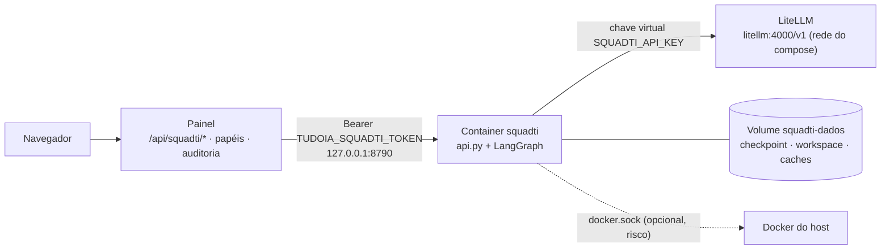

[🏠 TudoIA](../../README.md) › [📚 Documentação](../README.md) › 🤖 SquadTI

# 🤖 SquadTI (squad de agentes)

> Para quem opera o TudoIA e para quem mantém o código de `runtime/squadti/`. Responde: o que a Squad faz, como ela roda isolada no Docker, como configurar
> (token, chave do LiteLLM, feed NuGet, template), o que a API local expõe, quais são os limites de segurança e como diagnosticar falhas.
> O fluxo dos agentes está em [`runtime/squadti/README.md`](../../runtime/squadti/README.md); o desenho de projeto, em [`docs/squadti/`](../squadti/00-visao-geral-e-arquitetura.md).

## 📑 Sumário

- [🎯 Visão geral](#-visão-geral)
- [🚀 Uso](#-uso)
- [⚙️ Opções](#️-opções)
- [🔌 API local](#-api-local)
- [🧩 Como o orquestrador funciona](#-como-o-orquestrador-funciona)
- [🛡️ Segurança](#️-segurança)
- [❌ Erros / diagnóstico](#-erros--diagnóstico)
- [❓ Perguntas frequentes](#-perguntas-frequentes)

## 🎯 Visão geral

A SquadTI é uma squad de agentes (LangGraph) que leva um briefing até uma entrega: requisitos, arquitetura, banco, backend, frontend, QA, revisão, AppSec, DevOps,
documentação e notas de release. Ela **só cria projeto novo**, em `workspace/<tarefa>` dentro do volume do container, e segue a Doutrina TEC (ver
[`doutrina.md`](doutrina.md) para o pin e o fail-closed da Doutrina no TudoIA).

Por que num container: a Squad compila e testa código escrito por modelo; o MSBuild e o npm executam código dele. No host isso rodaria com o seu usuário.



*C4 enxuto: o painel é o único cliente da API; o container só fala com o LiteLLM.*

Perfil de compose `squadti` (componente **opcional** no instalador, desmarcado por padrão; a imagem tem cerca de 2 GB: .NET SDK 10, Node 24, Python 3.12).
Os detalhes do serviço no compose (portas, limites, healthcheck) estão em [`servicos-docker.md`](servicos-docker.md); aqui ficam só os que mudam o comportamento da Squad.

## 🚀 Uso

**Pelo instalador:** marque *SquadTI*. Ele coloca `squadti` em `COMPOSE_PROFILES`, gera `TUDOIA_SQUADTI_TOKEN`, roda `scripts.squadti.chave` e sobe o container com `--wait`
(etapa `squadti_chave` de `instalador/tudoia_instalador/etapas.py`).

**Instalação existente:**

```powershell
# .env: inclua squadti em COMPOSE_PROFILES
.\scripts\tudoia.ps1 segredos          # gera TUDOIA_SQUADTI_TOKEN se estiver vazio
.\scripts\tudoia.ps1 squadti-chave     # cria a chave virtual do LiteLLM e grava SQUADTI_API_KEY (LiteLLM precisa estar no ar)
.\scripts\iniciar.ps1 -ComSquadti      # constrói a imagem (primeira vez) e sobe o container
```

Depois use o menu **SquadTI** do painel (`#squadti`): iniciar tarefa, responder às perguntas do analista, aprovar o `BUSINESS_SPEC` e aprovar o release.
Ligar e desligar também é possível em Sistema → Serviços → **SquadTI**.

**Rotacionar a chave:** `.\scripts\tudoia.ps1 squadti-chave --rotacionar` (apaga a chave do alias `squadti` no LiteLLM e gera outra); depois recrie o container
(`docker compose up -d squadti`) para ele ler a chave nova.

**Template TEC:** copie a pasta do TemplateTEC para `dados\squadti-template` (ou aponte `SQUADTI_TEMPLATE_DIR`). Ela é montada somente leitura em `/template` e o
`entrypoint.sh` roda `dotnet new install /template` se existir `/template/.template.config/template.json`. Sem o template, o `dotnet new tec-project` do nó
`dev_backend` falha e a tarefa para em `BACKEND_FALHOU`.

**Feed NuGet:** o `entrypoint.sh` escreve `NuGet.Config` no volume (`$HOME/.nuget/NuGet`) a cada partida, com `nuget.org` sempre e, opcionalmente:

| Fonte | Quando entra | Credencial |
|---|---|---|
| `tec-publico` | `TUDOIA_NUGET_FEED_URL` começa com `https://` (outro esquema é ignorado, com aviso no log) | nenhuma |
| `tec-interno` (GitHub Packages da organização) | `TUDOIA_NUGET_USER` **e** `TUDOIA_NUGET_PAT` presentes | o arquivo guarda só a referência `%TUDOIA_NUGET_PAT%`; o NuGet expande na hora de usar, o PAT não vai para o disco |

Scripts do Windows que operam a Squad:

| Script | O que faz |
|---|---|
| `scripts\iniciar.ps1 [-ComSquadti]` | Liga Docker, Ollama, ComfyUI, serviços e painel; com `-ComSquadti`, também (re)constrói e sobe a Squad |
| `scripts\parar.ps1` | Desliga painel, Squad, serviços, Ollama e ComfyUI (os dois últimos só se o `.env` os configurou) |
| `scripts\reiniciar.ps1 [-ComSquadti] [-Tudo]` | Padrão: reinicia **só** o painel (e a Squad, se estiver no ar). `-Tudo` = parar + iniciar |
| `scripts\painel.ps1` | Abre o painel; sobe-o se não estiver no ar |

`IniciarSquadti` (`scripts/_comum.ps1`) exige `TUDOIA_SQUADTI_TOKEN` com 32+ caracteres **e** `SQUADTI_API_KEY`; sem eles avisa e não sobe. A porta é testada por
conexão TCP real, porque `Get-NetTCPConnection -State Listen` deixa entradas fantasma de processos mortos.

CLI do orquestrador, para desenvolvimento sem Docker (`runtime/squadti/orquestrador/main.py`):

```bash
cd runtime/squadti
uv sync --frozen
export DOUTRINA_TEC=<pasta-da-doutrina>        # sem Doutrina legível a Squad não trabalha
export TUDOIA_API_KEY=<chave-virtual-do-litellm>
uv run python orquestrador/main.py iniciar --tarefa TASK-001 --briefing "Cadastro de clientes" --perfil local-estrito
uv run python orquestrador/main.py responder --tarefa TASK-001 --resposta "..."
uv run python orquestrador/main.py aprovar --tarefa TASK-001
uv run python orquestrador/main.py aprovar-release --tarefa TASK-001
uv run python orquestrador/main.py estado --tarefa TASK-001
```

Códigos de saída da CLI: `0` ok, `2` erro de uso (`ErroUso`), `1` falha fechada (Doutrina ilegível, nuvem sem consentimento, saída de modelo inválida, gateway indisponível).

## ⚙️ Opções

### Variáveis do `.env` (lidas pelo compose e pelo painel)

| Variável | Padrão | Efeito |
|---|---|---|
| `TUDOIA_SQUADTI_TOKEN` | vazio | Token Bearer da API (mínimo 32 caracteres). Painel e container leem o mesmo valor; sem ele a API não sobe |
| `SQUADTI_API_KEY` | vazio | Chave virtual do LiteLLM só da Squad; vira `TUDOIA_API_KEY` no container |
| `TUDOIA_SQUADTI_URL` | `http://127.0.0.1:8790` | Onde o painel acha a API; só `http://127.0.0.1` ou `http://localhost` |
| `TUDOIA_NUGET_FEED_URL` | vazio | Feed NuGet público das TEC.* (`https://`, sem credencial) |
| `TUDOIA_NUGET_USER`, `TUDOIA_NUGET_PAT` | vazio | Feed privado `tec-interno` (PAT com `read:packages`). Só por ambiente |
| `SQUADTI_TEMPLATE_DIR` | `../dados/squadti-template` (relativo ao compose) | Pasta do TemplateTEC, montada em `/template:ro` |
| `SQUADTI_DOUTRINA_SHA` | SHA de `governanca/doutrina.json` (repetido no `Dockerfile` e no compose) | Commit da Doutrina embutido na imagem; trocar exige reconstruir |
| `SQUADTI_MEMORIA` | `6g` | `mem_limit` do container |
| `SQUADTI_CPUS` | `4` | `cpus` do container |
| `SQUADTI_TIMEOUT_S` | `300` | Vira `TUDOIA_TIMEOUT_S`: prazo de **uma** chamada ao modelo |
| `SQUADTI_CONTEXTO_TOKENS` | `32768` | Vira `TUDOIA_CONTEXTO_TOKENS`: janela de contexto do modelo em uso |

### Variáveis do orquestrador (processo)

| Variável | Padrão | Efeito |
|---|---|---|
| `TUDOIA_GATEWAY_URL` | `http://localhost:4000/v1` (no container: `http://litellm:4000/v1`) | Gateway LiteLLM |
| `TUDOIA_API_KEY` | `sk-tudoia-local` (exemplo, o gateway recusa) | Chave virtual; nunca a `LITELLM_MASTER_KEY` |
| `TUDOIA_MODEL` | `tudoia-local` (imagem: `tudoia-local-estrito`) | Modelo do processo |
| `TUDOIA_PERMITIR_NUVEM` | ausente | `1` libera, no processo, `TUDOIA_MODEL` que pode sair da máquina (uso da CLI) |
| `TUDOIA_TIMEOUT_S` | `300` | Aceita 5 a 3600; inválido volta a 300. Cada chamada tem 1 nova tentativa |
| `TUDOIA_CONTEXTO_TOKENS` | `32768` | Aceita 1024 a 2.000.000. Prompt estimado (caracteres/4) acima de 85% da janela é **recusado** antes de ir ao modelo |
| `DOUTRINA_TEC` | `/doutrina` na imagem | Pasta da Doutrina (precede `architecture_source_path`) |
| `DOUTRINA_FAMILIAS` | perfil de cada papel | Lista separada por vírgula; força as mesmas famílias em todos os papéis |
| `DOUTRINA_REGRAS_MAX_TOKENS` | `12000` | Orçamento das regras do papel no prompt (500 a 200.000); inválido volta ao padrão |
| `TUDOIA_SQUADTI_HOST` | `127.0.0.1` (imagem: `0.0.0.0`) | Só `127.0.0.1` ou `0.0.0.0` |
| `TUDOIA_SQUADTI_PORTA` | `8790` | Porta da API |
| `SQUADTI_DB`, `SQUADTI_STACK_CONFIG` | `squad_state.db`, `stack_config.example.json` | Checkpoint SQLite e stack (a imagem passa `/dados/squad_state.db` e `/app/orquestrador/stack_config.example.json`) |

`quality.coverage_min` na stack aceita `0` para desligar o gate de cobertura de forma explícita (registrado no relatório); valor inválido volta a 90.

### Perfis (`perfis.py`)

| `perfil` | Modelo no gateway | Sai da máquina? | Consentimento |
|---|---|---|---|
| `local-estrito` (padrão) | `tudoia-local-estrito` | Nunca, sem fallback | não |
| `local` | `tudoia-local` | O gateway pode reenviar à nuvem se estourar o contexto | não na API; o **painel** exige |
| `hibrido` | `tudoia-hibrido` | Sim | `consentimento_nuvem: true` |
| `nuvem` | `tudoia-nuvem` | Sim | `consentimento_nuvem: true` |
| `max` | `tudoia-max` (pago) | Sim | só CLI/API; o painel **não oferece**, e a chave da Squad não o lista |

O roteador `tudoia-auto` é recusado: não garante execução local.

### Chave virtual (`scripts/squadti/chave.py`)

Alias e tag `squadti` (o gasto aparece separado em Atividade e Custos), validade `90d`, modelos `tudoia-local-estrito`, `tudoia-local-estrito-agente`, `tudoia-local`,
`tudoia-local-agente`, `tudoia-hibrido`, `tudoia-nuvem`. Usa `LITELLM_MASTER_KEY` do `.env` e `TUDOIA_LITELLM_URL` (padrão `http://127.0.0.1:4000`, só loopback).
Grava `SQUADTI_API_KEY` com backup do `.env` em `dados/backups/env`; o valor nunca é impresso. Códigos de saída: `0` ok (inclui "já existe"), `1` LiteLLM recusou, `2` sem
conexão ou sem master key.

## 🔌 API local

Implementada em `orquestrador/api.py` (stdlib, `ThreadingHTTPServer`). Tudo em `/api/` exige `Authorization: Bearer <token>`; `/saude` não.

| Rota | O que faz |
|---|---|
| `GET /saude` | `{"ok": true}` (valida o `Host`, sem token) |
| `GET /api/tarefas` | Lista (até 200) com situação e execução |
| `GET /api/tarefas/{id}` | Detalhe: briefing, perguntas, respostas, arquivos, versão e hash da Doutrina, verificações, `falha_origem` |
| `GET /api/tarefas/{id}/arquivo?caminho=` | Texto de um arquivo do workspace (até 200.000 bytes; linhas com padrão de segredo omitidas; `415` se não for UTF-8) |
| `POST /api/tarefas` | `{tarefa, briefing, perfil?, consentimento_nuvem?}`; briefing até 20.000 caracteres |
| `POST /api/tarefas/{id}/responder` | `{resposta}` (até 20.000 caracteres) |
| `POST /api/tarefas/{id}/aprovar` | Aprova o `BUSINESS_SPEC` (só se pausada antes de `arquiteto`) |
| `POST /api/tarefas/{id}/aprovar-release` | Aprova o release (só se pausada antes de `release`) |

As ações respondem `202` e rodam em segundo plano, **uma por vez** (`409 ocupado` se houver outra). O identificador da tarefa vira nome de pasta: `^[A-Za-z0-9][A-Za-z0-9._-]{0,63}$`.
O painel expõe as mesmas rotas em `/api/squadti/*` (`painel/tudoia_painel/rotas/squadti.py`) e acrescenta `GET /api/squadti/estado` (`configurado`, `no_ar`, perfis). Leitor vê;
operador inicia, responde e aprova.

Situações (`servico.situacao`): `inexistente`, `aguardando_respostas`, `aguardando_aprovacao_spec`, `aguardando_aprovacao_release`, `em_fase`, `concluida`, `bloqueada`
(AppSec ou DevOps reprovou), `escalada_qa`, `escalada_revisao`.

## 🧩 Como o orquestrador funciona

Arquivos de `runtime/squadti/orquestrador/`:

| Arquivo | Papel |
|---|---|
| `main.py` | CLI; `explicar_falha` traduz erro do gateway sem repetir o corpo da resposta |
| `api.py` | API HTTP local e registro de execuções (uma por vez) |
| `servico.py` | Camada comum à CLI e à API: `situacao`, `montar_entrada`, validação do id; recusa pasta de workspace que já tenha conteúdo (IA-ORQ-10) |
| `graph.py` | Grafo LangGraph com checkpoint SQLite; pausa antes de `arquiteto` e de `release` |
| `nodes.py` | Os onze nós; chamada ao modelo, verificação de janela e de consentimento |
| `state.py` | `SquadState` (TypedDict) |
| `perfis.py` | Perfis aceitos e `modelo_e_local` |
| `execucao.py` | Gravação de arquivos (`### ARQUIVO:`) e execução de comandos |
| `doutrina_tec.py` | Carregador da Doutrina por papel; ver [`doutrina.md`](doutrina.md) |
| `cobertura.py`, `revisao.py`, `verificacoes.py`, `segredos.py` | Gate de cobertura, leitura do veredito, higiene estática do DevOps, varredura de segredos |

### Nós e quem usa modelo

| Nó | Modelo? | Papel na Doutrina | Escreve em |
|---|---|---|---|
| `analista_requisitos` | sim | `requisitos` | `docs/negocio/` |
| `arquiteto` | sim | `arquiteto` | `docs/arquitetura/`, `contracts/` |
| `dba` | sim | `dba` | `src/`, `docs/dados/` |
| `dev_backend` | sim | `backend` | `src/`, `tests/` |
| `dev_frontend` | sim | `frontend` | `frontend/` |
| `qa_testes` | não | n/d | `tests/reports/qa_report.json` |
| `revisor` | sim | `backend` e/ou `frontend` (conforme os arquivos revisados) | `docs/revisao/` |
| `appsec` | não | n/d | `tests/reports/security_report.json` |
| `devops` | não | n/d | `tests/reports/devops_report.json` |
| `documentacao` | sim | `documentacao` | `README.md`, `docs/` (nunca `docs/negocio/`, `docs/revisao/`, `docs/release/`, `PRD_TECNICO.md`, `DICIONARIO.md`) |
| `release` | não | n/d | `docs/release/RELEASE_NOTES.md` |

Os agentes e seus contratos estão descritos em [`docs/squadti/04-agentes/`](../squadti/04-agentes/chefe-orquestrador.md) e no [catálogo](../squadti/01-catalogo-de-agentes.md).

### Regras do grafo

- Se o analista só gerou perguntas (sem `BUSINESS_SPEC`), a execução termina e espera `responder`.
- QA e revisor dividem o contador `iteration_count` (limite 3, `LIMITE_ITERACOES`): ao atingi-lo a tarefa é **escalada** para uma pessoa.
- A falha vai a quem a causou: `falha_origem` (`backend` ou `frontend`) escolhe o nó de correção.
- AppSec ou DevOps reprovando termina em `ENTREGA_BLOQUEADA`.
- O nó `arquiteto` recusa rodar sem `business_spec_approved` e o `release` sem `release_approved`, mesmo se o grafo for retomado à força.
- O `release` também exige `tests_passed`, `review_passed`, `security_passed`, `devops_passed` e `docs_file`; escreve versão SemVer **sugerida** (`0.0.1` sem tag anterior; com
  `ultima_versao` conhecida deixa a escolha para o humano). Nunca roda git, tag, push nem publicação.
- Toda tarefa grava `doutrina_versao` e `doutrina_hash` no estado; se a Doutrina mudar no meio, a tarefa aborta (ECO-CON-02).

### Verificações

- **QA** (`qa_testes`): `build_command` e `test_command` da stack para .NET (`dotnet build/test`) e `frontend/` (`npm run build`/`npm test`); depois o gate de cobertura
  (padrão 90% de linha e de ramo, consolidando relatórios Cobertura). Sem projeto, sem testes, frontend esperado e ausente (`frontend/package.json`) ou cobertura não medida = reprovado.
- **Revisor**: aprova só com uma linha exata `VEREDITO: APROVADO`; sem veredito válido ou com achado `CRITICO` = reprovado. Revisa `src/`, `tests/` e `frontend/` (até 60.000 caracteres no total).
- **AppSec**: `dotnet list package --vulnerable --include-transitive`, `npm audit --audit-level=high` e varredura de padrões de segredo (tipo e `arquivo:linha`, nunca o valor).
  Não cobre modelo de ameaças, SAST/DAST nem cadeia de suprimentos: `ENTREGA_CONCLUIDA` não significa "segura".
- **DevOps** (`verificacoes.py`, sem modelo, sem rede, sem executar nada): workflow GitHub se `infra.ci` for GitHub, Dockerfile sem `latest`/sem tag (ou com digest), actions
  fixadas por SHA, `.gitignore` cobrindo `bin`, `obj`, `node_modules`, `.env`, e ausência de arquivo `.env` com conteúdo.

### Fronteira com arquivos e processos (`execucao.py`)

A saída do modelo é dado não confiável. Só vira arquivo via blocos `### ARQUIVO: caminho`, com: caminho validado (sem `..`, unidade, fluxo alternativo do NTFS, ponto ou espaço no fim),
área permitida por nó, no máximo 50 arquivos por resposta e 200.000 bytes por arquivo. O que for recusado **falha alto**. Comandos vêm da configuração (não do modelo), rodam **sem shell**,
só `dotnet`, `npm` e `npx`, com timeout (padrão 900 s; scaffold, 300 s).

## 🛡️ Segurança

> [!WARNING]
> **O `docker.sock` do host está montado** no serviço `squadti` (decisão do dono, 2026-11-03) para os testes de integração (Testcontainers). Quem controla o socket controla o
> Docker do host: o código que o modelo gera e a Squad executa pode criar containers privilegiados, ler volumes de outros serviços (banco do LiteLLM, Keycloak) e obter root no host
> (acesso ao socket do Docker equivale a root no host). O endurecimento abaixo não cobre esse caminho. Para voltar ao isolamento, remova do serviço `squadti` do `runtime/docker-compose.yml` a linha do `docker.sock`,
> o `group_add: ["0"]` e o `TESTCONTAINERS_HOST_OVERRIDE`; os testes de integração deixam de rodar. Alternativa mais segura (não implementada): um Docker próprio em container
> (`docker:dind`), que isola os containers de teste dos do TudoIA.

Os containers de teste sobem no Docker do host, como irmãos do da Squad, que os alcança por `host.docker.internal` (`TESTCONTAINERS_HOST_OVERRIDE`; `extra_hosts: host-gateway`).
No Docker Desktop o socket é `root:root 0660`, por isso o usuário `10001` entra pelo grupo `0`.

Controles do container (`runtime/docker-compose.yml`, `Dockerfile`):

| Controle | Valor |
|---|---|
| Usuário | `squadti`, uid `10001`, sem root, shell `nologin` |
| Sistema de arquivos | `read_only: true`; `tmpfs /tmp:size=1g`; escrita só em `/dados` (volume `squadti-dados`) |
| Capabilities | `cap_drop: [ALL]`, `no-new-privileges:true` |
| Limites | `pids_limit: 1024`, memória e CPU por `SQUADTI_MEMORIA`/`SQUADTI_CPUS` |
| Rede | porta publicada só em `127.0.0.1:8790`; dentro do container a API escuta em `0.0.0.0` |
| Imagem | bases fixadas por digest; Doutrina clonada num SHA fixo, sem histórico; SDKs sem telemetria; caches NuGet/npm em `/dados` |
| Healthcheck | `GET /saude` em `127.0.0.1:8790` (30 s, 3 tentativas, `start_period` 30 s); depende de `litellm` saudável |

API: sem `TUDOIA_SQUADTI_TOKEN` de 32+ caracteres ela não sobe (`SystemExit`); token comparado em tempo constante (`hmac.compare_digest`); `Host` aceito: `127.0.0.1`, `localhost`, com ou sem a
porta; `POST` só `application/json` até 64 KB; sem log de acesso (a URL traz nome de tarefa e de arquivo); erro interno responde só o nome da exceção.
No painel: token divergente ou falha 5xx da API viram `503 indisponivel`, sem repassar o corpo.

Privacidade: o padrão nunca sai da máquina. Perfil que pode sair exige `consentimento_nuvem: true`, gravado no estado da tarefa; o nó recusa modelo fora dos perfis conhecidos
ou sem consentimento. Linhas com padrão de segredo são omitidas do que vai ao prompt e do que o painel exibe. O release não cria commit, tag nem publicação.

> [!NOTE]
> A varredura de segredos é um filtro de padrões, não substitui um scanner dedicado (gitleaks, trufflehog) no CI do projeto gerado.

## ❌ Erros / diagnóstico

| Sintoma | Causa | Ação |
|---|---|---|
| Painel: "SquadTI não configurado" (`503`) | `TUDOIA_SQUADTI_TOKEN` ausente ou com menos de 32 caracteres no `.env` | `tudoia segredos`; reinicie o painel |
| Painel: "a SquadTI recusou o token" | Token do `.env` difere do que o container recebeu | Recrie o container (`docker compose up -d squadti`) |
| Painel: "a API da SquadTI não responde" | Container parado ou ainda subindo | `docker logs squadti`; Sistema → Serviços → SquadTI |
| `scripts\iniciar.ps1 -ComSquadti` avisa "SquadTI nao configurada" | Falta token ou `SQUADTI_API_KEY` | `squadti-chave` com o LiteLLM no ar |
| `squadti-chave` sai com `2` | Sem `LITELLM_MASTER_KEY` ou LiteLLM fora do ar | `tudoia segredos`; subir o LiteLLM |
| `squadti-chave` sai com `1` ("já existe uma chave com o alias") | Alias já em uso no LiteLLM | `--rotacionar` |
| Tarefa com erro "o gateway recusou a chave" | `SQUADTI_API_KEY` vazia ou inválida | Gere de novo e recrie o container |
| Erro "prompt de ~N tokens não cabe na janela" | Regras da Doutrina maiores que o modelo comporta | Aumente o `num_ctx` e `SQUADTI_CONTEXTO_TOKENS`, ou reduza `DOUTRINA_REGRAS_MAX_TOKENS` |
| Erro "saída do modelo inválida" com resposta curta | Modelo local devolveu quase nada com prompt grande | Mesmas ações da linha anterior |
| `BACKEND_FALHOU` "scaffold falhou" | Template TEC não instalado | Ver "Template TEC" em [Uso](#-uso) |
| `409 ocupado` | Já há uma execução em andamento | Aguarde terminar |
| "a Doutrina TEC mudou durante a tarefa" | A imagem foi reconstruída com outro SHA no meio de uma tarefa | Reinicie a tarefa com outro identificador |
| "a pasta workspace/... já tem conteúdo" | Identificador reutilizado | Use outro identificador (a Squad só trabalha em projeto novo) |
| `NuGet.Config` sem o feed esperado | `TUDOIA_NUGET_FEED_URL` sem `https://` (aviso no log) ou PAT sem usuário | Corrija o `.env` e recrie o container |

## ❓ Perguntas frequentes

**Posso usar a Squad em repositório existente?** Não. Ela escreve só em `workspace/<tarefa>` e recusa pasta com conteúdo (IA-ORQ-10).

**Onde ficam os projetos gerados?** No volume `squadti-dados`, em `/dados/workspace/<tarefa>`; a leitura pelo painel passa pela rota de arquivo (texto, com segredos omitidos).

**O ciclo completo já foi exercitado com modelo real?** Não. Em 2026-11-02 só o primeiro nó rodou com modelo real; os limites conhecidos estão em
[`runtime/squadti/README.md`](../../runtime/squadti/README.md#-limites-conhecidos). Os testes automatizados usam dublês do modelo.

**Como trocar a versão da Doutrina da imagem?** Troque `governanca/doutrina.json` e rode `python -m scripts.empacotar.payload --derivar-pin`, que propaga o SHA; reconstrua a imagem.
Detalhes em [`doutrina.md`](doutrina.md).

---

[🏠 README](../../README.md) · ⬅️ [Serviços Docker](servicos-docker.md) · [Automação n8n](automacao-n8n.md) ➡️
