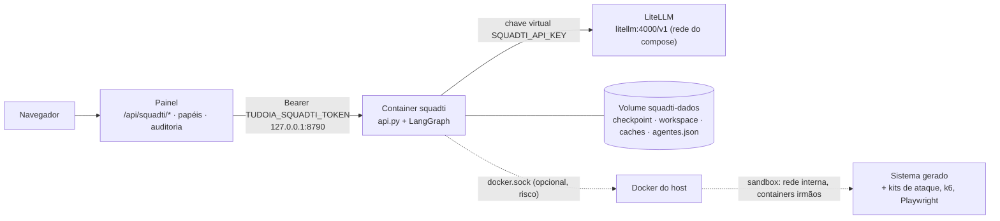
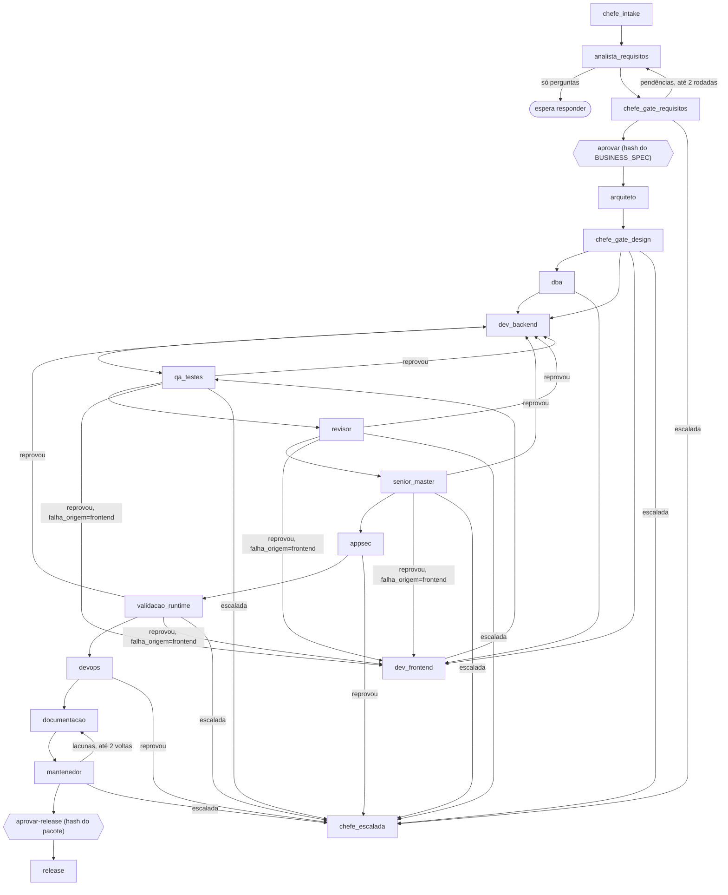

[🏠 TudoIA](../../README.md) › [📚 Documentação](../README.md) › 🤖 SquadTI

# 🤖 SquadTI (squad de agentes)

> Para quem opera o TudoIA e para quem mantém o código de `runtime/squadti/`. Responde: o que a Squad (v2) faz, como ela roda isolada no Docker, como configurar
> (token, chave do LiteLLM, feed NuGet, template, agentes, orçamento), o que a API local e o painel expõem, quais são os limites de segurança e como diagnosticar falhas.
> O fluxo dos agentes está em [`runtime/squadti/README.md`](../../runtime/squadti/README.md); o desenho de projeto, em [`docs/squadti/`](../squadti/00-visao-geral-e-arquitetura.md).

## 📑 Sumário

- [🎯 Visão geral](#-visão-geral)
- [🚀 Uso](#-uso)
- [🖥️ Painel: abas Tarefas e Agentes](#️-painel-abas-tarefas-e-agentes)
- [⚙️ Opções](#️-opções)
- [🔌 API local](#-api-local)
- [🧩 Como o orquestrador funciona](#-como-o-orquestrador-funciona)
- [🛡️ Segurança](#️-segurança)
- [❌ Erros / diagnóstico](#-erros--diagnóstico)
- [❓ Perguntas frequentes](#-perguntas-frequentes)

## 🎯 Visão geral

A SquadTI é uma squad de agentes (LangGraph) que leva um briefing até uma entrega: plano, requisitos, arquitetura, banco, backend, frontend, QA, revisão, qualidade de código,
AppSec, validação em execução (hacker, macaco e carga), DevOps, documentação, teste de manutenibilidade e notas de release. O usuário fala **só com o CHEFE**
(Tech Lead): ele planeja a demanda, escolhe a stack (`dotnet` ou `python`), confere os critérios de pronto entre as fases e escreve o relatório quando a execução para.
A Squad **só cria projeto novo**, em `workspace/<tarefa>` dentro do volume do container, e segue a Doutrina TEC (ver [`doutrina.md`](doutrina.md) para o pin e o fail-closed da Doutrina no TudoIA).

Por que num container: a Squad compila e testa código escrito por modelo; o MSBuild, o npm e o uv executam código dele. No host isso rodaria com o seu usuário.



*C4 enxuto: o painel é o único cliente da API; o container só fala com o LiteLLM. O sandbox existe só se o container alcança um Docker (ver [Segurança](#️-segurança)).*

Perfil de compose `squadti` (componente **opcional** no instalador, desmarcado por padrão; a imagem tem cerca de 2 GB: .NET SDK 10, Node 24, uv e Python 3.12).
Os detalhes do serviço no compose (portas, limites, healthcheck) estão em [`servicos-docker.md`](servicos-docker.md); aqui ficam só os que mudam o comportamento da Squad.

## 🚀 Uso

**Pelo instalador:** marque *SquadTI*. Ele coloca `squadti` em `COMPOSE_PROFILES`, gera `TUDOIA_SQUADTI_TOKEN`, roda `scripts.squadti.chave` e sobe o container com `--wait`
(etapa `squadti_chave` de `instalador/tudoia_instalador/etapas.py`).

**Instalação existente:**

```powershell
# .env: inclua squadti em COMPOSE_PROFILES
.\scripts\tudoia.ps1 segredos          # gera TUDOIA_SQUADTI_TOKEN se estiver vazio
.\scripts\tudoia.ps1 squadti-chave     # cria a chave virtual do LiteLLM e grava SQUADTI_API_KEY (LiteLLM precisa estar no ar)
.\scripts\iniciar.ps1 -ComSquadti      # constrói a imagem (primeira vez) e sobe o container
```

Depois use o menu **SquadTI** do painel (`#squadti`): [Nova tarefa](#️-painel-abas-tarefas-e-agentes), conversa com o CHEFE, aprovação da especificação e do release.
Ligar e desligar também é possível em Sistema → Serviços → **SquadTI**.

**Rotacionar a chave:** `.\scripts\tudoia.ps1 squadti-chave --rotacionar` (apaga a chave do alias `squadti` no LiteLLM e gera outra); depois recrie o container
(`docker compose up -d squadti`) para ele ler a chave nova.

**Template TEC (só stack `dotnet`):** copie a pasta do TemplateTEC para `dados\squadti-template` (ou aponte `SQUADTI_TEMPLATE_DIR`). Ela é montada somente leitura em `/template` e o
`entrypoint.sh` roda `dotnet new install /template` se existir `/template/.template.config/template.json`. Sem o template, o `dotnet new tec-project` do nó
`dev_backend` falha e a tarefa para em `BACKEND_FALHOU`. A stack `python` não usa template.

**Feed NuGet:** o `entrypoint.sh` escreve `NuGet.Config` no volume (`$HOME/.nuget/NuGet`) a cada partida, com `nuget.org` sempre e, opcionalmente:

| Fonte | Quando entra | Credencial |
|---|---|---|
| `tec-publico` | `TUDOIA_NUGET_FEED_URL` começa com `https://` (outro esquema é ignorado, com aviso no log) | nenhuma |
| `tec-interno` (GitHub Packages da organização) | `TUDOIA_NUGET_USER` **e** `TUDOIA_NUGET_PAT` presentes | o arquivo guarda só a referência `%TUDOIA_NUGET_PAT%`; o NuGet expande na hora de usar, o PAT não vai para o disco |

Scripts do Windows que operam a Squad:

| Script | O que faz |
|---|---|
| `scripts\iniciar.ps1 [-ComSquadti]` | Liga Docker, Ollama, ComfyUI, serviços e painel; com `-ComSquadti`, também (re)constrói e sobe a Squad |
| `scripts\parar.ps1` | Desliga o ecossistema inteiro: painel, Squad, serviços Docker de qualquer perfil, Ollama e ComfyUI. Sai com código 1 se algum continuar no ar |
| `scripts\reiniciar.ps1 [-ComSquadti] [-Tudo]` | Padrão: reinicia **só** o painel (e a Squad, se estiver no ar). `-Tudo` = parar + iniciar |
| `scripts\painel.ps1` | Abre o painel; sobe-o se não estiver no ar |

`IniciarSquadti` (`scripts/_comum.ps1`) exige `TUDOIA_SQUADTI_TOKEN` com 32+ caracteres **e** `SQUADTI_API_KEY`; sem eles avisa e não sobe. A porta é testada por
conexão TCP real, porque `Get-NetTCPConnection -State Listen` deixa entradas fantasma de processos mortos.

CLI do orquestrador, para desenvolvimento sem Docker (`runtime/squadti/orquestrador/main.py`):

```bash
cd runtime/squadti
uv sync --frozen
export DOUTRINA_TEC=<pasta-da-doutrina>        # sem Doutrina legível a Squad não trabalha
export TUDOIA_API_KEY=<chave-virtual-do-litellm>
uv run python orquestrador/main.py iniciar --tarefa TASK-001 --briefing "Cadastro de clientes" --perfil local-estrito [--stack dotnet|python]
uv run python orquestrador/main.py responder --tarefa TASK-001 --resposta "..."
uv run python orquestrador/main.py aprovar --tarefa TASK-001
uv run python orquestrador/main.py aprovar-release --tarefa TASK-001
uv run python orquestrador/main.py estado --tarefa TASK-001
```

Sem `--stack` o CHEFE decide. A CLI não tem comando para falar com o CHEFE, continuar tarefa escalada nem editar o orçamento: isso é da API e do painel. Ela usa a configuração dos
agentes de `agentes.json` (pasta atual).
Códigos de saída: `0` ok, `2` erro de uso (`ErroUso`), `1` falha fechada (Doutrina ilegível, nuvem sem consentimento, saída de modelo inválida, gateway indisponível).

Para medir a qualidade da entrega com modelo real, veja [Evals](../squadti/evals.md); para o aprendizado entre tarefas, o [Livro de Lições](../squadti/licoes.md) (biblioteca, ainda não ligada ao fluxo).

## 🖥️ Painel: abas Tarefas e Agentes

O menu SquadTI (`painel/tudoia_painel/static/squadti.js`, rotas em `painel/tudoia_painel/rotas/squadti.py`) tem duas abas e se atualiza a cada 5 s enquanto aberto.
Sem `TUDOIA_SQUADTI_TOKEN` ou com a API parada, mostra um aviso em vez das abas.

| Aba | O que mostra e permite |
|---|---|
| **Tarefas** | Lista com situação; **Nova tarefa** (identificador, briefing, perfil, consentimento de nuvem, stack `dotnet`/`python` ou deixar o CHEFE decidir, orçamento desta tarefa) |
| Cockpit (ao abrir uma tarefa) | Trilha dos nós com status (pendente, rodando, ok, falhou) e tempo, chamadas e tokens por nó; barras de consumo do orçamento (tokens, tempo, chamadas); **log ao vivo** (polling de 2 s enquanto há execução); tabela de auditoria das chamadas ao modelo (nó, agente, modelo, tentativa, tokens, tempo, `prompt_sha`); arquivos gerados (leitura com segredos omitidos); selos de testes, revisão, AppSec e DevOps |
| Conversa com o CHEFE | Histórico `usuário ↔ CHEFE`; resposta às perguntas do analista (vale como resposta da entrevista); `/ajuste <texto>` registra instrução para as fases seguintes; pergunta de andamento ("status", "o que falta") é respondida sem modelo |
| Faixa de escalada | Aparece quando a Squad parou esperando você, com os campos de orçamento e o botão **Continuar** |
| Aprovações | **Aprovar especificação** (pausa antes do `arquiteto`) e **Aprovar release** (pausa antes do `release`) |
| **Agentes** | Por agente: perfil, temperatura e máximo de tokens; modo de revisão (`simples`/`dupla`); validação em execução (modo, carga, SLO p95/p99/erro, segundos do macaco de interface); orçamento padrão. **Só o admin salva** |

Papéis (Keycloak): leitor vê tudo; operador inicia, responde, fala com o CHEFE, continua tarefa escalada e aprova; só o admin grava a configuração dos agentes
(`PREFIXOS_ESCRITA_SO_ADMIN` em `painel/tudoia_painel/autenticacao.py`), porque ela decide o que pode sair da máquina e quanto a Squad gasta.
O perfil `max` (pago) não é oferecido pelo painel.

## ⚙️ Opções

### Variáveis do `.env` (lidas pelo compose e pelo painel)

| Variável | Padrão | Efeito |
|---|---|---|
| `TUDOIA_SQUADTI_TOKEN` | vazio | Token Bearer da API (mínimo 32 caracteres). Painel e container leem o mesmo valor; sem ele a API não sobe |
| `SQUADTI_API_KEY` | vazio | Chave virtual do LiteLLM só da Squad; vira `TUDOIA_API_KEY` no container |
| `TUDOIA_SQUADTI_URL` | `http://127.0.0.1:8790` | Onde o painel acha a API; só `http://127.0.0.1` ou `http://localhost` |
| `TUDOIA_NUGET_FEED_URL` | vazio | Feed NuGet público das TEC.* (`https://`, sem credencial) |
| `TUDOIA_NUGET_USER`, `TUDOIA_NUGET_PAT` | vazio | Feed privado `tec-interno` (PAT com `read:packages`). Só por ambiente |
| `SQUADTI_TEMPLATE_DIR` | `../dados/squadti-template` (relativo ao compose) | Pasta do TemplateTEC, montada em `/template:ro` |
| `SQUADTI_DOUTRINA_SHA` | SHA de `governanca/doutrina.json` (repetido no `Dockerfile` e no compose) | Commit da Doutrina embutido na imagem; trocar exige reconstruir |
| `SQUADTI_MEMORIA` | `6g` | `mem_limit` do container |
| `SQUADTI_CPUS` | `4` | `cpus` do container |
| `SQUADTI_TIMEOUT_S` | `300` | Vira `TUDOIA_TIMEOUT_S`: prazo de **uma** chamada ao modelo |
| `SQUADTI_CONTEXTO_TOKENS` | `32768` | Vira `TUDOIA_CONTEXTO_TOKENS`: janela de contexto do modelo em uso |

### Variáveis do orquestrador (processo)

| Variável | Padrão | Efeito |
|---|---|---|
| `TUDOIA_GATEWAY_URL` | `http://localhost:4000/v1` (no container: `http://litellm:4000/v1`) | Gateway LiteLLM |
| `TUDOIA_API_KEY` | `sk-tudoia-local` (exemplo, o gateway recusa) | Chave virtual; nunca a `LITELLM_MASTER_KEY` |
| `TUDOIA_MODEL` | `tudoia-local` (imagem: `tudoia-local-estrito`) | Modelo do processo |
| `TUDOIA_PERMITIR_NUVEM` | ausente | `1` libera, no processo, `TUDOIA_MODEL` que pode sair da máquina (uso da CLI) |
| `TUDOIA_TIMEOUT_S` | `300` | Aceita 5 a 3600; inválido volta a 300. Cada chamada tem 1 nova tentativa |
| `TUDOIA_CONTEXTO_TOKENS` | `32768` | Aceita 1024 a 2.000.000. Prompt estimado acima de 85% da janela é **recusado** antes de ir ao modelo; a razão caracteres por token é calibrada pelo que o gateway reporta (começa em 4) |
| `DOUTRINA_TEC` | `/doutrina` na imagem | Pasta da Doutrina (precede `architecture_source_path`) |
| `DOUTRINA_FAMILIAS` | perfil de cada papel | Lista separada por vírgula; força as mesmas famílias em todos os papéis |
| `DOUTRINA_REGRAS_MAX_TOKENS` | `12000` | Orçamento das regras do papel no prompt (500 a 200.000); inválido volta ao padrão |
| `TUDOIA_SQUADTI_HOST` | `127.0.0.1` (imagem: `0.0.0.0`) | Só `127.0.0.1` ou `0.0.0.0` |
| `TUDOIA_SQUADTI_PORTA` | `8790` | Porta da API |
| `SQUADTI_DB`, `SQUADTI_STACK_CONFIG` | `squad_state.db`, `stack_config.example.json` | Checkpoint SQLite e stack (a imagem passa `/dados/squad_state.db` e `/app/orquestrador/stack_config.example.json`) |
| `SQUADTI_AGENTES_ARQUIVO` | `agentes.json` (relativo à pasta de trabalho; na imagem `/dados`, no volume) | Onde a aba Agentes grava a configuração dos agentes |
| `SQUADTI_LICOES_ARQUIVO` | `licoes.jsonl` | Livro de Lições (hoje só usado pela biblioteca; ver [Livro de Lições](../squadti/licoes.md)) |
| `SQUADTI_EVALS_SAIDA`, `TUDOIA_SQUADTI_URL` | `evals/resultados`, `http://127.0.0.1:8790` | Só para `python -m evals.run` (ver [Evals](../squadti/evals.md)) |
| `DOCKER_BIN` | `docker` | Executável do Docker procurado pela validação em execução |

`quality.coverage_min` na stack aceita `0` para desligar o gate de cobertura de forma explícita (registrado no relatório); valor inválido volta a 90.

### Stacks (`stacks.py`)

O CHEFE escolhe a stack no plano; o usuário pode fixá-la (`stack` na API/painel, `--stack` na CLI). O grafo, os portões e as regras de segurança são os mesmos; o adaptador muda só os comandos, as áreas de escrita e a receita passada ao modelo.
`target_stack.backend.language` também escolhe (apelidos `csharp`, `c#`, `.net`, `fastapi`...); `build_command`, `test_command` e `scaffold_command` declarados na configuração vencem os do adaptador.

| | `dotnet` (padrão se nada decidir) | `python` |
|---|---|---|
| Base | .NET 10, Clean Architecture, CQRS, EF Core, template TEC | Python 3.12, FastAPI, SQLAlchemy 2, Alembic, pytest, uv |
| Scaffold | `dotnet new tec-project -n {nome}` | nenhum (o desenvolvedor escreve o projeto; detecção por `pyproject.toml`) |
| Build | `dotnet build --configuration Release` | `uv sync` |
| Testes | `dotnet test --no-build --coverage --coverage-output-format cobertura` | `uv run pytest --cov=app --cov-branch --cov-report=xml` |
| Auditoria de dependências | `dotnet list package --vulnerable --include-transitive` (o texto `has the following vulnerable packages` reprova, pois o comando sai 0) | `uv run --with pip-audit pip-audit` |
| Escrita do backend | `src/`, `tests/` | `app/`, `tests/`, `migrations/`, `pyproject.toml`, `uv.lock`, `alembic.ini`, `Dockerfile`, `.dockerignore`, `.gitignore`, `.env.example`, `.github/workflows/` |
| Famílias da Doutrina dispensadas | nenhuma | `arquitetura` e `componentes` (específicas de .NET/TEC.*) |

### Agentes, revisão, validação e orçamento (`agentes.py`, aba Agentes)

`agentes.json` é validado campo a campo (valor fora da faixa é recusado, nunca ajustado) e **copiado para o estado da tarefa ao iniciar**: editar não muda uma tarefa em andamento.

| Campo | Padrão | Faixa |
|---|---|---|
| `agentes.<nome>.perfil` | `null` (o da tarefa) | um dos perfis; perfil que pode sair da máquina exige `consentimento_nuvem` na tarefa |
| `agentes.<nome>.temperatura` | `0.1` | 0 a 1,5 |
| `agentes.<nome>.max_tokens` | `null` | 256 a 32000 |
| `revisao.modo` | `simples` | `simples` ou `dupla` (dois revisores independentes e um verificador adversarial para o que só um apontou) |
| `validacao.modo` | `auto` | `auto` (roda se o Docker responder), `sempre` (sem Docker, escala), `nunca` |
| `validacao.carga` | `escalado` | `escalado` (25, 50, 100, 200, 400 usuários), `completo` (500 a 10 mil), `nunca` |
| `validacao.slo` | p95 800 ms, p99 2000 ms, erro 1% | p95 50 a 60000; p99 50 a 120000; erro 0 a 1 |
| `validacao.ui_segundos` | `60` | 10 a 600 (duração do macaco de interface) |
| `orcamento.tokens` / `tempo_s` / `chamadas` | 2.000.000 / 7200 / 300 | 1.000 a 50.000.000 / 60 a 86.400 / 1 a 10.000; `null` = sem limite |

Agentes configuráveis (com modelo): `chefe`, `analista`, `arquiteto`, `dba`, `backend`, `frontend`, `revisor`, `senior`, `hacker`, `mantenedor`, `documentacao`. QA, AppSec, DevOps, macaco, carga e release não usam modelo.

### Perfis (`perfis.py`)

| `perfil` | Modelo no gateway | Sai da máquina? | Consentimento |
|---|---|---|---|
| `local-estrito` (padrão) | `tudoia-local-estrito` | Nunca, sem fallback | não |
| `local` | `tudoia-local` | O gateway pode reenviar à nuvem se estourar o contexto | não na API; o **painel** exige |
| `hibrido` | `tudoia-hibrido` | Sim | `consentimento_nuvem: true` |
| `nuvem` | `tudoia-nuvem` | Sim | `consentimento_nuvem: true` |
| `auto` | `tudoia-auto` (o roteador decide por pedido entre local e nuvem) | Pode | `consentimento_nuvem: true` |
| `max` | `tudoia-max` (pago) | Sim | só CLI/API; o painel **não oferece** |

### Chave virtual (`scripts/squadti/chave.py`)

Alias e tag `squadti` (o gasto aparece separado em Atividade e Custos), validade `90d`, modelos `tudoia-local-estrito`, `tudoia-local-estrito-agente`, `tudoia-local`,
`tudoia-local-agente`, `tudoia-hibrido`, `tudoia-nuvem`, `tudoia-auto`. Usa `LITELLM_MASTER_KEY` do `.env` e `TUDOIA_LITELLM_URL` (padrão `http://127.0.0.1:4000`, só loopback).
Grava `SQUADTI_API_KEY` com backup do `.env` em `dados/backups/env`; o valor nunca é impresso. Códigos de saída: `0` ok (inclui "já existe"), `1` LiteLLM recusou, `2` sem
conexão ou sem master key. A chave **não lista `tudoia-max`**.

## 🔌 API local

Implementada em `orquestrador/api.py` (stdlib, `ThreadingHTTPServer`). Tudo em `/api/` exige `Authorization: Bearer <token>`; `/saude` não.

| Rota | O que faz |
|---|---|
| `GET /saude` | `{"ok": true}` (valida o `Host`, sem token) |
| `GET /api/tarefas` | Lista (até 200) com situação e execução |
| `GET /api/tarefas/{id}` | Detalhe: briefing, perguntas, respostas, arquivos, versão e hash da Doutrina, verificações (testes, revisão, AppSec, DevOps), `falha_origem` |
| `GET /api/tarefas/{id}/arquivo?caminho=` | Texto de um arquivo do workspace (até 200.000 bytes; linhas com padrão de segredo omitidas; `415` se não for UTF-8) |
| `POST /api/tarefas` | `{tarefa, briefing, perfil?, consentimento_nuvem?, stack?, orcamento?}`; briefing até 20.000 caracteres; `orcamento` substitui o padrão só nesta tarefa |
| `POST /api/tarefas/{id}/responder` | `{resposta}` (até 20.000 caracteres) |
| `POST /api/tarefas/{id}/aprovar` | Aprova o `BUSINESS_SPEC` (só se pausada antes de `arquiteto`) |
| `POST /api/tarefas/{id}/aprovar-release` | Aprova o release (só se pausada antes de `release`) |
| `GET /api/tarefas/{id}/mensagens` · `POST .../mensagem` | Conversa com o CHEFE: `{texto}` (até 4.000 caracteres). Resposta à entrevista segue ao analista; `/ajuste <texto>` vira instrução; o resto o CHEFE responde. **Nunca** altera aprovação, portão nem configuração |
| `GET /api/tarefas/{id}/auditoria` | Totais, orçamento, um registro por nó e uma linha por chamada ao modelo (agente, modelo, tentativa, tokens, tempo, `prompt_sha`) |
| `GET /api/tarefas/{id}/proveniencia` | Manifesto da entrega (ver [Proveniência](#-como-o-orquestrador-funciona)) |
| `GET /api/tarefas/{id}/log?desde=N` | Eventos ao vivo da execução (até os últimos 500); devolve `proximo` para o cursor |
| `POST /api/tarefas/{id}/continuar` | `{orcamento?}`: retoma tarefa escalada (ver [limites](#-perguntas-frequentes)) |
| `GET /api/agentes` · `POST /api/agentes` | Lê e grava a configuração dos agentes (validada; `500 config_invalida` se o arquivo estiver corrompido) |

As ações respondem `202` e rodam em segundo plano, **uma por vez** (`409 ocupado` se houver outra). O identificador da tarefa vira nome de pasta: `^[A-Za-z0-9][A-Za-z0-9._-]{0,63}$`.
O painel expõe as mesmas rotas em `/api/squadti/*` e acrescenta `GET /api/squadti/estado` (`configurado`, `no_ar`, perfis). A rota de mensagem espera até 120 s (o CHEFE chama o modelo); as demais, 15 s.

Situações (`servico.situacao`): `inexistente`, `aguardando_respostas`, `aguardando_aprovacao_spec`, `aguardando_aprovacao_release`, `em_fase`, `concluida`, `bloqueada`
(AppSec ou DevOps reprovou), `escalada_qa`, `escalada_revisao`, `escalada` (estagnação, orçamento, critério de pronto, saída inválida, validação em execução).
O estado de execução (`execucao.estado`) é `rodando`, `ok`, `erro` ou `escalada`.

## 🧩 Como o orquestrador funciona

Arquivos de `runtime/squadti/orquestrador/`:

| Arquivo | Papel |
|---|---|
| `main.py` | CLI; `explicar_falha` traduz erro do gateway sem repetir o corpo da resposta |
| `api.py` | API HTTP local e registro de execuções (uma por vez, com eventos ao vivo) |
| `servico.py` | Camada comum à CLI e à API: `situacao`, `montar_entrada`, aprovações com hash, validação do id; recusa pasta de workspace que já tenha conteúdo (IA-ORQ-10) |
| `graph.py` | Grafo LangGraph com checkpoint SQLite; pausa antes de `arquiteto` e de `release` |
| `chefe.py` | CHEFE: plano, critérios de pronto, escalada e conversa |
| `nodes.py` | Nós dos agentes de construção e verificação; chamada ao modelo, janela de contexto e consentimento |
| `qualidade.py` | Sênior Master (métricas + crítica) e Mantenedor ("eu daqui a 1 ano") |
| `validacao.py`, `sandbox.py`, `carga.py`, `kits/` | Validação em execução: sandbox Docker, macaco, hacker e teste de carga |
| `metricas.py` | Métricas de código determinísticas (IDs `QC-*`) |
| `stacks.py`, `agentes.py`, `perfis.py` | Adaptadores de stack, configuração dos agentes e orçamento, perfis de modelo |
| `auditoria.py`, `proveniencia.py`, `aprovacao.py` | Trilha e orçamento, manifesto da entrega, aprovação amarrada ao conteúdo |
| `entrada.py` | Sanitização da entrada do usuário e defesa padrão contra injeção |
| `state.py`, `execucao.py`, `doutrina_tec.py` | `SquadState`, gravação de arquivos e execução de comandos, carregador da Doutrina ([`doutrina.md`](doutrina.md)) |
| `cobertura.py`, `revisao.py`, `verificacoes.py`, `segredos.py` | Gate de cobertura, leitura do veredito, higiene estática do DevOps, varredura de segredos |
| `licoes.py` | Livro de Lições (biblioteca isolada; ver [Livro de Lições](../squadti/licoes.md)) |

### O grafo e quem usa modelo



*Simplificado: `dba` só roda se o plano pede banco; `dev_frontend` só se o plano pede frontend (`graph.py`: `construcao`, `rota_pos_design`).*

| Nó | Modelo? | Agente configurável | Escreve em |
|---|---|---|---|
| `chefe_intake` | sim | `chefe` | `docs/chefe/PLANO.json` e `PLANO.md` |
| `analista_requisitos` | sim | `analista` | `docs/negocio/` |
| `chefe_gate_requisitos`, `chefe_gate_design` | não (verificação em código) | n/d | só o estado |
| `arquiteto` | sim | `arquiteto` | `docs/arquitetura/`, `contracts/` |
| `dba` | sim | `dba` | áreas do adaptador (`src/` ou `app/`, `migrations/`) e `docs/dados/` |
| `dev_backend` | sim | `backend` | áreas do adaptador da stack |
| `dev_frontend` | sim | `frontend` | `frontend/` |
| `qa_testes` | não | n/d | `tests/reports/qa_report.json` |
| `revisor` | sim (2 revisores + verificador no modo `dupla`) | `revisor` | `docs/revisao/` |
| `senior_master` | sim (após métricas em código) | `senior` | `docs/qualidade/` |
| `appsec` | não | n/d | `tests/reports/security_report.json` |
| `validacao_runtime` | só o modelo de ameaças do hacker | `hacker` | `tests/reports/hacker_report.json`, `macaco_report.json`, `carga_report.json`, `docs/seguranca/` |
| `devops` | não | n/d | `tests/reports/devops_report.json` |
| `documentacao` | sim | `documentacao` | `README.md`, `docs/` (nunca `docs/negocio/`, `docs/revisao/`, `docs/release/`, PRD técnico, dicionário de dados) |
| `mantenedor` | sim | `mantenedor` | `docs/manutencao/` |
| `release` | não | n/d | `docs/release/RELEASE_NOTES.md`, `docs/proveniencia.json` |
| `chefe_escalada` | não | n/d | `docs/chefe/ESCALADA.md` |

Os agentes e seus contratos estão em [`docs/squadti/04-agentes/`](../squadti/04-agentes/chefe-orquestrador.md) e no [catálogo](../squadti/01-catalogo-de-agentes.md).

### O CHEFE (canal único)

- **Plano** (`chefe_intake`): o modelo devolve um JSON (`tamanho`: trivial, pequeno, padrao ou grande; `stack`; `precisa_banco`, `motor_banco`, `precisa_frontend`, `precisa_api`; `resumo`; até 8 `riscos`), validado campo a campo. Duas tentativas; se nenhuma valer, cai num **plano padrão conservador** (API e banco, marcado `origem: padrao`). Stack fixada pelo usuário prevalece. O plano manda no grafo (sem banco, o `dba` é pulado; sem frontend, não há `dev_frontend`), na Doutrina (famílias dispensadas) e na meta de carga.
- **Critérios de pronto** (código, não opinião de modelo): a `BUSINESS_SPEC` precisa de 400+ caracteres, cenários Dado-Quando-Então, erro de negócio nomeado em SCREAMING_SNAKE e nenhuma pendência (`TODO`, `TBD`, "a definir", `???`); devolvida ao analista com a lista, no máximo **2 rodadas**, depois escala. O design precisa de PRD com 300+ caracteres e, se há API, um OpenAPI 3.x em YAML válido com `paths`; reprovou, escala (a arquitetura não volta sozinha porque exige aprovação).
- **Conversa** (`POST .../mensagem`): a mensagem é sanitizada (caracteres invisíveis e de controle saem); `/ajuste` grava a instrução como **dado** repassado às fases seguintes; perguntas de andamento têm resposta determinística; o resto vai ao modelo, que só enxerga o resumo da tarefa e é instruído a não prometer mudar aprovações, portões ou configuração.
- **Escalada**: `chefe_escalada` escreve `docs/chefe/ESCALADA.md` (motivo, fase, consumo, último erro sem segredos, o que decidir).

### Regras do grafo

- Se o analista só gerou perguntas (sem `BUSINESS_SPEC`), a execução termina e espera `responder` (ou uma mensagem ao CHEFE na situação `aguardando_respostas`).
- QA e revisor dividem o contador `iteration_count` (limite 3, `LIMITE_ITERACOES`); o Sênior Master tem 3 voltas próprias, a validação em execução 3, o Mantenedor 2 (devolve à documentação) e o gate de requisitos 2. Ao atingir o limite a tarefa é **escalada**.
- **Estagnação**: a mesma falha (assinatura do erro sem números e caminhos) em duas verificações seguidas escala antes de gastar as iterações que sobram.
- A falha vai a quem a causou: `falha_origem` (`backend` ou `frontend`) escolhe o nó de correção.
- AppSec ou DevOps reprovando termina em `ENTREGA_BLOQUEADA` (passa por `chefe_escalada`).
- **Aprovação amarrada ao conteúdo**: `aprovar` grava o SHA-256 da `BUSINESS_SPEC` (fim de linha normalizado) e o `arquiteto` recusa se o arquivo mudou depois; `aprovar-release` grava o hash do pacote (especificação, PRD, OpenAPI, relatórios de QA, revisão, AppSec, DevOps, Sênior, hacker, macaco, carga, manutenção e documentação) e o `release` recusa se qualquer um mudou. Texto novo da especificação zera a aprovação anterior.
- O nó `arquiteto` recusa rodar sem `business_spec_approved` e o `release` sem `release_approved`, mesmo se o grafo for retomado à força.
- O `release` exige `tests_passed`, `review_passed`, `security_passed`, `devops_passed`, `senior_passed`, `manutencao_passed` e `docs_file`; se a validação em execução rodou, exige também `hacker_passed` e `macaco_passed` e carga sem reprovação; se foi **pulada**, exige o motivo registrado e as notas dizem que o sistema não foi validado em execução. Escreve versão SemVer **sugerida** (`0.0.1` sem tag anterior; com `ultima_versao` conhecida deixa a escolha para o humano). Nunca roda git, tag, push nem publicação.
- Toda tarefa grava `doutrina_versao` e `doutrina_hash` no estado; se a Doutrina mudar no meio, a tarefa aborta (ECO-CON-02).

### Controle de execução e orçamento (`auditoria.py`)

- Cada nó e cada chamada ao modelo deixam registro no estado (modelo, tokens, tempo, hash do prompt): é o que o cockpit e `GET .../auditoria` mostram.
- **Orçamento por tarefa** (tokens, segundos de execução somados dos nós, chamadas): conferido **antes** de cada nó; esgotado, a execução PARA e escala. Como a checagem é na entrada do nó, um nó em andamento pode ultrapassar o teto.
- Resposta do modelo com menos de 24 caracteres: nova tentativa com orçamento de regras reduzido a um terço; duas seguidas escalam (`saida_invalida`), sem seguir com lixo.
- Falha do gateway, Doutrina ilegível e consentimento ausente continuam sendo **falha fechada** (estado `erro` da execução), não escalada.

### Verificações

- **QA** (`qa_testes`): `build_command` e `test_command` da stack para o backend e, se há `frontend/package.json`, `npm run build`/`npm test`; depois o gate de cobertura
  (padrão 90% de linha e de ramo, consolidando relatórios Cobertura). Sem projeto, sem testes, frontend esperado e ausente (`frontend/package.json`) ou cobertura não medida = reprovado.
- **Revisor**: aprova só com uma linha exata `VEREDITO: APROVADO`; sem veredito válido ou com achado `CRITICO` **verificado** (regra que existe na Doutrina, arquivo e linha que existem) = reprovado. Revisa `src/`, `app/`, `tests/` e `frontend/` (até 60.000 caracteres no total).
- **Sênior Master** (`senior_master`): mede o código (complexidade, função longa, parâmetros, duplicação, API pública sem documentação, gambiarras; IDs `QC-*` em `metricas.py`) e pede ao modelo a crítica dos pontos suspeitos. Bloqueia só o que dá para conferir: violação medida de severidade ALTO ou achado do modelo verificado.
- **AppSec** (`appsec`): a auditoria de dependências da stack, `npm audit --audit-level=high` e varredura de padrões de segredo (tipo e `arquivo:linha`, nunca o valor).
  Não cobre modelo de ameaças, SAST/DAST nem cadeia de suprimentos: `ENTREGA_CONCLUIDA` não significa "segura".
- **Validação em execução** (`validacao_runtime`, `validacao.py`): constrói o `Dockerfile` do projeto gerado e o sobe numa **rede interna do Docker** (sem rota para a internet, sem porta no host), com o banco do plano (só `postgres` tem imagem de sandbox; outro motor sobe sem banco, com aviso). O sistema precisa responder em `/saude`. Três agentes atacam:
  - **Macaco (QA)**: entrada errada de todo jeito a partir do contrato OpenAPI (kit de API) e, se o sistema serve HTML e o plano tem frontend, cliques e digitação aleatórios (Playwright, `validacao.ui_segundos`).
  - **Hacker (AppSec)**: ataque ao sistema rodando (autenticação, injeção, vazamento de erro, CORS, atribuição em massa, limites, cabeçalhos, IDOR); o modelo só escreve `docs/seguranca/MODELO_DE_AMEACAS.md`.
  - **Carga (DevOps/SRE)**: k6 em degraus de usuários simultâneos até violar o SLO; a meta mínima depende do tamanho do plano (trivial 25, pequeno 50, padrão 100, grande 200; trivial só roda com `carga: completo`) e o resultado é capacidade **relativa** ao teto de CPU e memória do sandbox.

  **Achado verificado**: os cenários são verificações fixas (nada de modelo escolhendo comando ou alvo); achado `CRITICO` ou `ALTO` confirmado reprova e volta ao desenvolvimento com o relatório e o modo de reproduzir (3 voltas, depois escala); `MEDIO` e `BAIXO` ficam no relatório. O sandbox é desmontado sempre. Docker ausente: em `auto` a validação é **pulada** com o motivo registrado; em `sempre` escala; em `nunca` é pulada.
- **Mantenedor** (`mantenedor`): lê o projeto "a frio", só com README, `docs/` e a árvore de arquivos, e tem de localizar onde mexer em até três mudanças reais (campo novo, regra de negócio, autorização). A nota vem da conferência dos arquivos que ele aponta contra uma busca no código, não da opinião dele; aprova com 80% dos itens de documentação e 2 acertos.
- **DevOps** (`verificacoes.py`, sem modelo, sem rede, sem executar nada): workflow GitHub se `infra.ci` for GitHub, Dockerfile sem `latest`/sem tag (ou com digest), actions
  fixadas por SHA, `.gitignore` cobrindo `bin`, `obj`, `node_modules`, `.env`, e ausência de arquivo `.env` com conteúdo.

### Proveniência

No `release` (e em `GET .../proveniencia`) a Squad gera `docs/proveniencia.json`: versão e hash da Doutrina, stack, plano, modelo e consentimento, modelos por agente, totais de consumo, uma linha por chamada (com o hash do prompt, **nunca** o prompt nem a resposta), hashes das aprovações humanas, verificações e o SHA-256 de cada arquivo gerado (até 500 arquivos de 5 MB).

### Fronteira com arquivos e processos (`execucao.py`)

A saída do modelo é dado não confiável. Só vira arquivo via blocos `### ARQUIVO: caminho`, com: caminho validado (sem `..`, unidade, fluxo alternativo do NTFS, ponto ou espaço no fim),
área permitida por nó, no máximo 50 arquivos por resposta e 200.000 bytes por arquivo. O que for recusado **falha alto**. Comandos vêm da configuração (não do modelo), rodam **sem shell**,
só `dotnet`, `npm`, `npx` e `uv`, com timeout (padrão 900 s; scaffold, 300 s). O briefing, as respostas e as mensagens ao CHEFE passam por `entrada.py` (invisíveis e controles removidos; homóglifos viram aviso) e todo prompt leva a defesa padrão: o que se recebe é dado, nunca instrução.

## 🛡️ Segurança

> [!WARNING]
> **O `docker.sock` do host está montado** no serviço `squadti` (decisão do dono, 2026-11-03) para os testes de integração (Testcontainers). Quem controla o socket controla o
> Docker do host: o código que o modelo gera e a Squad executa pode criar containers privilegiados, ler volumes de outros serviços (banco do LiteLLM, Keycloak) e obter root no host
> (acesso ao socket do Docker equivale a root no host). O endurecimento abaixo não cobre esse caminho. Para voltar ao isolamento, remova do serviço `squadti` do `runtime/docker-compose.yml` a linha do `docker.sock`,
> o `group_add: ["0"]` e o `TESTCONTAINERS_HOST_OVERRIDE`; os testes de integração deixam de rodar. Alternativa mais segura (não implementada): um Docker próprio em container
> (`docker:dind`), que isola os containers de teste dos do TudoIA.

Os containers de teste sobem no Docker do host, como irmãos do da Squad, que os alcança por `host.docker.internal` (`TESTCONTAINERS_HOST_OVERRIDE`; `extra_hosts: host-gateway`).
No Docker Desktop o socket é `root:root 0660`, por isso o usuário `10001` entra pelo grupo `0`.

> [!IMPORTANT]
> **A validação em execução precisa do cliente `docker` dentro do container, e o `Dockerfile` da Squad não o instala** (confirmado por leitura do `Dockerfile` e do `entrypoint.sh`; a imagem não foi construída nem executada nesta revisão).
> `sandbox.docker_disponivel()` procura `docker` no `PATH` (ou `DOCKER_BIN`); sem ele, no modo padrão `auto` a validação é **pulada** (`VALIDACAO_RUNTIME_PULADA`, motivo "o Docker não respondeu") e as notas de release avisam que o sistema não foi validado em execução.
> Com `validacao.modo = sempre` a tarefa escala nesse ponto. Rodando o orquestrador fora do container, com Docker no `PATH`, o sandbox funciona.

O sandbox (`sandbox.py`) reduz o que **este código** faz com o Docker, não protege de outro código no mesmo container: o sistema gerado e o banco sobem numa rede `--internal`; as ferramentas (kits, k6, Playwright) rodam como containers irmãos na mesma rede; todos com teto de CPU, memória e processos, `cap_drop ALL` e `no-new-privileges`;
as imagens são fixadas por digest; a CLI do Docker é chamada só com argumentos montados pelo módulo e passa por um validador que recusa subcomandos fora da lista e flags que quebram o isolamento (`--privileged`, `-v`, `--mount`, `--cap-add`, `--network host`, `--add-host`...).

Controles do container (`runtime/docker-compose.yml`, `Dockerfile`):

| Controle | Valor |
|---|---|
| Usuário | `squadti`, uid `10001`, sem root, shell `nologin` |
| Sistema de arquivos | `read_only: true`; `tmpfs /tmp:size=1g`; escrita só em `/dados` (volume `squadti-dados`) |
| Capabilities | `cap_drop: [ALL]`, `no-new-privileges:true` |
| Limites | `pids_limit: 1024`, memória e CPU por `SQUADTI_MEMORIA`/`SQUADTI_CPUS` |
| Rede | porta publicada só em `127.0.0.1:8790`; dentro do container a API escuta em `0.0.0.0` |
| Imagem | bases fixadas por digest; Doutrina clonada num SHA fixo, sem histórico; SDKs sem telemetria; caches NuGet/npm em `/dados` |
| Healthcheck | `GET /saude` em `127.0.0.1:8790` (30 s, 3 tentativas, `start_period` 30 s); depende de `litellm` saudável |

API: sem `TUDOIA_SQUADTI_TOKEN` de 32+ caracteres ela não sobe (`SystemExit`); token comparado em tempo constante (`hmac.compare_digest`); `Host` aceito: `127.0.0.1`, `localhost`, com ou sem a
porta; `POST` só `application/json` até 64 KB; sem log de acesso (a URL traz nome de tarefa e de arquivo); erro interno responde só o nome da exceção.
No painel: token divergente ou falha 5xx da API viram `503 indisponivel`, sem repassar o corpo; a configuração dos agentes só o admin grava.

Privacidade: o padrão nunca sai da máquina. Perfil que pode sair exige `consentimento_nuvem: true`, gravado no estado da tarefa; o mesmo vale para **cada agente** configurado com perfil de nuvem (a API recusa `422 consentimento_nuvem`). O nó recusa modelo fora dos perfis conhecidos
ou sem consentimento. Linhas com padrão de segredo são omitidas do que vai ao prompt e do que o painel exibe. O release não cria commit, tag nem publicação.

> [!NOTE]
> A varredura de segredos é um filtro de padrões, não substitui um scanner dedicado (gitleaks, trufflehog) no CI do projeto gerado.

## ❌ Erros / diagnóstico

| Sintoma | Causa | Ação |
|---|---|---|
| Painel: "SquadTI não configurado" (`503`) | `TUDOIA_SQUADTI_TOKEN` ausente ou com menos de 32 caracteres no `.env` | `tudoia segredos`; reinicie o painel |
| Painel: "a SquadTI recusou o token" | Token do `.env` difere do que o container recebeu | Recrie o container (`docker compose up -d squadti`) |
| Painel: "a API da SquadTI não responde" | Container parado ou ainda subindo | `docker logs squadti`; Sistema → Serviços → SquadTI |
| `scripts\iniciar.ps1 -ComSquadti` avisa "SquadTI nao configurada" | Falta token ou `SQUADTI_API_KEY` | `squadti-chave` com o LiteLLM no ar |
| `squadti-chave` sai com `2` | Sem `LITELLM_MASTER_KEY` ou LiteLLM fora do ar | `tudoia segredos`; subir o LiteLLM |
| `squadti-chave` sai com `1` ("já existe uma chave com o alias") | Alias já em uso no LiteLLM | `--rotacionar` |
| Tarefa com erro "o gateway recusou a chave" | `SQUADTI_API_KEY` vazia ou inválida | Gere de novo e recrie o container |
| Erro "prompt de ~N tokens não cabe na janela" | Regras da Doutrina maiores que o modelo comporta | Aumente o `num_ctx` e `SQUADTI_CONTEXTO_TOKENS`, ou reduza `DOUTRINA_REGRAS_MAX_TOKENS` |
| Erro "saída do modelo inválida" com resposta curta | Modelo local devolveu quase nada com prompt grande | Mesmas ações da linha anterior |
| Escalada "o modelo devolveu resposta vazia ou minúscula duas vezes seguidas" | Modelo do agente não aguenta o prompt | Troque o modelo do agente na aba Agentes ou aumente a janela; depois **Continuar** |
| Escalada "orçamento da tarefa esgotado" | Teto de tokens, tempo ou chamadas atingido | Suba o teto no banner da escalada e **Continuar** |
| Escalada "estagnacao: ..." | A mesma falha se repetiu em verificações seguidas | Leia `docs/chefe/ESCALADA.md` e `tests/reports/`; ajuste o briefing e inicie outra tarefa, ou corrija à mão |
| Escalada "requisitos: a especificação não atingiu o critério de pronto" | O analista não fechou as pendências em 2 rodadas | Responda com mais detalhe (regras de erro, cenários) em outra tarefa |
| Escalada "design: ..." | PRD curto ou OpenAPI ausente, inválido ou sem `paths` | Outra tarefa, com briefing mais objetivo; troque o modelo do `arquiteto` |
| `VALIDACAO_RUNTIME_PULADA` nas notas de release | Docker não respondeu (cliente `docker` ausente na imagem) ou `validacao.modo = nunca` | Ver o aviso em [Segurança](#️-segurança); o sistema não foi atacado nem estressado |
| `VALIDACAO_RUNTIME_FALHOU` ("o sistema não subiu") | O projeto gerado não tem `Dockerfile`, não construiu ou não respondeu em `/saude` | Tratado como defeito do desenvolvimento (volta ao backend); veja o log ao vivo e `docker logs` do `sut-*` se ainda existir |
| `BACKEND_FALHOU` "scaffold falhou" | Template TEC não instalado (stack `dotnet`) | Ver "Template TEC" em [Uso](#-uso) |
| `409 ocupado` | Já há uma execução em andamento | Aguarde terminar |
| `422 consentimento_nuvem` ao iniciar | Perfil da tarefa ou de algum agente pode sair da máquina | Envie `consentimento_nuvem: true` ou use `local-estrito` |
| `500 config_invalida` em `/api/agentes` | `agentes.json` corrompido ou com valor fora da faixa | Corrija ou apague `/dados/agentes.json` (volta ao padrão) |
| "a Doutrina TEC mudou durante a tarefa" | A imagem foi reconstruída com outro SHA no meio de uma tarefa | Reinicie a tarefa com outro identificador |
| "a pasta workspace/... já tem conteúdo" | Identificador reutilizado | Use outro identificador (a Squad só trabalha em projeto novo) |
| "o conteúdo mudou depois da aprovação" | A especificação (ou um relatório do pacote) foi alterado depois do `aprovar` | Aprove de novo o texto atual |
| `NuGet.Config` sem o feed esperado | `TUDOIA_NUGET_FEED_URL` sem `https://` (aviso no log) ou PAT sem usuário | Corrija o `.env` e recrie o container |

## ❓ Perguntas frequentes

**Posso usar a Squad em repositório existente?** Não. Ela escreve só em `workspace/<tarefa>` e recusa pasta com conteúdo (IA-ORQ-10).

**Onde ficam os projetos gerados?** No volume `squadti-dados`, em `/dados/workspace/<tarefa>`; a leitura pelo painel passa pela rota de arquivo (texto, com segredos omitidos).

**O botão Continuar retoma qualquer parada?** Pela leitura do código, só a que interrompeu um nó: orçamento esgotado e saída inválida (o checkpoint fica antes do nó, que roda de novo).
Uma parada decidida pelo roteamento do grafo (QA reprovado 3 vezes, estagnação, gate do CHEFE, validação reprovada 3 vezes) já terminou em `END`, e `/continuar` limpa a marca de escalada mas não há próximo nó para executar.
Nesses casos inicie outra tarefa a partir do relatório. Esse comportamento é inferido do grafo e **não** tem teste de ponta a ponta.

**O ciclo completo já foi exercitado com modelo real?** Não de forma registrada. Em 2026-11-02 só o primeiro nó rodou com modelo real, antes da v2; os limites conhecidos estão em
[`runtime/squadti/README.md`](../../runtime/squadti/README.md#-limites-conhecidos). Os testes automatizados usam dublês do modelo e do Docker; o [Evals](../squadti/evals.md) existe para medir isso com modelo real.

**Como trocar a versão da Doutrina da imagem?** Troque `governanca/doutrina.json` e rode `python -m scripts.empacotar.payload --derivar-pin`, que propaga o SHA; reconstrua a imagem.
Detalhes em [`doutrina.md`](doutrina.md).

---

[🏠 README](../../README.md) · ⬅️ [Serviços Docker](servicos-docker.md) · [Automação n8n](automacao-n8n.md) ➡️
