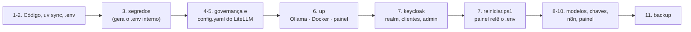

[🏠 TudoIA](../README.md) › [📚 Documentação](README.md) › 📦 Instalação

# 📦 Instalação manual

> Para quem instala, atualiza ou desinstala o TudoIA à mão, a partir do código-fonte (Windows; Linux parcial). Responde: o que
> precisa estar na máquina, em que ordem rodar cada comando, como confirmar que subiu e qual comando faz o quê.
> No Windows, o caminho curto é o [instalador de um clique](instalador.md). Para falhas depois de instalado, veja o [runbook de operação](operacao.md).

## 📑 Sumário

- [🎯 Visão geral](#-visão-geral)
- [Pré-requisitos (Windows)](#pré-requisitos-windows)
- [🚀 Passo a passo](#-passo-a-passo)
  - [1. Obter o código e instalar as dependências](#1-obter-o-código-e-instalar-as-dependências)
  - [2. Criar o `.env`](#2-criar-o-env)
  - [3. Gerar os segredos internos](#3-gerar-os-segredos-internos)
  - [4. Ajustar a governança e a Doutrina](#4-ajustar-a-governança-e-a-doutrina)
  - [5. Gerar a configuração do LiteLLM](#5-gerar-a-configuração-do-litellm)
  - [6. Subir os serviços](#6-subir-os-serviços)
  - [7. Provisionar o Keycloak e reiniciar o painel](#7-provisionar-o-keycloak-e-reiniciar-o-painel)
  - [8. Baixar os modelos](#8-baixar-os-modelos)
  - [9. Preencher as chaves de provedores (opcional)](#9-preencher-as-chaves-de-provedores-opcional)
  - [10. Credencial do Cérebro no n8n e abertura do painel](#10-credencial-do-cérebro-no-n8n-e-abertura-do-painel)
  - [11. Backup](#11-backup)
- [SquadTI (opcional)](#squadti-opcional)
- [Verificação](#verificação)
- [Comandos disponíveis](#comandos-disponíveis)
- [Iniciar, parar e reiniciar](#iniciar-parar-e-reiniciar)
- [Linux](#linux)
- [Atualização e desinstalação](#atualização-e-desinstalação)
- [❌ Erros e diagnóstico](#-erros-e-diagnóstico)

---

## 🎯 Visão geral

| Plataforma | Situação |
|---|---|
| Windows 10 (build 19041 ou mais novo) e 11 | Suportado. O ambiente de referência é Windows 11 com GPU NVIDIA. |
| Linux | Parcial, não testado. Ponto de entrada: `scripts/tudoia.sh`, com quase todos os comandos do `tudoia.ps1` (ver [Linux](#linux)). O painel também tem trechos só de Windows (`painel/tudoia_painel/servicos.py`: `taskkill`, `powershell`, `run_nvidia_gpu.bat`). |
| macOS | Não automatizado, pelo mesmo motivo. Dá para rodar as partes em Python e o `docker compose`, mas a orquestração (`up`, `down`, início do Ollama e do ComfyUI) fica à mão. Não testado. |

Ordem do que se faz, e onde cada coisa passa a existir:



> [!NOTE]
> Esta ordem segue a do instalador (`instalador/tudoia_instalador/etapas.py`, `montar_etapas`): o Keycloak é provisionado
> **depois** de a stack subir, porque o provisionador conversa com o Keycloak já em execução, e o painel só lê o `.env` ao iniciar.

## Pré-requisitos (Windows)

| Item | Para quê | Observação |
|---|---|---|
| Python 3.12 | Runtime do painel, da governança e dos scripts | O `uv` instala a versão pedida (`.python-version`; `requires-python = ">=3.12"`). Não precisa instalar Python à parte. |
| uv | Cria o `.venv` e instala as dependências (`uv sync`) | Siga a documentação oficial do uv. O instalador usa a versão `0.13.0`. |
| PowerShell 5.1 | Executa `scripts\tudoia.ps1` e os scripts de ciclo de vida | Os scripts são ASCII puro por causa do 5.1 (`tests/test_scripts_ps1.py`). |
| Docker Desktop com `docker compose` | Sobe Postgres, LiteLLM e, por perfil, Cérebro, SearXNG, Open WebUI, Kokoro, n8n, Keycloak e SquadTI | O instalador o instala com o backend WSL2. Versão mínima do Docker: não definida no repositório. |
| Ollama | LLMs locais e embeddings (`bge-m3`, usado pelo roteador e pelo Cérebro) | `ollama` precisa estar no PATH para o `up` iniciá-lo. |
| GPU NVIDIA com driver recente | Ollama e ComfyUI | Os limites de contexto e os tempos no código foram medidos em RTX 5070 com 8 GB de VRAM (comentários em `painel/tudoia_painel/gerador.py`). Outras GPUs: não testado. |
| ComfyUI portable (NVIDIA) | Imagem e vídeo no Estúdio local | Opcional. Pasta em `TUDOIA_COMFYUI_PORTABLE`. Sem ele, o Estúdio usa só motores em nuvem. |
| Keycloak | Login do painel | Vem no compose (perfil `keycloak`, porta 8180). Quem já tem um Keycloak em `localhost:8180` tira `keycloak` de `COMPOSE_PROFILES`. Guia: [keycloak.md](componentes/keycloak.md). |
| Espaço em disco | Código, imagens Docker e pesos | O instalador estima, sem os pesos: núcleo 4 GB, Cérebro 2, Open WebUI 6, n8n 2, Keycloak 1, Ollama 2, ComfyUI 12, SquadTI 4 (`sistema.py`, `GB_POR_COMPONENTE`). Os pesos dos modelos são à parte: [modelos.md](componentes/modelos.md). |
| Git | Clonar o repositório | |

## 🚀 Passo a passo

Rode na raiz do repositório (`<raiz-do-repositório>`). Os exemplos usam PowerShell.

### 1. Obter o código e instalar as dependências

```powershell
git clone https://github.com/tudoemcodigo/TudoIA.git
cd TudoIA
uv sync
```

`uv sync` cria `.venv\` e instala as dependências do `pyproject.toml` (versão 2.0.6 do projeto). O Cérebro tem o próprio
`pyproject.toml` em `runtime/cerebro/` e roda no Docker: este comando não o instala.

### 2. Criar o `.env`

Nada no código copia o modelo. Copie à mão:

```powershell
Copy-Item .env.example .env
```

O `.env` está no `.gitignore` e nunca vai para o git. Os segredos internos começam vazios. Os valores de cada variável estão em
[configuracao.md](configuracao.md). O `COMPOSE_PROFILES` do modelo é `cerebro,webui,n8n,keycloak`; acrescente `squadti` se quiser a
[SquadTI](#squadti-opcional).

### 3. Gerar os segredos internos

```powershell
.\scripts\tudoia.ps1 segredos
```

Preenche só as chaves internas vazias e imprime só os nomes (`gerado: <NOME>`): `WEBUI_SECRET_KEY`, `SEARXNG_SECRET`,
`N8N_ENCRYPTION_KEY`, `LITELLM_MASTER_KEY`, `POSTGRES_ADMIN_PASSWORD`, `LITELLM_DB_PASSWORD`, `KEYCLOAK_DB_PASSWORD`,
`TUDOIA_SESSAO_SEGREDO` e `CEREBRO_TOKEN_ESTATICO`. Com `keycloak` em `COMPOSE_PROFILES` gera também
`TUDOIA_KEYCLOAK_ADMIN_PASSWORD`; com `squadti`, `TUDOIA_SQUADTI_TOKEN` (`painel/tudoia_painel/cli.py`). Valores existentes não
são trocados. Antes de cada gravação o `.env` anterior vai para `dados\backups\env\` (até 10 cópias).

> [!IMPORTANT]
> Guarde uma cópia do `.env` fora da máquina, em cofre. O backup do TudoIA não copia o `.env`, e sem a mesma
> `N8N_ENCRYPTION_KEY` as credenciais do n8n restauradas não decifram. Também não troque `POSTGRES_ADMIN_PASSWORD`,
> `LITELLM_DB_PASSWORD` nem `KEYCLOAK_DB_PASSWORD` depois da primeira subida sem seguir o [runbook](operacao.md#senha-do-postgres-trocada-no-env-sem-mudar-no-banco).

Para usar `tudoia segredos` sem o caminho, ponha `scripts\` no PATH: o `scripts\tudoia.cmd` só repassa os argumentos ao
`tudoia.ps1`. O `pyproject.toml` não instala um executável `tudoia`.

### 4. Ajustar a governança e a Doutrina

O `up` roda `sync` antes de subir os containers, e o `sync` para sem escrever nada se houver erro. Confira antes
`governanca\governanca.json`:

- `instancias` lista os clientes de IA do autor (Claude Code, Antigravity, Codex, OpenCode, Aider e pastas da home), todos
  `ativo: true`. Marque `ativo: false` ou remova o que não existe na sua máquina: cada instância ativa recebe arquivos de
  configuração. `workspaces` está vazio.
- `mcp` lista os servidores MCP ativos. Uma variável `${VAR}` sem valor padrão e sem valor no `.env` aborta o `sync`
  (`governanca/__init__.py`, `_interpolar`: "variável ... ausente no .env"). Hoje o MCP `cerebro` usa `CEREBRO_TOKEN_ESTATICO` (passo 3) e o
  `doutrina-tec` usa `TUDOIA_PYTHON` e `DOUTRINA_TEC`.
- Em instalação manual essas duas últimas vêm **vazias** no `.env.example`. Defina `TUDOIA_PYTHON` com `<raiz-do-repositório>\.venv\Scripts\python.exe` e
  `DOUTRINA_TEC` com a pasta de um clone da Doutrina no commit fixado em `governanca\doutrina.json`. Ou tire `doutrina-tec` de `mcp`
  (então a skill e a SquadTI também ficam sem a Doutrina; ver [doutrina.md](componentes/doutrina.md)).
- `github` e `supabase` existem no catálogo (`mcp.json`) mas não estão em `mcp`; só exigem token se você os ligar.

Leia [governanca.md](componentes/governanca.md) antes de rodar `sync` numa máquina que você não controla. `.\scripts\tudoia.ps1 verificar`
lista o que mudaria, sem escrever.

> [!NOTE]
> Este passo foi conferido contra o código, não executado: rodar `sync` grava nos arquivos dos seus clientes de IA.

### 5. Gerar a configuração do LiteLLM

`runtime\litellm\config.yaml` não é versionado (está no `.gitignore`) e o compose o monta como arquivo
(`./litellm/config.yaml:/app/config.yaml:ro`). O instalador o gera antes de subir a stack (etapa `config_litellm`); à mão, faça o mesmo:

```powershell
$env:PYTHONPATH = "$PWD;$PWD\painel"
uv run python -m tudoia_painel gerar-config
```

Saída esperada: `gerado: runtime/litellm/config.yaml`. Um provedor só entra se **todas** as chaves dele estiverem preenchidas
(`painel/tudoia_painel/catalogo.py`); depois de mudar chaves, gere de novo (o painel faz isso em `POST /api/roteador/gerar`).

### 6. Subir os serviços

```powershell
.\scripts\tudoia.ps1 up
```

`OLLAMA_URL` pode ficar vazia: o compose passa `http://host.docker.internal:11434` ao LiteLLM. O comando faz, nesta ordem
(`scripts/tudoia.ps1`):

1. Se a porta 11434 não aceita conexão, inicia `ollama serve` em segundo plano com `OLLAMA_HOST=127.0.0.1:11434` (só loopback) e
   `OLLAMA_MODELS` igual a `TUDOIA_OLLAMA_MODELS` do `.env` ou, sem ela, `modelos\ollama\models`.
2. Roda `sync` (distribui a governança).
3. Roda `docker compose -p <projeto> -f runtime\docker-compose.yml --env-file .env up -d --build`. O projeto é
   `TUDOIA_COMPOSE_PROJETO` (padrão `tudoia`).
4. Inicia o painel em segundo plano, sem janela, e espera a porta 3100 por até 90 s. Se não responder, o comando falha com
   `dados\logs\painel.err.log` para consultar.

Se um comando nativo falha (por exemplo o `sync`), o script para ali com o mesmo código de saída. **O `up` não inicia o ComfyUI**: use a aba
**Serviços** do painel ou o `iniciar.ps1` (que o inicia quando `TUDOIA_COMFYUI_PORTABLE` está no `.env`).

Neste ponto o painel está no ar mas sem login configurado: toda rota `/api` responde 503 até o próximo passo (fail-closed).

### 7. Provisionar o Keycloak e reiniciar o painel

Pré-requisito: o Keycloak em `http://localhost:8180` (o do compose sobe no `up`, perfil `keycloak`) e o administrador do realm `master`.
Com o perfil embutido, `TUDOIA_KEYCLOAK_ADMIN` e `TUDOIA_KEYCLOAK_ADMIN_PASSWORD` já estão no `.env`; com um Keycloak próprio,
defina-os ou digite-os quando o script pedir.

```powershell
.\scripts\tudoia.ps1 keycloak --verificar                 # compara o template com o Keycloak; somente leitura; sai com 1 se houver desvio
.\scripts\tudoia.ps1 keycloak                             # aplica o realm tudoia; a 2ª execução imprime "igual"
.\scripts\tudoia.ps1 keycloak --admin-inicial admin@example.com
```

O último comando cria o primeiro administrador e imprime uma senha temporária **uma única vez**; a troca no primeiro login é
obrigatória. O provisionador grava no `.env` `TUDOIA_OIDC_CLIENT_SECRET` (painel), `TUDOIA_MCP_CLIENT_ID` e
`TUDOIA_MCP_CLIENT_SECRET` (cliente de serviço do Cérebro), e aplica a validade de 8 h do token do painel (sem isso, a sessão cai
em 5 min). O realm exige senha de 12 caracteres ou mais. Detalhes e papéis: [keycloak.md](componentes/keycloak.md).

Como o painel lê o `.env` só ao iniciar, reinicie **só o painel**:

```powershell
.\scripts\reiniciar.ps1 -SemNavegador
```

Sem este passo, o painel segue com 503 nas rotas `/api`. O `reiniciar.ps1` sem `-Tudo` não toca em Ollama, ComfyUI nem Docker (ver [Iniciar, parar e reiniciar](#iniciar-parar-e-reiniciar)).

### 8. Baixar os modelos

```powershell
.\scripts\tudoia.ps1 modelos --listar
.\scripts\tudoia.ps1 modelos --obrigatorios
.\scripts\tudoia.ps1 modelos --verificar --obrigatorios
```

O download grava em `modelos\` por padrão (`--base-dir PASTA` muda). Os modelos do Ollama são enviados ao servidor Ollama, que os guarda em
`OLLAMA_MODELS`. Lista, licenças restritas e pendências: [modelos.md](componentes/modelos.md).

### 9. Preencher as chaves de provedores (opcional)

Edite o `.env` ou use a aba **Segredos** do painel (só admin). Os nomes das variáveis estão em [configuracao.md](configuracao.md).
Gratuito não é privado: o texto dos pedidos enviados a provedores gratuitos sai da máquina. Para a chave chegar ao container do
LiteLLM, ele precisa ser recriado (`docker compose ... up -d --force-recreate litellm`, ou **reiniciar** o serviço pela aba
Serviços, que recria o container; um `compose restart` simples mantém o ambiente antigo).

### 10. Credencial do Cérebro no n8n e abertura do painel

Com o `n8n` no ar (perfil `n8n`) e o Keycloak provisionado:

```powershell
.\scripts\tudoia.ps1 n8n-credencial
```

Grava no cofre do n8n a credencial OAuth2 `TudoIA Cérebro (client_credentials)`, que o fluxo `ingerir-documento` usa. O segredo vem do
`.env` (`TUDOIA_MCP_CLIENT_SECRET`), segue pelo stdin do `docker exec` e não vai para variável do container. Rodar de novo só
sobrescreve a mesma credencial. Depois importe `automacao/n8n/ingerir-documento.json`: [automacao-n8n.md](componentes/automacao-n8n.md).

Para abrir o painel, use `.\scripts\painel.ps1` (sobe se preciso e abre o navegador) ou acesse `http://127.0.0.1:3100/app/`. O
painel atende só em `127.0.0.1`, porta 3100. `.\scripts\tudoia.ps1 painel` roda o painel em **primeiro plano** (ocupa o terminal) e não
repassa `--porta`; trocar a porta exige também `TUDOIA_PAINEL_PORTA` e o redirect URI do Keycloak, e não foi testado. Entre com a
conta de `--admin-inicial`. Conta sem papel `tudoia-*` recebe 403 no login.

### 11. Backup

```powershell
.\scripts\tudoia.ps1 backup                       # mantém os 7 mais recentes
.\scripts\tudoia.ps1 backup --manter 14
.\scripts\tudoia.ps1 backup --destino <pasta-de-destino>
```

O `scripts/backup/backup.py` cria `dados\backups\<AAAAMMDD-HHMMSS>\` com:

- `postgres-litellm.sql.gz` e `postgres-keycloak.sql.gz`: `pg_dump` de cada database do Postgres único (`docker exec tudoia-postgres`);
- `cerebro.db`: cópia consistente pela API de backup do SQLite, conferida com `PRAGMA quick_check`;
- `n8n.tar.gz` e `open-webui.tar.gz`: tar dos volumes `<projeto>_n8n` e `<projeto>_open-webui`, lidos somente para leitura por um
  container `alpine:3.20.3` sem rede;
- `manifesto.json`: tamanho e sha256 de cada item e a lista do que falhou.

Cada item é independente: se um falha, os outros continuam e o comando sai com código 1. A rotação (`--manter N`) só roda quando nada
falhou e só apaga pastas com nome `AAAAMMDD-HHMMSS`. O `.env` **não** entra no backup: guarde-o à parte. A restauração é manual, item por
item: `scripts/backup/restaurar.md`, resumida com os riscos no [runbook de backup e restauração](operacao.md#backup-e-restauração).

## SquadTI (opcional)

A SquadTI sobe pelo perfil `squadti` (container `squadti`, porta 8790). Depois de `segredos` com `squadti` em `COMPOSE_PROFILES`
(gera `TUDOIA_SQUADTI_TOKEN`) e com o LiteLLM no ar:

```powershell
.\scripts\tudoia.ps1 squadti-chave      # cria SQUADTI_API_KEY (chave virtual do LiteLLM, alias squadti, 90 dias); --rotacionar troca
.\scripts\iniciar.ps1 -ComSquadti       # ou reiniciar.ps1 -ComSquadti
```

Sem `TUDOIA_SQUADTI_TOKEN` (32 caracteres ou mais) e sem `SQUADTI_API_KEY`, `iniciar.ps1` e `reiniciar.ps1` não sobem a Squad.
Atenção: o compose monta o `docker.sock` do host na Squad; leia o aviso em [seguranca.md](seguranca.md#riscos-residuais) (risco 21) antes de ligar. Detalhes:
[squadti.md](componentes/squadti.md).

## Verificação

Rode na ordem. Cada item diz o resultado esperado.

| Verificação | Comando | Esperado |
|---|---|---|
| Containers | `.\scripts\tudoia.ps1 status` | `postgres` (`tudoia-postgres`) e `litellm` sempre; mais os dos perfis ligados (`cerebro`, `searxng`, `open-webui`, `kokoro`, `n8n`, `keycloak`), em execução. Têm healthcheck: `postgres`, `litellm`, `searxng`, `cerebro`, `n8n`, `keycloak`, `squadti` |
| Cérebro | `curl.exe -s http://127.0.0.1:8765/saude` | JSON com `"ok": true` (e contagens e estado da indexação) |
| Painel no ar | `curl.exe -s http://127.0.0.1:3100/saude` | `{"ok":true}` |
| Painel sem login | `curl.exe -s http://127.0.0.1:3100/api/sessao` | `"configurado": true` e `"autenticado": false` |
| Governança | `.\scripts\tudoia.ps1 verificar` | `tudo em sincronia` |
| Keycloak | `.\scripts\tudoia.ps1 keycloak --verificar` | `Sem desvios: realm igual ao template.` |
| Modelos | `.\scripts\tudoia.ps1 modelos --verificar --obrigatorios` | sem erros |
| Testes do projeto | `uv run pytest -q` | suíte de `tests\` ([desenvolvimento.md](desenvolvimento.md)) |

## Comandos disponíveis

Todos são subcomandos de `scripts\tudoia.ps1` (ou `scripts\tudoia.cmd`, que só repassa os argumentos).

| Comando | O que faz |
|---|---|
| `up` | Inicia o Ollama (porta 11434 sem resposta), roda `sync`, sobe a stack com `--build` e inicia o painel em segundo plano. Não inicia o ComfyUI |
| `down` | `docker compose down`: **remove** os containers do compose (os volumes ficam). Não para o painel, o Ollama nem o ComfyUI |
| `status` | `docker compose ps` |
| `painel` | Painel em primeiro plano em `127.0.0.1:3100` |
| `sync` | Distribui regras, skills e MCP para os clientes (`governanca`) |
| `verificar` | Lista divergências entre a governança e o disco; não escreve |
| `segredos` | Gera os segredos internos vazios no `.env` |
| `keycloak [--verificar \| --rotacionar-secret \| --admin-inicial EMAIL]` | Provisiona o realm `tudoia` |
| `modelos [--listar \| --verificar \| --modelo ID... \| --obrigatorios \| --base-dir PASTA]` | Lista, baixa e verifica os modelos |
| `n8n-credencial` | Grava no n8n (container no ar) a credencial OAuth2 do Cérebro |
| `squadti-chave [--rotacionar]` | Cria ou rotaciona a chave virtual da SquadTI no LiteLLM (grava `SQUADTI_API_KEY`) |
| `backup [--manter N] [--destino PASTA]` | Backup em `dados\backups\<AAAAMMDD-HHMMSS>\` (sem o `.env`) |
| `verificar-openwebui [--aprovar]` | Confere `runtime/open-webui/env.py` contra o da imagem fixada ([seguranca.md](seguranca.md#riscos-residuais), risco 18) |
| `empacotar` | Gera `dist/TudoIA-Setup.exe` ([instalador.md](instalador.md#para-quem-empacota)) |

O código de saída do `tudoia.ps1` é o do comando nativo (`uv`, `docker`, `python`) que falhou, ou 0.

Não há subcomando `gerar-config`: ele é do módulo (`python -m tudoia_painel gerar-config`, passo 5).

## Iniciar, parar e reiniciar

Os scripts do dia a dia ficam em `scripts\` e são os que os atalhos do instalador chamam. Eles compartilham `_comum.ps1`.

| Script | O que faz |
|---|---|
| `iniciar.ps1 [-SemNavegador] [-ComSquadti]` | Liga o Docker Desktop (espera até 5 min), o Ollama (só se `TUDOIA_OLLAMA_MODELS` está no `.env` e `ollama` no PATH), o ComfyUI (só se `TUDOIA_COMFYUI_PORTABLE` está no `.env`), a stack (`up -d --wait`, até 300 s) e o painel. O painel sobe **sempre**, mesmo se a infraestrutura falhar; nesse caso o script avisa e sai com 1 |
| `parar.ps1` | Para o painel, a SquadTI, **todos** os serviços Docker de qualquer perfil (`stop --profile '*'`), o **Ollama** e o **ComfyUI**. Volumes e dados ficam. Sai com 1 se algo continuar no ar |
| `reiniciar.ps1 [-Tudo] [-ComSquadti] [-SemNavegador]` | Padrão: reinicia **só** o painel (e a Squad, se estava no ar). `-Tudo`: `parar.ps1` e depois `iniciar.ps1` |
| `painel.ps1 [-SemNavegador]` | Abre o painel; se a porta 3100 não responde, sobe antes |
| `desinstalar.ps1` | Desinstala (pede `DESINSTALAR`; dados e modelos só saem com `APAGAR`) |

> [!WARNING]
> `parar.ps1` para o Ollama e o ComfyUI **sempre**, mesmo que o `.env` não aponte para eles, e `down` do `tudoia.ps1` não os
> toca. Cada processo só é encerrado se a linha de comando bater com o serviço esperado, então outro programa na mesma porta é preservado.
> Detalhes e o caso em que o painel leva os serviços junto: [runbook](operacao.md#ollama-e-comfyui-caíram-ao-reiniciar-o-painel).

## Linux

Use `scripts/tudoia.sh` (bash). Ele substitui o `tudoia.ps1` em `up`, `down`, `status`, `painel`, `sync`, `verificar`, `segredos`, `keycloak`,
`modelos`, `n8n-credencial`, `backup`, `verificar-openwebui` e `empacotar`. Não tem `squadti-chave`. Os argumentos extras dos comandos
em Python são repassados.

```bash
chmod +x scripts/tudoia.sh   # só na primeira vez, se o modo de execução não veio do git
scripts/tudoia.sh up
```

- **Painel:** o `up` do `.sh` **não** inicia o painel (diferente do Windows); rode `scripts/tudoia.sh painel` (primeiro plano).
- **Python:** usa `.venv/bin/python` se existir; senão `uv run --project` (se `uv` estiver no PATH); senão para com mensagem.
- **Ollama:** o `up` inicia `ollama serve` só se o binário estiver no PATH e a porta 11434 estiver livre. Pesos: `TUDOIA_OLLAMA_MODELS` ou
  `modelos/ollama/models`. Log em `dados/ollama.log`. O endereço depende do Docker (`endereco_ollama`):
  - Docker Desktop (Linux ou macOS): `OLLAMA_HOST=127.0.0.1:11434`, como no Windows; os containers chegam ao loopback por `host.docker.internal`.
  - Docker Engine sem Desktop: o Ollama escuta no IPv4 da bridge `docker0` (ex.: `172.17.0.1:11434`), o IP que `host.docker.internal`
    (`host-gateway`) resolve. Use `OLLAMA_HOST=<esse IP>:11434` na CLI e no painel e libere a 11434 no firewall (ufw) para as redes do Docker.
    Sem `docker0`, o script avisa e fica em `127.0.0.1` (os containers não alcançam o Ollama). Nunca `0.0.0.0`.
- **ComfyUI:** o script não o inicia.
- **Limites:** não testado em Linux nem em macOS; os trechos do painel só de Windows continuam fora de escopo.

## Atualização e desinstalação

- **Atualizar o código:** `.\scripts\tudoia.ps1 backup`, depois `git pull`, `uv sync` e `.\scripts\tudoia.ps1 up`. Se o diff trouxe mudança no
  `docker-compose.yml`, leia-o antes. As imagens estão fixadas por digest, então atualizar imagem é manual
  ([seguranca.md](seguranca.md#riscos-residuais), risco 4). Se o código do painel mudou, `.\scripts\reiniciar.ps1`.
- **Parar:** `.\scripts\parar.ps1` (tudo, inclusive Ollama e ComfyUI) ou `.\scripts\tudoia.ps1 down` (só containers).
- **Desinstalar (instalação do instalador):** atalho **TudoIA - Desinstalar** ou `.\scripts\desinstalar.ps1`; ver [instalador.md](instalador.md#depois-de-instalado).
- **Remover dados à mão (DESTRUTIVO):** apague `dados\` e os volumes `<projeto>_open-webui`, `<projeto>_n8n`, `<projeto>_postgres` e
  `<projeto>_squadti-dados`. Antes, confirme o alvo com `docker volume ls --filter name=<projeto>_` e guarde o `.env`, `dados\backups\` e
  `~\.tudoia\backups\`. Sem a `N8N_ENCRYPTION_KEY`, as credenciais salvas no n8n não decifram.

## ❌ Erros e diagnóstico

| Sintoma | Causa provável | O que fazer |
|---|---|---|
| `up` para no `sync` com "variável ... ausente no .env" | Um MCP ativo precisa de variável vazia (ex.: `DOUTRINA_TEC`, `TUDOIA_PYTHON`, `CEREBRO_TOKEN_ESTATICO`) | Preencha a variável (passos 3 e 4) ou remova o MCP de `governanca.json` |
| `sync` recusa com "workspace inexistente" | Caminho de `workspaces` não existe nesta máquina | Ajuste `workspaces` |
| `litellm` não sobe ou reinicia em loop | `runtime\litellm\config.yaml` ausente (o Docker cria uma **pasta** no lugar do arquivo montado) ou inválido; outra causa possível: senha do Postgres | `docker logs litellm`; gere o arquivo (passo 5). Se for senha do banco, ver [runbook](operacao.md#senha-do-postgres-trocada-no-env-sem-mudar-no-banco) |
| `up` falha com `defina no .env (tudoia segredos)` | `POSTGRES_ADMIN_PASSWORD`, `LITELLM_DB_PASSWORD` ou `KEYCLOAK_DB_PASSWORD` vazia (o compose exige as três) | `.\scripts\tudoia.ps1 segredos` |
| `up` termina com "O painel nao respondeu na porta 3100" | `.venv` ausente (falta `uv sync`) ou painel travou ao iniciar | `dados\logs\painel.err.log`; [runbook](operacao.md#o-painel-não-sobe-ou-uma-porta-está-ocupada) |
| Sessão do painel cai a cada 5 min | O Keycloak ainda tem o token de 300 s do cliente `tudoia-painel` | `.\scripts\tudoia.ps1 keycloak`; saia e entre de novo |
| `n8n-credencial` sai com código 1 | `TUDOIA_MCP_CLIENT_SECRET` vazio no `.env` | `.\scripts\tudoia.ps1 keycloak` |
| `n8n-credencial` sai com código 2 | Container `n8n` fora do ar, Docker indisponível ou n8n recusou a importação | Confira `status`; suba o `n8n` |
| Painel responde 503 em `/api/*` | Configuração OIDC ausente, ou `TUDOIA_SESSAO_SEGREDO` com menos de 32 caracteres, ou painel não reiniciado depois do `keycloak` | `keycloak`, `segredos`, `reiniciar.ps1`; confira `TUDOIA_OIDC_*` |
| Painel responde 403 `host_recusado` | Acesso por host diferente de `127.0.0.1` ou `localhost` | Use `http://127.0.0.1:3100/app/` |
| Login falha com `user_not_found` no log do Keycloak | `KC_BOOTSTRAP_ADMIN_*` só cria o admin na primeira inicialização do banco | [keycloak.md](componentes/keycloak.md) |
| Ollama não inicia pelo `up` | `ollama` não está no PATH | Instale o Ollama e abra um terminal novo |
| `keycloak` sai com código 2 | Credenciais de admin do `master` recusadas, ou Keycloak fora do ar | `curl.exe http://localhost:8180/realms/master/.well-known/openid-configuration`; [keycloak.md](componentes/keycloak.md) |

---

[🏠 README](../README.md) · [📚 Documentação](README.md) · ⬅️ [Arquitetura](arquitetura.md) · [Instalador](instalador.md) ➡️
