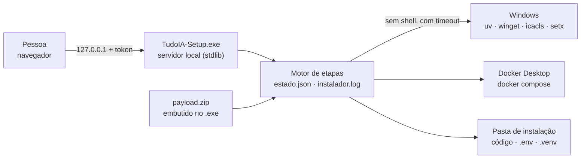

[🏠 TudoIA](../README.md) › [📚 Documentação](README.md) › 💿 Instalador

# 💿 Instalador (TudoIA Setup)

> Para quem instala o TudoIA numa máquina Windows limpa com o `TudoIA-Setup.exe`, e para quem empacota e publica esse executável.
> Responde: o que a tela pergunta, o que cada etapa faz na máquina, como retomar uma instalação que falhou, o que entra no pacote e
> como sair uma release. A instalação sem o executável está em [instalacao.md](instalacao.md).

## 📑 Sumário

- [🎯 Visão geral](#-visão-geral)
- [🚀 Para quem instala](#-para-quem-instala)
  - [Depois de instalado](#depois-de-instalado)
  - [Sem tela (automação)](#sem-tela-automação)
- [⚙️ Opções e etapas](#️-opções-e-etapas)
  - [Opções da tela](#opções-da-tela)
  - [Etapas, em ordem](#etapas-em-ordem)
  - [Alterações no Windows](#alterações-no-windows)
- [Limites conhecidos](#limites-conhecidos)
- [Para quem empacota](#para-quem-empacota)
  - [A Doutrina TEC dentro do pacote](#a-doutrina-tec-dentro-do-pacote)
  - [Publicar uma release](#publicar-uma-release)
- [❌ Erros e diagnóstico](#-erros-e-diagnóstico)
- [🛡️ Segurança do assistente](#️-segurança-do-assistente)

---

## 🎯 Visão geral

`TudoIA-Setup.exe` instala o ecossistema numa máquina Windows 10 (build 19041 ou mais novo) ou 11: assistente no navegador,
pré-requisitos (Docker Desktop, Ollama, Python via uv), serviços Docker, login (Keycloak) e atalhos. O executável não leva nada da
máquina onde foi gerado: o código que ele instala vem de um pacote (`payload.zip`) montado por lista de permissão.



Código do instalador: `instalador/tudoia_instalador/` (`servidor.py`, `motor.py`, `etapas.py`, `opcoes.py`, `sistema.py`, `codigo.py`,
`atalhos.py`, `desinstalar.py`, `execucao.py`, `envfile.py`, tela em `static/`). Empacotamento: `scripts/empacotar/`.

## 🚀 Para quem instala

1. Baixe `TudoIA-Setup.exe` e o `.sha256` da [última release](https://github.com/tudoemcodigo/TudoIA/releases/latest). Confira o hash com
   `(Get-FileHash .\TudoIA-Setup.exe).Hash` (deve ser igual ao do `.sha256`) e, com a CLI do GitHub, a origem:
   `gh attestation verify .\TudoIA-Setup.exe --repo tudoemcodigo/TudoIA`. Dê duplo clique. O SmartScreen avisa porque o executável
   **não é assinado**: *Mais informações > Executar assim mesmo*.
2. O instalador imprime e abre `http://127.0.0.1:<porta>/?t=<token>` (porta livre sorteada; o token é novo a cada execução). A tela
   tem seis passos: **Sistema**, **O que instalar**, **Onde instalar**, **Conta e chaves**, **Revisar**, **Instalar**. Abrir o endereço sem
   o `?t=` dá 403.
3. No fim aparecem o endereço do painel (`http://127.0.0.1:3100/app/`), o e-mail do administrador e uma **senha temporária, mostrada uma
   única vez** (a troca é obrigatória no primeiro login; a política do realm exige 12 caracteres ou mais).

**Os modelos de IA não são baixados na instalação.** Depois, use o painel ou `.\scripts\tudoia.ps1 modelos`.

Cada etapa é idempotente. Se uma falha, corrija a causa e clique em **Tentar de novo**: as já concluídas são puladas. O estado fica em
`%LOCALAPPDATA%\TudoIA-Setup\estado.json` (sem segredos) e o registro em `instalador.log` na mesma pasta (segredos mascarados com
`***`). Se o Windows precisar reiniciar (Docker Desktop recém-instalado), abra o TudoIA Setup de novo depois do reinício, carregue as opções
anteriores e ele continua de onde parou. Uma instalação já concluída que roda de novo (outras opções, reparo) recomeça do zero, preservando
`.env`, `dados`, `modelos`, `.venv`, `ferramentas` e o `config.yaml` do LiteLLM.

### Depois de instalado

Cinco atalhos, na área de trabalho e na pasta **TudoIA** do menu Iniciar (`instalador/tudoia_instalador/atalhos.py`):

| Atalho | Script | Janela |
|---|---|---|
| TudoIA - Painel | `scripts\painel.ps1` | oculta |
| TudoIA - Iniciar | `scripts\iniciar.ps1` | oculta |
| TudoIA - Parar | `scripts\parar.ps1` | oculta |
| TudoIA - Reiniciar painel | `scripts\reiniciar.ps1` | oculta |
| TudoIA - Desinstalar | `scripts\desinstalar.ps1` | visível (pede confirmação) |

O que cada script faz, e o aviso de que **Parar derruba também o Ollama e o ComfyUI**, está em [instalacao.md](instalacao.md#iniciar-parar-e-reiniciar).
A desinstalação pede que você digite `DESINSTALAR` e, depois, `APAGAR` se quiser remover dados e modelos; por padrão mantém `dados` e
`modelos`. Só apaga pastas com a marca `.tudoia-instalacao.json` e nunca segue junção ou link ao apagar. Com `APAGAR`, o `docker compose
down -v` também remove os volumes.

### Sem tela (automação)

```powershell
TudoIA-Setup.exe --config opcoes.json          # mesmos nomes de campo da tela; o JSON pode ter segredos: apague-o depois
TudoIA-Setup.exe --desinstalar C:\TudoIA [--remover-dados]
TudoIA-Setup.exe --sem-navegador               # sobe a tela, mas não abre o navegador: só mostra o endereço
TudoIA-Setup.exe --versao
```

Códigos de saída da instalação com `--config`: 0 ok, 1 falhou, 2 opções inválidas, 3 precisa reiniciar o Windows. Nesse modo a senha
temporária do administrador é impressa no console (junto com o log), então não redirecione a saída para um arquivo compartilhado.
`--desinstalar` sai com 0 ou 1.

## ⚙️ Opções e etapas

### Opções da tela

Fonte: `instalador/tudoia_instalador/opcoes.py` (`Opcoes`). Campo desconhecido no JSON é erro.

| Campo | Padrão | Efeito |
|---|---|---|
| `pasta_instalacao` | `C:\TudoIA` | Onde ficam código, `.env` e `.venv`. Caminho completo do Windows com até 90 caracteres, sem `% $ \` ' ; & ^ ! " < > \| ? *`, nem dentro de `Windows`, `Program Files`, `Program Files (x86)` ou `ProgramData`, nem a raiz do disco |
| `pasta_dados` | vazia = `<instalação>\dados` | Pasta de dados; se for outra, `<instalação>\dados` vira **junção** para ela |
| `pasta_pesos_ollama` | vazia = `<instalação>\modelos\ollama\models` | Vira `TUDOIA_OLLAMA_MODELS` |
| `pasta_comfyui` | vazia = `<instalação>\modelos\comfyui\ComfyUI_windows_portable` | Vira `TUDOIA_COMFYUI_PORTABLE` |
| `projeto_compose` | `tudoia` | Projeto do compose (`^[a-z0-9][a-z0-9_-]{0,30}$`); prefixo dos volumes |
| `componentes` | `cerebro`, `webui`, `n8n`, `keycloak`, `ollama` | O núcleo (painel, LiteLLM, Postgres) é sempre instalado. Opcionais: `cerebro` (Cérebro + SearXNG), `webui` (Open WebUI + Kokoro), `n8n`, `keycloak`, `squadti` (imagem de uns 2 GB com .NET e Node, roda isolada), `ollama`, `comfyui` (exige GPU NVIDIA) |
| `fonte_codigo` | `embutido` | `embutido` (pacote dentro do `.exe`) ou `github` |
| `github_repo`, `github_ref` | `tudoemcodigo/TudoIA`, `main` | Só com `fonte_codigo = github` |
| `admin_email` | vazio | Obrigatório com Keycloak: vira o primeiro administrador do painel |
| `fuso` | `America/Sao_Paulo` | Vira `TZ` |
| `keycloak_existente` | `false` | `true` usa o Keycloak que já roda em `localhost:8180` (não marque também o embutido) |
| `keycloak_existente_admin`, `keycloak_existente_senha` | `admin`, vazio | Credenciais do `master` desse Keycloak; a senha só vai ao `.env` |
| `chaves_provedores` | vazio | Só estas chaves são aceitas: `NVIDIA_NIM_API_KEY`, `OPENROUTER_API_KEY`, `GROQ_API_KEY`, `GEMINI_API_KEY`, `CLOUDFLARE_API_KEY`, `CLOUDFLARE_ACCOUNT_ID`, `ANTHROPIC_API_KEY`, `OPENAI_API_KEY`, `DEEPSEEK_API_KEY`, `XAI_API_KEY`, `HF_TOKEN`. Vão só para o `.env` |
| `configurar_clientes_ia` | `false` | `true` roda o `sync` (grava regras e MCP no Claude Code, Cursor etc.) |
| `criar_atalhos` | `true` | Cria os cinco atalhos |
| `iniciar_ao_final` | `true` | Inicia o painel ao terminar |

O painel exige login: sem Keycloak embutido nem existente a validação recusa a instalação.

### Etapas, em ordem

`montar_etapas()` em `etapas.py`. "Aplica quando" é a condição das opções; sem ela a etapa roda sempre.

| Id | O que faz | Aplica quando |
|---|---|---|
| `verificacao` | Valida opções; exige Windows 19041+, internet (HEAD em `github.com`), espaço em disco (soma por componente), GPU NVIDIA se `comfyui`, portas livres (exceto numa reinstalação) | sempre |
| `codigo` | Extrai o `payload.zip` embutido (ou o zip do GitHub) em `pasta_instalacao`, sem sobrescrever o que é do usuário; normaliza ACLs de `runtime`, `config` e `infra`; garante `doutrina/` | sempre |
| `pastas` | Cria `dados\{logs,cerebro,documentos,estudio,backups\env}`, a junção de dados e a marca `.tudoia-instalacao.json` | sempre |
| `env` | Monta o `.env` a partir do `.env.example` (ou do existente) com perfis, projeto, `TZ`, `DOUTRINA_TEC`, `TUDOIA_PYTHON`, pastas e chaves; restringe o acesso ao seu usuário (`icacls`) | sempre |
| `uv` | Usa o `uv` do PATH ou baixa a versão `0.13.0` (https, hosts do GitHub, sha256 publicado quando disponível) para `ferramentas\uv` | sempre |
| `python` | `uv python find 3.12`; instala o 3.12 pelo `uv` se faltar | sempre |
| `dependencias` | `uv sync --frozen` | sempre |
| `segredos` | `python -m tudoia_painel segredos` | sempre |
| `docker` | Instala o Docker Desktop (winget elevado, backend WSL2; sem winget, baixa o instalador oficial, sem hash) e espera ficar pronto por até 420 s. Se precisar reiniciar o Windows, pausa e retoma depois | sempre |
| `ollama` | Instala o Ollama (winget ou instalador oficial), grava `OLLAMA_MODELS` e `OLLAMA_HOST=127.0.0.1:11434` com `setx` e inicia `ollama serve` | `ollama` |
| `config_litellm` | `python -m tudoia_painel gerar-config` (cria `runtime\litellm\config.yaml`) | sempre |
| `stack` | `docker compose pull --ignore-buildable` e `up -d --build --wait --wait-timeout 900` | sempre |
| `keycloak` | `python -m scripts.keycloak.provisionar --admin-inicial <email>`: realm, clientes, papéis e administrador; guarda a senha temporária só em memória | `keycloak` ou `keycloak_existente` |
| `n8n` | Grava a credencial OAuth2 do Cérebro no cofre do n8n | `n8n` e `cerebro` |
| `squadti` | Cria a chave virtual da SquadTI no LiteLLM (`SQUADTI_API_KEY`) e recria o container `squadti` | `squadti` |
| `comfyui` | Baixa o ComfyUI portable NVIDIA (uns 2 GB; extrai com `tar` ou `7zr`) e o inicia | `comfyui` |
| `sync` | `python -m tudoia_painel sync` | `configurar_clientes_ia` |
| `atalhos` | Cria os atalhos | `criar_atalhos` |
| `painel` | Inicia o painel em segundo plano e espera `/saude` por até 120 s (log em `dados\logs\painel.log`) | `iniciar_ao_final` |

### Alterações no Windows

Além dos arquivos na pasta de instalação, o instalador muda:

- variáveis de ambiente do **usuário** `OLLAMA_MODELS` e `OLLAMA_HOST` (`setx`), para o Ollama que sobe com o Windows usar a sua pasta de pesos e escutar só em loopback;
- ACL do `.env` (herança removida, só o seu usuário) e das pastas `runtime`, `config` e `infra` (herança restaurada, leitura para `BUILTIN\Users`), necessária para os bind mounts do Docker;
- programas instalados: Docker Desktop (com permissão de administrador, pedida pelo Windows) e Ollama, se não existirem;
- atalhos `.lnk` na área de trabalho e no menu Iniciar.

## Limites conhecidos

- Só Windows 10 2004 (build 19041) ou mais novo e 11. Linux e macOS não têm instalador.
- Portas fixas: painel 3100, LiteLLM 4000, Postgres 5433, Cérebro 8765, SearXNG 8080, Open WebUI 3000, Kokoro 8880, n8n 5678, Keycloak 8180,
  Ollama 11434, ComfyUI 8188, SquadTI 8790. O instalador confere as dos componentes escolhidos e recusa instalar por cima de outro
  programa. Uma instalação por máquina (os containers têm nome fixo).
- Docker Desktop, Ollama e ComfyUI são baixados da internet. O caminho do Docker Desktop (winget elevado, WSL2, reinício) foi escrito
  conforme a documentação e coberto por testes com duplos, **mas não foi executado numa máquina sem Docker**.
- Sem winget, o instalador do Docker Desktop e o do Ollama são baixados **sem verificação de hash** (a etapa registra isso no log).
- O Keycloak embutido roda em modo `start` com HTTP, só em `127.0.0.1`. É para uso local.
- O `.exe` não é assinado. Antivírus podem reclamar de executáveis PyInstaller; confira o SHA-256.

## Para quem empacota

```powershell
$env:DOUTRINA_TEC = "<pasta-do-clone-da-Doutrina>"
.\scripts\tudoia.ps1 empacotar        # = python -m scripts.empacotar.construir
```

1. `scripts/empacotar/payload.py` monta `instalador/dados/payload.zip` por **lista de permissão** (`INCLUIR`): nunca entram `.env`, `dados`,
   `modelos`, `.venv`, bancos, caches, memórias de agentes, nem o `config.yaml` do LiteLLM. O zip é reprodutível (datas fixas: mesmo código e
   mesma Doutrina, mesmo SHA-256). O `governanca.json` do pacote sai **sem** as instâncias e os workspaces desta máquina e só com os MCP que
   não pedem chave (`governanca_padrao`).
2. O mesmo script **varre o pacote** atrás de chaves de API, tokens, chaves privadas, JWT, senha em URL, e-mails pessoais, a pasta de
   usuário do Windows e o nome de usuário e do computador de quem empacota. Qualquer achado reprova a construção (`ACHADO:` no
   stderr, código 1). Termos extras: `PESSOAIS_EXTRA=nome1,nome2`.
3. O PyInstaller (`pyinstaller==6.22.3`, `--onefile`) gera `dist/TudoIA-Setup.exe` (cerca de 10 MB) e o `.sha256`, e um teste de fumaça
   roda `TudoIA-Setup.exe --versao`.

Para mudar o que entra no pacote, edite `INCLUIR` e `EXCLUIR` em `payload.py`. O teste
`tests/instalacao/test_payload.py::test_o_repositorio_real_gera_um_pacote_limpo` reprova se alguém commitar um segredo.

### A Doutrina TEC dentro do pacote

O pacote leva um instantâneo da [Doutrina TEC](https://github.com/tudoemcodigo/Doutrina) em `doutrina/` (`gerado/`, `familias/`,
`INDEX.md`, `llms.txt`, `VERSION`, `LICENSE`, `NOTICE` e `tools/mcp_doutrina.py`; lista em `DOUTRINA_INCLUIR`). Sem ela, a skill `doutrina-tec`, o
MCP `doutrina-tec` e a SquadTI falham fechado (ECO-CON-01). Visão do conjunto: [doutrina.md](componentes/doutrina.md).

- **Versão:** `governanca/doutrina.json` fixa o **commit completo (40 caracteres hexadecimais)**; branch, tag e SHA curto são recusados. É a
  única fonte: o `Dockerfile` e o `docker-compose.yml` da SquadTI repetem o mesmo SHA, e `tests/test_squadti_compose.py` reprova se divergirem.
- **Empacotar:** defina `DOUTRINA_TEC` com um clone da Doutrina que tenha esse commit (`git fetch` se faltar). O conteúdo vem do histórico git daquele
  commit (`git archive`), não da pasta de trabalho: edição local não entra. Sem `DOUTRINA_TEC`, sem o commit, com o manifesto
  `gerado/manifesto.json` ilegível ou arquivo listado nele faltando, o pacote **não é gerado**. O `empacotar` também recusa se o
  `Dockerfile` ou o compose divergirem do JSON.
- **Atualizar a Doutrina:** publique na `main` da Doutrina e rode `python -m scripts.empacotar.payload --sincronizar-pin`. O comando
  **sempre busca o commit mais novo** (`git ls-remote ... HEAD`), grava o SHA completo em `governanca/doutrina.json`, propaga para o
  `Dockerfile` e o compose da SquadTI e, se `DOUTRINA_TEC` estiver definida, faz `git fetch` no clone. Se a consulta falhar, nada é alterado.
  Depois rode `empacotar`. `--derivar-pin` só propaga o SHA já gravado, sem rede.
- **No painel:** Agentes e regras > Regras, skills e MCP mostra o cartão "Doutrina TEC" (versão em uso, commit fixado, arquivos derivados
  defasados e os comandos acima). É só leitura: não consulta o GitHub nem altera a versão (`painel/tudoia_painel/doutrina_servico.py`).
- **Instalar:** o instalador grava `DOUTRINA_TEC` (`<instalação>\doutrina`) e `TUDOIA_PYTHON` (`<instalação>\.venv\Scripts\python.exe`) no `.env`.
  Se o código veio do GitHub e não traz `doutrina/`, a etapa `codigo` baixa a Doutrina no SHA fixado; se não conseguir, a instalação falha.

### A Doutrina TEC dentro do pacote

O pacote leva um instantâneo da [Doutrina TEC](https://github.com/tudoemcodigo/Doutrina) em `doutrina/` (`gerado/`,
`familias/`, `INDEX.md`, `llms.txt`, `tools/mcp_doutrina.py`, licença). Sem ela a skill `doutrina-tec`, o MCP `doutrina-tec`
e a SquadTI falham fechado (ECO-CON-01).

- **Versão:** `governanca/doutrina.json` fixa o **commit completo (40 caracteres)**; branch, tag e SHA curto são recusados.
  É a única fonte: o `Dockerfile` e o `docker-compose.yml` da SquadTI repetem o mesmo SHA e
  `tests/test_squadti_compose.py` reprova se divergirem.
- **Empacotar:** defina `DOUTRINA_TEC` com um clone da Doutrina que tenha esse commit (`git fetch` se faltar). O conteúdo
  vem do histórico git daquele commit, não da pasta de trabalho: edição local não entra. Sem `DOUTRINA_TEC`, sem o commit
  ou com o manifesto incompleto, o pacote **não é gerado**.
- **Atualizar a Doutrina:** publique na `main` da Doutrina e rode `python -m scripts.empacotar.payload --sincronizar-pin`.
  O comando **sempre busca o commit mais novo** da `main` no GitHub (`git ls-remote`), grava o SHA completo em
  `governanca/doutrina.json`, propaga para o `Dockerfile` e o compose da SquadTI e, se `DOUTRINA_TEC` estiver definida, faz
  `git fetch` no clone. Se a consulta falhar, nada é alterado. Depois rode `empacotar`. `--derivar-pin` só propaga o SHA já
  gravado, sem rede. O `empacotar` se recusa a gerar o pacote se o `Dockerfile` ou o compose divergirem do JSON.
- **No painel:** Agentes e regras > Regras, skills e MCP mostra o cartão "Doutrina TEC" (versão em uso, commit fixado,
  arquivos defasados e os comandos acima). É só leitura: a tela não consulta o GitHub nem altera a versão.
- **Instalar:** o instalador grava `DOUTRINA_TEC` e `TUDOIA_PYTHON` no `.env` (o MCP `doutrina-tec` usa os dois). Se o código
  veio do GitHub e não traz `doutrina/`, a etapa de código baixa a Doutrina no SHA fixado; se não conseguir, a instalação falha.

### Publicar uma release

O `.exe` **não vai para o Git** (`dist/` e `build/` estão no `.gitignore`): sai de uma release do GitHub, construída pelo CI em
`.github/workflows/release.yml`.

1. Suba a versão no `pyproject.toml` e em `VERSAO` (`instalador/tudoia_instalador/__init__.py`); `tests/instalacao/test_versao.py` reprova se divergirem.
2. Commit, e então `git tag vX.Y.Z` e `git push origin vX.Y.Z` (publicar é ação do mantenedor).
3. O workflow, em `windows-latest`, confere tag = `pyproject` = instalador, roda `ruff` e `pytest`, constrói o `.exe`, confere o SHA-256, atesta a
   proveniência (`actions/attest-build-provenance`) e cria a release com o `.exe` e o `.sha256`.

> [!WARNING]
> **Lacuna conhecida.** O passo "Construir o instalador" do `release.yml` roda `scripts.empacotar.construir`, que agora exige `DOUTRINA_TEC`
> apontando para um clone da Doutrina com o commit fixado (`payload.principal`). O workflow não define essa variável nem clona a
> Doutrina, então, como está, uma tag `vX.Y.Z` falha nesse passo ("defina DOUTRINA_TEC ..."). Antes de publicar, o workflow precisa clonar
> a Doutrina no SHA de `governanca/doutrina.json`. Conferido por leitura; o workflow não foi executado.

Assinatura digital (remove o aviso do SmartScreen) é pendência: exige certificado de code signing ou Azure Trusted Signing, com segredos no
repositório. Não está implementada.

## ❌ Erros e diagnóstico

Mensagens vêm de `etapas.py` e `motor.py`. A etapa que falhou fica marcada na tela; corrija e clique em **Tentar de novo**.

| Sintoma | Causa | Ação |
|---|---|---|
| "Windows build N é antigo demais" | Menos que Windows 10 2004 (19041) | Atualize o Windows |
| "sem acesso à internet (github.com)" | O instalador baixa imagens, dependências e a Doutrina | Verifique rede e proxy |
| "pouco espaço em disco" | Menos GB livres que o estimado | Libere espaço ou desmarque componentes |
| "o ComfyUI portable é a versão NVIDIA e não encontrei GPU NVIDIA" | `nvidia-smi` sem resposta | Desmarque o ComfyUI |
| "portas em uso por outro programa: ..." | Outro programa usa uma porta do TudoIA | Feche o programa ou desmarque o componente ([runbook](operacao.md#o-painel-não-sobe-ou-uma-porta-está-ocupada)) |
| "este instalador não traz o código embutido" / "pacote embutido está corrompido" | `.exe` sem payload ou com payload adulterado | Baixe de novo e confira o SHA-256; ou use a fonte GitHub |
| "já existe ...\dados com conteúdo" | `dados` existe com arquivos e você escolheu outra pasta de dados | Use a mesma pasta ou esvazie-a |
| Docker "provavelmente falta reiniciar o Windows (WSL2)" | WSL2 recém-habilitado | Reinicie, abra o Setup, carregue as opções anteriores |
| "o Docker Desktop não ficou pronto" | Termos não aceitos ou Docker parado | Abra o Docker Desktop, aceite os termos, espere ficar verde, clique em **Tentar de novo** |
| "a stack Docker não ficou saudável" | Container sem healthcheck verde em 900 s | Leia o `docker compose ps -a` no registro; `docker logs <container>` |
| "não há nada respondendo em localhost:8180" | `keycloak_existente` sem Keycloak no ar | Suba o Keycloak ou use o embutido |
| "o painel não respondeu em 127.0.0.1:3100" | Painel não iniciou em 120 s | `dados\logs\painel.log` |
| "o pacote não traz a Doutrina TEC nem governanca/doutrina.json legível" | Código do GitHub sem `doutrina/` e sem pin válido | Corrija `governanca/doutrina.json` (repositório e SHA de 40 caracteres) |

## 🛡️ Segurança do assistente

O assistente executa comandos e grava arquivos na sua máquina, então a tela local é fechada (`servidor.py`):

- escuta só em `127.0.0.1`, porta sorteada; token aleatório por execução (`secrets.token_urlsafe(24)`), cabeçalho `X-Token` comparado em tempo constante
  (a página inicial aceita o token em `?t=`);
- `Host` exato (`127.0.0.1:<porta>` ou `localhost:<porta>`) em toda requisição; nos `POST`, `Origin` presente precisa ser local;
- corpo JSON de até 256 KB (413 acima; `Content-Type: application/json` obrigatório); nada de CORS; CSP restritiva
  (`default-src 'self'`, `frame-ancestors 'none'`), `nosniff`, `no-referrer`, `X-Frame-Options: DENY`, `no-store`;
- a listagem de pastas da tela devolve só nomes de pasta, recusa `..` e caminho relativo, e ignora links simbólicos;
- toda opção é validada antes de virar caminho, comando ou linha de `.env` (caracteres proibidos nos caminhos, nome de projeto, e-mail, repositório, só as
  chaves de provedor conhecidas, valor sem quebra de linha);
- comandos rodam como lista, sem shell, com tempo limite (padrão 1800 s) e com os segredos mascarados em tudo que vai ao log (`Redator`); a senha temporária do
  administrador só existe em memória e é entregue uma vez;
- a extração do pacote barra `..`, caminho absoluto, unidade, byte nulo, link simbólico e zip bomb (60.000 arquivos, 1 GB descomprimido; download de código de até 400 MB);
- downloads só por https e só nos hosts esperados, inclusive nos redirecionamentos; o `uv` é conferido contra o `.sha256` publicado quando
  ele está disponível (se não estiver, a conferência é pulada).

Modelo de ameaças e riscos do restante do sistema: [seguranca.md](seguranca.md).

---

[🏠 README](../README.md) · [📚 Documentação](README.md) · ⬅️ [Instalação](instalacao.md) · [Segurança](seguranca.md) ➡️
