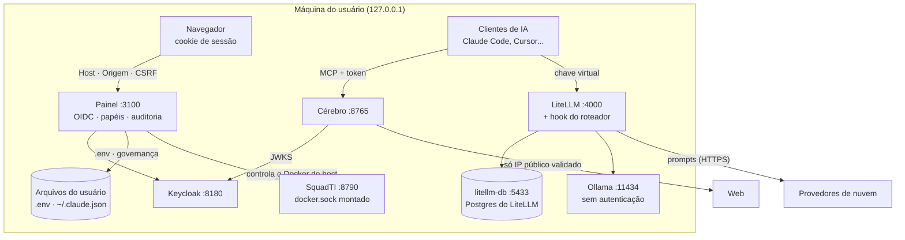

[🏠 TudoIA](../README.md) › [📚 Documentação](README.md) › 🛡️ Segurança

# 🛡️ Segurança

> Para quem mantém, audita ou decide sobre o TudoIA: o modelo de ameaças, cada controle que existe no código (com o arquivo onde está),
> os riscos residuais numerados com o estado de cada um e como reportar uma vulnerabilidade. Para agir num incidente, vá ao
> [runbook de operação](operacao.md).

Tudo aqui foi conferido no código. Quando a afirmação vem de uma leitura e não de uma execução, o texto diz. As referências usam nome de
arquivo e de função ou rota, não número de linha. O estado de cada risco é **corrigido**, **em aberto** (o dono decide) ou **segue**
(aceito, sem mudança prevista). O projeto é desenhado para uma máquina, acessada só localmente; **não é desenhado para ser exposto à internet.**

## 📑 Sumário

- [🎯 Visão geral](#-visão-geral)
- [Escopo e ativos](#escopo-e-ativos)
- [Controles implementados](#controles-implementados)
  - [Autenticação OIDC](#autenticação-oidc) · [Autorização](#autorização) · [Guarda de Host, Origem e CSRF](#guarda-de-host-origem-e-csrf) · [Auditoria](#auditoria)
  - [Validação de entrada](#validação-de-entrada) · [Segredos](#segredos) · [Containers e variáveis](#containers-e-variáveis)
  - [Cérebro](#cérebro-autenticação) · [Imagens Docker](#imagens-docker) · [Governança](#governança-e-execução-de-código-de-terceiros) · [Estúdio](#estúdio) · [SquadTI](#squadti) · [Logs](#logs-e-observabilidade)
- [Riscos residuais](#riscos-residuais)
- [Privacidade](#privacidade)
- [Mapa para o ASVS 5.0.0](#mapa-para-o-asvs-500)
- [Como reportar uma vulnerabilidade](#como-reportar-uma-vulnerabilidade)
- [Checklist mínimo para uma máquina](#checklist-mínimo-para-uma-máquina)
- [Política de senha do realm `tudoia`](#política-de-senha-do-realm-tudoia)
- [❓ Perguntas frequentes](#-perguntas-frequentes)

---

## 🎯 Visão geral

Fronteiras de confiança (nível de contêiner, enxuto). Tudo escuta em loopback; a única saída para a internet é o que o gateway
envia aos provedores, o que o Cérebro lê da web e o que o instalador e as imagens baixam.

| Princípio | Como aparece no código |
|---|---|
| Nada fora de loopback | Todas as portas do compose são `127.0.0.1:...` (`tests/runtime/test_compose.py::test_portas_so_em_loopback`); o painel sobe em `127.0.0.1`; o Ollama em `127.0.0.1` |
| Falhar fechado | Sem OIDC completo, `/api` responde 503; sem credencial, `/mcp` do Cérebro responde 503; Keycloak fora do ar nega a requisição com 503 |
| Menor privilégio | Três papéis; o LiteLLM recebe só as variáveis que usa; o `n8n` não lê variáveis de ambiente; o LiteLLM e o Keycloak têm cada um o seu Postgres (`litellm-db`, `keycloak-db`) |
| Entrada sempre limitada | Corpo, upload, página lida, PDF, resultado de busca e prazo de cada operação têm teto |
| Rastro sem conteúdo | Auditoria e eventos registram quem, quando e o quê, nunca corpo de pedido, prompt ou valor de segredo |

## Escopo e ativos

| Ativo | Onde está | Sensibilidade |
|---|---|---|
| Chaves de provedores (NIM, Groq, Anthropic etc.) | `.env`; no container do LiteLLM, só as chaves listadas no compose | Alta: custo financeiro e acesso às contas |
| Chaves internas (`LITELLM_MASTER_KEY`, `TUDOIA_SESSAO_SEGREDO`, `CEREBRO_TOKEN_ESTATICO`, `N8N_ENCRYPTION_KEY` etc.) | `.env` | Alta: `LITELLM_MASTER_KEY` dá acesso ao gateway; `CEREBRO_TOKEN_ESTATICO` dá escrita na memória do Cérebro |
| Senhas dos Postgres (`LITELLM_DB_PASSWORD`, `KEYCLOAK_DB_PASSWORD`) | `.env` e volumes `<projeto>_litellm-db`, `<projeto>_keycloak-db` | Alta: dão acesso às chaves virtuais do LiteLLM e às contas do Keycloak |
| Segredo do cliente `tudoia-mcp` | `.env` (`TUDOIA_MCP_CLIENT_SECRET`) e cofre do n8n | Alta: emite token de operador para o Cérebro |
| Token e chave da SquadTI | `.env` (`TUDOIA_SQUADTI_TOKEN`, `SQUADTI_API_KEY`) | Alta: dispara execução de código gerado por modelo |
| Tokens de MCP (Context7, GitHub e Supabase quando ligados) | `.env`; gravados em `~\.claude.json`, `opencode.json` e `~\.gemini\config\mcp_config.json` pela governança | Alta |
| Sessão do painel | Cookie `tudoia_sessao` no navegador | Média |
| Memória e documentos do Cérebro | `dados\cerebro\cerebro.db`, `dados\documentos\` | Média a alta (pode conter dados pessoais) |
| Prompts e respostas | Enviados aos provedores; metadados em `dados\logs\` | Alta (ver [Privacidade](#privacidade)) |
| Backups | `dados\backups\` (dados e cópias do `.env`) e `~\.tudoia\backups\` (JSON de MCP com tokens) | Alta |
| Host e GPU | Windows do usuário | Alta: o painel controla processos e pastas |

Atores considerados:

1. Outro processo ou usuário na mesma máquina.
2. Página web aberta no navegador do usuário (CSRF e DNS rebinding).
3. Máquina na mesma rede local, se a porta do Ollama ficar exposta.
4. Conteúdo externo lido pelo agente: páginas da web e documentos indexados (injeção de prompt).
5. Operador do painel (papel `tudoia-operador`), que não é admin.
6. Administrador do painel (papel `tudoia-admin`).
7. Provedores de nuvem, que recebem os prompts dos modelos gratuitos e pagos.
8. Autor de uma skill ou de um servidor MCP de terceiros.
9. Código gerado por modelo e executado pela SquadTI.
10. Quem fornece o instalador ou as imagens (cadeia de suprimentos).

Fora de escopo: acesso de administrador ao próprio Windows e exposição deliberada à internet.

## Controles implementados

### Autenticação OIDC

Arquivo: `painel/tudoia_painel/autenticacao.py`.

- Fluxo Authorization Code com PKCE `S256` (`client_kwargs` com `code_challenge_method: S256`). O authlib gera o `code_verifier`.
  O realm também exige `pkce.code.challenge.method=S256` no cliente `tudoia-painel`, sem fluxo implícito nem *direct grant*
  (`infra/keycloak/realm-tudoia.json`).
- O estado de cada login fica no **servidor** (memória, validade de 10 min, máximo de 500 pendentes) e é amarrado ao navegador por um
  cookie próprio `tudoia_login_<state>` (`HttpOnly`, `SameSite=lax`, só em `/auth/callback`). Um callback com o `state` de outro navegador é
  recusado. Falhou: uma nova tentativa automática; falhou de novo: página de erro, nunca laço com o SSO (`MAX_TENTATIVAS_LOGIN = 2`).
- O parâmetro `retorno` só aceita caminhos dentro de `/app`; bloqueia `//`, `\` e URLs absolutas (`retorno_seguro`).
- Papéis vêm do claim `groups` ou de `realm_access.roles` (`papeis_do_token`). Só valem `tudoia-admin`, `tudoia-operador` e
  `tudoia-leitor`. Conta sem papel recebe 403 `sem_papel` no callback.
- Erros do IdP não vão ao navegador (a descrição pode ecoar parâmetros).
- Fail-closed: sem `TUDOIA_OIDC_*` completo, ou com `TUDOIA_SESSAO_SEGREDO` de menos de 32 caracteres, toda rota `/api` responde 503
  (`ConfigAuth.do_ambiente`). Só `/api/sessao` responde, para a interface saber que a autenticação não está configurada. A configuração é lida
  **ao iniciar** o painel: depois de `keycloak` ou de mudar `TUDOIA_OIDC_*`, reinicie o painel.
- Sessão: cookie `tudoia_sessao`, `HttpOnly`, `SameSite=lax`, validade de 8 h (`IDADE_MAXIMA_SESSAO`), com `expira_em` no payload. Com
  `TUDOIA_COOKIE_SEGURO=1` o cookie também é `Secure`.
- `expira_em` vencido, ausente ou mais de 8 h no futuro invalida a sessão (`_papeis_validos`): o painel nunca emite um cookie assim,
  então ele é tratado como forjado.
- A sessão é reconfirmada no Keycloak (`userinfo`, `consultar_userinfo`, tempo limite de 5 s) quando `verificado_em` tem mais de 30 s
  (`TTL_REVALIDACAO_S`). Valor no futuro, negativo ou que não é número também força a confirmação. Conta desativada, sessão revogada ou
  sem papel do painel derrubam a sessão na hora. Se o Keycloak não responde, a requisição é negada com 503. Papel alterado no Keycloak
  vale no próximo ciclo de confirmação.
- A confirmação usa o `access_token` da sessão. O cliente `tudoia-painel` tem `access.token.lifespan = 28800` (8 h) no template; antes valia o padrão de 300 s e a
  sessão caía em 5 min. O valor só vale no Keycloak em execução depois do provisionamento (`.\scripts\tudoia.ps1 keycloak`).
- A sessão é **assinada, não cifrada**: o cookie leva o `access_token` em base64, legível pelo próprio usuário; `HttpOnly` impede acesso por
  JavaScript. O `id_token` (usado só no logout) fica no servidor, em memória; reiniciar o painel o perde e o Keycloak só pede confirmação ao sair.
- Token de API (opcional): com `TUDOIA_API_BEARER_CLIENTES` preenchido (lista de `azp` separados por vírgula), o painel aceita
  `Authorization: Bearer <JWT>` em `/api`. Validação local: RS256 fixo, emissor, `exp`, `azp` na lista e `aud` contendo o `client_id` do painel
  (`validar_token_bearer`). Chaves do JWKS em cache de 600 s; `kid` desconhecido renova o cache no máximo a cada 30 s, uma busca por vez;
  sem as chaves, 503. Vazio (padrão), qualquer Bearer recebe 401 `bearer_desativado`.
- Logout (`POST /auth/logout`) passa pela checagem de origem, limpa a sessão e leva ao `end_session_endpoint` do IdP.

### Autorização

Arquivo: `painel/tudoia_painel/autenticacao.py`, função `decidir`, listas `PREFIXOS_SO_ADMIN` e `PREFIXOS_ESCRITA_SO_ADMIN`.

| Ação | Leitor | Operador | Admin |
|---|---|---|---|
| `GET` em `/api/*` (fora de `PREFIXOS_SO_ADMIN`) | sim | sim | sim |
| `POST`, `PUT`, `PATCH`, `DELETE` em `/api/*` (fora das listas abaixo) | não | sim | sim |
| `GET` em `/api/governanca/*` | sim | sim | sim |
| `POST`, `PUT`, `PATCH`, `DELETE` em `/api/governanca` e `/api/governanca/*` (inclui instâncias e `sincronizar`) | não | não | sim |
| `/api/segredos`, `/api/provedores`, `/api/governanca/skills/importar`, `/api/governanca/mcp`, `/api/modelos/local/baixar` (qualquer método) | não | não | sim |

`/api/governanca/mcp` está em `PREFIXOS_SO_ADMIN`, então nem a leitura do catálogo MCP é liberada ao leitor e ao operador.

> [!WARNING]
> O operador pode iniciar tarefas da SquadTI (`POST /api/squadti/tarefas` não está em nenhuma lista de admin) e controlar os serviços (`POST /api/servicos/*`).
> Com o `docker.sock` montado na SquadTI, isso tem o alcance descrito no [risco 21](#21-dockersock-montado-na-squadti-em-aberto-decisão-do-dono).

### Guarda de Host, Origem e CSRF

Arquivo: `painel/tudoia_painel/seguranca.py`, classe `GuardaApi` (middleware ASGI, o mais externo) e função `checar`. Aplica-se a `/api`, `/app` e `/auth/*`.
Regras, na ordem em que o código as avalia:

1. `Host` exatamente `127.0.0.1:<porta>` ou `localhost:<porta>`, em toda requisição (inclusive `GET` e SSE). Senão, 403 `host_recusado`. Barra DNS rebinding.
2. Em `/api`, métodos que mudam estado (`POST`, `PUT`, `PATCH`, `DELETE`):
   - `Origin`, se presente, precisa ser local (esquema, host e porta exatos); `null` é recusado.
   - Sem `Origin`, o `Referer`, se presente, precisa ser local.
   - `Sec-Fetch-Site`, se presente, só `same-origin` ou `none`.
   - `POST`, `PUT` e `PATCH` exigem `Content-Type: application/json` (quem não tem corpo envia `{}`; `DELETE` com corpo também).
   - Corpo de até 10 MB (`LIMITE_CORPO`); exceção: `POST /api/estudio/upload`, até 140 MB (`LIMITES_POR_ROTA`; o upload vai em base64 no JSON).
     `Content-Length` acima do limite recebe 413 antes da leitura; `_receive_limitado` também conta os bytes que chegam (corpo `chunked` ou
     `Content-Length` menor que o corpo real) e responde 413 ao passar.
3. Em `/auth/*`, só a regra de Host; login e callback usam `state` e PKCE; o logout tem a checagem de origem própria.
4. Cabeçalhos em toda resposta: `X-Content-Type-Options: nosniff`, `Referrer-Policy: no-referrer`, `X-Frame-Options: DENY`,
   `Cross-Origin-Resource-Policy: same-origin`. Na API, também `Cache-Control: no-store`. A interface recebe uma Content-Security-Policy restrita e
   `Cross-Origin-Opener-Policy: same-origin`.
5. Toda resposta traz `X-Request-ID` (16 hexadecimais por pedido), o mesmo id que vai para o log e para a auditoria.
6. Exceção não tratada em rota `/api` vira 500 `falha_interna`, com o tipo da exceção e o id do pedido. Mensagem e traceback nunca vão ao
   cliente; o traceback vai só ao log do servidor.
7. Não há CORS. A interface é servida pela mesma origem.

`GET /saude` fica fora da guarda e do login e responde só `{"ok":true}` (`rotas/ui.py`).

### Auditoria

Arquivo: `painel/tudoia_painel/auditoria.py`, classe `Auditoria`, gravando `dados\logs\auditoria.jsonl`.

- Uma linha JSON por `POST`, `PUT`, `PATCH` ou `DELETE` em `/api/`, inclusive os negados pela autorização (401 e 403).
- Campos: `instante`, `id` (o `X-Request-ID`), `usuario` (e-mail, login ou `sub`; para Bearer, `cliente:<azp>`), `papeis`, `metodo`, `rota` e `status`.
  O corpo nunca entra (pode ter segredo ou prompt).
- Ao passar de 5 MB, vira `auditoria.jsonl.1` (sobrescreve a cópia anterior). Disco cheio ou arquivo preso não derrubam o pedido; o aviso vai ao log.
- Pedidos recusados pela `GuardaApi` (Host, origem, tipo de conteúdo, `Content-Length` grande demais) não chegam à auditoria.

### Validação de entrada

- Nome de chave de segredo: `^[A-Z][A-Z0-9_]{0,63}$` (`rotas/segredos.py`, constante `CHAVE`).
- IDs de instância, grupo e skill: `^[A-Za-z0-9][A-Za-z0-9._-]{0,63}$` (`skills_servico.py`, constante `ID`) e `_id_seguro` em `governanca/__init__.py`, que recusa `..` e separadores.
- Valores do `.env` com quebra de linha são recusados (`limpar_valor`, `envfile.py`), com 422.
- Estúdio: toda rota de arquivo passa por `arquivo_em` (`estudio_servico.py`), que resolve a pasta permitida e o alvo e só aceita arquivo existente
  dentro dela (`is_relative_to`): fecha `..`, `%2F` e caminho absoluto. Uploads aceitam só extensões por tipo.
- Mídia do ComfyUI: verificar ou excluir aceita só `.safetensors`, `.gguf`, `.ckpt` e `.pt` (`EXT_PESOS`, `modelos_service.py`).
- Modelos de entrada da API usam Pydantic; erros saem com código `validacao` e a lista de campos.
- Interface: texto de fora (resposta de modelo, erro de provedor) passa por `esc()` antes de entrar em `innerHTML` (`static/painel.js`).

### Segredos

- `.env` está no `.gitignore`; só `.env.example` é versionado, com valores vazios ou de exemplo.
- Segredos internos nascem de `secrets.token_urlsafe(32)` (`cli.py`, `preencher_segredos`; lista `SEGREDOS_INTERNOS`; `LITELLM_MASTER_KEY` com prefixo `sk-`). Se o
  painel sobe com OIDC configurado e sem segredo de sessão, gera um com `secrets.token_urlsafe(48)` (`carregar_config_auth`). `segredos` só preenche chaves vazias.
- Gravação atômica do `.env`: escreve em `.env.tmp` e faz `os.replace`; antes copia o arquivo para `dados\backups\env\` (até 10 cópias, `envfile.py`).
- Na API, cada chave aparece mascarada: prefixo até o primeiro `-` ou `_` (no máximo 7 caracteres), `…` e os últimos 4; valores com menos de 12 caracteres viram só `…`.
- Exceção: `POST /api/segredos/{chave}/revelar` devolve o valor inteiro, só para admin, com `no-store`; fica na auditoria (rota com o nome da chave, nunca o valor). Ver o risco 6.
- "Testar" envia a chave só a um endereço fixo no código, do provedor correspondente; para `LITELLM_MASTER_KEY`, o LiteLLM local (`127.0.0.1:4000`).
- Erros de provedor no hook do roteador registram só a classe da exceção e o código HTTP (`roteador_eventos.resumir_erro`).
- Instalador: o `.env` ganha ACL só do seu usuário; segredos dos campos da tela são mascarados no log (`Redator`) e nunca vão para `estado.json` ([instalador.md](instalador.md#️-segurança-do-assistente)).

### Containers e variáveis

Arquivo: `runtime/docker-compose.yml`. Os testes de `tests/runtime/test_compose.py` e `tests/test_squadti_compose.py` guardam o que segue.

- Nenhum serviço recebe o `.env` inteiro (não há `env_file`). O LiteLLM recebe uma lista explícita: `DATABASE_URL`, `LITELLM_MASTER_KEY`, `OLLAMA_URL`, `TZ` e as
  chaves de provedor (`NVIDIA_NIM_API_KEY`, `NVIDIA_NIM_API_BASE`, `OPENROUTER_API_KEY`, `GROQ_API_KEY`, `GEMINI_API_KEY`, `CLOUDFLARE_API_KEY`,
  `CLOUDFLARE_ACCOUNT_ID`, `ANTHROPIC_API_KEY`, `OPENAI_API_KEY`, `DEEPSEEK_API_KEY`, `XAI_API_KEY`, `FAL_AI_API_KEY`, `HF_TOKEN`). O teste garante que toda chave do
  catálogo está na lista e que segredos alheios (senha do Keycloak, token do GitHub, chaves do n8n, `TUDOIA_MCP_CLIENT_SECRET`) não estão.
- **Dois Postgres, um por consumidor** (`litellm-db` e, só com o perfil `keycloak`, `keycloak-db`): cada um tem o seu role, o seu database e o seu volume, criados pela imagem a partir de `POSTGRES_USER`, `POSTGRES_DB` e `POSTGRES_PASSWORD`. Só o `litellm-db` publica porta (`127.0.0.1:5433`). Nenhuma das duas senhas (`LITELLM_DB_PASSWORD`, `KEYCLOAK_DB_PASSWORD`) é exigida pelo compose (sem `:?`): vazia, o serviço sobe e o banco recusa o login; `tudoia segredos` as gera. Risco 22.
- O n8n roda com `N8N_BLOCK_ENV_ACCESS_IN_NODE=true`: nenhum nó Code ou expressão lê variáveis do container (nem `N8N_ENCRYPTION_KEY`). O segredo do cliente `tudoia-mcp` vai para o
  cofre do n8n por `scripts/n8n/credencial_cerebro.py`, pelo stdin do `docker exec`. O formulário de ingestão exige login no n8n (`authentication: n8nUserAuth`).
- Healthcheck em `litellm-db`, `litellm`, `searxng`, `cerebro`, `n8n`, `keycloak-db`, `keycloak` e `squadti`.
- Todas as portas são publicadas só em `127.0.0.1`.

### Cérebro: autenticação

Arquivo: `runtime/cerebro/cerebro/autenticacao.py`. Detalhes em [cerebro.md](componentes/cerebro.md).

- `/mcp` e `/indexar` exigem `Authorization: Bearer`. Valem dois tipos: JWT RS256 do Keycloak (cliente `tudoia-mcp`, validado localmente contra o JWKS) e o
  `CEREBRO_TOKEN_ESTATICO` (comparação em tempo constante, papel de operador, mínimo de 32 caracteres; menor que isso, o caminho fica desligado).
- Sem OIDC e sem token estático, `/mcp` e `/indexar` respondem 503 (fail-closed). `/saude` é público.
- `lembrar`, `esquecer` e `/indexar` exigem `tudoia-admin` ou `tudoia-operador`.
- Negações vão ao log só com rota, status e código do motivo; token e cabeçalhos nunca entram.

### Cérebro: leitura de páginas (SSRF)

Arquivo: `runtime/cerebro/cerebro/web.py`, ferramenta `ler_pagina`.

- Aceita só `http` e `https`, com host. A URL é interpretada pelo próprio `httpx.URL`, o mesmo parser que monta a requisição.
- Resolve o host antes de conectar e exige que **todos** os endereços sejam globais (`ip_publico`, com `is_global`): recusa privado, loopback, link-local (inclui `169.254.169.254`),
  CGNAT, reservado e não especificado; trata IPv6 mapeado em IPv4 e NAT64; recusa multicast.
- A conexão vai para o IP já validado, com `Host` e SNI do nome original (`_baixar`): o `httpx` não resolve de novo, sem janela de DNS rebinding. O certificado TLS continua
  conferido contra o nome. `trust_env=False` (`servidor.py`): proxy do ambiente não desvia a conexão.
- `follow_redirects=False`; cada `Location` passa de novo pela validação, no máximo 3 saltos.
- Corpo de até 2 MB, 15 s por leitura e prazo total de 20 s (`PRAZO_TOTAL`); `max_caracteres` entre 500 e 20000 (padrão 8000).
- O texto volta num envelope "conteúdo externo, não confiável", com marca aleatória no início e no fim (`_envelopar`).

### Cérebro: entradas e limites

- `pesquisar_web`, `buscar_documentos` e `recordar`: `n` entre 1 e 20 (`vetores.MAX_RESULTADOS`). `lembrar`: fato de até 2000 caracteres, `origem` até 500 (`memoria.py`).
- Indexação: PDF até 500 páginas; texto extraído até 2 milhões de caracteres; 120 s por arquivo. Arquivo que estoura o prazo fica em quarentena até mudar de `mtime` ou tamanho.
- `recordar` e `buscar_documentos` devolvem o texto num envelope "conteúdo não confiável" com marca aleatória (`cerebro/envelope.py`). Mitigação, não garantia (risco 19).
- Argumentos das ferramentas nunca entram no log; ele registra ferramenta, duração e resultado.

### Cérebro: rede e container

- Proteção de DNS rebinding do SDK `mcp`; hosts aceitos: `cerebro`, `127.0.0.1`, `localhost` e `host.docker.internal`, sempre na porta 8765 (`servidor.py`, `SEGURANCA`).
- O container roda como `cerebro` (uid 10001); só `/dados` é gravável. `dados\documentos` entra em `/docs` com `:ro`. A porta é publicada só em `127.0.0.1`.

### Imagens Docker

- As imagens do compose estão fixadas por digest (`@sha256:`); a tag fica no arquivo, mas o digest é o que vale. O `uv` do Dockerfile do Cérebro está em `0.13.0`.
- A imagem base do Cérebro, `python:3.12-slim`, **não** tem digest (risco 4).
- O Dockerfile da SquadTI fixa por digest as bases (`alpine/git`, `node`, `uv`, `dotnet/sdk`) e baixa a Doutrina por SHA completo.

### Governança e execução de código de terceiros

- Importar skill (`POST /api/governanca/skills/importar`, só admin) executa `npx --yes skills@<versão fixa> add <repositório> --skill <nome> -y` (`skills_servico.py`,
  `VERSAO_SKILLS_CLI`). O repositório precisa casar com `REPO_GITHUB` (`https://github.com/<dono>/<repo>`, ou `dono/repo`, que vira essa URL). No Windows o `npx` é um `.cmd` e o Python não escapa
  argumento de `.cmd` para o `cmd.exe` (`&`, `|`, `^`, `%` e `"` virariam comando); a regra barra isso.
- Skill importada com link simbólico (na pasta ou em qualquer arquivo) é recusada antes da cópia (`copytree` seguiria o link e traria, por exemplo, `~\.ssh`).
- Teste de MCP stdio (`painel/tudoia_painel/mcp_stdio.py`, `handshake`): prazo total de 30 s, stderr descartado, no máximo 200 linhas lidas, árvore de processos encerrada no fim
  (`taskkill /T /F` no Windows, `killpg` no Linux). `command` e `args` com `${VAR}` são resolvidos como no `sync`; variável obrigatória ausente falha citando só o nome (`mcp_teste.py`).
- Skills são Markdown lido pelo agente como instrução; uma skill hostil pode tentar injeção de prompt. As do repositório foram lidas por inteiro antes da cópia (`governanca/ORIGEM.md`).
- Servidores MCP do catálogo rodam com `npx`, `uv` ou script local; ver o risco 5.
- Escrita da governança (`governanca/__init__.py`): destinos resolvidos (junção e link simbólico no meio do caminho não desviam); destino fora da home e dos workspaces é recusado; destino em
  workspace recebe `${VAR}` literal; JSON de MCP com backup em `~\.tudoia\backups\` (criados com modo `0600`; no Windows quem decide são as ACLs do perfil). Ver [governanca.md](componentes/governanca.md).
- O MCP `doutrina-tec` roda um script local da Doutrina fixada (`${DOUTRINA_TEC}/tools/mcp_doutrina.py`, somente leitura, só biblioteca padrão), sem baixar código ([doutrina.md](componentes/doutrina.md)).

### Estúdio

- O Pollinations (serviço público, sem conta, que recebe o prompt na URL) só é usado com `TUDOIA_ESTUDIO_POLLINATIONS=1`. Desligado por padrão (`rotas/estudio_imagem.py`).
- O prompt na imagem SVG de reserva passa por `html.escape`.
- Upload (`POST /api/estudio/upload`): além da extensão, os primeiros bytes precisam bater com o formato (`midia.py`); o tamanho é conferido antes de decodificar o base64; o nome ganha sufixo aleatório.
- Nomes e pastas que o ComfyUI devolve no histórico (`filename`, `subfolder`, `type`) são validados antes de virar caminho ou consulta de `/view` (`comfyui.py`): `..`, separador, unidade e byte nulo são recusados.

### SquadTI

Arquivos: `runtime/docker-compose.yml` (serviço `squadti`), `runtime/squadti/orquestrador/api.py`, `painel/tudoia_painel/rotas/squadti.py`. Visão geral: [squadti.md](componentes/squadti.md).

- O container roda sem privilégios extras: usuário não root, `read_only: true`, `tmpfs` em `/tmp`, `cap_drop: [ALL]`, `no-new-privileges`, `pids_limit`, teto de memória e de CPU (`SQUADTI_MEMORIA`, `SQUADTI_CPUS`). Escreve só no volume `squadti-dados`. **Exceção importante: o `docker.sock` do host está montado** (risco 21).
- A API da Squad exige `TUDOIA_SQUADTI_TOKEN` de 32 caracteres ou mais (comparação em tempo constante), aceita `Host` só de loopback e corpo `POST` JSON de até 64 KB (`api.py`). `/saude` não pede token.
- Chave virtual própria no LiteLLM (`scripts/squadti/chave.py`): alias e tag `squadti`, 90 dias, só os modelos dos perfis `local-estrito`, `local`, `hibrido`, `nuvem` e `auto` (`tudoia-auto` entrou com o painel v2); `tudoia-max` (pago) fica de fora. O valor da chave nunca é impresso.
- Privacidade: o painel recusa (422 `consentimento_nuvem`) qualquer perfil que não seja `local-estrito` sem consentimento explícito, porque o gateway pode reenviar à nuvem (risco 16); isso vale também para o perfil `auto`. O orquestrador só usa nuvem com `TUDOIA_PERMITIR_NUVEM=1` (IA-PRV-01, ECO-CON-03).
- Papéis no painel (`rotas/squadti.py`, `autenticacao.py`): leitor vê tarefas, mensagens, auditoria, proveniência, log e a configuração dos agentes; operador inicia tarefas, responde, **conversa com o CHEFE** (`POST .../mensagem`, até 4000 caracteres), continua tarefa escalada e aprova (inclusive o release, que só gera notas); **só admin** salva a configuração dos agentes (`POST /api/squadti/agentes`, em `PREFIXOS_ESCRITA_SO_ADMIN`), porque ela define perfil, temperatura e orçamento de cada agente.
- Sem a Doutrina legível o orquestrador não trabalha (falha fechada, ECO-CON-01); a versão da Doutrina é gravada no estado da tarefa (ECO-CON-02).

### Logs e observabilidade

- `eventos.jsonl` (aba "Ao vivo") usa lista branca de campos (`roteador_eventos.CAMPOS`), sem texto de pedido ou resposta; corte por idade (24 h) e tamanho (20 MB).
- `roteador.jsonl` e `correcoes.jsonl` viram `.1` ao passar de 5 MB. `correcoes.jsonl` guarda só rótulo, SHA-1 e tamanho do pedido (risco 12).
- `auditoria.jsonl`: ver [Auditoria](#auditoria). O painel loga em nível `warning`; o traceback de um erro 500 só vai ao log, com o id do pedido.

## Riscos residuais

Cada item diz o que é, onde está, o impacto e o estado. A numeração é estável: outros arquivos e comentários do código a citam (o risco 16 é citado em `painel/tudoia_painel/gerador.py`). Não renumere.

### 1. Ollama exposto na rede (corrigido)

- Antes: `0.0.0.0:11434` em `scripts/tudoia.ps1`, `scripts/tudoia.sh` e `painel/tudoia_painel/servicos.py`.
- Agora: `127.0.0.1:11434` no Windows (`tudoia.ps1`, `iniciar.ps1`, `servicos.py`, instalador com `setx OLLAMA_HOST`) e no Docker Desktop. Um container alcança o Ollama por `host.docker.internal` com o bind em loopback.
- Linux com Docker Engine sem Desktop: `tudoia.sh` (`endereco_ollama`) usa o IPv4 da bridge `docker0`, que é o que `host-gateway` resolve. Nunca `0.0.0.0`. Não testado em Linux.
- Impacto se voltar a `0.0.0.0`: a API do Ollama não tem autenticação; quem alcança a porta usa a GPU, lista e pode baixar ou apagar modelos.

### 2. DNS rebinding no `ler_pagina` (corrigido)

- Antes: a validação resolvia o nome e o `httpx` resolvia de novo; um domínio com IP público na validação e interno na conexão alcançava serviços locais.
- Agora: a conexão vai para o IP validado, com `Host` e SNI do nome original (`web.py`, `_validar_destino` e `_baixar`). Ver [Cérebro: leitura de páginas](#cérebro-leitura-de-páginas-ssrf).

### 3. `runtime/open-webui/env.py` é uma cópia alterada (em aberto)

- Onde: `runtime/docker-compose.yml`, serviço `open-webui`, volume `./open-webui/env.py:/app/backend/open_webui/env.py:ro`.
- Impacto: o arquivo substitui o módulo de configuração da imagem; quando a imagem sobe de versão, ele não acompanha o upstream e correções de segurança ou de configuração podem ficar de fora em silêncio.
- Estado: a conferência é manual a cada troca de digest, com `verificar-openwebui` (risco 18). Ver [servicos-docker.md](componentes/servicos-docker.md).

### 4. Atualizações de imagem são manuais (em aberto)

- As imagens estão fixadas por digest, então atualização não acontece sozinha: bom para reprodutibilidade, ruim para correção de segurança.
- Tags flutuantes continuam no compose (`open-webui:main`, `litellm:main-latest`, `n8n:latest`), embora o digest as prenda. `python:3.12-slim` do Cérebro não tem digest.
- Atualizar o digest do Open WebUI sem revisar o `env.py` (riscos 3 e 18) pode quebrar o serviço.

### 5. Supply chain dos servidores MCP (em aberto, reduzido)

- Onde: `governanca/mcp.json`. Fixados por versão: `@upstash/context7-mcp@4.4.4`, `@supabase/mcp-server-supabase@0.15.0` (com `--read-only`), `@playwright/mcp@0.0.84`,
  `@modelcontextprotocol/server-sequential-thinking@2.0.0`, `@tokenizin/mcp-npx-fetch@1.0.0` e `mcp-remote@0.16.0`.
- Ainda soltos: `serena` roda o comando `serena` do PATH (instalado por `uv tool`; a versão aparece só na descrição, não é imposta), e os servidores remotos `github` (`api.githubcopilot.com`) e `vercel`
  (`mcp.vercel.com`, OAuth) mudam do lado do provedor.
- Impacto: uma versão nova ou comprometida de um pacote roda com as credenciais do `.env` na próxima vez que o cliente iniciar o MCP.
- Sugestão: revisar a versão de cada pacote a cada atualização e fixar o `serena`.

### 6. Revelação de segredo pela API (em aberto)

- Onde: `rotas/segredos.py`, `POST /api/segredos/{chave}/revelar` (`revelar_segredo`) devolve o valor completo.
- Controles: só admin, resposta `no-store`, cada revelação na auditoria com usuário, instante, id e rota (que tem o nome da chave); o valor nunca é registrado.
- Risco: sessão de admin roubada ou navegador aberto vaza todos os segredos chave a chave. A auditoria mostra depois, mas não impede.
- Decisão em aberto: manter a rota (necessária para editar) ou só mostrar mascarado.

### 7. Cérebro sem autenticação (corrigido)

- Antes: `/mcp` e `/indexar` não pediam credencial.
- Agora: JWT do Keycloak (cliente `tudoia-mcp`) ou `CEREBRO_TOKEN_ESTATICO`, com papéis por ferramenta ([Cérebro: autenticação](#cérebro-autenticação)).
- Resíduo: o `CEREBRO_TOKEN_ESTATICO` não expira e tem papel de operador. Fica no `.env` e, depois do `sync`, em claro nos arquivos dos clientes (risco 15). Revogar é trocar o valor, recriar o `cerebro` e rodar o `sync` ([runbook](operacao.md#segredo-comprometido)).

### 8. Limite de tamanho não cobria requisição sem `Content-Length` (corrigido)

- Antes: o teto comparava só o `Content-Length` declarado. Agora: 10 MB (140 MB no upload do Estúdio) contados nos bytes recebidos (`seguranca.py`, `_receive_limitado`).

### 9. Operador gravava segredos em caminhos escolhidos por ele (corrigido)

- Antes: o operador criava uma instância de governança apontando para uma pasta dele e disparava o `sync`; tokens de MCP eram escritos em claro ali.
- Agora: toda escrita em `/api/governanca` exige admin (`PREFIXOS_ESCRITA_SO_ADMIN`), a governança recusa destino fora da home e dos workspaces, no caminho resolvido, e destino em workspace recebe `${VAR}` literal.

### 10. Comentário de segurança citava camada inexistente (corrigido)

- O cabeçalho de `painel/tudoia_painel/seguranca.py` não cita mais um "OrigemLocal" (inexistente).

### 11. `/auth/*` fora da guarda de Host (corrigido)

- `GuardaApi` aplica a regra de Host a `/auth/*` (`eh_auth`).

### 12. `correcoes.jsonl` guardava texto de prompt (corrigido)

- Antes: `_gravar_correcao` gravava até 500 caracteres do prompt quando o usuário escrevia `#local` ou `#nuvem`.
- Agora grava `{ts, rotulo, sha1, caracteres}`. Se um dia houver aprendizado a partir de correções, o texto precisa de decisão e base legal própria (`lgpd-compliance`).
- Linhas antigas, com texto, podem continuar em `dados\logs\correcoes.jsonl*`. Apague-as se não quiser guardá-las.

### 13. Keycloak do autor em modo de desenvolvimento (segue)

- Informado pelo dono, sem verificação possível neste repositório: a instância de Keycloak que o autor usava roda em `start-dev`, fora deste repositório. O Keycloak do compose usa `start` com
  HTTP só em `127.0.0.1`. Nenhum dos dois é para produção; o template define `sslRequired=external`, mas isso não faz de um servidor em modo de desenvolvimento uma instalação de produção.
- Não use essa instância para nada além do uso local.

### 14. Variáveis de proxy do `httpx` (corrigido)

- O cliente do `ler_pagina` usa `trust_env=False`; `HTTP_PROXY` e `HTTPS_PROXY` do ambiente não valem.

### 15. Segredos em texto claro nos arquivos dos clientes (segue, por design)

- Onde: `governanca/__init__.py` (`_servidores_para`, `aplicar_tudo`). O painel escreve em `~\.claude.json` (`mcpServers`), `opencode.json` e `~\.gemini\config\mcp_config.json` os valores reais das `${VAR}` do `mcp.json`, lidos do `.env`.
- Os backups ficam em `~\.tudoia\backups\{claude-json,opencode-json,antigravity-json}`, modo `0600`, fora de todo workspace (10 cópias por arquivo), também com os tokens em claro.
- Impacto: quem lê o perfil do usuário lê os tokens (hoje, no mínimo `CEREBRO_TOKEN_ESTATICO`; mais `CONTEXT7_API_KEY` e os que você ativar). Os clientes precisam desses valores para iniciar os MCP; não há cofre intermediário.
- Mitigações: tokens com escopo mínimo e revogáveis; perfil do Windows sem compartilhamento; não sincronizar `~\` em nuvem. Arquivo copiado para outro lugar é tratado como vazado.

### 16. Fallback de contexto do `tudoia-local` para a nuvem (aceito pelo dono)

- Onde: `painel/tudoia_painel/gerador.py`, `router_settings.context_window_fallbacks = [{"tudoia-local": ["tudoia-nuvem"]}]`.
- Impacto: um pedido marcado `#local` que não cabe no contexto do modelo local é reenviado pelo LiteLLM a `tudoia-nuvem`. O texto sai da máquina, embora o usuário tenha pedido local. O hook não roda de novo nessa troca e `#local` não impede o fallback.
- Decisão do dono (27/10/2026): manter. Pedido que não cabe no contexto local vai para a nuvem; resposta vale mais que erro. Para pedido que não pode sair da máquina em hipótese alguma, use o perfil `tudoia-local-estrito` (sem essa saída),
  encurte o contexto ou use um cliente que fale direto com o Ollama (IA-PRV-02).

### 17. Papel admin equivale a executar código no host e nos clientes de IA (segue)

- Onde: `POST /api/governanca/mcp` grava um `command` arbitrário em `governanca/mcp.json`; o `sync` o propaga a `~\.claude.json`, Cursor, Codex e demais, onde roda a cada início do cliente. `POST /api/governanca/mcp/{id}/testar` o executa na hora. `skills/importar` executa `npx` com um repositório do GitHub escolhido por quem pede.
- Impacto: uma sessão de admin comprometida vira execução de código no Windows do usuário. É a mesma fronteira do risco 6, só que maior.
- Controles: só `tudoia-admin`; repositório restrito ao GitHub (`REPO_GITHUB`); pacote `skills` com versão fixa; skill com link simbólico recusada; a troca de skill não apaga a anterior se a cópia falhar; toda chamada na auditoria.
- Não há confirmação em duas etapas nem lista de comandos permitidos. Mantenha poucos admins, com MFA no Keycloak.

### 18. `runtime/open-webui/env.py` muda o nome do produto (em aberto, verificável)

- A cópia troca `WEBUI_NAME` e `WEBUI_FAVICON_URL` e remove o aviso de licença do upstream (diff em `runtime/open-webui/env.py.aprovado.diff`). A licença do Open WebUI restringe alterar essa marca fora do que ela permite
  (https://docs.openwebui.com/license). Confirme se o seu uso está dentro da licença.
- Mitigação do risco 3: `.\scripts\tudoia.ps1 verificar-openwebui` extrai o `env.py` da imagem fixada, calcula o diff contra a cópia e reprova (código 1) se for diferente do aprovado; código 2 se não deu para conferir. Rode ao trocar o digest; depois de
  revisar o diff novo, `--aprovar`. `tests/openwebui/test_verificar_env.py` faz a mesma conferência quando o docker e a imagem existem.

### 19. Resposta de modelo e conteúdo indexado continuam sendo instrução em potencial (segue)

- O envelope do Cérebro marca texto de fora como dado, mas o modelo decide o que fazer com ele. `lembrar` aceita `origem` para o agente declarar de onde veio o fato; nada obriga o agente a informar (SEC-LLM-01: a defesa precisa estar fora do modelo).
- Mitigação prática: tratar a memória como não verificada; usar `esquecer` em fato suspeito; não indexar pasta que receba conteúdo de terceiros sem revisão.

### 20. Primeiro acesso ao Open WebUI e ao n8n (segue)

- Os dois criam o dono na primeira visita. Em `127.0.0.1` o risco é outro processo local chegar antes. Crie as contas logo depois do primeiro `up`.

### 21. `docker.sock` montado na SquadTI (em aberto, decisão do dono)

- Onde: `runtime/docker-compose.yml`, serviço `squadti`: `/var/run/docker.sock:/var/run/docker.sock`, `group_add: ["0"]` e `TESTCONTAINERS_HOST_OVERRIDE`. O comentário `ATENÇÃO` no compose registra a decisão do dono de 03/11/2026, tomada para os testes de integração (Testcontainers).
- Impacto: quem controla o socket controla o Docker do host (volumes, containers, redes) e pode virar root no host. O código que o modelo gera e a Squad executa deixa de estar isolado do host. O restante do endurecimento reduz o dano de outros caminhos, **não deste**.
- Quem alcança: o papel `tudoia-operador` inicia tarefas (`POST /api/squadti/tarefas`), responde à entrevista, fala com o CHEFE (`POST .../mensagem`), continua tarefas escaladas e aprova, e tudo isso chega ao modelo; qualquer prompt malicioso que induza o modelo a gerar código hostil roda lá. Desde o painel v2 só o admin altera a configuração dos agentes (`/api/squadti/agentes` em `PREFIXOS_ESCRITA_SO_ADMIN`), mas isso não fecha este risco: iniciar tarefa continua sendo do operador (leitura do código; não executado).
- Para voltar ao isolamento: remova a linha do socket, o `group_add` e o `TESTCONTAINERS_HOST_OVERRIDE`; os testes de integração da Squad deixam de rodar. O teste `tests/test_squadti_compose.py` exige o aviso junto da linha e a menção em [squadti.md](componentes/squadti.md).
- Sugestão para o dono: restringir também o início de tarefas e a conversa com o CHEFE a admin enquanto o socket estiver montado.

### 22. Bancos Postgres: senha só vale na criação do volume e a porta do LiteLLM fica no host (segue)

- Onde: `runtime/docker-compose.yml`, serviços `litellm-db` (publica `127.0.0.1:5433`) e `keycloak-db` (sem porta no host).
- Impacto: o `litellm-db` guarda as chaves virtuais e o gasto do LiteLLM; qualquer processo local que tenha `LITELLM_DB_PASSWORD` (que está no `.env`) lê e altera esses dados pela porta 5433. O `keycloak-db` guarda o realm e os hashes de senha, e só é alcançável pela rede do compose.
- As senhas só valem na criação do volume: trocar a variável no `.env` depois não muda a do banco ([runbook](operacao.md#senha-do-postgres-trocada-no-env-sem-mudar-no-banco)). Nenhuma das duas variáveis é exigida pelo compose (sem `:?`).
- O backup cobre só o `litellm-db`; o `keycloak-db` não tem cópia (`scripts/backup/backup.py`).

### 23. Cadeia de suprimentos do instalador e da release (em aberto)

- `.github/workflows/release.yml` e `ci.yml` usam actions por tag móvel (`actions/checkout@v4`, `actions/setup-python@v5`, `actions/setup-node@v4`, `actions/attest-build-provenance@v2`), não por SHA de commit; o job da release tem `contents: write` e `id-token: write`. O pacote `uv` é instalado por `pip` com versão fixa (`uv==0.13.0`) e o `pyinstaller==6.22.3` por `uv run --with`.
- Sem winget, os instaladores do Docker Desktop e do Ollama são baixados sem verificação de hash; a conferência do `uv` contra o `.sha256` é pulada se o arquivo não puder ser baixado.
- O `.exe` não é assinado (SmartScreen avisa); a proveniência é atestada (`gh attestation verify`).
- Sugestão: fixar as actions por SHA e, quando houver certificado, assinar o `.exe`.

### 24. O painel encerra qualquer processo que ocupe a porta do Ollama ou do ComfyUI (em aberto, baixo)

- Onde: `painel/tudoia_painel/servicos.py`, `_stop_host`: `Get-NetTCPConnection -LocalPort <porta> | Stop-Process -Force`, sem conferir a linha de comando do dono da porta. `parar.ps1` e `_comum.ps1` conferem (`PararPorta ... $deveConter`).
- Impacto: "Parar" ou "Reiniciar" o Ollama/ComfyUI pelo painel (papel operador ou admin) mata outro programa que escute em 11434 ou 8188. Disponibilidade local, sem vazamento.
- Relacionado: reiniciar o painel por uma tarefa em segundo plano com Job Object leva Ollama e ComfyUI junto ([runbook](operacao.md#ollama-e-comfyui-caíram-ao-reiniciar-o-painel)).

## Privacidade

- Provedores gratuitos e pagos recebem o texto dos pedidos que o roteador envia a eles. Gratuito não é privado. O `.env.example` avisa disso e cita o plano gratuito do Gemini, que usa os dados para treino.
- `#local` não garante que o texto fica na máquina: ver o risco 16. O perfil `tudoia-local-estrito` nunca sai.
- Modelos locais (Ollama) não saem da máquina. Mesmo assim, o embedding de cada mensagem é calculado pelo `bge-m3` e guardado no cache `exemplos-vetores.json` (hashes e vetores, não o texto, segundo `roteador.py`).
- O Cérebro guarda documentos e fatos em `dados\cerebro\cerebro.db`. Não há criptografia em repouso (use BitLocker ou equivalente). O backup copia esse banco para `dados\backups\`, também sem criptografia.
- A memória e os documentos podem ter dado pessoal de terceiros. Incidente com dado pessoal tem prazo próprio de comunicação (SEC-EVT-06): ver o [runbook de segredo comprometido](operacao.md#segredo-comprometido).

## Mapa para o ASVS 5.0.0

O alvo da Doutrina TEC para serviços é ASVS 5.0.0 nível 3 (SEC-ASV-01). O TudoIA é uma ferramenta local, e **não declara "ASVS nível 3"**: SEC-ASV-04 exige uma matriz com todas as linhas atendidas ou
não aplicáveis, e o repositório não tem `docs/seguranca/asvs-matriz.md` (SEC-ASV-02). Isso é uma **lacuna**. O que segue é um mapa por capítulo do que o código já cobre, sem a conferência requisito a requisito.

| Capítulo ASVS 5.0.0 | O que o TudoIA tem | Estado |
|---|---|---|
| V3 Frontend web | CSP restritiva, `nosniff`, `X-Frame-Options`, `Referrer-Policy`, `esc()` no DOM, sem CORS (`seguranca.py`, `painel.js`) | parcial |
| V3, HSTS (`v5.0.0-3.4.1`, `v5.0.0-3.7.4`) | O painel serve HTTP em loopback e não emite HSTS | lacuna se o painel for exposto atrás de proxy TLS; não aplicável enquanto for só local |
| V4 API e serviço web | Host/Origem/`Sec-Fetch-Site`, `Content-Type` obrigatório, limites de corpo, erros sem detalhe | parcial |
| V5 Arquivos | Extensão e assinatura (magic bytes) no upload do Estúdio, caminho resolvido dentro da pasta, tamanho antes de decodificar | parcial |
| V6 Autenticação | Delegada ao Keycloak (código + PKCE), política de 12 caracteres, proteção contra força bruta. MFA resistente a phishing (`v5.0.0-6.3.3`) **não está no realm** | parcial; MFA é lacuna |
| V7 Sessão | Cookie `HttpOnly`/`SameSite`, validade absoluta de 8 h, reconfirmação a cada 30 s, logout no IdP | parcial |
| V8 Autorização | Decisão no servidor a cada requisição (`decidir`), três papéis, admin separado. Mudança de permissão vale em até 30 s no painel (`v5.0.0-8.3.2` pede efeito imediato); no Cérebro o JWT vale até expirar (8 h) | parcial |
| V9 Tokens autocontidos | RS256 fixo, `exp`, `azp`, `aud`, JWKS com rotação (`validar_token_bearer`, Cérebro) | parcial |
| V10 OAuth e OIDC | Código + PKCE `S256`, `state` amarrado ao navegador, redirect URI pré-registrado, sem fluxo implícito nem senha | parcial |
| V12 Comunicação segura | Tudo em HTTP no loopback; downloads externos só por HTTPS | lacuna fora do loopback |
| V13 Configuração | Fail-closed sem configuração, portas só em loopback, imagens por digest, variáveis mínimas por container | parcial |
| V14 Proteção de dados | Mascaramento de segredos, `no-store`; sem criptografia em repouso (Privacidade) | lacuna |
| V15 Código seguro e arquitetura | Dependências travadas (`uv.lock`), digests. O CI (`ci.yml`) roda `ruff`, `pytest`, sintaxe de JS e PowerShell e o build da SquadTI; não há SAST, auditoria de dependências nem varredura de segredos (a única varredura é a do pacote do instalador) | lacuna |
| V16 Registro e erro | Auditoria de escrita, `X-Request-ID`, erros sem traceback; sem registro de leituras sensíveis | parcial |

Capítulos sem mapa (V1, V2, V11, V17) não foram avaliados. Para sair do estado de lacuna: criar a matriz com uma linha por requisito, dono e prazo, e registrar em ADR a lacuna aceita.

## Como reportar uma vulnerabilidade

Não abra issue pública com detalhes de exploração.

Use o recurso de **security advisory privado** do repositório (no GitHub: aba **Security** > **Report a vulnerability**). Se o projeto não estiver no GitHub, o canal é **a confirmar**. Não há e-mail de contato no repositório.

Inclua:

- o commit ou a versão afetada (`pyproject.toml` diz 2.0.6; o commit é mais preciso);
- os passos para reproduzir, com o endpoint ou arquivo envolvido;
- o impacto esperado;
- se houver segredo exposto, diga qual, **sem colar o valor**. Rotacione o segredo antes de reportar ([runbook](operacao.md#segredo-comprometido)).

## Checklist mínimo para uma máquina

- `.env` fora de qualquer pasta sincronizada (OneDrive, Dropbox). O mesmo vale para `~\.tudoia\backups\` e `dados\backups\`.
- `TUDOIA_COOKIE_SEGURO=1` se houver proxy com TLS. Sem TLS, mantenha `0`.
- Ollama só em loopback (Windows e Docker Desktop) ou no IP da `docker0` (Linux com Docker Engine). Risco 1.
- Contas no Keycloak com senha forte e MFA quando o provedor permitir.
- Só admins que realmente precisam de acesso a segredos, skills e governança.
- Revisar `governanca/governanca.json` e `governanca/mcp.json` antes de cada `sync`.
- Rodar `.\scripts\tudoia.ps1 verificar-openwebui` ao trocar o digest do Open WebUI (risco 18).
- Não usar a instância de Keycloak em modo de desenvolvimento para nada além de uso local (risco 13).
- Não ligar a SquadTI sem ler o risco 21.
- Ler `dados\logs\auditoria.jsonl` de vez em quando, sobretudo as linhas de `/revelar`.
- Guardar uma cópia do `.env` em cofre (o backup não o inclui).

## Política de senha do realm `tudoia`

O template (`infra/keycloak/realm-tudoia.json`) define `passwordPolicy = "length(12) and notUsername and notEmail"`: no mínimo 12 caracteres, sem repetir o login nem o e-mail. A proteção contra força bruta (`bruteForceProtected`)
está ligada e o cadastro público desligado.

- A política vale para senhas **novas ou trocadas**. Contas que já existem mantêm a senha até a próxima troca; troque as dos admins.
- A senha temporária do primeiro administrador (`--admin-inicial`) tem 24 caracteres e cumpre a regra.
- Para mudar a regra, edite `passwordPolicy` no template e rode `.\scripts\tudoia.ps1 keycloak`; o provisionador aplica o template inteiro.

## ❓ Perguntas frequentes

**Posso expor o painel ou o gateway na internet?** Não. Não há TLS no caminho, o Ollama não tem autenticação e vários controles pressupõem loopback (Host exato, portas em `127.0.0.1`).

**`#local` mantém meu texto na máquina?** Não sempre: um pedido que não cabe no contexto local pode ir à nuvem (risco 16). Use `tudoia-local-estrito` para o que não pode sair.

**Um segredo vazou. O que faço primeiro?** Revogue e rotacione no provedor, depois troque no `.env`; limpar histórico ou apagar arquivo não basta (DOC-SEG-05, SEC-SUP-08). Passo a passo: [runbook](operacao.md#segredo-comprometido).

**Por que o painel não aceita acesso por outro nome de host?** Barra DNS rebinding (403 `host_recusado`); acesse `http://127.0.0.1:3100/app/`.

---

[🏠 README](../README.md) · [📚 Documentação](README.md) · ⬅️ [Instalador](instalador.md) · [Operação](operacao.md) ➡️
