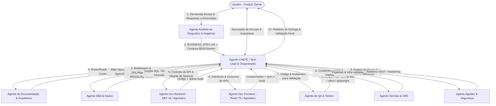

[🏠 TudoIA](../../README.md) › [📚 Documentação](../README.md) › 🧭 Visão geral e arquitetura da SquadTI

# 🧭 Visão geral e arquitetura da SquadTI

> **Público:** quem mantém ou avalia a SquadTI. Responde por que a squad é um grafo de artefatos e como se liga ao TudoIA; o estado real do código (v2) está em [SquadTI (componente)](../componentes/squadti.md).

## 📑 Sumário

- [1. O Desafio e a Abordagem de Engenharia](#1-o-desafio-e-a-abordagem-de-engenharia)
- [2. Topologia do Sistema com Engenharia de Requisitos](#2-topologia-do-sistema-com-engenharia-de-requisitos)
- [3. Integração com o Ecossistema Local (TudoIA)](#3-integração-com-o-ecossistema-local-tudoia)
- [4. Stack Padrão e Arquitetura Agnóstica (Stack Adapters)](#4-stack-padrão-e-arquitetura-agnóstica-stack-adapters)
- [5. O Papel Crítico do Agente CHEFE (Tech Lead & Orquestrador)](#5-o-papel-crítico-do-agente-chefe-tech-lead--orquestrador)

---

## 1. O Desafio e a Abordagem de Engenharia

Criar uma equipe autônoma de desenvolvimento de software baseada em IA não consiste em colocar múltiplos modelos de linguagem em um chat aberto conversando livremente. Na prática de engenharia, sistemas multi-agente puramente conversacionais sofrem de:
1. **Looping e alucinação cumulativa:** Agentes concordando mutuamente com erros ou amplificando falhas conceituais.
2. **Explosão de custos de tokens e perda de contexto:** Conversas longas diluem regras críticas e gastam orçamento computacional sem avanço de código real.
3. **"Verification Theater" (Teatro de Verificação):** Agentes de teste que apenas leem o código e dizem "parece bom", sem jamais compilar, rodar suítes de testes ou validar ambientes reais.
4. **Desalinhamento de Contrato:** O backend muda um endpoint REST/GraphQL sem notificar o frontend ou o banco de dados.

Para solucionar isso, esta Squad adota a **Arquitetura Baseada em Contratos e Artefatos (Artifact-Driven Orchestration)** executada via **LangGraph (Python)** conectado ao ecossistema local **TudoIA** (gateway LiteLLM em `localhost:4000` e modelos locais no Ollama).

---

## 2. Topologia do Sistema com Engenharia de Requisitos

A squad opera sob o modelo **Hierárquico com Supervisão por Grafo de Estados (LangGraph StateGraph)**, incluindo o ciclo formal de elicitação negocial.

> [!NOTE]
> O diagrama é o **modelo conceitual**: mostra o CHEFE como hub entre o usuário e os agentes. No código (v2) o CHEFE é real, mas não é um hub que despacha cada mensagem: são quatro nós (`chefe_intake`, `chefe_gate_requisitos`, `chefe_gate_design`, `chefe_escalada`, em `chefe.py`) mais a rota de conversa da API; os demais agentes seguem o fluxo do grafo (`graph.py`). Os nós reais são 18; o fluxo implementado está em [protocolo](02-protocolo-de-comunicacao-e-estado.md#1-o-ciclo-de-vida-de-uma-demanda-no-langgraph). No desenho abaixo, "Agente de Documentação & Arquitetura" corresponde ao nó `arquiteto`.

---

## 3. Integração com o Ecossistema Local (TudoIA)

A squad não depende de APIs externas proprietárias ou conexões que exponham código confidencial. Ela conecta-se nativamente à infraestrutura local do **TudoIA**:
- **Gateway LiteLLM (`http://localhost:4000/v1`):** Ponto único de chamada de LLM compatível com a API OpenAI.
- **Perfis do gateway (`tudoia-local-estrito`, `tudoia-local`, `tudoia-hibrido`, `tudoia-nuvem`, `tudoia-auto`, `tudoia-max`):** o orquestrador usa por padrão `tudoia-local-estrito` e recusa perfil que pode sair da máquina sem consentimento explícito (`TUDOIA_PERMITIR_NUVEM=1` ou `consentimento_nuvem`). O roteador `tudoia-auto` **é** um perfil (`auto`), tratado como nuvem: exige o consentimento. Cada agente pode ter o seu perfil (aba Agentes do painel). Ver [guia de implementação](03-guia-de-implementacao.md#perfis-aceitos---perfil-orquestradorperfispy). Atenção: o gateway desta árvore ainda não define `tudoia-local-estrito` nem `tudoia-hibrido` ([aviso](../componentes/squadti.md#perfis-perfispy)).
- **Cérebro MCP:** não é usado pelo orquestrador atual (nenhuma referência em `runtime/squadti/orquestrador/`); é intenção de projeto.
- **Privacidade por Padrão (Local-First):** Código-fonte proprietário, esquemas de banco e regras de negócio permanecem na máquina local sem vazamento.

---

## 4. Stack Padrão e Arquitetura Agnóstica (Stack Adapters)

A stack prioritária de referência da organização é:
- **Backend:** .NET 10 + C# (Clean Architecture, EF Core; regras na Doutrina TEC, família `arquitetura`)
- **Frontend:** React 19 + TypeScript + Vite + Tailwind CSS
- **Banco de Dados:** Microsoft SQL Server (MSSQL) com migrações versionadas

A Squad adota o **Padrão de Adaptadores de Stack (Stack Adapters)** (`stacks.py`): o grafo e os portões são os mesmos; o adaptador diz só como detectar o projeto, que comandos rodam, onde cada papel escreve, qual receita o modelo recebe e quais famílias da Doutrina não se aplicam.

> **Estado real:** o código implementa **duas** stacks de backend, `dotnet` (padrão) e `python` (FastAPI, SQLAlchemy 2, Alembic, pytest, uv), mais frontend React. Quem escolhe é o CHEFE (no plano), o usuário (fixando) ou `target_stack.backend.language`. Para `python` a Squad dispensa as famílias `arquitetura` e `componentes` da Doutrina (específicas de .NET/TEC.*), de modo que o agente trabalha só com as demais. Go, Node.js e outras seguem como intenção de projeto: exigem um adaptador novo em `stacks.py`.

---

## 5. O Papel Crítico do Agente CHEFE (Tech Lead & Orquestrador)

No código (`chefe.py`) o CHEFE é o **canal único** entre o usuário e os agentes:

1. **Decomposição Estruturada de Demandas:** `chefe_intake` transforma o briefing num plano validado (tamanho, stack, banco, frontend, API, riscos) que manda no grafo; sem plano válido cai num plano padrão conservador.
2. **Critérios de pronto entre as fases:** `chefe_gate_requisitos` e `chefe_gate_design` conferem a especificação e o PRD/OpenAPI em código antes de a fase seguinte começar.
3. **Isolamento de Contexto (Context Firewalls):** cada nó monta um prompt só com o plano, as instruções do usuário (`/ajuste`, como dado) e os artefatos de que precisa; o histórico da conversa não vai aos agentes.
4. **Resolução de Conflitos e Retroalimentação:** o laço de correção é limitado (QA e revisor dividem 3 passagens; Sênior Master 3; validação em execução 3; Mantenedor 2; estagnação escala cedo) e, no limite, `chefe_escalada` escreve o relatório para o humano decidir (Human-in-the-Loop).

O que **não** existe: um CHEFE que reescreve prompts dos agentes ou despacha ordens de serviço por modelo (ver [protocolo](02-protocolo-de-comunicacao-e-estado.md#3-formato-padrão-da-ordem-de-serviço-prompt-cirúrgico)). Perfil do agente: [`04-agentes/chefe-orquestrador.md`](04-agentes/chefe-orquestrador.md).

---

[🏠 README](../../README.md) · ⬅️ [SquadTI (componente)](../componentes/squadti.md) · [Catálogo de agentes da SquadTI](01-catalogo-de-agentes.md) ➡️
