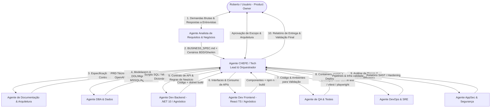

# Visão Geral e Arquitetura: Squad de TI Autônoma com Agentes de IA

## 1. O Desafio e a Abordagem de Engenharia

Criar uma equipe autônoma de desenvolvimento de software baseada em IA não consiste em colocar múltiplos modelos de linguagem em um chat aberto conversando livremente. Na prática de engenharia, sistemas multi-agente puramente conversacionais sofrem de:
1. **Looping e alucinação cumulativa:** Agentes concordando mutuamente com erros ou amplificando falhas conceituais.
2. **Explosão de custos de tokens e perda de contexto:** Conversas longas diluem regras críticas e gastam orçamento computacional sem avanço de código real.
3. **"Verification Theater" (Teatro de Verificação):** Agentes de teste que apenas leem o código e dizem "parece bom", sem jamais compilar, rodar suítes de testes ou validar ambientes reais.
4. **Desalinhamento de Contrato:** O backend muda um endpoint REST/GraphQL sem notificar o frontend ou o banco de dados.

Para solucionar isso, esta Squad adota a **Arquitetura Baseada em Contratos e Artefatos (Artifact-Driven Orchestration)** executada via **LangGraph (Python)** conectado ao ecossistema local **TudoIA** (LiteLLM Gateway :4000 e modelos locais/Ollama).

---

## 2. Topologia do Sistema com Engenharia de Requisitos

A squad opera sob o modelo **Hierárquico com Supervisão por Grafo de Estados (LangGraph StateGraph)**, incluindo o ciclo formal de elicitação negocial:

---

## 3. Integração com o Ecossistema Local (TudoIA)

A squad não depende de APIs externas proprietárias ou conexões que exponham código confidencial. Ela conecta-se nativamente à infraestrutura local do **TudoIA**:
- **Gateway LiteLLM (`http://localhost:4000/v1`):** Ponto único de chamada de LLM compatível com a API OpenAI.
- **Roteador Inteligente (`tudoia-auto`):** Encaminha prompts para modelos locais no Ollama (ex: Qwen2.5-Coder 32B/7B, DeepSeek-Coder, Llama 3) ou modelos em nuvem conforme disponibilidade e regras de privacidade.
- **Cérebro MCP:** Servidor MCP local para busca e memória documental persistente.
- **Privacidade por Padrão (Local-First):** Código-fonte proprietário, esquemas de banco e regras de negócio permanecem na máquina local sem vazamento.

---

## 4. Stack Padrão e Arquitetura Agnóstica (Stack Adapters)

Embora a stack prioritária de referência da organização seja:
- **Backend:** .NET 10 + C# (Clean Architecture, EF Core; regras na Doutrina TEC, família Arquitetura)
- **Frontend:** React 19 + TypeScript + Vite + Tailwind CSS
- **Banco de Dados:** Microsoft SQL Server (MSSQL) com migrações versionadas

A Squad adota o **Padrão de Adaptadores de Stack (Stack Adapters)**:
Cada agente desenvolvedor, DBA e QA possui sub-regras modulares. Caso o projeto seja em Python/FastAPI, Go ou Node.js, o CHEFE injeta a receita correspondente do projeto sem alterar a mecânica orquestradora.

> **Estado real:** a única família da Doutrina TEC hoje é a de Arquitetura, e é específica de .NET. O código do orquestrador implementa só a stack .NET (+ frontend React). Outras stacks são intenção de projeto: exigem antes uma família própria na Doutrina, senão o agente trabalha sem regras.

---

## 5. O Papel Crítico do Agente CHEFE (Tech Lead & Orquestrador)

1. **Decomposição Estruturada de Demandas:** Traduz o documento funcional do Analista de Requisitos em tarefas técnicas e contratos estritos.
2. **Controle de Dependências e Ordem de Execução:** Garante que o banco e os contratos existam antes de qualquer desenvolvimento de código.
3. **Isolamento de Contexto (Context Firewalls):** Prompts cirúrgicos contendo apenas as especificações pertinentes àquele agente.
4. **Resolução de Conflitos e Retroalimentação:** Limita loops de correção a no máximo 3 tentativas antes de acionar intervenção humana (Human-in-the-Loop).
