[🏠 TudoIA](../../README.md) › [📚 Documentação](../README.md) › 🔄 Protocolo de comunicação e estado

# 🔄 Protocolo de comunicação e estado

> **Público:** quem mantém o orquestrador. Descreve o ciclo de vida de uma tarefa, o estado compartilhado (`SquadState`) e o laço de auto-cura, conforme `graph.py` e `state.py`.

## 📑 Sumário

- [1. O Ciclo de Vida de uma Demanda no LangGraph](#1-o-ciclo-de-vida-de-uma-demanda-no-langgraph)
- [2. Esquema do Estado Compartilhado no LangGraph (`SquadState`)](#2-esquema-do-estado-compartilhado-no-langgraph-squadstate)
- [3. Formato Padrão da Ordem de Serviço (Prompt Cirúrgico)](#3-formato-padrão-da-ordem-de-serviço-prompt-cirúrgico)
- [4. Loop de Auto-Cura Limitado (Bounded Self-Healing)](#4-loop-de-auto-cura-limitado-bounded-self-healing)

---


Para garantir previsibilidade, baixo consumo de tokens e rastreabilidade total, os agentes da Squad não conversam em linguagem livre desestruturada. Toda comunicação obedece ao **Protocolo de Artefatos & Transição de Estado**, gerenciado pelo motor de grafo no LangGraph.

---

## 1. O Ciclo de Vida de uma Demanda no LangGraph

O fluxo é modelado como uma máquina de estados finita com pontos de interrupção (Human-in-the-Loop) controlados:

```mermaid
stateDiagram-v2
    [*] --> ElicitacaoRequisitos: Usuário envia demanda inicial
    ElicitacaoRequisitos --> EntrevistaUsuario: Analista de Requisitos formula perguntas
    EntrevistaUsuario --> ElicitacaoRequisitos: Usuário responde
    ElicitacaoRequisitos --> AprovacaoRequisitos: Geração do BUSINESS_SPEC.md (Gherkin)
    
    AprovacaoRequisitos --> ArquiteturaContratos: Usuário Aprova (Human-in-the-Loop)
    AprovacaoRequisitos --> ElicitacaoRequisitos: Usuário solicita ajustes
    
    ArquiteturaContratos --> ModelagemDados: Arquiteto gera PRD Técnico + OpenAPI
    ModelagemDados --> ConstrucaoSoftware: DBA entrega DDL MSSQL / Migrações
    
    state ConstrucaoSoftware {
        [*] --> Backend: Implementa regras e APIs .NET 10
        [*] --> Frontend: Implementa telas React TypeScript
        Backend --> IntegracaoLocal
        Frontend --> IntegracaoLocal
    }
    
    ConstrucaoSoftware --> InspecaoQA: Build, testes e cobertura mínima de 90%
    InspecaoQA --> ConstrucaoSoftware: Reprovou (volta ao dev_backend ou dev_frontend conforme falha_origem; 3 passagens no total)
    InspecaoQA --> RevisaoCodigo: Testes passaram com Exit Code 0
    RevisaoCodigo --> ConstrucaoSoftware: Reprovou (achado CRITICO ou sem veredito válido; mesmo limite de 3)
    RevisaoCodigo --> AppSec: Aprovado
    AppSec --> DevOps: Dependências e segredos sem achado
    AppSec --> [*]: ENTREGA_BLOQUEADA
    DevOps --> Documentacao: CI, Dockerfile e actions fixadas sem achado
    DevOps --> [*]: ENTREGA_BLOQUEADA
    Documentacao --> AprovacaoRelease: README e docs gerados
    
    AprovacaoRelease --> Release: Usuário aprova (Human-in-the-Loop, comando aprovar-release)
    Release --> [*]: RELEASE_NOTES com versão SUGERIDA; o agente nunca cria tag, push nem publica
```



> O fluxo acima é o implementado em `orquestrador/graph.py`. O limite de iterações é compartilhado entre QA e revisor; sem o `release_approved`, o nó `release` se recusa a rodar mesmo se o grafo for retomado.

---

## 2. Esquema do Estado Compartilhado no LangGraph (`SquadState`)

O estado global é um `TypedDict` em `orquestrador/state.py`, persistido pelo checkpoint SQLite do LangGraph. Abaixo, os campos reais (resumo; o arquivo tem a lista completa e reducers para campos escritos em paralelo, como `arquivos_gerados` e `current_phase`):

```python
class SquadState(TypedDict):
    # Identificação e Doutrina
    task_id: str
    project_name: str
    target_stack: Dict[str, Any]
    architecture_source_path: str   # pasta da Doutrina; DOUTRINA_TEC tem precedência
    workspace_dir: str              # workspace/<task_id>: tudo que a tarefa gera fica aqui
    modelo: Optional[str]           # perfil do gateway desta tarefa
    consentimento_nuvem: Optional[bool]
    doutrina_versao: Optional[str]  # mudou no meio da tarefa = a tarefa aborta
    doutrina_hash: Optional[str]
    doutrina_familias: Optional[List[str]]

    # Entrevista e aprovação
    user_initial_briefing: str
    interview_questions: List[str]
    interview_answers: List[str]
    business_spec_approved: bool

    # Artefatos (caminhos relativos ao workspace)
    business_spec_file: Optional[str]   # docs/negocio/BUSINESS_SPEC.md
    technical_prd_file: Optional[str]   # docs/arquitetura/PRD_TECNICO.md
    openapi_file: Optional[str]         # contracts/openapi.yaml
    qa_report_file: Optional[str]       # tests/reports/qa_report.json
    security_report_file: Optional[str] # tests/reports/security_report.json
    devops_report_file: Optional[str]   # tests/reports/devops_report.json
    review_file: Optional[str]          # docs/revisao/REVISAO.md
    release_notes_file: Optional[str]   # docs/release/RELEASE_NOTES.md
    arquivos_gerados: Annotated[List[str], unir_listas]

    # Execução e auto-cura
    current_phase: Annotated[str, ultimo_valor]
    iteration_count: int            # passagens de QA/revisor; limite 3
    last_error_log: Optional[str]
    falha_origem: Optional[str]     # 'backend' | 'frontend'
    tests_passed: bool
    review_passed: bool
    security_passed: bool
    devops_passed: bool
    release_approved: bool          # aprovação humana explícita; sem ela o nó release recusa rodar
```

---

## 3. Formato Padrão da Ordem de Serviço (Prompt Cirúrgico)

> [!NOTE]
> Modelo de projeto. O código não tem um gerador de "ordem de serviço": cada nó monta seu próprio prompt em `nodes.py` (instrução do papel, artefatos de entrada aprovados e regras da Doutrina do papel). Os itens abaixo (restrições, DoD) valem como critério, mas o template literal não existe.

Quando o CHEFE delega uma subtarefa para um agente especialista, o prompt segue este template:

```markdown
### [ORDEM DE SERVIÇO]: {TASK_ID} - {FASE}
**De:** Agente CHEFE (Tech Lead)
**Para:** {NOME_DO_AGENTE_ESPECIALISTA}
**Stack Alvo:** {target_stack}

#### 1. Insumos Obrigatórios
- Artefatos Anteriores: {Lista de arquivos já aprovados, ex: BUSINESS_SPEC.md, openapi.yaml}

#### 2. Restrições e Padrões Não-Negociáveis
- Padrão arquitetural: a Doutrina TEC (núcleo + regras do papel, via `gerado/<familia>.json` das famílias lidas); a versão usada fica em `doutrina_versao`/`doutrina_hash` no estado.
- Banco MSSQL com tipos de dados estritos (DECIMAL para moeda, NVARCHAR com tamanho definido).
- Frontend React com TypeScript estrito (zero `any`) e componentes desacoplados.

#### 3. Critério de Aceitação (DoD)
- [ ] Arquivos gerados no caminho correto
- [ ] Execução do comando de validação (`dotnet build`, `dotnet test`, `npm run build`) com código de saída 0; o QA registra em `tests/reports/qa_report.json`
- [ ] 0 Warnings de compilação ou linter

#### 4. Resposta Esperada
- Resumo cirúrgico das alterações
- Comando executado e código de saída (Exit Code)
```

---

## 4. Loop de Auto-Cura Limitado (Bounded Self-Healing)

Implementado em `graph.py` (`rota_pos_qa`, `rota_pos_revisor`, `LIMITE_ITERACOES = 3`):

1. Se o QA reprova, o grafo devolve a tarefa a quem causou a falha (`falha_origem`: `backend` ou `frontend`) com o log de erro sanitizado em `last_error_log`. O revisor reprovado volta pelo mesmo caminho.
2. `iteration_count` cresce a cada passagem do QA e é **compartilhado** com o revisor: são 3 passagens no total.
3. No limite, o grafo termina (escalação humana): a tarefa fica no checkpoint com o diagnóstico em `last_error_log` e o usuário decide. Não existe etapa intermediária de "simplificar o algoritmo"; era intenção do desenho original e não está no código.

AppSec e DevOps não têm laço de correção: se reprovam, a entrega termina bloqueada (`ENTREGA_BLOQUEADA`).

---

[🏠 README](../../README.md) · ⬅️ [Catálogo de agentes da SquadTI](01-catalogo-de-agentes.md) · [Guia de implementação com LangGraph e TudoIA](03-guia-de-implementacao.md) ➡️
