[🏠 TudoIA](../../README.md) › [📚 Documentação](../README.md) › 🔄 Protocolo de comunicação e estado

# 🔄 Protocolo de comunicação e estado

> **Público:** quem mantém o orquestrador. Descreve o ciclo de vida de uma tarefa, o estado compartilhado (`SquadState`) e o laço de auto-cura, conforme `graph.py`, `chefe.py` e `state.py` (v2).

## 📑 Sumário

- [1. O Ciclo de Vida de uma Demanda no LangGraph](#1-o-ciclo-de-vida-de-uma-demanda-no-langgraph)
- [2. Esquema do Estado Compartilhado no LangGraph (`SquadState`)](#2-esquema-do-estado-compartilhado-no-langgraph-squadstate)
- [3. Formato Padrão da Ordem de Serviço (Prompt Cirúrgico)](#3-formato-padrão-da-ordem-de-serviço-prompt-cirúrgico)
- [4. Loop de Auto-Cura Limitado (Bounded Self-Healing)](#4-loop-de-auto-cura-limitado-bounded-self-healing)

---


Para garantir previsibilidade, baixo consumo de tokens e rastreabilidade total, os agentes da Squad não conversam em linguagem livre desestruturada. Toda comunicação obedece ao **Protocolo de Artefatos & Transição de Estado**, gerenciado pelo motor de grafo no LangGraph.

---

## 1. O Ciclo de Vida de uma Demanda no LangGraph

O fluxo é modelado como uma máquina de estados finita com pontos de interrupção (Human-in-the-Loop) controlados:

```mermaid
stateDiagram-v2
    [*] --> Planejamento: Usuário envia a demanda (chefe_intake)
    Planejamento --> ElicitacaoRequisitos: plano validado (tamanho, stack, banco, frontend, API)
    ElicitacaoRequisitos --> EntrevistaUsuario: Analista formula até 4 perguntas
    EntrevistaUsuario --> ElicitacaoRequisitos: Usuário responde (ou fala com o CHEFE)
    ElicitacaoRequisitos --> GateRequisitos: BUSINESS_SPEC.md (Gherkin)
    GateRequisitos --> ElicitacaoRequisitos: pendências (até 2 rodadas)
    GateRequisitos --> AprovacaoRequisitos: critério de pronto atendido
    GateRequisitos --> Escalada: 2 rodadas sem fechar

    AprovacaoRequisitos --> ArquiteturaContratos: Usuário aprova (hash do texto)
    ArquiteturaContratos --> GateDesign: PRD técnico + OpenAPI
    GateDesign --> Escalada: PRD ou OpenAPI fora do critério
    GateDesign --> ModelagemDados: plano pede banco
    GateDesign --> ConstrucaoSoftware: plano sem banco
    ModelagemDados --> ConstrucaoSoftware

    state ConstrucaoSoftware {
        [*] --> Backend
        [*] --> Frontend: só se o plano pede frontend
    }

    ConstrucaoSoftware --> InspecaoQA: build, testes e cobertura mínima de 90%
    InspecaoQA --> ConstrucaoSoftware: reprovou (falha_origem; 3 passagens QA+revisor)
    InspecaoQA --> RevisaoCodigo: exit code 0
    RevisaoCodigo --> ConstrucaoSoftware: reprovou
    RevisaoCodigo --> SeniorMaster: aprovado
    SeniorMaster --> ConstrucaoSoftware: reprovou (até 3 voltas)
    SeniorMaster --> AppSec: aprovado
    AppSec --> Escalada: ENTREGA_BLOQUEADA
    AppSec --> ValidacaoRuntime: dependências e segredos sem achado
    ValidacaoRuntime --> ConstrucaoSoftware: hacker, macaco ou carga reprovaram (até 3 voltas)
    ValidacaoRuntime --> DevOps: aprovada ou pulada com motivo
    DevOps --> Escalada: ENTREGA_BLOQUEADA
    DevOps --> Documentacao: CI, Dockerfile e actions fixadas sem achado
    Documentacao --> Mantenedor
    Mantenedor --> Documentacao: lacunas (até 2 voltas)
    Mantenedor --> AprovacaoRelease: orientou-se só com a documentação

    AprovacaoRelease --> Release: Usuário aprova (hash do pacote)
    Release --> [*]: RELEASE_NOTES com versão SUGERIDA; o agente nunca cria tag, push nem publica
    Escalada --> [*]: chefe_escalada escreve docs/chefe/ESCALADA.md
```



> O fluxo acima é o implementado em `orquestrador/graph.py`. O limite de iterações é compartilhado entre QA e revisor; sem o `release_approved`, o nó `release` se recusa a rodar mesmo se o grafo for retomado. Em qualquer ponto o orçamento da tarefa esgotado, a estagnação (mesma falha duas vezes seguidas) ou uma saída de modelo inválida repetida levam à escalada.

---

## 2. Esquema do Estado Compartilhado no LangGraph (`SquadState`)

O estado global é um `TypedDict` em `orquestrador/state.py`, persistido pelo checkpoint SQLite do LangGraph. Abaixo, os campos reais (resumo; o arquivo tem a lista completa e reducers: `unir_listas` para `arquivos_gerados` e `docs_proprios`, `ultimo_valor` para `current_phase` e `somar_listas` para as trilhas que só acrescentam):

```python
class SquadState(TypedDict):
    # Identificação e Doutrina
    task_id: str
    project_name: str
    target_stack: Dict[str, Any]
    architecture_source_path: str   # pasta da Doutrina; DOUTRINA_TEC tem precedência
    workspace_dir: str              # workspace/<task_id>: tudo que a tarefa gera fica aqui
    modelo: Optional[str]           # perfil do gateway desta tarefa
    consentimento_nuvem: Optional[bool]

    # CHEFE, stack e controle de execução
    plano: Optional[Dict[str, Any]]         # tamanho, stack, precisa_banco, precisa_frontend, precisa_api, riscos
    stack_id: Optional[str]                 # 'dotnet' | 'python'; stack_fixa=True se o usuário a escolheu
    mensagens: Annotated[List[Dict], somar_listas]        # conversa usuário <-> CHEFE
    observacoes_usuario: Annotated[List[str], somar_listas]  # instruções /ajuste (dado, já sanitizadas)
    agentes_cfg: Optional[Dict[str, Any]]   # cópia da configuração dos agentes ao iniciar
    orcamento: Optional[Dict[str, Any]]     # tetos: tokens, tempo_s, chamadas
    auditoria: Annotated[List[Dict], somar_listas]        # um registro por nó (duração, chamadas, tokens, modelos)
    assinaturas_erro: Annotated[List[str], somar_listas]  # detecção de estagnação
    achados_agentes: Annotated[List[Dict], somar_listas]  # achados estruturados (insumo do Livro de Lições)
    escalada: Optional[str]                 # motivo de uma parada que exige humano
    feedback_chefe: Optional[str]           # pendências devolvidas ao analista (critério de pronto)
    doutrina_versao: Optional[str]  # mudou no meio da tarefa = a tarefa aborta
    doutrina_hash: Optional[str]
    doutrina_familias: Optional[List[str]]

    # Entrevista e aprovação
    user_initial_briefing: str
    interview_questions: List[str]
    interview_answers: List[str]
    business_spec_approved: bool
    business_spec_hash: Optional[str]       # hash do texto aprovado; mudou depois, o arquiteto recusa
    release_gate_hash: Optional[str]        # hash do pacote de verificações aprovado no release

    # Artefatos (caminhos relativos ao workspace)
    business_spec_file: Optional[str]   # docs/negocio/BUSINESS_SPEC.md
    technical_prd_file: Optional[str]   # docs/arquitetura/PRD_TECNICO.md
    openapi_file: Optional[str]         # contracts/openapi.yaml
    qa_report_file: Optional[str]       # tests/reports/qa_report.json
    security_report_file: Optional[str] # tests/reports/security_report.json
    devops_report_file: Optional[str]   # tests/reports/devops_report.json
    review_file: Optional[str]          # docs/revisao/REVISAO.md
    senior_report_file: Optional[str]   # docs/qualidade/RELATORIO_SENIOR.json
    hacker_report_file: Optional[str]   # tests/reports/hacker_report.json (idem macaco_report_file, carga_report_file)
    manutencao_report_file: Optional[str]  # docs/manutencao/AVALIACAO_MANUTENIBILIDADE.json
    release_notes_file: Optional[str]   # docs/release/RELEASE_NOTES.md
    arquivos_gerados: Annotated[List[str], unir_listas]

    # Execução e auto-cura
    current_phase: Annotated[str, ultimo_valor]
    iteration_count: int            # passagens de QA/revisor; limite 3
    rodadas_senior: Optional[int]; rodadas_runtime: Optional[int]; rodadas_manutencao: Optional[int]; rodadas_gate: Optional[int]
    last_error_log: Optional[str]
    falha_origem: Optional[str]     # 'backend' | 'frontend'
    tests_passed: bool
    review_passed: bool
    security_passed: bool
    devops_passed: bool
    senior_passed: Optional[bool]; manutencao_passed: Optional[bool]
    validacao_executada: Optional[bool]  # False = o sistema NÃO foi validado em execução (com validacao_motivo)
    hacker_passed: Optional[bool]; macaco_passed: Optional[bool]; carga_passed: Optional[bool]
    release_approved: bool          # aprovação humana explícita; sem ela o nó release recusa rodar
```

---

## 3. Formato Padrão da Ordem de Serviço (Prompt Cirúrgico)

> [!NOTE]
> Modelo de projeto. O código não tem um gerador de "ordem de serviço": cada nó monta seu próprio prompt em `nodes.py`, `chefe.py` e `qualidade.py` (instrução do papel, artefatos de entrada aprovados, o plano do CHEFE e as instruções `/ajuste` do usuário como dado, e as regras da Doutrina do papel, mais a defesa padrão contra injeção de `entrada.py`). Os itens abaixo (restrições, DoD) valem como critério, mas o template literal não existe.

Quando o CHEFE delega uma subtarefa para um agente especialista, o prompt segue este template:

```markdown
### [ORDEM DE SERVIÇO]: {TASK_ID} - {FASE}
**De:** Agente CHEFE (Tech Lead)
**Para:** {NOME_DO_AGENTE_ESPECIALISTA}
**Stack Alvo:** {target_stack}

#### 1. Insumos Obrigatórios
- Artefatos Anteriores: {Lista de arquivos já aprovados, ex: BUSINESS_SPEC.md, openapi.yaml}

#### 2. Restrições e Padrões Não-Negociáveis
- Padrão arquitetural: a Doutrina TEC (núcleo + regras do papel, via `gerado/<familia>.json` das famílias lidas); a versão usada fica em `doutrina_versao`/`doutrina_hash` no estado.
- Banco MSSQL com tipos de dados estritos (DECIMAL para moeda, NVARCHAR com tamanho definido).
- Frontend React com TypeScript estrito (zero `any`) e componentes desacoplados.

#### 3. Critério de Aceitação (DoD)
- [ ] Arquivos gerados no caminho correto
- [ ] Execução do comando de validação (`dotnet build`, `dotnet test`, `npm run build`) com código de saída 0; o QA registra em `tests/reports/qa_report.json`
- [ ] 0 Warnings de compilação ou linter

#### 4. Resposta Esperada
- Resumo cirúrgico das alterações
- Comando executado e código de saída (Exit Code)
```

---

## 4. Loop de Auto-Cura Limitado (Bounded Self-Healing)

Implementado em `graph.py` (`rota_pos_*`, `LIMITE_ITERACOES = 3`), `qualidade.py`, `validacao.py` e `auditoria.py`:

1. Se o QA reprova, o grafo devolve a tarefa a quem causou a falha (`falha_origem`: `backend` ou `frontend`) com o log de erro sanitizado em `last_error_log`. O revisor reprovado volta pelo mesmo caminho.
2. `iteration_count` cresce a cada passagem do QA e é **compartilhado** com o revisor: são 3 passagens no total.
3. O Sênior Master (`rodadas_senior`, 3), a validação em execução (`rodadas_runtime`, 3) e o gate de requisitos do CHEFE (`rodadas_gate`, 2) têm contadores próprios; o Mantenedor devolve à documentação (`rodadas_manutencao`, 2).
4. **Estagnação:** cada reprovação grava uma assinatura do erro (números e caminhos saem). A mesma assinatura em duas verificações seguidas escala imediatamente, sem gastar as iterações que restam.
5. **Orçamento:** tokens, segundos e chamadas da tarefa são conferidos antes de cada nó; esgotado, a execução para e escala.
6. No limite, `chefe_escalada` escreve `docs/chefe/ESCALADA.md` e o grafo termina: a tarefa fica no checkpoint com o diagnóstico em `last_error_log`/`escalada` e o usuário decide. Não existe etapa intermediária de "simplificar o algoritmo"; era intenção do desenho original e não está no código.

AppSec e DevOps não têm laço de correção: se reprovam, a entrega termina bloqueada (`ENTREGA_BLOQUEADA`), com o relatório do CHEFE.

---

[🏠 README](../../README.md) · ⬅️ [Catálogo de agentes da SquadTI](01-catalogo-de-agentes.md) · [Guia de implementação com LangGraph e TudoIA](03-guia-de-implementacao.md) ➡️
