# Protocolo de Comunicação, Gestão de Estado e Ciclo de Vida

Para garantir previsibilidade, baixo consumo de tokens e rastreabilidade total, os agentes da Squad não conversam em linguagem livre desestruturada. Toda comunicação obedece ao **Protocolo de Artefatos & Transição de Estado**, gerenciado pelo motor de grafo no LangGraph.

---

## 1. O Ciclo de Vida de uma Demanda no LangGraph

O fluxo é modelado como uma máquina de estados finita com pontos de interrupção (Human-in-the-Loop) controlados:

```mermaid
stateDiagram-v2
    [*] --> ElicitacaoRequisitos: Usuário envia demanda inicial
    ElicitacaoRequisitos --> EntrevistaUsuario: Analista de Requisitos formula perguntas
    EntrevistaUsuario --> ElicitacaoRequisitos: Usuário responde
    ElicitacaoRequisitos --> AprovacaoRequisitos: Geração do BUSINESS_SPEC.md (Gherkin)
    
    AprovacaoRequisitos --> ArquiteturaContratos: Usuário Aprova (Human-in-the-Loop)
    AprovacaoRequisitos --> ElicitacaoRequisitos: Usuário solicita ajustes
    
    ArquiteturaContratos --> ModelagemDados: Arquiteto gera PRD Técnico + OpenAPI
    ModelagemDados --> ConstrucaoSoftware: DBA entrega DDL MSSQL / Migrações
    
    state ConstrucaoSoftware {
        [*] --> Backend: Implementa regras e APIs .NET 10
        [*] --> Frontend: Implementa telas React TypeScript
        Backend --> IntegracaoLocal
        Frontend --> IntegracaoLocal
    }
    
    ConstrucaoSoftware --> InspecaoQA: Build, testes e cobertura mínima de 90%
    InspecaoQA --> ConstrucaoSoftware: Reprovou (volta ao dev_backend ou dev_frontend conforme falha_origem; 3 passagens no total)
    InspecaoQA --> RevisaoCodigo: Testes passaram com Exit Code 0
    RevisaoCodigo --> ConstrucaoSoftware: Reprovou (achado CRITICO ou sem veredito válido; mesmo limite de 3)
    RevisaoCodigo --> AppSec: Aprovado
    AppSec --> DevOps: Dependências e segredos sem achado
    AppSec --> [*]: ENTREGA_BLOQUEADA
    DevOps --> Documentacao: CI, Dockerfile e actions fixadas sem achado
    DevOps --> [*]: ENTREGA_BLOQUEADA
    Documentacao --> AprovacaoRelease: README e docs gerados
    
    AprovacaoRelease --> Release: Usuário aprova (Human-in-the-Loop, comando aprovar-release)
    Release --> [*]: RELEASE_NOTES com versão SUGERIDA; o agente nunca cria tag, push nem publica
```



> O fluxo acima é o implementado em `orquestrador/graph.py`. O limite de iterações é compartilhado entre QA e revisor; sem o `release_approved`, o nó `release` se recusa a rodar mesmo se o grafo for retomado.

---

## 2. Esquema do Estado Compartilhado no LangGraph (`SquadState`)

O estado global da Squad é gerenciado por uma classe tipada em Python (`TypedDict` / Pydantic):

```python
from typing import TypedDict, List, Dict, Optional, Any

class SquadState(TypedDict):
    # Identificadores e Rastreabilidade
    task_id: str
    project_name: str
    target_stack: Dict[str, str] # {"backend": "dotnet10", "frontend": "react_ts", "db": "mssql"}
    
    # Fases e Controle de Fluxo
    current_phase: str           # "ELICITACAO", "ARQUITETURA", "CONSTRUCAO", "QA", "FINALIZADO"
    status: str                  # "EM_ANDAMENTO", "AGUARDANDO_USUARIO", "APROVADO", "FALHA"
    iteration_count: int         # Contador de auto-cura (max 3)
    
    # Artefatos Produzidos (Caminhos em disco)
    business_spec_path: Optional[str]   # docs/negocio/BUSINESS_SPEC.md
    technical_prd_path: Optional[str]   # docs/arquitetura/PRD_TECNICO.md
    openapi_spec_path: Optional[str]    # contracts/openapi.yaml
    db_migrations_path: Optional[str]   # src/Database/Migrations/
    backend_code_dir: Optional[str]     # src/Backend/
    frontend_code_dir: Optional[str]    # src/Frontend/
    qa_report_path: Optional[str]       # tests/reports/qa_results.json
    security_report_path: Optional[str] # docs/security/audit_results.json
    
    # Mensagens e Perguntas Ativas
    pending_user_questions: List[str]
    last_error_log: Optional[str]
    human_approved: bool
```

---

## 3. Formato Padrão da Ordem de Serviço (Prompt Cirúrgico)

Quando o CHEFE delega uma subtarefa para um agente especialista, o prompt gerado segue estritamente este template:

```markdown
### [ORDEM DE SERVIÇO]: {TASK_ID} - {FASE}
**De:** Agente CHEFE (Tech Lead)
**Para:** {NOME_DO_AGENTE_ESPECIALISTA}
**Stack Alvo:** {target_stack}

#### 1. Insumos Obrigatórios
- Artefatos Anteriores: {Lista de arquivos já aprovados, ex: BUSINESS_SPEC.md, openapi.yaml}

#### 2. Restrições e Padrões Não-Negociáveis
- Padrão arquitetural: a Doutrina TEC (núcleo + regras do papel, via `gerado/<familia>.json` das famílias lidas); a versão usada fica em `doutrina_versao`/`doutrina_hash` no estado.
- Banco MSSQL com tipos de dados estritos (DECIMAL para moeda, NVARCHAR com tamanho definido).
- Frontend React com TypeScript estrito (zero `any`) e componentes desacoplados.

#### 3. Critério de Aceitação (DoD)
- [ ] Arquivos gerados no caminho correto
- [ ] Execução do comando de validação (`dotnet build`, `dotnet test`, `npm run build`) com código de saída 0; o QA registra em `tests/reports/qa_report.json`
- [ ] 0 Warnings de compilação ou linter

#### 4. Resposta Esperada
- Resumo cirúrgico das alterações
- Comando executado e código de saída (Exit Code)
```

---

## 4. Loop de Auto-Cura Limitado (Bounded Self-Healing)

1. Se o agente Backend ou Frontend submeter código que falhe na compilação ou nos testes do QA:
   - **Tentativa 1:** O CHEFE repassa o log de erro exato. O agente corrige a causa-raiz.
   - **Tentativa 2:** Se persistir, o CHEFE instrui a simplificação do algoritmo (remover complexidade desnecessária).
   - **Tentativa 3:** Se falhar pela terceira vez, o LangGraph dispara uma interrupção (**Interrupt**) e notifica o Usuário com o diagnóstico exato, evitando desperdício de tokens e corrupção da base.
