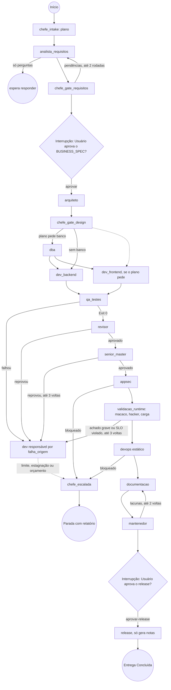

[🏠 TudoIA](../../README.md) › [📚 Documentação](../README.md) › 🛠️ Guia de implementação com LangGraph e TudoIA

# 🛠️ Guia de implementação com LangGraph e TudoIA

> **Público:** quem integra a SquadTI ao gateway do TudoIA. Mostra a conexão com o LiteLLM, o grafo real (v2) e a configuração de stack; para operar, veja [SquadTI (componente)](../componentes/squadti.md).

## 📑 Sumário

- [1. Conexão com o Ecossistema TudoIA](#1-conexão-com-o-ecossistema-tudoia)
- [2. Estrutura do Grafo no LangGraph (`StateGraph`)](#2-estrutura-do-grafo-no-langgraph-stategraph)
- [3. O Padrão de Adaptadores de Stack (Stack Adapters)](#3-o-padrão-de-adaptadores-de-stack-stack-adapters)

---


Este guia descreve como colocar a Squad em execução utilizando **LangGraph (Python)** como motor orquestrador de estados e o ecossistema local **TudoIA** como provedor soberano de IA.

---

## 1. Conexão com o Ecossistema TudoIA

A Squad consome modelos pelo **gateway LiteLLM** do TudoIA. Por padrão só usa modelo local; perfil que pode sair da máquina exige consentimento explícito.

### Configuração do cliente de IA (compatível com a API OpenAI), como em `orquestrador/nodes.py`
```python
from langchain_openai import ChatOpenAI

# Conexão com o Gateway TudoIA na porta 4000
tudoia_llm = ChatOpenAI(
    base_url=TUDOIA_GATEWAY_URL,  # env; padrão http://localhost:4000/v1
    api_key=TUDOIA_API_KEY,       # env; use uma chave virtual do LiteLLM (o padrão do código é só um placeholder)
    model=TUDOIA_MODEL,           # env; padrão tudoia-local (imagem: tudoia-local-estrito) ou o perfil de --perfil
    temperature=0.1,              # baixa temperatura para alta fidelidade técnica
    timeout=timeout_do_modelo(),  # TUDOIA_TIMEOUT_S, padrão 300 s por chamada
    max_retries=1,
)
```

Esse é o cliente do processo. Para um agente com perfil, temperatura ou `max_tokens` próprios (`agentes.json`), `_cliente()` cria e reaproveita outro `ChatOpenAI` por combinação (modelo, temperatura, `max_tokens`).

### Perfis aceitos (`--perfil`, `orquestrador/perfis.py`)

| Perfil | Modelo no gateway | Sai da máquina? |
|---|---|---|
| `local-estrito` | `tudoia-local-estrito` | Não, sem fallback para a nuvem (recomendado) |
| `local` | `tudoia-local` | Não por padrão; o gateway pode reenviar à nuvem se estourar o contexto |
| `hibrido` | `tudoia-hibrido` | Sim (nuvem gratuita como apoio) |
| `nuvem` | `tudoia-nuvem` | Sim |
| `auto` | `tudoia-auto` | Pode (o roteador decide por pedido); exige consentimento |
| `max` | `tudoia-max` | Sim, pago |

> [!WARNING]
> O gateway desta árvore não define `tudoia-local-estrito` nem `tudoia-hibrido` (ver o aviso em [SquadTI (componente)](../componentes/squadti.md#perfis-perfispy)): uma tarefa com esses perfis falha no LiteLLM por modelo desconhecido, sem enviar nada à nuvem.

O modelo **padrão** é um por tarefa (perfil ou `--modelo`), mas na v2 cada agente com modelo (`chefe`, `analista`, `arquiteto`, `dba`, `backend`, `frontend`, `revisor`, `senior`, `hacker`, `mantenedor`, `documentacao`) pode ter perfil, temperatura e `max_tokens` próprios na aba Agentes do painel (`orquestrador/agentes.py`, `agentes.json`); a configuração é copiada para a tarefa ao iniciar. Perfil de nuvem num agente exige o consentimento da tarefa. Quais modelos do Ollama atendem cada perfil é configuração do TudoIA (`config/roteamento.yaml`). A sugestão antiga de modelos fixos por papel (`qwen2.5-coder:32b` para raciocínio, `:7b` para DevOps) não existe no código.

---

## 2. Estrutura do Grafo no LangGraph (`StateGraph`)

O grafo (`orquestrador/graph.py`) tem 18 nós (um por papel, mais os do CHEFE), persistência via `SqliteSaver` (`squad_state.db` por padrão; `--db` ou `SQUADTI_DB`) e interrupção antes dos nós `arquiteto` e `release` (Human-in-the-Loop). A aprovação dos requisitos é a pausa antes do `arquiteto`. Backend e frontend rodam em paralelo (o frontend só se o plano pede) e voltam ao mesmo `qa_testes`.



---

## 3. O Padrão de Adaptadores de Stack (Stack Adapters)

Para não perder o rigor na stack prioritária (**C# / .NET 10 + React TS + MSSQL**) e ainda atender outras, o orquestrador tem adaptadores de stack em `stacks.py` (`dotnet` e `python`) e lê um arquivo de configuração de stack (`--config` ou `SQUADTI_STACK_CONFIG`; padrão `stack_config.example.json`, em `orquestrador/`). Exemplo real:

```json
{
  "project_name": "GestaoFinanceira",
  "architecture_source_path": "../Doutrina",
  "stack": {
    "backend": {
      "language": "csharp",
      "framework": "dotnet10",
      "architecture": "clean_architecture",
      "build_command": "dotnet build --configuration Release",
      "test_command": "dotnet test --no-build --coverage --coverage-output-format cobertura",
      "scaffold_command": "dotnet new tec-project -n {nome}"
    },
    "frontend": {
      "framework": "react19",
      "language": "typescript",
      "bundler": "vite",
      "styling": "tailwindcss",
      "build_command": "npm run build",
      "test_command": "npm test"
    },
    "database": {
      "engine": "mssql",
      "version": "2022",
      "migration_tool": "ef_core",
      "migration_command": "dotnet ef database update"
    },
    "quality": {
      "coverage_min": 90
    },
    "infra": {
      "ci": "github",
      "container_runtime": "docker",
      "compose_file": "docker-compose.yml"
    }
  }
}
```

A ordem de decisão da stack do backend é: `stack_id` do estado (o CHEFE grava no plano; o usuário pode fixar com `--stack`/`stack` na API) > `target_stack.backend.language` (apelidos `csharp`, `c#`, `.net`, `python`, `fastapi`) > `dotnet`. Comandos declarados em `target_stack.backend` (`build_command`, `test_command`, `scaffold_command`, `audit_command`) vencem os do adaptador; o executável precisa estar na lista de `execucao.py` (`dotnet`, `npm`, `npx`, `uv`). Se o CHEFE escolhe uma stack diferente da declarada no arquivo, os comandos .NET do arquivo saem de cena e valem os do adaptador; sem frontend ou sem banco no plano, essas seções saem da stack.

Tabela de adaptadores e comandos: [SquadTI (componente)](../componentes/squadti.md#stacks-stackspy).

> [!WARNING]
> **Proposta, não implementada:** Go, Node.js, Java e outras stacks de backend. Exigem um adaptador novo em `stacks.py` (detecção do projeto, comandos, áreas de escrita, receita) e, na Doutrina, famílias que se apliquem a ela; sem isso o agente trabalha só com as famílias genéricas. Os prompts de frontend continuam React + TypeScript + Vite.

---

[🏠 README](../../README.md) · ⬅️ [Protocolo de comunicação e estado](02-protocolo-de-comunicacao-e-estado.md) · [Consumo da Doutrina TEC pela SquadTI](05-fonte-da-verdade-arquitetura.md) ➡️
