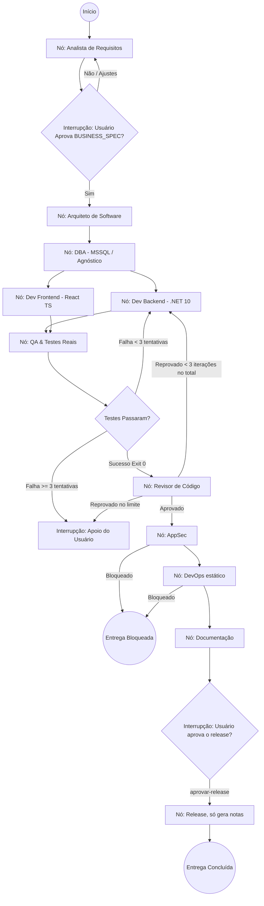

[🏠 TudoIA](../../README.md) › [📚 Documentação](../README.md) › 🛠️ Guia de implementação com LangGraph e TudoIA

# 🛠️ Guia de implementação com LangGraph e TudoIA

> **Público:** quem integra a SquadTI ao gateway do TudoIA. Mostra a conexão com o LiteLLM, o grafo real e a configuração de stack; para operar, veja [SquadTI (componente)](../componentes/squadti.md).

## 📑 Sumário

- [1. Conexão com o Ecossistema TudoIA](#1-conexão-com-o-ecossistema-tudoia)
- [2. Estrutura do Grafo no LangGraph (`StateGraph`)](#2-estrutura-do-grafo-no-langgraph-stategraph)
- [3. O Padrão de Adaptadores de Stack (Stack Adapters)](#3-o-padrão-de-adaptadores-de-stack-stack-adapters)

---


Este guia descreve como colocar a Squad em execução utilizando **LangGraph (Python)** como motor orquestrador de estados e o ecossistema local **TudoIA** como provedor soberano de IA.

---

## 1. Conexão com o Ecossistema TudoIA

A Squad consome modelos pelo **gateway LiteLLM** do TudoIA. Por padrão só usa modelo local; perfil que pode sair da máquina exige consentimento explícito.

### Configuração do cliente de IA (compatível com a API OpenAI), como em `orquestrador/nodes.py`
```python
from langchain_openai import ChatOpenAI

# Conexão com o Gateway TudoIA na porta 4000
tudoia_llm = ChatOpenAI(
    base_url=TUDOIA_GATEWAY_URL,  # env; padrão http://localhost:4000/v1
    api_key=TUDOIA_API_KEY,       # env; use uma chave virtual do LiteLLM (o padrão do código é só um placeholder)
    model=TUDOIA_MODEL,           # env; padrão tudoia-local (ou o perfil de --perfil)
    temperature=0.1,              # baixa temperatura para alta fidelidade técnica
)
```

### Perfis aceitos (`--perfil`, `orquestrador/perfis.py`)

| Perfil | Modelo no gateway | Sai da máquina? |
|---|---|---|
| `local-estrito` | `tudoia-local-estrito` | Não, sem fallback para a nuvem (recomendado) |
| `local` | `tudoia-local` | Não por padrão; o gateway pode reenviar à nuvem se estourar o contexto |
| `hibrido` | `tudoia-hibrido` | Sim (nuvem gratuita como apoio) |
| `nuvem` | `tudoia-nuvem` | Sim |
| `max` | `tudoia-max` | Sim, pago |

O modelo é **único por tarefa** (não há modelo por agente): vem do perfil ou de `--modelo`. Quais modelos do Ollama atendem cada perfil é configuração do TudoIA (`config/roteamento.yaml`). A sugestão antiga de modelos por papel (`qwen2.5-coder:32b` para raciocínio, `:7b` para DevOps) não existe no código.

---

## 2. Estrutura do Grafo no LangGraph (`StateGraph`)

O grafo (`orquestrador/graph.py`) tem um nó por papel, persistência via `SqliteSaver` (`squad_state.db` por padrão; `--db` ou `SQUADTI_DB`) e interrupção antes dos nós `arquiteto` e `release` (Human-in-the-Loop). A aprovação dos requisitos é a pausa antes do `arquiteto`.



---

## 3. O Padrão de Adaptadores de Stack (Stack Adapters)

Para manter a Squad 100% agnóstica sem perder o rigor na stack prioritária (**C# / .NET 10 + React TS + MSSQL**), o orquestrador lê um arquivo de configuração de stack (`--config` ou `SQUADTI_STACK_CONFIG`; padrão `stack_config.example.json`, em `orquestrador/`). Exemplo real:

```json
{
  "project_name": "GestaoFinanceira",
  "architecture_source_path": "../Doutrina",
  "stack": {
    "backend": {
      "language": "csharp",
      "framework": "dotnet10",
      "architecture": "clean_architecture",
      "build_command": "dotnet build --configuration Release",
      "test_command": "dotnet test --no-build --coverage --coverage-output-format cobertura",
      "scaffold_command": "dotnet new tec-project -n {nome}"
    },
    "frontend": {
      "framework": "react19",
      "language": "typescript",
      "bundler": "vite",
      "styling": "tailwindcss",
      "build_command": "npm run build",
      "test_command": "npm test"
    },
    "database": {
      "engine": "mssql",
      "version": "2022",
      "migration_tool": "ef_core",
      "migration_command": "dotnet ef database update"
    },
    "quality": {
      "coverage_min": 90
    },
    "infra": {
      "ci": "github",
      "container_runtime": "docker",
      "compose_file": "docker-compose.yml"
    }
  }
}
```

> [!WARNING]
> **Proposta, não implementada:** trocar para Python (`fastapi`, `postgresql`) e esperar que os nós injetem `pytest`/`alembic`. Hoje a configuração só troca **comandos** (`build_command`, `test_command`, `scaffold_command`) e o mínimo de cobertura. Prompts, template (`dotnet new tec-project`), detecção de projeto (`tem_projeto_dotnet`) e regras da Doutrina são .NET + React.

---

[🏠 README](../../README.md) · ⬅️ [Protocolo de comunicação e estado](02-protocolo-de-comunicacao-e-estado.md) · [Consumo da Doutrina TEC pela SquadTI](05-fonte-da-verdade-arquitetura.md) ➡️
