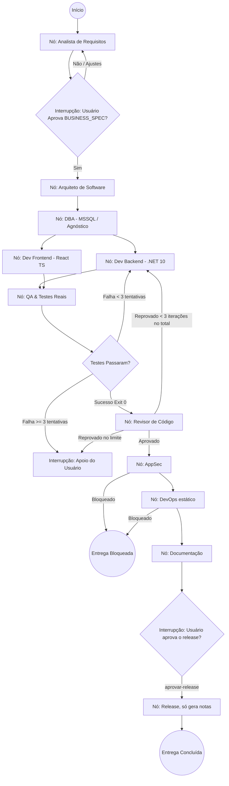

# Guia de Implementação Prática com LangGraph e TudoIA

Este guia descreve como colocar a Squad em execução utilizando **LangGraph (Python)** como motor orquestrador de estados e o ecossistema local **TudoIA** como provedor soberano de IA.

---

## 1. Conexão com o Ecossistema TudoIA

A Squad consome modelos locais através do **LiteLLM Gateway** do TudoIA, garantindo que nenhum código ou regra confidencial saia da sua máquina sem o seu consentimento.

### Configuração do Cliente de IA (compatível com OpenAI API):
```python
from langchain_openai import ChatOpenAI

# Conexão com o Gateway TudoIA na porta 4000
tudoia_llm = ChatOpenAI(
    base_url="http://localhost:4000/v1",
    api_key="sk-tudoia-local", # Chave gerenciada pelo TudoIA
    model="tudoia-auto",       # Roteador semântico local/Ollama
    temperature=0.1            # Baixa temperatura para alta fidelidade técnica
)
```

### Modelos Locais Sugeridos no TudoIA (via Ollama):
- **CHEFE / Analista de Requisitos / QA:** Modelos com forte raciocínio lógico (ex: `qwen2.5-coder:32b`, `llama3.3:70b` ou fallback seguro no roteador).
- **Backend / DBA / Frontend:** `qwen2.5-coder:14b` ou `deepseek-coder-v2:16b`.
- **DevOps / Infra:** `qwen2.5-coder:7b` ou `mistral`.

---

## 2. Estrutura do Grafo no LangGraph (`StateGraph`)

O grafo implementa nós especializados para cada agente, com persistência via `SqliteSaver` e pontos de interrupção (Human-in-the-Loop) para validação do usuário.



---

## 3. O Padrão de Adaptadores de Stack (Stack Adapters)

Para manter a Squad 100% agnóstica sem perder o rigor na stack prioritária (**C# / .NET 10 + React TS + MSSQL**), o orquestrador utiliza um arquivo de configuração de stack por projeto (`stack_config.json`):

```json
{
  "project_name": "SistemaContabilidade",
  "stack": {
    "backend": {
      "language": "csharp",
      "framework": "dotnet10",
      "architecture": "clean_architecture",
      "build_command": "dotnet build --no-restore",
      "test_command": "dotnet test --no-build"
    },
    "frontend": {
      "framework": "react19",
      "language": "typescript",
      "bundler": "vite",
      "build_command": "npm run build",
      "test_command": "npm run test"
    },
    "database": {
      "engine": "mssql",
      "version": "2022",
      "migration_tool": "ef_core",
      "migration_command": "dotnet ef database update"
    }
  }
}
```

Se você mudar o projeto para Python (`backend: "fastapi"`, `database: "postgresql"`), os nós do LangGraph leem a configuração e injetam os comandos adequados (`pytest`, `alembic upgrade head`) sem necessidade de reprogramar os agentes!
