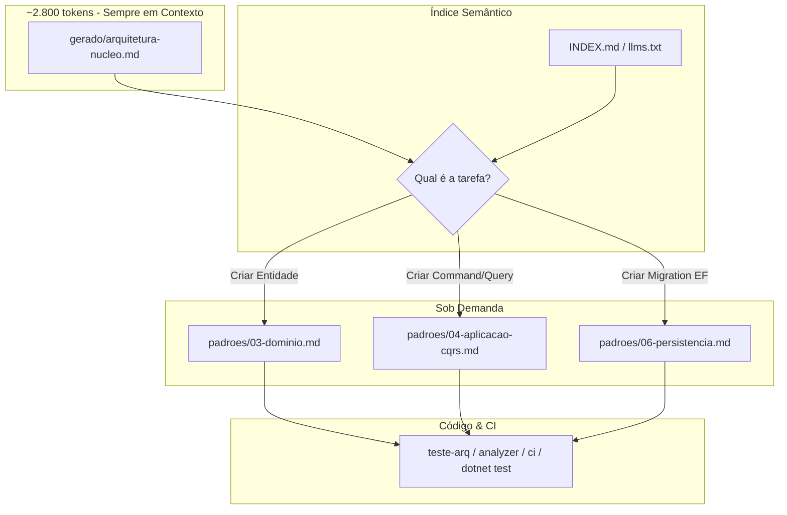

[🏠 TudoIA](../../README.md) › [📚 Documentação](../README.md) › 📜 Consumo da Doutrina TEC pela SquadTI

# 📜 Consumo da Doutrina TEC pela SquadTI

> **Público:** quem mantém a ligação entre a SquadTI e a Doutrina TEC. Explica como as regras chegam aos agentes, o orçamento de tokens e a falha fechada.

## 📑 Sumário

- [1. O Conceito de Doutrina para Inteligência Artificial](#1-o-conceito-de-doutrina-para-inteligência-artificial)
- [2. A Melhor Forma de Consumo de Conteúdo Voltado para IA (Protocolo em 4 Camadas)](#2-a-melhor-forma-de-consumo-de-conteúdo-voltado-para-ia-protocolo-em-4-camadas)
- [3. Estrutura de Diretórios da Doutrina TEC](#3-estrutura-de-diretórios-da-doutrina-tec)
- [4. Como a Squad Consome a Doutrina no LangGraph](#4-como-a-squad-consome-a-doutrina-no-langgraph)

---


## 1. O Conceito de Doutrina para Inteligência Artificial

A **Doutrina TEC** (a pasta apontada por `DOUTRINA_TEC`) não é uma documentação estática comum para humanos lerem sequencialmente. Ela foi concebida sob uma arquitetura de governança **AI-Ready**, desenhada especificamente para consumo por agentes de IA com **orçamento controlado de tokens** e **regras acionáveis e verificáveis**.

> **Regra de Ouro da Doutrina:**
> *"Se o código gerado por qualquer agente e a Doutrina divergirem, **a Doutrina vence** e o código é corrigido, ou a Doutrina é alterada formalmente por um novo ADR. Nunca os dois divergindo em silêncio."*

---

## 2. A Melhor Forma de Consumo de Conteúdo Voltado para IA (Protocolo em 4 Camadas)

Carregar 14 arquivos completos de documentação técnica em todo prompt de IA é um anti-padrão grave: esgota a janela de contexto de modelos locais (Ollama), custa caro, gera dispersão de atenção (*Lost in the Middle*) e aumenta a taxa de alucinação.

A Doutrina TEC resolve isso implementando o **Consumo Hierárquico Just-in-Time (JIT)** em 4 camadas:



### Camada 1: Núcleo Permanente (`gerado/arquitetura-nucleo.md`)
- **Tamanho:** ~2.800 tokens só da família `arquitetura` (estimativa caracteres/4; orçamento rígido de 3.000 por família, validado no CI da doutrina); com `ia` e `ecossistema` o contexto fixo passa de ~4.400.
- **Quando usar:** injetado no prompt dos papéis que usam modelo, conforme o perfil do papel (`gerado/perfis/<papel>.json`, ver seção 4).
- **Conteúdo:** Contém apenas as regras `MUST · núcleo` inegociáveis (ex: `ARQ-PRI-01`, `ARQ-EST-01`, `ARQ-DOM-02`, `ARQ-APL-03`).

### Camada 2: Roteamento Semântico (`INDEX.md` ou `llms.txt`)
- Cada padrão possui metadados em frontmatter com a diretriz **`leia-quando`** e **`palavras-chave`**.
- O orquestrador cruza a tarefa com o `INDEX.md` e descobre exatamente qual padrão deve ser aberto.
  - Exemplo: Tarefa *"Criar endpoint de cadastro"* $\rightarrow$ Carrega apenas `04-aplicacao-cqrs.md` e `05-api-http.md`.

### Camada 3: Slicing de Regras (Somente o bloco `## Regras`)
- O agente não lê introduções históricas, contexto ou discussões no momento de codificar.
- O gerador da Doutrina extrai **exclusivamente o bloco `## Regras`** de cada padrão; a SquadTI não parseia Markdown, consome só o JSON gerado (seção 4).
- Justificativas e ADRs só são abertos se houver ambiguidade no requisito.

### Camada 4: Citação de IDs e Validação Fechada
- O agente cita os IDs das regras aplicadas na seção "Regras aplicadas" do relatório de entrega. **Não** em comentários de código: comentário explica o porquê (ARQ-EST-12), e citar ID é fácil de um modelo fingir.
- A conformidade é medida, não declarada: regras com `evidencia:` apontam o teste real do TemplateTEC (ex.: `ConvencoesTests.TodoCommand_TemValidador`), que o `dotnet test` executa. O QA reprova a entrega se o comando sair com código diferente de 0.

### Privacidade
- O orquestrador usa por padrão o modelo `tudoia-local` (somente Ollama). Qualquer modelo que não seja `tudoia-local`, `tudoia-local-estrito` ou `local/*` (inclui o roteador `tudoia-auto`) pode mandar código e esquema para a nuvem e é recusado a menos que `TUDOIA_PERMITIR_NUVEM=1` (CLI) ou `consentimento_nuvem` (API). Ver `perfis.py`.

### Rastreabilidade e falha fechada
- `gerado/manifesto.json` dá versão e hash da doutrina. A primeira etapa grava `doutrina_versao`/`doutrina_hash` no `SquadState`; se mudarem durante a tarefa, a tarefa aborta.
- Sem doutrina legível (variável `DOUTRINA_TEC` ausente, pasta errada, JSON corrompido) a Squad não roda. Nada de rodar um agente sem regras.
- Agentes **não escrevem** na Doutrina: mudança de regra entra por PR humano (ver `GOVERNANCA.md` da doutrina). ADR de projeto vai no repositório do projeto.

---

## 3. Estrutura de Diretórios da Doutrina TEC

A estrutura canônica da Doutrina está organizada em famílias. A árvore mostra só a família `arquitetura` e é um resumo; a Doutrina vive em repositório próprio, fora deste, e esta árvore **não foi conferida** contra ele na revisão de 2026-11-03 (a contagem de 14 padrões, ADR 0001 a 0012 e ~2.800 tokens vêm do texto original). O que o código da SquadTI exige está na seção 4.

```text
<raiz-da-doutrina>/
├── INDEX.md                     # Índice geral com metadados 'leia-quando'
├── llms.txt                     # Manifesto padronizado para IA
├── AGENTS.md                    # Regras de postura para agentes
├── GOVERNANCA.md                # Como evoluir regras e ADRs
├── gerado/
│   ├── arquitetura-nucleo.md   # [CAMADA 1] Núcleo inegociável (~2,8k tokens)
│   ├── arquitetura-regras.md   # Todas as regras compiladas para auditoria
│   ├── arquitetura.json        # Regras + por_papel + evidência, para máquina
│   └── manifesto.json          # Versão e hash da doutrina
├── familias/
│   └── arquitetura/
│       ├── padroes/            # 14 padrões técnicos detalhados
│       │   ├── 01-principios-e-postura.md
│       │   ├── 02-estrutura-e-camadas.md
│       │   ├── 03-dominio.md
│       │   ├── 04-aplicacao-cqrs.md
│       │   ├── 05-api-http.md
│       │   ├── 06-persistencia.md
│       │   ├── 07-seguranca.md
│       │   ├── 08-mensageria-e-eventos.md
│       │   ├── 09-observabilidade-e-operacao.md
│       │   ├── 10-testes.md
│       │   ├── 11-build-ci-cd.md
│       │   ├── 12-ambiente-local.md
│       │   ├── 13-template-e-geracao.md
│       │   └── 14-checklists.md
│       └── adr/                # Decisões duráveis numeradas (ADR 0001 a 0012)
├── skills/
│   └── doutrina-tec/
│       └── SKILL.md            # Skill de roteamento da doutrina
└── tools/
    └── doutrina.py             # Validador e gerador dos artefatos (Python stdlib)
```

---

## 4. Como a Squad Consome a Doutrina no LangGraph

O módulo [`doutrina_tec.py`](../../runtime/squadti/orquestrador/doutrina_tec.py), usado por [`nodes.py`](../../runtime/squadti/orquestrador/nodes.py), consome só os artefatos gerados, sem parsear Markdown:

1. **Núcleo e perfil do papel:** cada papel lê `gerado/perfis/<papel>.json` (`nucleo_sugerido` = famílias do papel); sem perfil, o papel não trabalha (falha fechada). O núcleo `gerado/<familia>-nucleo.md` dessas famílias entra no prompt. `FAMILIAS_PADRAO` (`arquitetura`, `ia`, `ecossistema`) só vale quando não há papel. Para forçar as mesmas famílias em todos os papéis, use `DOUTRINA_FAMILIAS` (lista separada por vírgula) ou `doutrina_familias` no `stack_config`; nome inválido ou família ausente derruba a tarefa (falha fechada). Mais famílias = mais tokens por chamada: confira a janela do modelo local, porque o gateway pode reenviar à nuvem o pedido que não couber (IA-PRV-02).
2. **Regras do papel:** `gerado/<familia>.json` → `por_papel[papel]` lista os padrões de cada família (o papel pode existir em só algumas); entram só as regras deles que não são de núcleo, MUST primeiro e depois SHOULD, até o orçamento de `DOUTRINA_REGRAS_MAX_TOKENS` (padrão 12000; valor inválido volta ao padrão). O roteamento mora na doutrina (front-matter `papeis`), não no orquestrador.
3. **Evidência:** `evidencias()` mapeia ID → teste do template (provas em outros repositórios, `fonte:caminho#trecho`, não entram); o QA relata no `qa_report.json` quais regras têm teste.
4. **Versão:** `verificar_versao()` grava/compara `manifesto.json` no estado.
5. **Caminho:** `DOUTRINA_TEC` (ambiente) tem precedência sobre `architecture_source_path` do `stack_config`. Não há caminho fixo no código.

A saída dos modelos só vira arquivo por [execucao.py](../../runtime/squadti/orquestrador/execucao.py) (caminho validado, área permitida, limite de tamanho), e comandos rodam sem shell com executável permitido e timeout.

Testes: o `pyproject.toml` de `runtime/squadti` configura `pytest` (`testpaths = ["orquestrador/tests"]`); rode `uv run pytest` nessa pasta. A suíte raiz `tests/runtime` roda a partir da raiz do repositório.

---

[🏠 README](../../README.md) · ⬅️ [Guia de implementação com LangGraph e TudoIA](03-guia-de-implementacao.md) · [Sistema web da SquadTI (proposta)](06-sistema-web-squadti.md) ➡️
