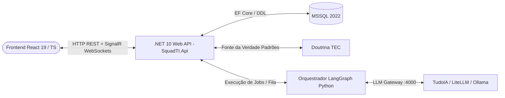

[🏠 TudoIA](../../README.md) › [📚 Documentação](../README.md) › 🌐 Sistema web da SquadTI (proposta)

# 🌐 Sistema web da SquadTI (proposta)

> **Público:** quem decide o futuro portal da SquadTI. **Proposta não implementada**: nada deste documento existe em `runtime/squadti/`.

## 📑 Sumário

- [1. Visão Geral da Arquitetura do Sistema Web](#1-visão-geral-da-arquitetura-do-sistema-web)
- [2. Módulos Funcionais do Sistema Web](#2-módulos-funcionais-do-sistema-web)
- [3. Modelo de Dados Relacional (MSSQL)](#3-modelo-de-dados-relacional-mssql)
- [4. Endpoints Principais da API (.NET 10)](#4-endpoints-principais-da-api-net-10)
- [5. Próximos Passos para Materialização do Sistema Web](#5-próximos-passos-para-materialização-do-sistema-web)

---


> [!WARNING]
> **Proposta não implementada.** Revisado em 2026-11-03 contra `runtime/squadti/`: não existe backend .NET, SignalR, banco `squad` nem os endpoints `/api/v1/...` abaixo. A SquadTI é hoje controlada pela CLI (`main.py`) e pela API HTTP do orquestrador (`api.py`, porta padrão 8790, token em `TUDOIA_SQUADTI_TOKEN`), e o painel do TudoIA a consome (ver [SquadTI (componente)](../componentes/squadti.md)). Os nomes de agente e de modelo citados (ex.: `qwen2.5-coder:32b`, `tudoia-auto`, "9 agentes") são do desenho original; o orquestrador usa um modelo único por tarefa e 11 nós.

Este documento especifica a concepção completa do **Sistema Web de Gestão da Squad TI (SquadTI Web Portal)**. O sistema permite parametrizar os agentes de IA, registrar solicitações com entrevistas interativas de requisitos e acompanhar a execução do grafo LangGraph em tempo real.

---

## 1. Visão Geral da Arquitetura do Sistema Web

O sistema adota os padrões corporativos de Doutrina TEC:
- **Backend:** .NET 10 Web API estruturada em Clean Architecture com CQRS (`TemplateTEC`).
- **Comunicação em Tempo Real:** **ASP.NET Core SignalR** para streaming do grafo, logs de terminal e mensagens do analista de requisitos.
- **Frontend:** React 19 + TypeScript + Vite + Tailwind CSS + Radix UI / shadcn + TanStack Query.
- **Persistência:** Microsoft SQL Server (MSSQL 2022) via Entity Framework Core.
- **Motor de Orquestração:** Serviço Python LangGraph integrado ao TudoIA (`localhost:4000`), acionado pelo backend via API/gRPC ou mensageria.



---

## 2. Módulos Funcionais do Sistema Web

### Módulo 1: Painel de Parametrização dos Agentes (`/configuracoes/agentes`)
Permite configurar o comportamento de cada agente da Squad sem alterar código:
- **Seleção de Modelo por Agente:** Atribuir modelo do TudoIA (ex: `qwen2.5-coder:32b`, `llama3.3:70b`, `tudoia-auto`).
- **Edição de System Prompts:** Ajustar diretrizes de persona e regras locais.
- **Configuração de Hiperparâmetros:** Temperatura, Top-P, max tokens e retry bounds.
- **Fonte da Verdade:** Input configurável para o caminho da Doutrina TEC (pasta apontada por `DOUTRINA_TEC`).
- **Ferramentas Ativas:** Toggle de permissões de terminal, escrita em disco e scanners de segurança.

### Módulo 2: Portal de Solicitações & Elicitação Interativa (`/solicitacoes/nova`)
- **Abertura de Demanda:** O usuário insere o briefing inicial da demanda (ex: *"Módulo de Conciliação Bancária"*).
- **Chat Interativo com o Analista de Requisitos:** O agente faz perguntas ativas em tempo real no chat da tela para esclarecer regras de negócio, fluxos de exceção e casos de borda.
- **Visualizador de `BUSINESS_SPEC.md`:** Visualização formatada da especificação com cenários Gherkin (Dado-Quando-Então).
- **Botão de Aprovação de Requisitos:** O usuário clica em *"Aprovar Especificação de Negócios"*, liberando o avanço do grafo para a Arquitetura.

### Módulo 3: Cockpit de Execução em Tempo Real (`/execucoes/{id}`)
- **Visualização do Grafo LangGraph (DAG Interativo):** Nós coloridos indicando o status atual (`Aguardando`, `Executando`, `Aprovado`, `Falha`, `Interrompido`).
- **Streaming de Logs (Console Output):** Logs ao vivo de compilação (`dotnet build`), execução de testes (`dotnet test`) e scanners de segurança.
- **Visualizador de Diffs e Artefatos:** Abas com prévia de código gerado, diagramas Mermaid renderizados, contratos OpenAPI e scripts SQL.

### Módulo 4: Central de Governança & Human-in-the-Loop (`/governanca`)
- **Fila de Aprovações Pendentes:** Checkpoints onde o sistema pausou para validação humana (Aprovação de Requisitos, Aprovação de Arquitetura, Aprovação de Migrações de Banco).
- **Histórico de Auditoria:** Rastreabilidade completa de tokens consumidos, tempo de execução e conformidade com os checklists da Doutrina TEC (família Arquitetura).

---

## 3. Modelo de Dados Relacional (MSSQL)

O banco de dados do sistema web utiliza o schema `squad`:

```sql
CREATE SCHEMA squad;
GO

-- Configuração dos Agentes
CREATE TABLE squad.AgenteConfiguracao (
    Id UNIQUEIDENTIFIER PRIMARY KEY DEFAULT NEWSEQUENTIALID(),
    IdentificadorAgente NVARCHAR(50) NOT NULL UNIQUE, -- 'analista_requisitos', 'arquiteto', 'dev_backend'
    NomeExibicao NVARCHAR(100) NOT NULL,
    ModeloTudoIA NVARCHAR(100) NOT NULL DEFAULT 'tudoia-auto',
    Temperatura DECIMAL(3,2) NOT NULL DEFAULT 0.1,
    SystemPrompt NVARCHAR(MAX) NOT NULL,
    Ativo BIT NOT NULL DEFAULT 1,
    DataAtualizacao DATETIMEOFFSET NOT NULL DEFAULT SYSDATETIMEOFFSET()
);

-- Projetos
CREATE TABLE squad.Projeto (
    Id UNIQUEIDENTIFIER PRIMARY KEY DEFAULT NEWSEQUENTIALID(),
    Nome NVARCHAR(100) NOT NULL,
    CaminhoDiretorio NVARCHAR(500) NOT NULL,
    FonteVerdadeArquitetura NVARCHAR(500) NOT NULL DEFAULT '<caminho-da-doutrina>',
    StackBackend NVARCHAR(50) NOT NULL DEFAULT 'dotnet10',
    StackFrontend NVARCHAR(50) NOT NULL DEFAULT 'react19_ts',
    EngineBanco NVARCHAR(50) NOT NULL DEFAULT 'mssql',
    DataCriacao DATETIMEOFFSET NOT NULL DEFAULT SYSDATETIMEOFFSET()
);

-- Demandas / Tarefas
CREATE TABLE squad.Demanda (
    Id UNIQUEIDENTIFIER PRIMARY KEY DEFAULT NEWSEQUENTIALID(),
    ProjetoId UNIQUEIDENTIFIER NOT NULL FOREIGN KEY REFERENCES squad.Projeto(Id),
    Titulo NVARCHAR(200) NOT NULL,
    BriefingInicial NVARCHAR(MAX) NOT NULL,
    Status NVARCHAR(50) NOT NULL, -- 'ELICITACAO', 'AGUARDANDO_APROVACAO', 'EM_CONSTRUCAO', 'CONCLUIDO'
    BusinessSpecMarkdown NVARCHAR(MAX) NULL,
    PrdTecnicoMarkdown NVARCHAR(MAX) NULL,
    OpenApiYaml NVARCHAR(MAX) NULL,
    DataCriacao DATETIMEOFFSET NOT NULL DEFAULT SYSDATETIMEOFFSET()
);

-- Execuções e Checkpoints do LangGraph
CREATE TABLE squad.ExecucaoGrafo (
    Id UNIQUEIDENTIFIER PRIMARY KEY DEFAULT NEWSEQUENTIALID(),
    DemandaId UNIQUEIDENTIFIER NOT NULL FOREIGN KEY REFERENCES squad.Demanda(Id),
    ThreadId NVARCHAR(100) NOT NULL,
    NoAtual NVARCHAR(50) NOT NULL,
    StatusExecucao NVARCHAR(50) NOT NULL, -- 'RODANDO', 'PAUSADO_CHECKPOINT', 'SUCESSO', 'ERRO'
    TentativasAutoCura INT NOT NULL DEFAULT 0,
    DataInicio DATETIMEOFFSET NOT NULL DEFAULT SYSDATETIMEOFFSET(),
    DataFim DATETIMEOFFSET NULL
);

-- Logs e Mensagens de Execução
CREATE TABLE squad.LogExecucao (
    Id BIGINT IDENTITY(1,1) PRIMARY KEY,
    ExecucaoId UNIQUEIDENTIFIER NOT NULL FOREIGN KEY REFERENCES squad.ExecucaoGrafo(Id),
    Agente NVARCHAR(50) NOT NULL,
    TipoMensagem NVARCHAR(30) NOT NULL, -- 'INFO', 'PROMPT', 'LOG_SHELL', 'ERRO', 'TESTE'
    Conteudo NVARCHAR(MAX) NOT NULL,
    DataHora DATETIMEOFFSET NOT NULL DEFAULT SYSDATETIMEOFFSET()
);
```

---

## 4. Endpoints Principais da API (.NET 10)

### Configurações de Agentes:
- `GET /api/v1/agentes`: Lista configurações atuais dos 9 agentes.
- `PUT /api/v1/agentes/{id}`: Atualiza modelo, prompt ou parâmetros do agente.
- `GET /api/v1/configuracoes/fonte-verdade`: Valida se o diretório da Doutrina TEC existe e lista os padrões disponíveis.

### Demandas & Elicitação:
- `POST /api/v1/demandas`: Cria nova solicitação de desenvolvimento.
- `POST /api/v1/demandas/{id}/mensagens`: Envia resposta do usuário para pergunta do Analista de Requisitos.
- `POST /api/v1/demandas/{id}/aprovar-requisitos`: Aprova o `BUSINESS_SPEC.md` e dispara a transição no grafo.

### Execução e Cockpit:
- `POST /api/v1/execucoes/{demandaId}/iniciar`: Dispara o grafo LangGraph.
- `GET /api/v1/execucoes/{id}/status`: Consulta o estado atual do grafo.
- `POST /api/v1/execucoes/{id}/aprovar-checkpoint`: Libera checkpoint humano (ex: aprovação de deploy/arquitetura).

### Hub SignalR:
- `/hubs/squad-cockpit`:
  - Evento `NoIniciado(string no)`
  - Evento `LogRecebido(string agente, string log)`
  - Evento `PerguntaRequisitosRecebida(string pergunta)`
  - Evento `CheckpointRequerido(string tipoCheckpoint, object dados)`
  - Evento `ExecucaoFinalizada(bool sucesso, string relatorio)`

---

## 5. Próximos Passos para Materialização do Sistema Web

1. Gerar a estrutura de backend utilizando o template corporativo: `dotnet new tec-project -n SquadTI.Web`.
2. Criar a SPA frontend utilizando Vite + React 19 + TypeScript.
3. Conectar o serviço SignalR da API aos eventos de streaming do LangGraph.

---

[🏠 README](../../README.md) · ⬅️ [Consumo da Doutrina TEC pela SquadTI](05-fonte-da-verdade-arquitetura.md) · [Análise crítica e benchmarks da SquadTI](07-analise-critica-e-benchmarks.md) ➡️
