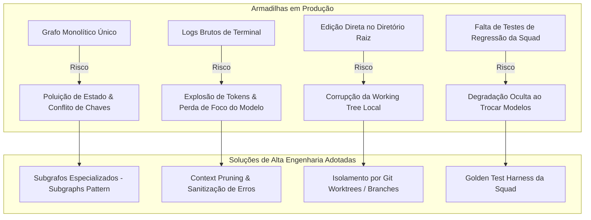

# Análise Crítica, Estado da Arte (2025/2026) e Recomendações Finais

## 1. Diagnóstico do Entendimento Atual: O que está 100% aderente

A concepção construída para a **Squad TI** atende com precisão aos objetivos centrais:
- **Papel do CHEFE:** Não atua como mero repassador de mensagens, mas como Tech Lead rigoroso que valida critérios de pronto e traduz objetivos de negócio em tarefas técnicas estruturadas.
- **Elicitação Prévia:** A inclusão do **Analista de Requisitos & Negócios** garante que premissas ocultas e regras de negócio sejam desenterradas antes de qualquer esforço de arquitetura ou código.
- **Fonte da Verdade Corporativa (Doutrina TEC):** Vinculação explícita às 14 diretrizes corporativas (Clean Architecture, CQRS, MSSQL, componentes `TEC.*`), garantindo consistência com a governança da empresa.
- **Soberania e Privacidade:** Integração com o ecossistema local **TudoIA** (LiteLLM na porta 4000 e modelos locais no Ollama), eliminando riscos de vazamento de código ou dependência de nuvem.
- **Zero Verification Theater:** O agente de QA possui mandato estrito para só aprovar entregas mediante execução real de testes no shell com exit code 0.

---

## 2. Benchmark com o Estado da Arte (Padrões da Indústria 2025/2026)

Pesquisas recentes e implementações de referência em sistemas multi-agente de engenharia de software (LangGraph em produção, SWE-agent, Devin, OpenHands e MetaGPT) revelam **4 armadilhas críticas** que ocorrem em equipes autônomas quando passam da teoria para a produção:

---

## 3. As 4 Recomendações de Engenharia para Blindar o Projeto

### Recomendação 1: Arquitetura de Subgrafos no LangGraph (Subgraphs Pattern)
- **Problema:** Um grafo plano único com 9 agentes acumulando histórico no mesmo dicionário de estado tende a vazar variáveis ou sobrescrever chaves acidentalmente.
- **Solução:** Dividir a Squad em **4 Subgrafos modulares**:
  1. `Subgrafo de Descoberta`: Usuário $\leftrightarrow$ Analista de Requisitos (gera `BUSINESS_SPEC.md`).
  2. `Subgrafo de Design`: Arquiteto $\rightarrow$ DBA (gera `PRD_TECNICO.md` + `openapi.yaml` + Migrações).
  3. `Subgrafo de Construção & Qualidade`: Dev Backend + Dev Frontend $\leftrightarrow$ QA (loop interno de auto-cura até 3x).
  4. `Subgrafo de Entrega`: AppSec $\rightarrow$ DevOps (Docker, CI/CD e relatório final).
- **Ganho:** O loop de correção de bugs do QA fica confinado ao Subgrafo de Construção, sem sujar o estado global da sprint.

### Recomendação 2: Sanitização e Pruning de Logs de Terminal (Context Pruning)
- **Problema:** Saídas completas de comandos como `dotnet build` ou `dotnet test` podem conter centenas de linhas de logs informativos. Injetar isso no prompt esgota a janela de contexto de modelos locais (Ollama) e dilui a atenção do LLM.
- **Solução:** Implementar um extrator cirúrgico de erros:
  - Para .NET: Filtrar apenas linhas que contenham `error CSxxxx` ou `[FAIL]`.
  - Para React: Filtrar apenas erros do compilador TypeScript (`TSxxxx`) ou asserções do Vitest.
  - Para SQL: Filtrar mensagens do engine de banco ou avisos do `sqlfluff`.

### Recomendação 3: Isolamento de Espaço de Trabalho (Git Worktrees / Branch por Demanda)
- **Problema:** Se os agentes escreverem código diretamente na pasta de trabalho ativa do desenvolvedor, um código com erro de compilação ou teste quebrado pode impedir o usuário humano de continuar trabalhando.
- **Solução:** O orquestrador deve criar automaticamente uma branch isolada para a tarefa (`git checkout -b squad/TASK-xxx`) ou usar **Git Worktrees**. O merge para a branch principal (`main` ou `develop`) só é realizado após aprovação formal no Checkpoint Humano.

### Recomendação 4: Conjunto de Testes Dourados da Squad (Golden Dataset Harness)
- **Problema:** Quando você trocar um modelo local no TudoIA (ex: atualizar de `qwen2.5-coder:14b` para `qwen2.5-coder:32b` ou testar um novo modelo de raciocínio), como saber se a Squad não piorou em gerar código no padrão `TemplateTEC`?
- **Solução:** Criar um conjunto de 3 testes fixos (Golden Tasks):
  - *Teste 1:* Criar um CRUD de Entidade com Aggregate Root e `Result` pattern.
  - *Teste 2:* Gerar um endpoint com idempotência e paginação no padrão corporativo.
  - *Teste 3:* Gerar script de migração MSSQL com índice filtrado.
  - Executar essas tarefas e validar se os analisadores de arquitetura corporativos passam com 100% de conformidade.

---

## 4. Parecer de Conclusão e Prontidão para Início

A documentação gerada em este repositório cobre **100% dos requisitos funcionais, de negócio, de segurança e de arquitetura** estabelecidos.

Com a incorporação das recomendações acima:
1. O ecossistema está **à prova de vazamento de contexto** e **otimizado para modelos locais**.
2. A separação de responsabilidades segue o estado da arte da engenharia de software (Subgrafos + Bounded Loops).
3. O projeto web especificado em [06_SISTEMA_WEB_SQUADTI.md](file:///D:/SquadTI/06_SISTEMA_WEB_SQUADTI.md) possui modelo relacional, arquitetura de eventos via SignalR e Clean Architecture .NET 10 prontos para execução.
