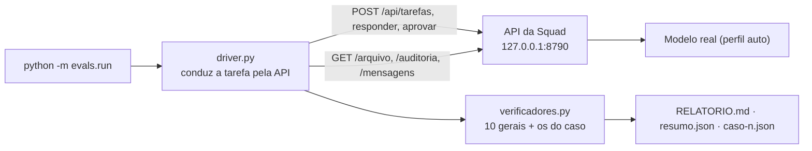

[🏠 TudoIA](../../README.md) › [📚 Documentação](../README.md) › 🧪 Evals da SquadTI

# 🧪 Evals da SquadTI (qualidade real de ponta a ponta)

> Para quem mantém a SquadTI ou troca o modelo/stack e quer saber se a entrega piorou. Responde: como rodar os casos dourados com modelo real, o que cada verificador confere, como ler `pass@k` e `pass^k` e o que os evals **não** provam.
> Código em [`runtime/squadti/evals/`](../../runtime/squadti/evals/); a Squad que eles exercitam está em [SquadTI (componente)](../componentes/squadti.md).

## 📑 Sumário

- [🎯 Visão geral](#-visão-geral)
- [🚀 Uso](#-uso)
- [⚙️ Opções](#️-opções)
- [📦 Os casos dourados](#-os-casos-dourados)
- [✅ Verificadores](#-verificadores)
- [📊 Como ler o resultado](#-como-ler-o-resultado)
- [❌ Erros / diagnóstico](#-erros--diagnóstico)
- [🛡️ Segurança e custo](#️-segurança-e-custo)
- [❓ Perguntas frequentes](#-perguntas-frequentes)

## 🎯 Visão geral

Os testes unitários (`orquestrador/tests`) provam que o orquestrador funciona com modelos falsos. Os evals respondem à outra pergunta: **com modelo real, a Squad entrega código bom?**
Eles rodam briefings sintéticos pela API HTTP da Squad, deixam o fluxo andar de verdade e conferem o resultado com verificadores em código (stdlib, sem modelo).



*C4 enxuto: o driver só fala HTTP com a API; ele não importa nada do orquestrador.*

> [!WARNING]
> **MODO EVAL**: o driver aprova sozinho a especificação e o release. É uma aprovação automática de TESTE, registrada em cada resultado
> (`modo_eval`, `aprovacoes_automaticas`) e no topo do relatório. Nada é commitado nem publicado, mas ninguém revisou a entrega. Cada execução consome tokens
> do perfil `auto` (pode usar nuvem; o driver envia `consentimento_nuvem: true`). Os briefings são sintéticos: sem dado real.

## 🚀 Uso

A imagem copia `orquestrador/` e `evals/` para `/app`. O token já está no ambiente do container (`TUDOIA_SQUADTI_TOKEN`); o driver o lê de lá e nunca por argumento.

```powershell
# todos os casos, uma vez
docker exec -e PYTHONPATH=/app squadti python -m evals.run --saida /dados/evals/resultados

# um caso, três vezes (pass@3 e pass^3)
docker exec -e PYTHONPATH=/app squadti python -m evals.run --caso d-pedidos --k 3 --saida /dados/evals/resultados
```

Para ler os resultados no host: `docker cp squadti:/dados/evals/resultados ./resultados`. Fora do container (API publicada em `127.0.0.1:8790`), a partir de `runtime/squadti`:
`$env:TUDOIA_SQUADTI_TOKEN="<token>"; uv run python -m evals.run`.

A Squad executa uma tarefa por vez, então as execuções são em série: um caso leva de dezenas de minutos a ~2 h. Se a Squad estiver ocupada, o driver espera a vez (`409 ocupado`) dentro do prazo do caso.

> [!IMPORTANT]
> Os verificadores `sem_achados_graves` e `portoes_verdes` exigem os relatórios `hacker_report.json` e `macaco_report.json`, que só existem se a **validação em execução** rodou. Ela precisa do cliente `docker` no `PATH` de quem roda a Squad, e o `Dockerfile` da SquadTI não o instala
> (ver [Segurança](../componentes/squadti.md#️-segurança)). Sem Docker a validação é pulada e esses dois verificadores reprovam por relatório ausente. Confirme isso antes de interpretar uma rodada.

## ⚙️ Opções

| Opção | Padrão | Efeito |
|---|---|---|
| `--caso ID` (repetível) | todos | Roda só os casos indicados; id inexistente sai com `2` e lista os disponíveis |
| `--k N` | `1` | Execuções por caso (1 a 20), para `pass@k` e `pass^k` |
| `--saida PASTA` | `SQUADTI_EVALS_SAIDA` ou `evals/resultados` | Onde gravar as rodadas |
| `--url` | `TUDOIA_SQUADTI_URL` ou `http://127.0.0.1:8790` | Só loopback (`127.0.0.1` ou `localhost`, com porta) |
| `--casos-dir` | `evals/casos` do pacote | Pasta dos JSON dos casos |
| `--timeout-s` | o `timeout_s` do caso | Prazo global por execução |
| `--intervalo-s` | `5` | Intervalo do polling do estado da tarefa |

Variável obrigatória: `TUDOIA_SQUADTI_TOKEN` (só do ambiente). Código de saída: `0` todos os casos passaram em todas as execuções, `1` algum falhou, `2` uso ou configuração inválidos (token ausente, URL fora do loopback, caso malformado, API fora do ar).

## 📦 Os casos dourados

Em `evals/casos/*.json` (o `id` do caso é o campo `id`, não o nome do arquivo):

| Caso (`id`) | Arquivo | Complexidade | O que exercita |
|---|---|---|---|
| `a-crud-tarefas` | `a-crud-tarefas.json` | 1 | CRUD, validação (título obrigatório) |
| `b-catalogo` | `b-catalogo-produtos.json` | 2 | regra de preço (Decimal), paginação, SKU único |
| `c-autenticada` | `c-api-autenticada.json` | 3 | token Bearer, papéis admin/usuário, escopo por dono (IDOR: B acessa nota de A deve dar 404), limite de login |
| `d-pedidos` | `d-fila-pedidos.json` | 4 | idempotência por `Idempotency-Key`, máquina de estados (409), concorrência |

Todos usam a stack fixa `python` (`validar_caso` recusa outra) e o perfil `auto`. Cada JSON traz `briefing`, `respostas_da_entrevista`, `limites` (`tokens`, `tempo_s`: o que o verificador confere), `orcamento` (o teto que a Squad
recebe, 1,5 vez maior que o limite, para o verificador, e não a parada da Squad, acusar o estouro), `timeout_s`, `cobertura_minima` e `verificadores_extra`.

| Caso | Limite de tokens / tempo | Orçamento da Squad (tokens / tempo / chamadas) |
|---|---|---|
| `a-crud-tarefas` | 1.500.000 / 3600 s | 2.250.000 / 5400 s / 300 |
| `b-catalogo` | 2.000.000 / 5400 s | 3.000.000 / 8100 s / 400 |
| `c-autenticada` | 2.500.000 / 7200 s | 3.750.000 / 10800 s / 500 |
| `d-pedidos` | 2.500.000 / 7200 s | 3.750.000 / 10800 s / 500 |

O driver envia **todas** as respostas fixas numa única mensagem quando a tarefa pausa em `aguardando_respostas`; se o analista perguntar de novo, responde "adote o padrão da Doutrina" e, após 3 rodadas, encerra o caso (`entrevista_nao_convergiu`).
Aprova a especificação e o release quando a tarefa pausa, no máximo 2 vezes cada (`aprovacao_em_loop`).

## ✅ Verificadores

Funções puras `(workspace, api, caso) -> {nome, passou, detalhe}` em `evals/verificadores.py`. Falham fechado: relatório ausente, corrompido, grande demais ou fora do workspace reprova; nenhum levanta exceção.

| Verificador | Passa quando |
|---|---|
| `desfecho_concluida` | `situacao.estado == "concluida"` |
| `build_e_testes` | `qa_report.json` tem `backend-build` e `backend-testes` com código 0 |
| `cobertura` | linha e ramo >= `cobertura_minima` do caso (padrão 90) e o gate não foi desligado (`minimo` 0 reprova) |
| `sem_achados_graves` | `hacker_report.json` e `macaco_report.json` existem e não têm achado CRITICO/ALTO |
| `portoes_verdes` | `tests/review/security/devops_passed` no estado; `aprovado: true` em QA, AppSec e DevOps; hacker, macaco e carga existem e não declaram `aprovado: false` |
| `arquivos_obrigatorios` | README, PRD técnico, OpenAPI, Dockerfile, `.gitignore`, `docs/proveniencia.json` presentes e não vazios |
| `sem_segredos` | nenhum padrão de segredo no workspace (só tipo e `arquivo:linha` no resultado, nunca o valor) |
| `proveniencia_doutrina` | versão e hash da Doutrina em `docs/proveniencia.json` = os que a tarefa usou |
| `limites_tokens_tempo` | `totais.tokens` (auditoria) e a duração medida pelo driver <= `limites` do caso |
| `conversa_com_chefe` | há mensagem do usuário e do CHEFE em `/mensagens` |

Verificadores por caso: `verificadores_extra` com `tipo: "conteudo_contem"` (`glob`, `termos_todos`, `termos_qualquer`), por exemplo o OpenAPI do caso `d` precisa conter `Idempotency-Key`.
Eles conferem presença de elementos, não correção do comportamento: uma suíte que *cita* 404 não prova que o IDOR está fechado (isso é papel dos relatórios hacker/macaco e de revisão humana).

## 📊 Como ler o resultado

`<saida>/<rodada>/` (rodada = `AAAA-MM-DD_HHMMSS`):

- `RELATORIO.md`: tabela por caso (passou, pass@k, pass^k, verificadores que falharam, tokens médios, duração média, nós mais lentos), motivos de parada, detalhe das falhas e a **comparação com a rodada anterior**.
- `<caso>-<n>.json`: resultado de uma execução (desfecho, motivo, verificadores, tokens, duração, aprovações automáticas).
- `<caso>-<n>/workspace/`: cópia dos arquivos coletados por `/arquivo` (a API já omite linhas com padrão de segredo; o driver ainda troca o token por `***`).
- `resumo.json`: usado para comparar com a próxima rodada.

**pass@k** = alguma das k execuções passou (capacidade). **pass^k** = todas passaram (confiabilidade; é o número que importa para confiar na Squad sem supervisão).
Regressão = caso que passava em todas as execuções e agora falha, ou tokens/duração médios +30% sobre a rodada anterior.

## ❌ Erros / diagnóstico

Desfechos de parada (campo `desfecho` do resultado):

| Desfecho | Causa | Ação |
|---|---|---|
| `escalada` | Orçamento, estagnação, gate do CHEFE ou QA/AppSec/DevOps bloqueando | Leia `motivo` e `docs/chefe/ESCALADA.md` no workspace coletado |
| `erro_de_execucao` | A execução da Squad falhou (gateway, chave, Doutrina, saída do modelo inválida) | O `motivo` traz a causa; veja `docker logs squadti` |
| `erro_de_api` | A API respondeu erro ou ficou fora do ar | Veja se o container está saudável |
| `timeout` | Passou o prazo global do caso | Suba `--timeout-s` ou troque o modelo |
| `entrevista_nao_convergiu` | O analista seguiu perguntando após 3 respostas | Ajuste `respostas_da_entrevista` do caso |
| `aprovacao_em_loop` | A tarefa voltou a pedir aprovação depois de 2 aprovações | Defeito do fluxo; reporte com o `RELATORIO.md` |
| `estado_inesperado` | Estado sem execução em andamento e sem pausa | Veja a situação da tarefa na API |
| `erro_do_driver` | Defeito do próprio driver (a rodada continua) | Reporte o `motivo` |

Outros sintomas:

| Sintoma | Causa | Ação |
|---|---|---|
| `sem_achados_graves` e `portoes_verdes` reprovam com "arquivo ausente" | A validação em execução foi pulada (sem Docker) | Ver o aviso em [Uso](#-uso) |
| Sai com `2`: "token ausente" | `TUDOIA_SQUADTI_TOKEN` fora do ambiente | Rode dentro do container ou exporte a variável |
| Sai com `2`: "URL da API deve ser..." | `--url` fora do loopback | Use `http://127.0.0.1:<porta>` |
| `erro_de_api` com a tarefa inexistente | A execução falhou antes do primeiro checkpoint (p.ex. modelo recusado), e a API responde 404 | O driver espera até 10 min; o motivo está no log do container |

## 🛡️ Segurança e custo

- O token vem só do ambiente e é removido de tudo que o driver escreve ou levanta como erro; só loopback; todo pedido HTTP tem prazo; `GET` é repetido em falha transitória e `POST` nunca.
- O perfil `auto` pode mandar código e esquema sintéticos para a nuvem: use briefings sem dado real (os dos casos são sintéticos).
- Cada execução gasta tokens (os limites dos casos chegam a milhões). A rodada completa com `--k 3` pode custar dezenas de milhões de tokens se o modelo for pago.
- O driver só aprova o que o fluxo pede (a especificação e o release) e nunca contorna escalada nem portão.

## ❓ Perguntas frequentes

**Os evals entram no CI?** Não. Precisam de modelo real, da API no ar e de muito tempo. A suíte `orquestrador/tests/test_evals.py` testa o próprio driver e os verificadores com a API simulada.

**Os relatórios `hacker/macaco/carga` têm formato fixo?** Sim, na Squad atual (`achados` com `severidade`, mais `aprovado`). O leitor dos verificadores segue tolerante de propósito (aceita `severidade`/`severity` em qualquer nível e resumos `{"ALTO": n}`); o comentário no topo de `verificadores.py` que diz o contrário ficou defasado.

**Os evals substituem revisão humana?** Não. Não testam o comportamento do código gerado além do que a própria Squad executa.

---

[🏠 README](../../README.md) · ⬅️ [Análise crítica e benchmarks](07-analise-critica-e-benchmarks.md) · [Livro de Lições](licoes.md) ➡️
