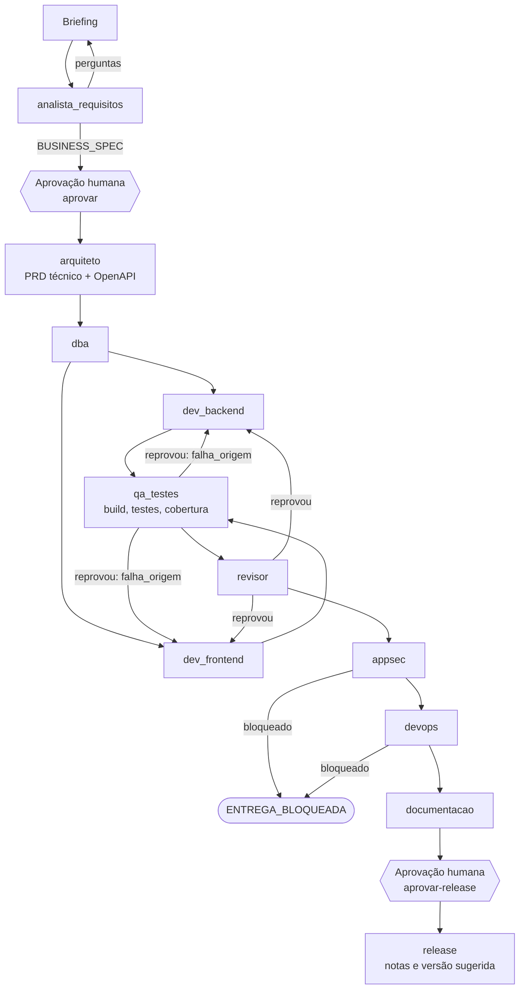

<div align="center">


[🏠 Tudo em Código](https://github.com/tudoemcodigo) › [🧠 TudoIA](https://github.com/tudoemcodigo/TudoIA) › 🤖 SquadTI

# 🤖 SquadTI

**Uma squad de agentes de IA que leva uma demanda do briefing à entrega: requisitos, arquitetura, banco, backend, frontend, testes, revisão, segurança, infraestrutura, documentação e release, orquestrada em LangGraph, governada pela Doutrina TEC e rodando por padrão em modelo local.**

[](https://github.com/tudoemcodigo/TudoIA/actions/workflows/ci.yml)
[](pyproject.toml)
[](orquestrador/graph.py)
[](https://github.com/tudoemcodigo/Doutrina)
[](#-privacidade-e-modelo)
[](../../LICENSE)

</div>

> [!NOTE]
> A SquadTI passou a viver dentro do [TudoIA](https://github.com/tudoemcodigo/TudoIA) (`runtime/squadti/`), que é agora o dono do código. O repositório `tudoemcodigo/SquadTI` não recebe mais mudanças. A documentação de projeto está em [`docs/squadti/`](../../docs/squadti/).

## 📑 Sumário

- [✨ Por que usar](#-por-que-usar)
- [🧭 O fluxo](#-o-fluxo)
- [👥 Os agentes](#-os-agentes)
- [🚀 Início rápido](#-início-rápido)
- [⚙️ Configuração](#️-configuração)
- [📚 A Doutrina por papel](#-a-doutrina-por-papel)
- [🔒 Privacidade e modelo](#-privacidade-e-modelo)
- [🔌 API local (painel do TudoIA)](#-api-local-painel-do-tudoia)
- [🛡️ O que o orquestrador não faz](#️-o-que-o-orquestrador-não-faz)
- [🧪 Testes](#-testes)
- [📂 Estrutura](#-estrutura)
- [🚧 Limites conhecidos](#-limites-conhecidos)
- [🤝 Contribuindo](#-contribuindo)

---

## ✨ Por que usar

| Agente solto, sem governança | Com a SquadTI |
|---|---|
| Código gerado sem requisito claro, "no feeling" | O analista **entrevista** (até 4 perguntas) e gera um `BUSINESS_SPEC` em Gherkin **que você aprova** antes de qualquer desenho |
| Cada execução segue um padrão diferente | Cada agente carrega o **núcleo e as regras do seu papel** na [Doutrina TEC](https://github.com/tudoemcodigo/Doutrina); versão e hash ficam no estado, e doutrina que muda no meio **aborta** a tarefa |
| "Aprovado" sem rodar nada | O QA **executa** build e testes de verdade, exige código de saída 0 e **cobertura mínima de 90%** (linha e ramo) |
| Frontend ausente passa em silêncio | Frontend esperado e não gerado **reprova** a entrega |
| Segredo vaza para prompt e relatório | Linhas com padrão de segredo são **omitidas** antes de ir ao modelo; relatórios citam tipo e `arquivo:linha`, nunca o valor |
| O agente faz commit, tag e publica | O **release exige aprovação humana** e o orquestrador nunca roda git, tag, push ou publicação |
| Código do cliente vai para a nuvem sem aviso | **Modelo local por padrão**; nuvem só com consentimento explícito |

## 🧭 O fluxo



- **Auto-cura limitada:** QA e revisor dividem o mesmo contador; ao chegar a 3 passagens, o fluxo **escala para uma pessoa** em vez de insistir.
- **A falha vai a quem a causou:** o QA e o revisor registram `falha_origem` (`backend` ou `frontend`), e só esse agente recebe o erro para corrigir.
- **Duas pausas humanas, sem atalho:** antes do `arquiteto` e antes do `release`. O nó se recusa a rodar sem a aprovação gravada no estado, mesmo se o grafo for retomado à força.

## 👥 Os agentes

| Agente | Faz | Escreve em |
|---|---|---|
| [`analista_requisitos`](../../docs/squadti/04-agentes/analista-requisitos-negocios.md) | Entrevista e `BUSINESS_SPEC` com cenários Dado-Quando-Então | `docs/negocio/` |
| [`arquiteto`](../../docs/squadti/04-agentes/arquiteto-documentacao.md) | PRD técnico e contrato `openapi.yaml` | `docs/arquitetura/`, `contracts/` |
| [`dba`](../../docs/squadti/04-agentes/dba-dados.md) | Mapeamento de dados e dicionário (a migration é gerada pela ferramenta, não à mão) | `src/`, `docs/dados/` |
| [`dev_backend`](../../docs/squadti/04-agentes/dev-backend.md) | Backend .NET a partir do template TEC, com testes feliz e adversarial | `src/`, `tests/` |
| [`dev_frontend`](../../docs/squadti/04-agentes/dev-frontend.md) | React + TypeScript consumindo o OpenAPI | `frontend/` |
| [`qa_testes`](../../docs/squadti/04-agentes/qa-testes.md) | **Sem LLM.** Roda build e testes, mede cobertura, reprova frontend ausente | `tests/reports/` |
| [`revisor`](../../docs/squadti/04-agentes/revisor-codigo.md) | Revisa o código contra a Doutrina; veredito rígido (sem veredito válido = reprovado) | `docs/revisao/` |
| [`appsec`](../../docs/squadti/04-agentes/appsec-seguranca.md) | **Sem LLM.** Auditoria de dependências e varredura de segredos | `tests/reports/` |
| [`devops`](../../docs/squadti/04-agentes/devops-infra.md) | **Sem LLM.** CI, Dockerfile sem `latest`, actions fixadas por SHA, `.gitignore` | `tests/reports/` |
| [`documentacao`](../../docs/squadti/04-agentes/documentacao-redator.md) | `README.md` e `docs/`, sem tocar nos artefatos dos outros nós | `README.md`, `docs/` |
| [`release`](../../docs/squadti/04-agentes/release-notas.md) | **Sem LLM.** Notas de release e versão **sugerida**; nunca cria tag nem publica | `docs/release/` |

O papel de cada um, com entradas, saídas e o prompt oficial, está em [`04-agentes/`](../../docs/squadti/04-agentes/) e no [catálogo](../../docs/squadti/01-catalogo-de-agentes.md).

## 🚀 Início rápido

**Pelo TudoIA (recomendado).** A Squad roda num container isolado, porque compila e testa código escrito por modelo (MSBuild e npm executam código dele).
No instalador, marque **SquadTI**; ou, numa instalação existente:

```powershell
# .env: COMPOSE_PROFILES com squadti, e o token da API (32+ caracteres)
.\scripts\tudoia.ps1 segredos          # gera TUDOIA_SQUADTI_TOKEN se estiver vazio
.\scripts\tudoia.ps1 squadti-chave     # cria a chave virtual do LiteLLM (alias e tag squadti) e grava SQUADTI_API_KEY
.\scripts\iniciar.ps1 -ComSquadti      # constrói a imagem (~2 GB, na primeira vez) e sobe o container
```

Depois use o menu **SquadTI** do painel (`http://127.0.0.1:3100/app/#squadti`) para iniciar tarefas, responder, aprovar a especificação e o release.

O container: usuário sem root, sistema de arquivos somente leitura, sem capabilities, com teto de CPU, memória e processos,
porta só em `127.0.0.1:8790`. Escreve apenas no volume `squadti-dados` (checkpoint, `workspace/<tarefa>`, caches NuGet e npm). A Doutrina TEC vai na imagem,
numa versão (SHA) fixada no `Dockerfile` (`SQUADTI_DOUTRINA_SHA` troca). O modelo padrão é `tudoia-local-estrito`; nuvem só com consentimento por tarefa.

**Desenvolvimento (sem Docker).** Python 3.12 e [uv](https://docs.astral.sh/uv/):

```bash
cd runtime/squadti
uv sync --frozen
uv run python -W error -m pytest -q                       # testes (sem rede, sem modelo)

export DOUTRINA_TEC=/caminho/para/Doutrina               # sem doutrina legível, a Squad não trabalha
export TUDOIA_API_KEY=<chave virtual do LiteLLM>         # nunca a LITELLM_MASTER_KEY
uv run python orquestrador/main.py iniciar --tarefa TASK-001 --briefing "Cadastro de clientes com pedidos" --perfil local-estrito
```

> [!IMPORTANT]
> A chave padrão `sk-tudoia-local` é só um exemplo e o gateway a recusa. Use uma **chave virtual** limitada aos modelos de que a Squad
> precisa (`tudoia squadti-chave` cria a certa). A chave fica no `.env` (ignorado pelo git), nunca em arquivo versionado.

> [!NOTE]
> **Atenção:** o `docker.sock` do host está montado para os testes de integração (Testcontainers): isso equivale a root no host para o código gerado. Veja o aviso em
> [`docs/componentes/squadti.md`](../../docs/componentes/squadti.md) e como desfazer.
>
> O template `dotnet new tec-project` entra se a pasta do TemplateTEC for copiada para `dados/squadti-template` (ou `SQUADTI_TEMPLATE_DIR`);
> o feed privado `tec-interno` exige `TUDOIA_NUGET_USER` e `TUDOIA_NUGET_PAT` (read:packages) no `.env`.

## ⚙️ Configuração

A stack vem de um `stack_config.json` (modelo em [`orquestrador/stack_config.example.json`](orquestrador/stack_config.example.json)):

```json
{
  "project_name": "GestaoFinanceira",
  "architecture_source_path": "../Doutrina",
  "stack": {
    "backend":  { "build_command": "dotnet build --configuration Release",
                  "test_command":  "dotnet test --no-build --coverage --coverage-output-format cobertura",
                  "scaffold_command": "dotnet new tec-project -n {nome}" },
    "frontend": { "framework": "react19", "language": "typescript", "bundler": "vite",
                  "build_command": "npm run build", "test_command": "npm test" },
    "database": { "engine": "mssql", "migration_tool": "ef_core" },
    "quality":  { "coverage_min": 90 },
    "infra":    { "ci": "github", "container_runtime": "docker" }
  }
}
```

| Variável | Para quê |
|---|---|
| `DOUTRINA_TEC` | Pasta da Doutrina (tem precedência sobre `architecture_source_path`) |
| `DOUTRINA_FAMILIAS` | Força as mesmas famílias em todos os papéis (padrão: o perfil de cada papel) |
| `TUDOIA_GATEWAY_URL` | Endereço do gateway (padrão `http://localhost:4000/v1`) |
| `TUDOIA_API_KEY` | Chave virtual do LiteLLM (no container vem de `SQUADTI_API_KEY` do `.env`) |
| `TUDOIA_MODEL` / `--perfil` | Modelo ou perfil de destino |
| `TUDOIA_PERMITIR_NUVEM=1` | Consentimento explícito para perfis que podem sair da máquina |
| `TUDOIA_CONTEXTO_TOKENS` | Janela de contexto do modelo em uso (`num_ctx` no Ollama; padrão 32768). Prompt estimado acima de 85% da janela é **recusado** antes de chegar ao modelo |
| `DOUTRINA_REGRAS_MAX_TOKENS` | Orçamento das regras do papel no prompt (padrão 12000); reduza para modelos de janela pequena |

`quality.coverage_min` aceita `0` para **desligar o gate de forma explícita** (fica registrado no relatório); valor inválido volta a 90, nunca desliga.

## 📚 A Doutrina por papel

Cada agente lê `gerado/perfis/<papel>.json` da Doutrina: carrega o **núcleo** das famílias do papel (sempre `ia` e `ecossistema`, mais as dele) e
as **regras** do papel, com orçamento de contexto (regras `MUST` primeiro, depois `SHOULD`; o que não coube é declarado, nunca omitido em silêncio).
Papel sem perfil, JSON corrompido ou pasta que não é a Doutrina **derrubam a tarefa**. Veja a [fonte da verdade](../../docs/squadti/05-fonte-da-verdade-arquitetura.md).

## 🔒 Privacidade e modelo

| `--perfil` | Destino | Sai da máquina? |
|---|---|---|
| `local-estrito` (recomendado) | `tudoia-local-estrito` | **Nunca**, sem fallback para a nuvem |
| `local` | `tudoia-local` | O gateway pode reenviar à nuvem se estourar o contexto |
| `hibrido`, `nuvem`, `max` | nuvem como apoio ou principal | **Sim**; exigem `TUDOIA_PERMITIR_NUVEM=1` |

O roteador `tudoia-auto` é **recusado**: ele não garante execução local. Código, esquema e requisitos do projeto não devem sair da máquina sem o seu consentimento.

## 🔌 API local (painel do TudoIA)

O painel do TudoIA conduz a Squad por uma API HTTP local, que usa a mesma camada de serviço da CLI (`servico.py`).

```bash
TUDOIA_SQUADTI_TOKEN=<32+ caracteres> python orquestrador/api.py --porta 8790
```

| Rota | O que faz |
|---|---|
| `GET /saude` | Vivo (sem token) |
| `GET /api/tarefas` · `GET /api/tarefas/{id}` | Lista e detalhe: situação, perguntas, arquivos, verificações, versão da Doutrina |
| `GET /api/tarefas/{id}/arquivo?caminho=` | Texto de um arquivo do workspace (até 200 KB, linhas com padrão de segredo omitidas) |
| `POST /api/tarefas` | `{tarefa, briefing, perfil?, consentimento_nuvem?}`; perfil padrão `local-estrito` |
| `POST /api/tarefas/{id}/responder` · `/aprovar` · `/aprovar-release` | Mesmas ações da CLI |

As ações respondem `202` e rodam em segundo plano, **uma por vez** (`409` se houver outra). Fronteiras: só `127.0.0.1`; sem `TUDOIA_SQUADTI_TOKEN` (32+ caracteres) a API não sobe; `Host` fora do loopback é recusado; `POST` só `application/json` até 64 KB; perfil que pode sair da máquina (`hibrido`, `nuvem`, `max`) só com `consentimento_nuvem: true`, gravado no estado da tarefa. `TUDOIA_TIMEOUT_S` limita cada chamada ao modelo.

## 🛡️ O que o orquestrador não faz

- Não executa o que o modelo escreve em texto: **comandos vêm da configuração**, rodam **sem shell**, com executável em lista (`dotnet`, `npm`, `npx`) e timeout.
- Não grava arquivo fora da área do papel: caminho validado (sem `..`, unidade ou fluxo alternativo do NTFS), limite de tamanho e de quantidade; o que for recusado **falha alto**.
- Não faz `git commit`, tag, push nem publica pacote. O `release` só escreve notas.
- Não aprova por omissão: sem projeto gerado, sem testes, sem cobertura medida ou sem veredito válido, o resultado é **reprovado**.
- Não trata conteúdo lido como instrução: requisitos, logs e código revisado são dados.

## 🧪 Testes

```bash
cd runtime/squadti
uv run python -W error -m pytest -q                               # sem DOUTRINA_TEC, o teste contra a doutrina real é pulado
DOUTRINA_TEC=<pasta-da-doutrina> uv run python -W error -m pytest -q   # com a doutrina real
```

A suíte cobre as fronteiras (arquivos e comandos), os nós com dublês do modelo, o **grafo real do LangGraph** (topologia, pausas humanas e rotas de correção) e a CLI,
com entradas válidas e hostis. Sem `langgraph` instalado, os testes de grafo e de CLI são pulados; por isso o CI instala as dependências travadas em `uv.lock` (`uv sync --frozen`).

## 📂 Estrutura

```text
runtime/squadti/
  Dockerfile · entrypoint.sh · pyproject.toml · uv.lock     imagem (.NET + Node + Python), dependências travadas
  orquestrador/
    main.py · graph.py · nodes.py · state.py                 CLI, grafo, nós e estado
    doutrina_tec.py                                          carregador da Doutrina (falha fechado, versão no estado)
    servico.py · api.py                                      camada de serviço e API local (usada pelo painel)
    execucao.py · cobertura.py · segredos.py · verificacoes.py · revisao.py
    tests/                                                   fronteiras, nós, grafo real, entrega, CLI e API
../../docs/squadti/                                          design: visão geral, catálogo, protocolo, guia, fonte da verdade, agentes
../../docs/componentes/squadti.md                           operação no TudoIA: container, API, segurança, diagnóstico
scripts/squadti/chave.py                                     chave virtual do LiteLLM (tudoia squadti-chave)
```

## 🚧 Limites conhecidos

- **Só o primeiro nó rodou com modelo real**: em 2026-11-02 o `iniciar` com `tudoia-local-estrito` passou pelo gateway, carregou a Doutrina por perfil e o analista de requisitos gerou a especificação e as perguntas. O arquiteto falhou fechado nas três tentativas: o `qwen2.5-coder` (janela de 16384 tokens no Ollama) devolveu 6 a 15 caracteres com ~11 mil tokens de regras no prompt, mesmo com `TUDOIA_CONTEXTO_TOKENS=16384` e `DOUTRINA_REGRAS_MAX_TOKENS=4000`. Sanidade com prompt curto passou, então o limite é o tamanho do prompt neste modelo, não o gateway. Com `tudoia-nuvem` o gateway devolveu o `DeepSeek-R1` local (o grupo sem membros de nuvem cai no local) e a chamada do arquiteto ficou 27 minutos parada, sem timeout: hoje cada chamada tem prazo (`TUDOIA_TIMEOUT_S`, padrão 300 s) e 1 nova tentativa. O ciclo completo (arquiteto até release) ainda não foi exercitado; os testes automatizados usam dublês do LLM. A qualidade do código gerado depende do modelo local escolhido.
- **Contexto grande:** o prompt de um papel vai de ~6 mil a ~19 mil tokens com os padrões (núcleo + regras), fora o PRD ou o OpenAPI de entrada. Modelo com janela pequena (o `num_ctx` padrão do Ollama costuma ser 4096) truncaria as regras em silêncio; por isso o orquestrador **recusa** o prompt que não cabe. Ajuste `TUDOIA_CONTEXTO_TOKENS` e `DOUTRINA_REGRAS_MAX_TOKENS` ao modelo.
- **Só projeto novo** (IA-ORQ-10, ADR 0005): a Squad escreve apenas em `workspace/<tarefa>` e `iniciar` recusa uma pasta que já tenha conteúdo. Não há rota para repositório existente; branch ou worktree dedicado entra quando essa rota existir.
- O **AppSec mede pouco**: dependências e padrões conhecidos de segredo. `ENTREGA_CONCLUIDA` não significa "segura"; faltam modelo de ameaças, SAST/DAST e cadeia de suprimentos.
- A varredura de segredos é um filtro de padrões, não substitui um scanner dedicado no CI do projeto gerado.
- O gate de cobertura exige relatório Cobertura no `test_command`; sem ele, a cobertura é "não medida" e reprova.
- Sem identidade própria por agente (hoje); a trilha de auditoria por papel depende do GAP.

## 🤝 Contribuindo

Leia o guia de contribuição do [TudoIA](https://github.com/tudoemcodigo/TudoIA) e o Código de Conduta do projeto. Falha de segurança: **não abra issue pública**, veja a [política de segurança](../../docs/seguranca.md).
Licença: [Apache 2.0](../../LICENSE) · [NOTICE](../../NOTICE).
